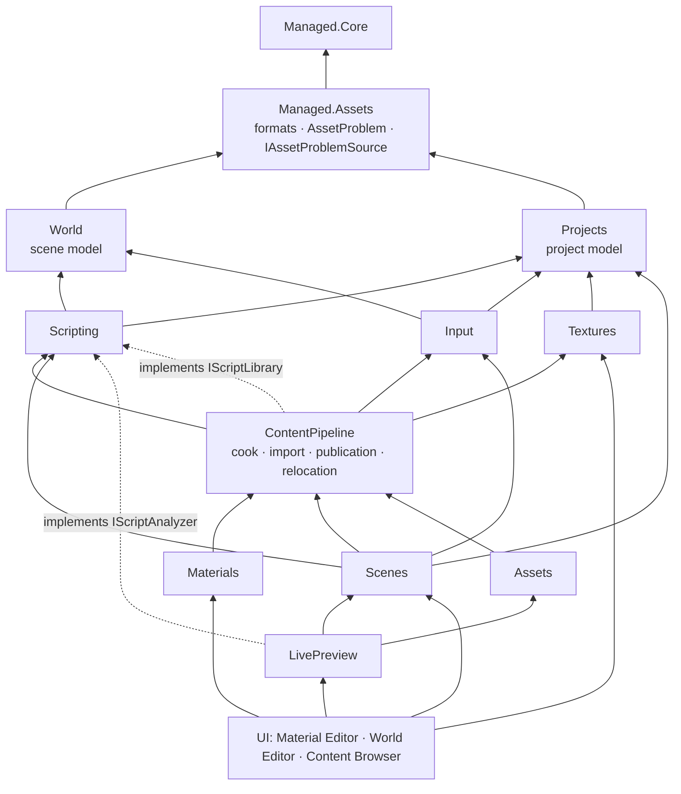
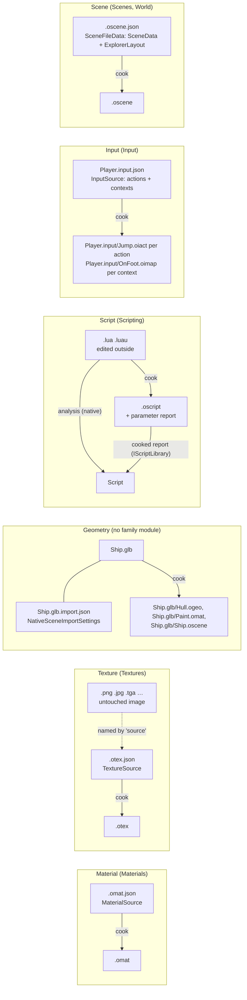
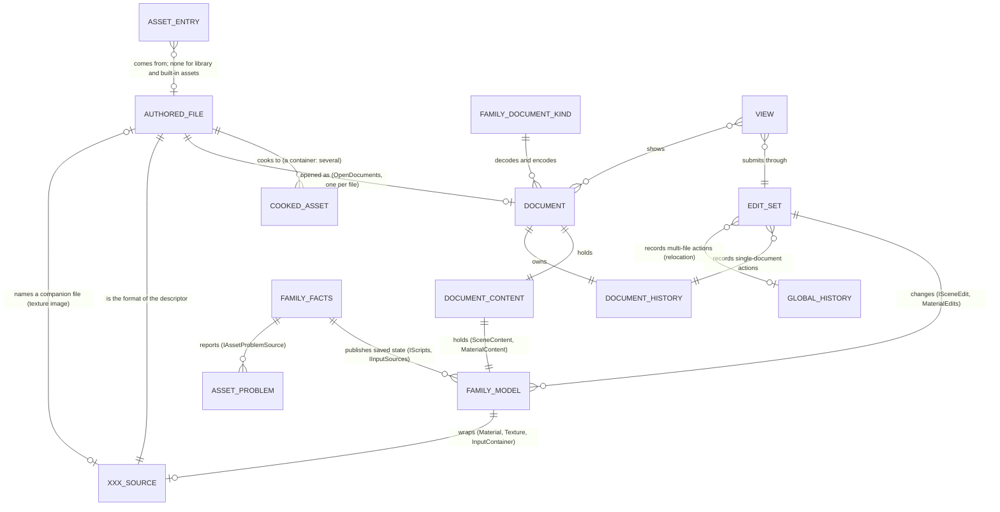

# Asset Family Modules LLD

Status: `agreed`

Last Updated: 2026-10-20 01:32

## 1. Purpose

Each asset family that the editor authors (scripts, input sources, textures,
materials) gets one domain module that owns everything true of that family
without a UI: its model over the file format, its rules, its problems, the
producer of its facts, its document kind and edits where it has an editor, its
templates and its diagnostic codes. Scenes keeps the scene and edits the scene's
references to the other families through their rules. The content pipeline stays
the cross-family infrastructure (cook, import orchestration, publication,
relocation, inspection) and consumes the families' rules instead of copying
them. UI projects keep views and view models only.

### 1.1 Scenarios

Actors: the user; the Material Editor; the scene inspector (script slots, the
Play and Scene References sections, the environment's cubemap picker); the
Content Explorer and its details pane; the Problems panel; the cook; the script
analyzer (native, through Interop); a code editor or another tool outside the
editor.

1. **Edit a material.** The user opens a material, drags roughness and picks a
   base color texture. Each change is checked against the engine schema before
   it is kept; one drag is one undo entry; Save writes the file.
2. **A texture is moved.** The user moves a texture the open material uses. The
   material's reference follows; undo of an older change restores the new path,
   or warns when the texture was deleted.
3. **Import a texture.** The user imports an image as a cube map from the
   Content Explorer. The descriptor is written beside the image; the
   environment's cubemap picker lists it; the material editor shows whether a
   texture has its source image.
4. **Attach a script.** The user adds a script slot to a node and picks a
   script. The inspector shows the script's declared parameters with their
   defaults, ranges and units; the user overrides `speed`. Undo shows "Set
   Script Value", not "Edit Scripts".
5. **A script changes outside the editor.** The user removes `speed` in the code
   editor and saves. The script is analyzed again; the slot's `speed` override
   is shown as stale, and the user removes it. A syntax error appears in the
   Problems panel with its line, and in the slot's card.
6. **A script from a library.** The user picks a script that exists only cooked,
   in a mounted library. Its parameters are read from the cooked report; it has
   no source and no problems.
7. **Cook a scene whose slot lost its script.** The script file is deleted. The
   inspector's slot card and the cook report the same problem, with the same
   code, and both lead to the same slot field.
8. **Edit an input source.** The user edits `Player.input.json` in a code
   editor: adds an action `Jump` and a context `OnFoot` that maps a key to it,
   then maps a name the source does not declare, and an action of another source
   by a path no source declares. Both are problems of the file. The scene's Play
   section lists `/Content/Player.input/OnFoot.oimap` with its declared
   priority, and the cook uses the same priority.
9. **Play with runtime script errors.** A script throws while playing. The
   Problems panel shows it beside the analysis problems, with the node and slot
   it came from.

## 2. PRD Traceability

| ID        | Coverage                                                                                                              |
| --------- | --------------------------------------------------------------------------------------------------------------------- |
| `REQ-010` | The material model, its document kind and edits live in Materials (scenario 1).                                       |
| `REQ-013` | Texture facts (source image presence, cube settings) come from Textures, read by the Material Editor and pickers.     |
| `REQ-016` | Texture import authoring lives in Textures (scenario 3).                                                              |
| `REQ-022` | Problems of every family reach the Problems panel through one problem source contract.                                |
| `REQ-043` | Script parameters, slot rules and slot edits come from Scripting and Scenes, the same for the inspector and the cook. |
| `REQ-044` | Runtime script problems are a specialization of the script problem (scenario 9).                                      |
| `REQ-045` | Input sources, their actions and contexts, their rules and starting context priorities come from Input (scenario 8).  |

## 3. Architecture Links

- [editor-module-architecture.md](editor-module-architecture.md): the module
  catalogue and layers this design adds the family modules to.
- [editor-documents.md](editor-documents.md): decisions 3 and 7, which place
  each model in its family module.
- [asset-identity.md](asset-identity.md): identities, containers and their
  products, references and collisions, which every family model follows.
- [script-authoring.md](script-authoring.md),
  [input-authoring.md](input-authoring.md),
  [material-editor.md](material-editor.md): the authoring features built on the
  family modules.
- [content-pipeline.md](content-pipeline.md): the cook that calls the family
  rules.

## 4. Current Baseline

The [issue-069 plan](../plan/issue-069-di-topology-and-decomposition.md), slice
S1.8, tracks the work that builds this design, its file inventory and its commit
order.

## 5. Target Design

### 5.1 The rule

A family module owns what is true of its family whatever shows it: the model,
the rules (including the rules for scene data that references the family), the
problems, the facts, the edits and the document kind when the family has an
editor, the templates of new files, and the diagnostic codes. A family module
holds no view, view model or dialog.

Why: when a family's knowledge is spread over several projects, no project
answers what a script, an input source or a texture is; rules copied between the
inspector and the cook drift apart; and domain logic in UI projects cannot be
shared by another window or run outside the UI. One owner per family gives one
set of rules for the inspector and the cook, one parameter vocabulary, one
problem type per meaning, and one producer of facts for every window.

- **World** holds the scene model only, and the value types a scene serializes
  when it references another family (`ScriptSlot`, `ScriptValue`,
  `MaterialsSlot`, `MaterialSlotTarget`, `StartingInputContextData`). It knows
  no family's rules, no project and no document.
- **Projects** holds the project model: `IProject`, settings, mount points and
  categories. It references no scene type.
- **Scenes** owns scene documents: their edits, their Explorer layout and their
  file. An edit that changes a reference to another family (a script slot, the
  starting input contexts, a material slot) is a Scenes edit, validated by that
  family's rules.
- **ContentPipeline** cooks, imports, publishes, relocates and inspects every
  family. It calls family rules (slot checks, input priorities) and never states
  them.
- **Assets** (the asset feed) reads formats from Managed.Assets for its own
  facts, a material's preview color and a descriptor that does not read, and
  references no family module.
- **UI projects** present. The Material Editor, the inspector, the Problems
  panel and the Content Explorer read and call family modules.

editor-documents.md decision 7 allowed a domain module only for work several UI
parts share, that runs outside the UI, or that needs native code, and then
listed materials, textures, input sources and scripts as having none. Each meets
its own criterion:

| Family   | Shared by                                                                                       | Runs outside the UI                     | Needs native code |
| -------- | ----------------------------------------------------------------------------------------------- | --------------------------------------- | ----------------- |
| Script   | Inspector, Problems, Content Explorer, cook                                                     | Analysis on every change, cook checks   | The analyzer      |
| Input    | Inspector (Play), Content Explorer, Problems, cook, the future Input Editor                     | Checks on every change, cook priorities | No                |
| Texture  | Content Explorer import, environment cubemap picker, Material Editor, the future Texture Editor | Import authoring                        | No                |
| Material | Material Editor, inspector material slots and pickers, LivePreview overrides, relocation        | Relocation rewrites, cook dependencies  | No                |

So the family modules are what decision 7 itself requires; editor-documents.md
decisions 3 and 7 and the module catalogue of editor-module-architecture.md
state them.

**The scene family has this shape:** World holds the scene model only, and
Scenes its documents, edits and Explorer layout. It is split because the cook,
Live Preview and the other family modules (through `ScriptSlot`) all need the
scene model, and none of them may see documents or edits. The other families are
one module each: whoever needs an input source's model, such as the cook, may
also depend on everything else in Input. A family is split into a model module
and an authoring module the same way, when one of its consumers needs the model
but must not see the rest.

### 5.2 Modules

| Module                                             | Owns                                                                                                                                                                                                                          | References                                                                        |
| -------------------------------------------------- | ----------------------------------------------------------------------------------------------------------------------------------------------------------------------------------------------------------------------------- | --------------------------------------------------------------------------------- |
| `Oxygen.Managed.Assets`                            | Formats shared with the engine's tools: `MaterialSource`, `TextureSource`, `InputSource`, their readers and writers, the embedded engine schemas; `AssetFileTypes`; `IAssetCatalog`; `AssetProblem` and `IAssetProblemSource` | `Managed.Core`                                                                    |
| `Oxygen.Editor.World`                              | Scene model; reference value types                                                                                                                                                                                            | `Managed.Core`                                                                    |
| `Oxygen.Editor.Projects`                           | Project model, settings, mount points, categories                                                                                                                                                                             | `Managed.Assets`, Storage, Data, Resources                                        |
| `Oxygen.Editor.Scripting`                          | `Script`, `ScriptParameter`, `ScriptProblem`, script slot rules, the script facts and their ports, project script tooling, script templates and codes                                                                         | World, Projects, `Managed.*`                                                      |
| `Oxygen.Editor.Input`                              | `InputContainer`, `InputAction`, `InputMappingContext`, `InputProblem`, input rules (references, priorities, starting input contexts), the input facts, input templates                                                       | World, Projects, `Managed.*`                                                      |
| `Oxygen.Editor.Textures`                           | `Texture`, cube layouts, texture import authoring                                                                                                                                                                             | Projects, `Managed.*`                                                             |
| `Oxygen.Editor.ContentPipeline`                    | Cook, import orchestration, publication, relocation, inspection, the creation workflow; implements Scripting's `IScriptLibrary`                                                                                               | Scripting, Input, Textures, World, Projects, Documents, Schemas, `Managed.*`      |
| `Oxygen.Editor.Materials`                          | `Material`, the material document kind, edits, validation, property catalog, codes and material templates                                                                                                                     | ContentPipeline (`IAssetRedirects`), Documents, Schemas, TimeMachine, `Managed.*` |
| `Oxygen.Editor.Scenes`                             | Scene documents, edits, Explorer layout and the scene file, including the script slot edits                                                                                                                                   | Scripting, Input, ContentPipeline, World, Projects, Documents, …                  |
| `Oxygen.Editor.LivePreview`                        | Engine adapters; implements Scripting's `IScriptAnalyzer`; runtime script problems                                                                                                                                            | Scripting, Scenes, Assets, Runtime, Interop, …                                    |
| UI: Material Editor, World Editor, Content Browser | Views and view models                                                                                                                                                                                                         | The modules above                                                                 |

### 5.3 Layers



Scripting and Input reference World for the reference value types their rules
check (`ScriptSlot`, `ScriptValue`, `StartingInputContextData`).

Why the families sit on two sides of the pipeline: the cook consults script and
input facts (slot checks, context priorities, and cook on change skipping inputs
with problems), so the pipeline references Scripting and Input. Materials and
Scenes use the pipeline's relocation (`IAssetRedirects`) to retarget restored
references, so they reference the pipeline. Textures need neither direction: the
cook only recognizes the descriptor suffix, and import authoring needs Projects
only. Where a family needs something from the pipeline, the family owns a port
and the pipeline implements it (`IScriptLibrary`), as LivePreview implements
`IScriptAnalyzer`.

### 5.4 Each family module

**Scripting** (`Oxygen.Editor.Scripting`)

- Model: `Script` (identity, its cooked virtual path as a slot names it; source
  path or none for a library script, `Origin` Source or Library, declared
  parameters, problems, parameters out of date),
  `ScriptParameter` (name, kind, `ValueKind`, default as `ScriptValue`, asset
  type, range, step, unit, description, options, color), and
  `ScriptParameterKind`. One vocabulary for source and cooked scripts.
- Problems: `ScriptProblem : AssetProblem`, adding the analyzer's rendered text.
  `ScriptDiagnosticCodes` holds the script codes; the input codes are Input's.
- Slot rules, `ScriptSlotRules`, over World's `ScriptSlot` and a `Script`:
  `FindStale`, `IsDefault`, `CheckValue(slot, parameter, value)` (kind and asset
  type), and `Check(slot, hasNode, scriptExists, script?)` returning the slot
  problems (`ScriptSlotProblem`) the edits and the cook report
  (`SlotWithoutScript`, `SlotScriptMissing`, `SlotNodeMissing`, and with a known
  script `SlotValueKindMismatch` and `SlotAssetTypeMismatch`). The caller says
  which nodes and scripts exist: the cook knows its cooked nodes and resolves
  scripts in the project. `ScriptFieldAddress` is the
  `Scripting/{slot}/{parameter}` path that leads from a problem to the field.
- Facts: `IScripts` (8.1), implemented by `ScriptFacts`; ports `IScriptAnalyzer`
  (LivePreview) and `IScriptLibrary` (ContentPipeline).
- Tooling: `ProjectScriptTooling`, `ScriptToolingPaths`,
  `ScriptOperationResults`.
- Templates: `ScriptTemplates.New`.

**Input** (`Oxygen.Editor.Input`)

- Model: an input source is a container ([asset identity](asset-identity.md)
  5.2). `InputContainer` over `InputSource` (decision 4 shape) holds its
  products, `InputAction` and `InputMappingContext`, each identified by its
  product identity (`/Content/Input/Player.input/Jump.oiact`), with mappings and
  triggers. A mapping names an action of its own source by name and one of
  another source by virtual path ([asset identity](asset-identity.md) 5.4).
- Rules: actions named but not declared, actions named by a path no source
  declares, `FindAction`, `FindContext`, `DeclaredPriority`,
  `EffectivePriority(StartingInputContextData, InputContainer?)`, and
  `StartingContextRules.Check(contexts, containers)` for
  `SetStartingInputContexts` and the cook.
- Problems: `InputProblem : AssetProblem`, adding the identity of the source
  that has it, with the codes of `InputSourceCodes` (`OXE.INPUT.`), which the
  format and `InputRules` report.
- Facts: `IInputSources` (8.1), implemented by `InputFacts`. A product's source
  follows from its identity ([asset identity](asset-identity.md) 5.2), so
  nothing scans a folder to find which source declares an action or a context.
- Templates: `InputTemplates.New(contextName)`.
- The document kind comes with the Input Editor.

**Textures** (`Oxygen.Editor.Textures`)

- Model: `Texture` over `TextureSource` (decision 4 shape): source image path
  and presence, intent, color space, format, cube settings; `CubeLayout`,
  `TextureCubeImport`.
- Authoring: `TextureImport`: resolve the target, create the descriptor and copy
  the image, cube face detection, supported images, intents, color spaces and
  formats.
- The document kind comes with the Texture Editor.

**Materials** (`Oxygen.Editor.Materials`)

- `Material`, the document kind, edits, validation, property catalog, codes and
  `MaterialTemplates.New`; the Material Editor keeps views and view models.

**What the other modules hold**

- Scenes: `Edits/Scripting` (decision 7), validated by `ScriptSlotRules`;
  `SceneTemplates.New`. `SetStartingInputContexts` checks only the list, as
  every reference edit does (no missing entry, a mapping context, no
  duplicate): a context its source no longer declares stays in the scene, so
  the user can still edit the list, and the cook reports it through
  `StartingContextRules`. `SetStartingCamera` checks only against the scene and
  needs no family rule.
- ContentPipeline: the creation workflow takes the family's template
  (`AuthoredAssetTemplate`: suffixes and content); the cook calls
  `ScriptSlotRules` and the Input rules and keeps only the mapping of their
  problems to `DiagnosticRecord`; it implements `IScriptLibrary` from its cooked
  report. The cook checks slots without their scripts' declarations: the cooker
  checks each value against the compiled script.
- LivePreview: `NativeScriptAnalyzer : IScriptAnalyzer`;
  `RuntimeScriptProblem : ScriptProblem` (slot node, index and hook);
  `IRuntimeProblemSource` extends `IAssetProblemSource`.
- The Problems panel aggregates every `IAssetProblemSource` and presents each
  problem by its type.

### 5.5 Files on disk



A texture has two authored files, like a Godot import (5.7): the image is never
rewritten, and the descriptor carries the settings. An input source and a model
are containers: one file that cooks to several assets, each named under the
container's identity. A script's facts come from analysis of its source, or from
the cooked report for a library script.

### 5.6 What a scene references, and whose rules apply

```mermaid
classDiagram
    direction LR
    class Scene {
        StartingCamera: NodeId?
        StartingInputContexts
        References: Scripts, InputActions, PhysicsSidecars, ExtraAssets
    }
    class StartingInputContextData {
        Context: Uri of a .oimap
        Priority: int? null means the declared one
    }
    class GeometryComponent {
        Geometry: Uri of a .ogeo, always set
        OverrideSlots: whole geometry
    }
    class MaterialsSlot {
        Material: Uri of a .omat
        Target: GeometryUri, SlotId, LayoutRevision
    }
    class ScriptSlot {
        Id: Guid
        Script: Uri? of a .oscript
        ExecutionOrder
        Overrides: name → ScriptValue
    }
    class Script {
        <<Scripting>>
        Parameters: ScriptParameter
        Problems: ScriptProblem
    }
    class ScriptSlotRules {
        <<Scripting>>
        FindStale, IsDefault, CheckValue, Check
    }
    class InputContainer {
        <<Input>>
        Actions, Contexts with priority and mappings
        Problems: InputProblem
    }
    class StartingContextRules {
        <<Input>>
        EffectivePriority, Check
    }
    class Material {
        <<Materials>>
        TextureReferences: channel → virtual path
    }
    class Texture {
        <<Textures>>
        Source image, cube settings
    }

    Scene "1" *-- "*" StartingInputContextData
    Scene "1" *-- "*" GeometryComponent : nodes carry
    Scene "1" *-- "*" ScriptSlot : nodes carry
    GeometryComponent *-- "*" MaterialsSlot
    MaterialsSlot ..> Material : URI
    Material ..> Texture : virtual path
    ScriptSlot ..> Script : URI
    ScriptSlotRules ..> ScriptSlot : checks against Script
    StartingInputContextData ..> InputContainer : URI of a declared context
    StartingContextRules ..> StartingInputContextData : checks against InputContainer
```



The scene's data stays in World; each reference is checked by the family it
points to. Material slots are resolved against the geometry's layout, and Scenes
owns that (`SetMaterialSlot`, `RemoveMaterialSlots`, `MaterialSlotEdits`);
script slots and starting contexts are checked the same way, by
`ScriptSlotRules` and `StartingContextRules`, in the inspector and in the cook.

The diagram leaves out the geometry's LOD-or-submesh slot scope: nothing authors
or applies it (abdes/DroidNet#77), and material overrides target the engine's
slot identity, which already covers every LOD and submesh the slot binds.

### 5.7 From asset to editor



A family model is held by a document while its file is open, or published by the
family's facts (the saved state of scripts and input sources). An input source
open in a future Input Editor has both: the document's `InputContainer` (edited)
and the one `IInputSources` holds (saved, with its problems, which are what the
cook sees).

**Which source produced an asset.** Two facts answer it, and nothing scans
folders for it:

- **The identity.** A container's product is named under the container
  ([asset identity](asset-identity.md) 5.2), so `AssetFileTypes.ContainerOf`
  gives the source of `/Content/Input/Player.input/Jump.oiact` or
  `/Content/Ship/Ship.glb/Hull.ogeo` from the path alone; every other source is
  the file its identity names. The family facts, the inspector and relocation
  use this.
- **The provenance map.** Each accepted cook records, per source, the outputs it
  declared, the references it made and the files it read (`CookProvenance` in
  the publication record). The cook reads it to tell what is up to date, to give
  a product its container's status, and to keep one producing source per
  identity ([asset identity](asset-identity.md) 5.6); the cooked index records
  the same producer for each entry. A family module reads the map only through
  the cook's status, never from the publication record.

### 5.8 How Godot and Unreal do it

Both editors are written in the engine's own language, so one type serves the
runtime and the editor; editor-only data sits inside it (Unreal compiles it
under `WITH_EDITORONLY_DATA`). Oxygen's editor is C# over a C++ engine, which is
why a format type shared with the engine's tools exists at all.

| Entity                | Godot 4                                                                                                                        | Unreal Engine 5                                                                                                                                                      | Oxygen (this design)                                                                                 |
| --------------------- | ------------------------------------------------------------------------------------------------------------------------------ | -------------------------------------------------------------------------------------------------------------------------------------------------------------------- | ---------------------------------------------------------------------------------------------------- |
| Ownership             | Each resource type comes with its importer or `EditorPlugin`                                                                   | An asset family is a module pair: a runtime module with the asset classes and an editor module with its `UAssetDefinition` and editor (Enhanced Input is one plugin) | One family module, plus its editor UI project                                                        |
| Any authored asset    | A `Resource` subclass, saved as `.tres`/`.res` by a `ResourceFormatSaver`; `ResourceLoader` keeps one instance per path        | A `UObject` in a `UPackage` (`.uasset`), created by a `UFactory`                                                                                                     | `XxxSource` (format, Managed.Assets) and `Xxx` (model, family module)                                |
| Asset identity        | `res://` path plus a UID; the editor's file system indexes files                                                               | `FAssetData` in the Asset Registry: path, class and tags, read without loading the asset                                                                             | Asset URI; `AssetEntry` in the Assets feed                                                           |
| Opening an editor     | An `EditorPlugin` answers `handles(object)` and `edit(object)`; the Inspector edits any object generically                     | A `UAssetDefinition` per class opens an `FAssetEditorToolkit`                                                                                                        | The family's `IDocumentKind` and the editor's `DocumentEditorDescriptor`                             |
| Material              | `StandardMaterial3D` or `ShaderMaterial` resources, edited in the Inspector                                                    | `UMaterial` or `UMaterialInstanceConstant`; the Material Editor edits a preview copy and Apply writes it back                                                        | `Material` in Materials; a gesture previews, then commits                                            |
| Texture               | An imported resource: the image stays as is, import settings live in a `.import` sidecar, the result goes to `.godot/imported` | `UTexture2D` holds the source pixels (`FTextureSource`), its settings, and `UAssetImportData` naming the source file for reimport                                    | `.otex.json` beside the image, in the role of Godot's `.import`; `Texture` in Textures               |
| Input                 | `InputMap` actions in the project settings (`input/*` in `project.godot`); no contexts in core                                 | `UInputAction` and `UInputMappingContext`, one asset each, in the Enhanced Input plugin                                                                              | `Player.input.json` declares actions and contexts, each an asset under it; `InputContainer` in Input |
| Script and parameters | A `Script` resource declares exported variables; a node stores only values that differ from the defaults                       | A Blueprint's generated class declares `UPROPERTY` fields; an instance stores deltas from the class defaults                                                         | `Script` in Scripting; a `ScriptSlot` (World) stores overrides only                                  |
| Undo                  | `EditorUndoRedoManager`: one history per scene, one global for project settings and external resources                         | One global transaction buffer; `UObject::Modify` snapshots objects into the current transaction                                                                      | One history per document plus a global one (editor-documents.md decision 1)                          |
| Problems              | Script errors in the script editor; import failures in the output log                                                          | Blueprint compiler results; data validation (`IsDataValid`) run on demand per asset                                                                                  | `AssetProblem` specialized per family, reported by each family's facts                               |

What this means for the decisions:

- **Ownership (decision 10).** Both engines keep an asset type's classes, its
  import and its editor together; Unreal splits runtime and editor modules,
  which is this design's split between a family module and its editor UI.
- **Two types per file (decision 2).** Neither engine has it; they have no
  language boundary to cross. The split is justified where the format is shared
  with the engine's tools and the model adds rules of its own, which each family
  model here does.
- **Input source (decision 3).** Oxygen's file holds several items that cook to
  separate assets, as one imported file produces several assets in both engines.
  The file is the document; its items are what scenes reference, each by its
  identity under the file's.
- **Texture.** The descriptor plays the role of Godot's `.import` file. A
  Texture Editor is an editor of import settings with a preview, as Godot's
  Import dock and Unreal's texture editor are.
- **Script (decisions 6, 7).** Both engines declare parameters on the script or
  class and store only overrides on the instance, as `ScriptSlot` does, and drop
  or warn on values whose declaration is gone.
- **Problems (decision 5).** Neither engine stores problems on the asset.
  Storing them in the family's facts gives the Problems panel, the inspector and
  the cook one place to read; the producer keeps it current.

Sources: Godot
[EditorImportPlugin](https://docs.godotengine.org/en/4.4/classes/class_editorimportplugin.html),
[ResourceSaver](https://docs.godotengine.org/en/4.2/classes/class_resourcesaver.html),
[InputMap](https://docs.godotengine.org/en/4.2/classes/class_inputmap.html),
[EditorUndoRedoManager](https://docs.godotengine.org/en/4.4/classes/class_editorundoredomanager.html);
Unreal
[FTextureSource](https://dev.epicgames.com/documentation/unreal-engine/API/Runtime/Engine/FTextureSource),
[UAssetImportData](https://dev.epicgames.com/documentation/unreal-engine/API/Runtime/Engine/UAssetImportData),
[UAssetDefinition](https://dev.epicgames.com/documentation/unreal-engine/API/Editor/AssetDefinition/UAssetDefinition),
[UInputMappingContext](https://dev.epicgames.com/documentation/unreal-engine/API/Plugins/EnhancedInput/UInputMappingContext),
[UMaterialEditorPreviewParameters](https://dev.epicgames.com/documentation/unreal-engine/API/Editor/UnrealEd/UMaterialEditorPreviewParameters).

### 5.9 Decisions

1. **The families.** Scripting, Input, Textures and Materials, each with its
   model. Texture and input editors are planned; their models and rules are what
   those editors start from.
2. **Formats in Managed.Assets, models in the family modules.** `XxxSource`, its
   reader and writer and the embedded engine schema are shared with the engine's
   tools; `Xxx` adds the family's rules. `MaterialSource`, `TextureSource` and
   `InputSource` are the formats, and the input schema, one for every input
   source, is embedded like the material schema; the input model is
   `InputContainer`, since the format has the name `InputSource`. The scene is
   the exception: no engine tool reads the scene JSON (the cook turns it into
   `.oscene`), so its format stays with its model, split between World
   (`SceneData`) and Scenes (the file record, `SceneFileData`, which adds the
   Explorer layout). A format holds each fact once and checks it on every way
   in, as `MaterialSource` does its texture map.
3. **The input model follows the container.** `InputContainer` holds
   `InputAction` and `InputMappingContext`, each identified under the source's
   identity; a source that declares only actions is an input source like any
   other.
4. **The shape of an editable model.** A sealed class over its immutable source:
   `Source`, `Changed`, `Replace(source)`, and the family's rules. Editors keep
   snapshot undo by replacing the source. `Script` has no source and is an
   immutable record replaced on each analysis.
5. **Problems.** `AssetProblem` (severity, code, message, file, line, column,
   explanation) and `IAssetProblemSource` (`Problems`, `ProblemsChanged`) in
   Managed.Assets, where the format readers produce schema problems. Each family
   specializes it (`ScriptProblem`, `InputProblem`); LivePreview's
   `RuntimeScriptProblem` specializes `ScriptProblem`. Each meaning is its own
   type: `ScriptProblem` carries no runtime flag. An invalid material edit is
   refused, not stored. The input and texture readers report a problem of the
   file as the material reader does: an `AssetFormatException` carrying an
   `AssetProblem` with the format's code.
6. **Script metadata in Scripting.** `Script` and `ScriptParameter` are one
   vocabulary for source and library scripts, keeping range, unit and options
   for both; no cooked parameter record or kind exists beside them, and the
   inspector maps nothing.
7. **Script slot rules in Scripting, slot edits in Scenes, one set of rules for
   the inspector and the cook.** Scenes has `AddScriptSlot`, `RemoveScriptSlot`,
   `MoveScriptSlot`, `SetSlotScript`, `SetSlotExecutionOrder`, `SetScriptValue`,
   `ResetScriptValue` and `RemoveStaleScriptValues`, targeting a slot by its
   identity (`ScriptSlotId`, as edits name nodes by `NodeId`) and validated by
   `ScriptSlotRules`; each gesture is its own
   undo entry with its own label ("Set Script Value"). `SetScriptSlots` serves
   paste and restore. The cook reports `ScriptSlotRules.Check` results;
   `ScriptSlotDiagnostics` holds only the mapping to `DiagnosticRecord`.
8. **Producers live in their family modules.** `ScriptFacts` (Scripting) and
   `InputFacts` (Input) produce the facts, once for the editor rather than per
   window; the native call is behind `IScriptAnalyzer`, which LivePreview
   implements; the cooked report is behind `IScriptLibrary`, which
   ContentPipeline implements.
9. **Reference forms are those of [asset identity](asset-identity.md) 5.4**,
   each documented on its model: a scene references by asset URI, a material's
   texture paths are virtual paths, and a mapping names an action of its own
   source by name and one of another source by virtual path.
10. **One domain module per asset family** (5.2), as editor-documents.md
    decisions 3 and 7 and the architecture's module catalogue state.
11. **Templates and codes belong to their family.** The creation workflow takes
    the family's `AuthoredAssetTemplate`; each family owns its diagnostic codes
    under its own prefix (`OXE.SCRIPT.`, `OXE.INPUT.`, `OXE.MATERIAL.`).

## 6. Ownership

Section 5.2 states what each module owns and references. Each family module
refuses views, view models and dialogs; World refuses every family's rules;
ContentPipeline refuses to state a family rule it calls; Assets refuses to
reference a family module.

## 7. Data Contracts

The family models and their records:

- `Script` and `ScriptParameter` (Scripting): one vocabulary for source and
  library scripts (5.4, decision 6).
- `InputContainer`, `InputAction` and `InputMappingContext` (Input): an input
  source and its products, identified as
  [asset-identity.md](asset-identity.md#52-sources-and-containers) states.
- `Texture` (Textures) and `Material` (Materials), over `TextureSource` and
  `MaterialSource`.
- `AssetProblem` and `IAssetProblemSource` (Managed.Assets), specialized per
  family (decision 5).
- `ScriptAnalysis` (`Parameters`, `Problems`, `HasDeclaration`,
  `IsUnavailable`), the record of the `IScriptAnalyzer` port, and `ScriptRead`,
  a library `Script`, `NotFound` or `Unavailable(reason)`.

## 8. Services, Ports And Lifetime

### 8.1 Facts and ports

```csharp
// Oxygen.Managed.Assets.Diagnostics
public interface IAssetProblemSource
{
    event EventHandler? ProblemsChanged;   // on the subscriber's context (8.2)
    IReadOnlyList<AssetProblem> Problems { get; }
}

// Oxygen.Editor.Scripting
public interface IScripts : IAssetProblemSource
{
    event EventHandler<ScriptChangedEventArgs>? Changed;
    Script? Find(AssetPath script);                          // /Content/Player/move.oscript
    IReadOnlyCollection<Script> All { get; }
    Task<ScriptRead> ReadLibraryAsync(AssetPath script, CancellationToken cancellationToken);
    Task RefreshAsync(bool force, CancellationToken cancellationToken);
}

public interface IScriptAnalyzer          // implemented by LivePreview
{
    Task WaitUntilAvailableAsync(CancellationToken cancellationToken);
    ScriptAnalysis Analyze(string sourceName, ReadOnlySpan<byte> source, string? definitions);
}

public interface IScriptLibrary           // implemented by ContentPipeline
{
    Task<Script?> ReadAsync(ProjectContext project, AssetPath script, CancellationToken cancellationToken);
}

// Oxygen.Editor.Input
public interface IInputSources : IAssetProblemSource
{
    event EventHandler<InputSourceChangedEventArgs>? Changed; // Container null: the project changed
    InputContainer? Find(AssetPath container);               // /Content/Input/Player.input
    IReadOnlyCollection<InputContainer> All { get; }
}
```

`ScriptAnalysis` (`Parameters`, `Problems`, `HasDeclaration`, `IsUnavailable`)
is the port's record; LivePreview maps the Interop types into it. `ScriptRead`
is a library `Script`, `NotFound` when no mounted library has it, or
`Unavailable(reason)` when the library cannot be read. `ScriptFacts` alone reads
script files. Input alone reads input sources: `InputFacts` the editor's saved state,
and `InputSourceFiles` the saved file the cook reads, so the cook never waits
for the facts. Both facts follow `IAssetCatalog.Changes` for their own suffixes,
so neither knows the other. A product's declaration is read from its container
(`InputContainer.FindDeclaration`); the Content Explorer opens it with the
container rows of #80.

### 8.2 Threading

No family module takes a `HostingContext`, `DispatcherQueue` or `IScheduler`.
Analysis and checks run on the thread pool. Each event handler is invoked on the
`SynchronizationContext` that was current when it subscribed (the event's `add`
accessor captures it, through Managed.Core's `SubscriberEvent`), or on the thread
pool when there was none, so the result does not depend on which thread first
resolved the singleton. The play session's runtime problems are raised on the UI
thread that owns it. `Find`, `All`,
`FindDeclaration` and `Problems` read an immutable snapshot that each change
replaces atomically. A source whose content is unchanged is not analyzed again;
when two analyses of one file overlap, the newer supersedes the older, which then
publishes nothing. Editable models
(decision 4) raise `Changed` on the thread that replaced the source, as
`SceneAuthoring` and `Document` do.

### 8.3 Project lifetime

All per-project state of `ScriptFacts` lives in an internal
`ProjectScriptFacts`, constructed with the `ProjectContext` and disposed when
the project closes (entries, versions, last valid parameters, scan, catalog
subscription); `InputFacts` has `ProjectInputFacts` likewise. The outer service
swaps it on `IProjectContextService.ProjectChanged`, its only use of that
service, so a scope that constructs the per-project object with its
`ProjectContext` replaces the swap without changing anything else.

### 8.4 Registration

- `ScriptFacts` (as `IScripts` and `IAssetProblemSource`), `InputFacts` (as
  `IInputSources` and `IAssetProblemSource`), `ProjectScriptTooling` and
  `ScriptToolingPaths` are registered by their family modules' registrations.
  The facts follow the asset catalog, which each workspace creates in its own
  container today, so they are singletons of that container; they become root
  singletons with the catalog.
- `NativeScriptAnalyzer` is a root singleton mapped to `IScriptAnalyzer`;
  `ContentPipelineService` is mapped to `IScriptLibrary`.
- `CodeEditorService` and the Problems panel are not family services; the UI
  that hosts them registers them.
- No family registration resolves `IContainer`, a window service or a view.

## 9. UI Surfaces

UI projects present and call family modules only; none reads a family's files.
What each surface reads:

| Surface                                                                                                  | Reads and calls                                                                             |
| -------------------------------------------------------------------------------------------------------- | ------------------------------------------------------------------------------------------- |
| Inspector script cards (`ScriptingViewModel`, `ScriptSlotCardViewModel`, parameter and stale value rows) | `IScripts`, `Script`, `ScriptSlotRules`; submit the decision 7 edits                        |
| Inspector Play section (the starting input contexts)                                                     | Priorities and declarations from `IInputSources` and `StartingContextRules`                 |
| Environment inspector `CubemapPickerModel`                                                               | `Texture` (cube settings)                                                                   |
| Problems panel                                                                                           | Every `IAssetProblemSource`; a cook problem leads to its field through `ScriptFieldAddress` |
| Content Explorer assets pane, details and layouts                                                        | `IScripts`, `IInputSources`, `TextureImport`                                                |
| Content Explorer texture import dialog and asset creation                                                | `TextureImport` and the family templates                                                    |

## 10. Persistence And Round Trip

Each format, its reader and writer and its engine schema stay in
`Oxygen.Managed.Assets`, shared with the engine's tools; the model replaces its
immutable source on each edit and Save writes the source (decisions 2 and 4).
The scene's format stays with its model, in World and Scenes. A format holds
each fact once and checks it on every way in.

## 11. Cook / Mount / Runtime Behavior

- The cook calls `ScriptSlotRules` and the Input rules and keeps only the
  mapping of their problems to `DiagnosticRecord`.
- ContentPipeline implements `IScriptLibrary` from its cooked report, so a
  library script has the same `Script` as a source script.
- LivePreview implements `IScriptAnalyzer` over the native analyzer and reports
  runtime problems as `RuntimeScriptProblem`.

## 12. Operation Results And Diagnostics

Each family owns its diagnostic codes under its prefix (`OXE.SCRIPT.`,
`OXE.INPUT.`, `OXE.MATERIAL.`) and its problem type (`ScriptProblem`,
`InputProblem`). The Problems panel aggregates every `IAssetProblemSource` and
presents each problem by its type. Tests assert codes, never messages.

## 13. Dependency Rules

Section 5.3 states the layers. With the family modules:

- No UI project reaches `Oxygen.Interop.Scripting`; the native analyzer is
  reached only through `IScriptAnalyzer`, implemented by LivePreview.
- The code editor launcher is the Shell's desktop integration (architecture
  section 8), not a family service.
- The inspector's script cards and Play section, the Problems panel, the Content
  Explorer's details and imports, the environment's cubemap picker and the
  Material Editor read and call family modules only, so each is UI and can live
  in any UI project.
- Facts are root services, per project in shape, raising events without WinUI
  (section 8), so a session or window scope does not rewrite them.
- The layer test enforces the family rule: a family module references no UI
  project, no other family module except through a port, and no module above it
  in 5.3.

## 14. Validation Gates

Each test lives with the module whose behavior it checks (plan decision 5); no
fixture crosses modules.

| Project                    | Tests                                                                                                                                                                                                                                                                                                         |
| -------------------------- | ------------------------------------------------------------------------------------------------------------------------------------------------------------------------------------------------------------------------------------------------------------------------------------------------------------- |
| Managed.Assets Unit        | `TextureSource` and `InputSource` round trips; fields outside the editable projection survive; schema problems by code                                                                                                                                                                                        |
| Scripting Unit             | `ScriptSlotRules` (stale, defaults, kinds, asset types, every slot check code); `ScriptFacts` over a fake `IScriptAnalyzer` and `IScriptLibrary` and a temporary project: scan, change, relocation, removal, out-of-date parameters, events on the subscriber's context, project swap; `ProjectScriptTooling` |
| Input Unit                 | `InputContainer` rules, `StartingContextRules`, `InputFacts`                                                                                                                                                                                                                                                  |
| Textures Unit              | `Texture` and `TextureImport`                                                                                                                                                                                                                                                                                 |
| Scenes Unit                | One class per decision 7 edit: apply, inverse, validation codes                                                                                                                                                                                                                                               |
| ContentPipeline Unit       | Cook slot checks through `ScriptSlotRules`; starting input contexts through `StartingContextRules`; `InputFileCookingTests`; `IScriptLibrary` over a cooked report; creation with family templates                                                                                                            |
| LivePreview Unit           | `RuntimeProblemReader` to `RuntimeScriptProblem`; `PlaySessionTests`                                                                                                                                                                                                                                          |
| LivePreview Integration.UI | `NativeScriptAnalyzer` against the real analyzer on the shared engine: parameters, a syntax error, unavailable before the SDK is verified                                                                                                                                                                     |
| WorldEditor Unit           | `ScriptingViewModelTests` and `ProblemsViewModelTests` over fakes of the family ports                                                                                                                                                                                                                         |
| ContentBrowser             | `ScriptAuthoringTests` over the family templates                                                                                                                                                                                                                                                              |

Tests assert codes, never messages.

The editor check covers script cards, the Play section, the Problems panel with
analysis and runtime problems, the Content Explorer's script and input details,
texture import and the cubemap picker.

## 15. Open Issues

- The document kinds of the Texture and Input editors come with those editors,
  on the models of this design.
- Presenting a container and its products in the Content Explorer is
  [#80](https://github.com/abdes/DroidNet/issues/80).
