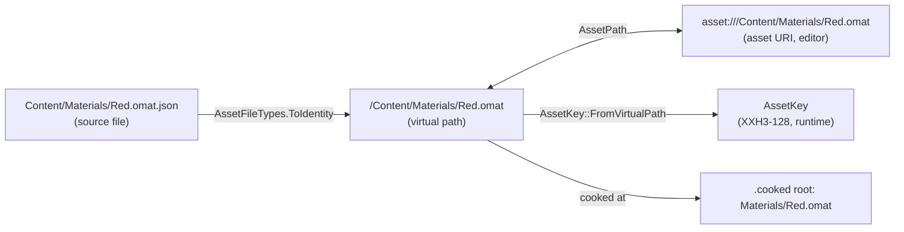
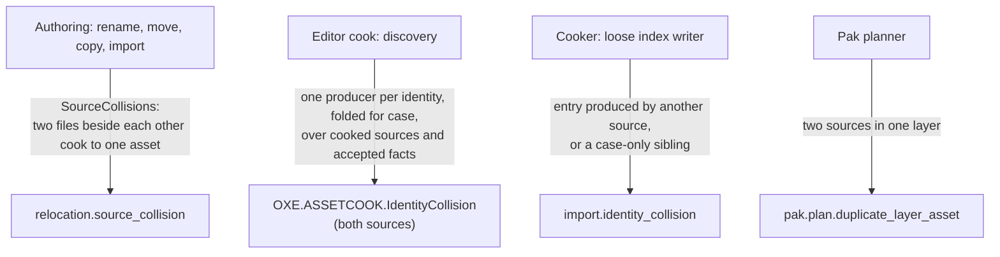

# Asset Identity LLD

Status: `agreed`

Last Updated: 2026-10-20 01:32

## 1. Purpose

Define how every asset of an Oxygen project is identified, how one asset names
another, which source produced each asset, when two producers conflict, and
which names and paths the engine and the editor accept. The engine cooker, the
loose cooked index, the pak planner, the runtime resolver and the editor's
content pipeline, relocation, Content Explorer and family checks all follow this
one contract; each rule below states where it lives and which tests pin it.

The contract answers the questions a user's actions raise:

- I rename `Red.omat.json`, move a folder or move `Ship.glb`: which references
  follow, and why does nothing else change?
- I import a model and assign one of its materials to a mesh surface in a scene:
  what does the scene store, and does it survive moving the model?
- I add `move.luau` beside `move.lua`, or `red.omat.json` beside
  `Red.omat.json`: what stops two files from becoming one cooked asset?
- I name a folder `Level.v2` or a material `Wood Mat`: what is accepted, and
  why?

## 2. PRD Traceability

| ID            | Coverage                                                                                                                                        |
| ------------- | ----------------------------------------------------------------------------------------------------------------------------------------------- |
| `GOAL-005`    | Sources, cooked output and browser selection share one identity that the user can read.                                                         |
| `REQ-012`     | Surface assignments store the material's identity and a surface id that survives moving the model.                                              |
| `REQ-016`     | Imported models name their products under the model's identity.                                                                                 |
| `REQ-017`     | Generated descriptors and manifests carry the identity of every job.                                                                            |
| `REQ-018`     | The cook writes each asset at its identity and keeps one producing source per identity.                                                         |
| `REQ-021`     | Picking and references use the identity, never cooked path text.                                                                                |
| `REQ-040`     | Retained imports re-cook to the same identities from their sources.                                                                             |
| `REQ-043`     | Script slots and asset-typed script parameters store identities.                                                                                |
| `REQ-045`     | Input actions and mapping contexts are identified under their input source.                                                                     |
| PRD table row | "Rename, move, cut/copy/paste and delete of authoring assets update every authored reference in one transaction" (Content import and browsing). |

## 3. Architecture Links

- [content-pipeline.md](content-pipeline.md): manifests, jobs, cook execution
  and publication, which carry and enforce the identities defined here.
- [content-explorer-asset-identity.md](content-explorer-asset-identity.md):
  browsing, picking and relocation UX built on these identities.
- [asset-primitives.md](asset-primitives.md): the `Oxygen.Managed.Assets` and
  `Oxygen.Managed.Core` primitives (`AssetPath`, `AssetFileTypes`, the loose
  index reader).
- [input-authoring.md](input-authoring.md) and
  [script-authoring.md](script-authoring.md): the families whose products and
  references follow this contract.
- [Asset family modules](asset-family-modules.md): the module partition that
  consumes these rules.
- Engine: `Oxygen/Content/VirtualPath.h` (the name rules),
  `Oxygen/Data/LooseCookedIndexFormat.h` (the index entry),
  `Oxygen/Cooker/Import/Naming.h` (product names),
  `Oxygen/Content/Docs/loose_cooked_content.md`.

## 4. Current Baseline

Where each rule of section 5 lives. The editor and the engine read and write
only the current formats: content cooked in an older format, or settings of an
older schema, are refused and recooked or re-imported, never converted.

| Rule                              | Engine                                                                      | Editor                                                                |
| --------------------------------- | --------------------------------------------------------------------------- | --------------------------------------------------------------------- |
| One identity, two spellings (5.1) | `AssetKey::FromVirtualPath`                                                 | `AssetPath` (Managed.Core)                                            |
| Containers and products (5.2)     | Model jobs require `virtual_path`; `ImportRequest::ModelProductVirtualPath` | `AssetFileTypes.ContainerOf`, `CookInputResolver.ResolveContainer`    |
| Product names (5.3)               | `NamingService` (`Naming.h`)                                                | Reads the names the cooker reports                                    |
| References (5.4)                  | One resolver for authored references; runtime lookups by key                | Reference fields per format; `AuthoredReferenceFormat`                |
| Producing source (5.5)            | Loose index entries record it                                               | `CookProvenance` in the publication record                            |
| Collisions (5.6)                  | `LooseCookedWriter` refuses other producers and case-only siblings          | `SourceCollisions`, the discovery producer map                        |
| Names and virtual paths (5.7)     | `ValidateVirtualPath`, `ToSegmentName`, `FoldCase` (`VirtualPath.h`)        | `VirtualPath` (Managed.Core), same cases from `VirtualPathCases.json` |

## 5. Target Design

### 5.1 Identity

An asset is identified by its virtual path, `/<mount>/<path>.<cooked ext>`. The
engine derives the `AssetKey` from it (`AssetKey::FromVirtualPath`, XXH3-128 of
the UTF-8 bytes); the editor spells the same identity as an asset URI,
`asset:///<mount>/<path>.<cooked ext>`. The two spellings convert one to one
through `AssetPath` (`VirtualPath`, `ToUriString`, `TryParse`, `TryParseUri`),
which escapes each segment on the way out and unescapes it on the way in. There
is no third form.

A source's identity is its path without its authoring suffix:
`/Content/Materials/Red.omat.json` is `/Content/Materials/Red.omat`,
`/Content/Player/move.lua` is `/Content/Player/move.oscript`
(`AssetFileTypes.ToIdentity`). The cooked asset carries exactly that name: no
step renames, shortens or replaces characters between the source and the cooked
asset. A name the engine cannot cook is refused where it is authored (5.7).



### 5.2 Sources and containers

A material, texture, scene, script, geometry, physics material or collision
shape source produces one asset, whose identity is the source's identity.

A container source produces several assets: an input source (actions and mapping
contexts) and an imported model (geometries, materials, textures and its scene).
Each product is identified by the container's identity and its name inside the
container:

```text
/Content/Input/Player.input.json  ->  /Content/Input/Player.input/Jump.oiact
                                      /Content/Input/Player.input/OnFoot.oimap
/Content/Models/Ship.glb          ->  /Content/Models/Ship.glb/Hull.ogeo
                                      /Content/Models/Ship.glb/Paint.omat
                                      /Content/Models/Ship.glb/Paint.base_color.otex
                                      /Content/Models/Ship.glb/Ship.oscene
```

The container keeps its suffix as a path segment (`Player.input`, `Ship.glb`),
so a product's identity depends only on its container and its own name, and the
container of any product follows from its path (`AssetFileTypes.ContainerOf`).
Consequences:

- Two containers never produce the same identity, and no authored file can be
  named under a model, since the model is a file.
- Moving or renaming a container moves its products: the relocation map's prefix
  rule (`RelocationMap.MapIdentity`) maps each product with it, and every
  reference to a product follows.
- Renaming an action or a context in its input source renames that product
  (`InputProductRename`); the references follow.
- A model's products change only when the model is re-imported, or through an
  explicit product rename ([#79](https://github.com/abdes/DroidNet/issues/79)).
  Moving, renaming or deleting one product of a model on its own is refused
  (`relocation.model_product`).
- A model is imported when a model import record names it as its source
  ([scene instances](scene-instances.md) NGN14); a model file without one
  produces nothing.

The cooked layout is the identity: the descriptor of `/Content/X/Y.ext` is the
file `X/Y.ext` under the mount's cooked root, for single-asset sources and
products alike. A model's buffers are files beside their geometry
(`Ship.glb/Hull.lod0.vertex.obuf`), not assets.

### 5.3 Product names

One rule names the products of every container, the same in source analysis and
in production (`NamingService`):

- **Name.** A product keeps its authored name: a mesh, material, action or
  context name as the source spells it. A model's scene is named after the model
  file without its extension (`Ship.glb/Ship.oscene`), as Godot and Unity name a
  model's scene or prefab after its file. An unnamed mesh or material takes
  `Mesh_<index>` or `Material_<index>`, its index in the source; the material a
  model without materials gets is `Default`. A texture takes its texture name,
  else its image name, else its image file's stem, else `texture_<index>`. A
  mesh variant adds its variant (`Hull__baked_3`). A texture adds its usage,
  because one image used as base color and as normal map cooks to two textures
  in two color spaces (`Paint.base_color.otex`, `Paint.normal.otex`). A buffer
  is named after its mesh, level of detail and kind (`Hull.lod0.vertex.obuf`).
- **No conventions.** No step adds a prefix or applies a naming convention, and
  no option does. A team's convention is authored in the source and kept as
  spelled: `M_Paint` stays `M_Paint`. The type is the leaf's extension and
  uniqueness is per type, so `Hull.ogeo` and `Hull.omat` coexist.
- **Replacement.** Only what the segment rule (5.7) refuses is changed
  (`content::ToSegmentName`), so `Paint.001`, `Wood-Trim` and `Wood Mat` are
  kept. The name is normalized to NFC. Each refused character, invalid UTF-8
  sequence and unassigned code point becomes `_`, as do a leading `.`, a leading
  or trailing space and a trailing dot. A name whose part before its first dot
  is a device name gets `_` after that part (`CON` becomes `CON_`, `NUL.v2`
  becomes `NUL_.v2`). A name left empty takes its fallback. A leaf longer than
  255 bytes, with its variant, usage, `_N` and extension, is shortened at a code
  point boundary.
- **Uniqueness.** One registry per container and asset type assigns the names,
  after replacement, comparing case-folded (Unicode simple case folding). A name
  already taken gets `_N`, probing past every occupied name, including authored
  `_N` names, fallbacks and variants. Two sources of one container never
  collapse into one product: work items are keyed by their source (image index
  or file path, and usage), names by the registry.
- **Scene nodes.** A node is not an asset. Its name is a label in the scene's
  string table: it keeps its authored name verbatim, `/` included, and an
  unnamed node takes `Node_<index>`. Node names are unique within the model,
  compared exactly, with the same `_N` probing, because a node's key derives
  from its scene's identity and its name.
- **Determinism.** Each run starts a fresh registry and registers in source
  order (meshes, materials, nodes and scenes in document order; textures and
  buffers sorted by their source key), so analysis and production assign the
  same names.

Two containers do not share products by name: each has its own. Identical
texture and buffer payloads still share one resource in the cooked root, by the
emitters' content signature.

### 5.4 References

Inside one source, an item names another item of the same source by its local
name: a mapping in `Player.input.json` names `"Jump"`.

Everything else references by identity. A scene names a geometry, material,
script, texture or mapping context by its asset URI; a material names a texture
by virtual path; a mapping that uses an action of another input source names it
by virtual path, `/Content/Input/Common.input/Jump.oiact`. The cooker resolves
every authored reference the same way: canonical virtual path, expected asset
type, mounted indexes searched in mount order. A cooked record stores the
`AssetKey`. At runtime an asset is found by its key; a name is a label for
display and logs, and nothing looks an asset up by its name.

Each authored format names the fields that hold references, and the field that
names its own identity (7.6). Tools read and rewrite references in those fields
only: a string elsewhere is text, even one shaped like a path.

### 5.5 Which source produced an asset

Two facts answer it; nothing scans folders to rediscover it.

- **The identity.** A product names its container (5.2), and every other asset's
  source is the file its identity names (`AssetFileTypes.SourcesOf`). Go to
  declaration, relocation and a product's cook status use this.
- **The provenance map.** The cooker's import report lists, for each source of
  the run, every asset it produced (key, virtual path, asset type). The editor
  keeps, per source, the outputs it declared, the references it made and the
  files it read, in the publication record (`CookProvenance`). Incremental
  cooking and the collision check (5.6) read it. The loose cooked index records
  the same producer for each entry (7.5).

A product's cook status is its container's
(`CookInputResolver.ResolveContainer`).

### 5.6 Collisions

A source re-cooking its own asset replaces it. An identity another source
produces, or one differing from an existing identity only in case, is an error,
with the same rule for every family. Each layer refuses what it can see:



- **Authoring.** No rename, move or copy may leave two sources that cook to one
  asset, such as `move.lua` beside `move.luau`, or `red.omat.json` beside
  `Red.omat.json` on a case-sensitive file system (`SourceCollisions`).
- **The editor's cook.** Resolving a source refuses an identity that two files
  beside each other cook to, such as a pair made outside the editor. Discovery
  keeps one producer per output identity, folded for case, over the sources it
  cooks and the accepted facts of the sources still in the project
  (`CookProvenance.CreateProducerLookup`). A second producer refuses both
  sources. A source that was moved or deleted produces nothing: its outputs are
  removed from the cooked root before the cook writes it.
- **The cooker.** Each loose cooked index entry records the source that produced
  it (7.5). The writer replaces an entry its own source produced and refuses one
  another source produced, or a virtual path differing from an existing one only
  in case (`LooseCookedIdentityCollision`). A sidecar completes its target
  scene, so what it emits keeps the scene's producer, taken from the cooked
  root, the scene in flight, or the context root it was resolved in.
- **The pak.** Two sources in one layer defining one key are an error; a later
  layer overriding an earlier one is allowed.

### 5.7 Names and virtual paths

The rules for a virtual path, a path segment and a mount name are one contract
with two implementations that agree exactly: C++ in
`Oxygen/Content/VirtualPath.h` (called by the cooker, the loose cooked writer,
the pak planner and the resolver) and C# in `Oxygen.Managed.Core`
(`VirtualPath`, beside `AssetPath`, reachable by every holder of an identity,
the scene model included). One table of cases,
`Oxygen/Content/VirtualPathCases.json`, states every rule with accepted and
refused inputs and the refusal code; the C++ tests and the Managed.Core tests
both run it. What the cooker accepts, the editor accepts; what it refuses, the
editor refuses with the same code. The editor checks a name where it is
authored, renamed, copied, relocated or imported and where a mount is named; it
does not re-check a path the engine already reported.

- **Segment.** Unicode in NFC; no code point unassigned in Unicode 15.1; no
  control characters; none of `\ / : * ? " < > |`; not empty, `.` or `..`; no
  leading or trailing space; no trailing dot; not a Windows device name (`CON`,
  `PRN`, `AUX`, `NUL`, `COM1-9`, `LPT1-9`, with or without an extension). Both
  implementations normalize typed text to NFC before it is checked.
- **Leaf.** Its last extension is the asset type (`.omat`); every other dot is
  part of the name. Any segment may contain dots, so `Level.v2.oscene`, a folder
  `v1.2` and a container segment `Player.input` are valid.
- **Derived content.** Below the mount, a segment starting with `.` names
  derived content (`.cooked`, `.imported`, `.build`, `.pipeline`) and is refused
  in an authored path, as is the `SourceMedia` folder.
- **Case.** Identity is case-sensitive: the key hashes the bytes as spelled. A
  path that differs from an existing one only in case (Unicode simple case
  folding, `FoldCase`, `VirtualPathComparer.CaseFolded`) is refused when
  authored and is a collision in the cook (5.6), because a case-insensitive file
  system holds both in one file.
- **Length.** A segment is at most 255 bytes of UTF-8, the portable bound for a
  file or folder name in the loose cooked tree (ext4 and APFS count bytes, NTFS
  255 UTF-16 units). Nothing limits a path's length or segment count: the
  formats store paths in string tables with `uint32` lengths, and the file
  system boundary uses the extended-length form (`Base/Filesystem.h`).
- **Mount name.** An identifier, `[A-Za-z_][A-Za-z0-9_-]*`, optionally preceded
  by `.`. A mount starting with `.` is reserved by the engine: `.cooked` is the
  mount of content cooked without a project. A project names its mounts without
  the dot, and two mounts may not differ only in case.
- **Unicode data.** Unicode 15.1 is pinned. Its stability policies guarantee
  that NFC and simple case folding of assigned code points never change, so
  implementations on a later Unicode version agree on every accepted segment.
  C++ normalizes with utf8proc; C# with
  `string.Normalize(NormalizationForm.FormC)`. The pinned Unicode Character
  Database lives in `Oxygen/Content/Unicode/15.1.0`; each implementation
  generates its assigned ranges and simple case folding table from it in its own
  build (`UnicodeCodeGen` in the engine, a Managed.Core source generator in the
  editor).

### 5.8 What the formats need

The rules of 5.7 follow from what the cooked formats and the loose cooked tree
hold:

- The pak identifies assets by `AssetKey` only; `AssetDirectoryEntry` holds no
  name and no path. Virtual paths appear only in the optional browse index
  (`PakBrowseIndexEntry`, a UTF-8 string table, `embed_browse_index` off by
  default) and in the loose index (a UTF-8 string table). Neither needs ASCII, a
  short name or a limit on dots.
- Names are stored in each descriptor's string table: the asset's name
  (`AssetHeader.name_offset`, for debugging and tools), mesh and submesh names,
  script parameter keys and values, shader paths, entry points and defines,
  scene node names and input slot names. No format limits a name's length.
- The loose cooked tree is written to a file system, so a segment must be a
  valid file name on every platform that holds a cooked tree, Windows included.
- A changed format is recooked; tools and runtime read only the current format.

## 6. Ownership

| Owner                           | Owns                                                                                                                                                           | Refuses to own                                                             |
| ------------------------------- | -------------------------------------------------------------------------------------------------------------------------------------------------------------- | -------------------------------------------------------------------------- |
| Engine Content                  | `VirtualPath.h` rules, `ToSegmentName`, `FoldCase`, the cases table, the loose index reader, the virtual path resolver                                         | Naming products                                                            |
| Engine Cooker                   | Product naming (`NamingService`), placing every output at its identity, the producer of each index entry, `LooseCookedWriter`'s identity rules, model surfaces | Deciding where a model's identity is                                       |
| Engine Data                     | `LooseCookedIndexFormat.h`, `AssetKey`                                                                                                                         | Validating names                                                           |
| `Oxygen.Managed.Core`           | `AssetPath`, `VirtualPath`, `VirtualPathComparer`, `AssetReferenceField`, diagnostic code prefixes                                                             | Knowing file types                                                         |
| `Oxygen.Managed.Assets`         | `AssetFileTypes` (identity, containers, reference fields), the formats, the loose index reader                                                                 | Knowing projects                                                           |
| `Oxygen.Editor.World`           | `SceneReferenceFields` (the scene document's reference fields)                                                                                                 | Rules of other families                                                    |
| `Oxygen.Editor.ContentPipeline` | Cook input resolution, the provenance map, the producer check, `SourceCollisions`, relocation, import retention and its identities                             | Presenting containers ([#80](https://github.com/abdes/DroidNet/issues/80)) |
| `Oxygen.Editor.ContentExplorer` | Listing a container as one asset, not its products                                                                                                             | Ownership rules                                                            |

## 7. Data Contracts

### 7.1 Identity spellings

| Form         | Example                                       | Where                                                     |
| ------------ | --------------------------------------------- | --------------------------------------------------------- |
| Virtual path | `/Content/Models/Ship.glb/Paint.omat`         | Engine descriptors, manifests, the loose index, materials |
| Asset URI    | `asset:///Content/Models/Ship.glb/Paint.omat` | Editor scene documents, the editor's references           |
| `AssetKey`   | XXH3-128 of the virtual path's bytes          | Cooked records, the pak directory, runtime lookups        |

### 7.2 File types

`AssetFileType` (Managed.Assets) describes each suffix: its category, the cooked
extension it is or cooks into, and for a container the extensions of its
products (`ProductExtensions`). `AssetFileTypes` derives every mapping from that
table: `ToIdentity`, `SourcesOf`, `ContainerOf`, `ToCookedPath`.

| Source                      | Category   | Identity       | Products                                      |
| --------------------------- | ---------- | -------------- | --------------------------------------------- |
| `Red.omat.json`             | Descriptor | `Red.omat`     | itself                                        |
| `move.lua`, `.luau`         | Script     | `move.oscript` | itself                                        |
| `Player.input.json`         | Input      | `Player.input` | `.oiact`, `.oimap` under it                   |
| `Ship.glb`, `.gltf`, `.fbx` | Model      | `Ship.glb`     | `.ogeo`, `.omat`, `.otex`, `.oscene` under it |

### 7.3 Manifest jobs

Every job that produces an asset names its identity in `virtual_path`: the asset
of a single-asset job, the container of an input or model job. A model job
without one, or with one that does not name a file of the model's type, is
refused (`import.asset_virtual_path_missing`,
`import.asset_virtual_path_invalid`). The layout carries only the mount's
virtual root and the resources directory.

### 7.4 Model import settings

The model import record (`<ProjectRoot>/imports/<source_identity>.import.json`,
[scene instances](scene-instances.md) NGN14) holds a model's import state:
source, virtual path, settings, source identity, surface provenance, node
continuity, published nodes and source fingerprint. It holds no mount and no
output folder: the model's identity is its path. Surface provenance is
keyed by each geometry's name in the model (`source_geometry_anchor`). A surface id
derives from the retained source identity, that anchor, the source layout
witness and the surface declaration (`oxygen.material-slot/v2`): it does not depend
on where the model is, so moving or renaming the model keeps every surface
override.

### 7.5 Loose index entry

Each asset entry and texture descriptor record of `container.index.bin`
(format 6) records, besides its virtual path, the source that produced it
(`source_path_offset`, read as `FindSourcePath`, `AssetEntry.SourcePath` and
`FileRecord.SourcePath` in C#). The cooker derives it as the job's identity
folder plus the source file's name (`ImportRequest::SourceVirtualPath`):
`Red.omat.json` cooking `/Content/Materials/Red.omat` is
`/Content/Materials/Red.omat.json`, and a model is its own identity. A table or
data file kind has one path in a root.

### 7.6 Identity and reference fields

Each format lists, as paths into its JSON, the field that repeats its own
identity, the fields that name its products when it is a container, and the
fields that reference other assets. A path uses `*` for every member and `**`
for any depth, and may require a sibling property to hold a value
(`AssetReferenceField`). A file's identity always comes from its path (5.1); an
identity field repeats it for the engine's tools, and relocation rewrites it
with the file.

| Format                  | Own identity                     | Products                                                                                    | Reference fields                                                                                                                                                                                |
| ----------------------- | -------------------------------- | ------------------------------------------------------------------------------------------- | ----------------------------------------------------------------------------------------------------------------------------------------------------------------------------------------------- |
| Material `.omat.json`   | path, repeated in `virtual_path` |                                                                                             | `textures/*/virtual_path`                                                                                                                                                                       |
| Geometry `.ogeo.json`   | path, repeated in `virtual_path` |                                                                                             | `buffers/*/virtual_path`, `lods/*/buffers/*`, `lods/*/skinning/*`, `lods/*/submeshes/*/material_ref`                                                                                            |
| Collision shape         | path, repeated in `virtual_path` |                                                                                             | `material_ref`                                                                                                                                                                                  |
| Physics material        | path, repeated in `virtual_path` |                                                                                             |                                                                                                                                                                                                 |
| Physics scene sidecar   | path                             |                                                                                             | `bindings/*/*/{shape_ref, inner_shape_ref, material_ref, source_mesh_ref, collision_mesh_ref}`                                                                                                  |
| Texture `.otex.json`    | path, repeated in `virtual_path` |                                                                                             | none; its images are file-relative, read through `TextureSource`                                                                                                                                |
| Input source            | path (`Player.input`)            | `actions/*/name` (`.oiact`), `contexts/*/name` (`.oimap`), each under the source's identity | `contexts/*/mappings/*/action`: a local action name, or another source's action by virtual path                                                                                                 |
| Model                   | path (`Ship.glb`)                | named by the cooker (5.3), under the model's identity                                       | none in the editor; the import settings name the bundle's files                                                                                                                                 |
| Scene document (editor) | path                             |                                                                                             | geometry, surfaces, script slots, asset-typed script parameters (`Type` is `asset`), environment cubemaps and metering mask, scene references, starting input contexts (`SceneReferenceFields`) |

Renaming a product of an input source rewrites its `name` field and every
reference to it (`InputProductRename`); a model's product names change only
through its import (5.2).

## 8. Services And Adapters

| Service                                             | Behavior                                                                                                                             |
| --------------------------------------------------- | ------------------------------------------------------------------------------------------------------------------------------------ |
| `CookInputResolver.Resolve`                         | Resolves an identity, or a path of one of its files, to the source the cook reads.                                                   |
| `CookInputResolver.ResolveContainer`                | Resolves a product to its container: an input source, or an imported model with its settings beside it.                              |
| `ImportedOutputs`                                   | Resolves a model's product to the model and, for a cook requested on a product, keeps the product as a required output of the model. |
| `CookDependencyDiscovery`                           | Resolves references by identity; keeps one producer per identity (5.6).                                                              |
| `CookProvenance.CreateProducerLookup`               | Finds the accepted source, still in the project, that produced an identity.                                                          |
| `SourceCollisions`                                  | Finds the files beside a source that cook to the same asset.                                                                         |
| `AuthoredReferenceIndex`, `AuthoredReferenceFormat` | Read and rewrite the reference fields of every authored file for relocation.                                                         |
| `RelocationMap`                                     | Maps old to new identities, a folder or a container with everything under it.                                                        |
| `InputSourceFiles`                                  | Finds the source and the declaration of an action or context from its identity.                                                      |
| `ImportSourceRetention`                             | Copies a model from outside the project into the chosen folder; the model's identity is its new path.                                |
| Engine `NamingService`                              | Names a container's products (5.3).                                                                                                  |
| Engine `LooseCookedWriter`                          | Records producers; refuses another producer and case-only siblings (5.6).                                                            |

## 9. UI Surfaces

- The Content Explorer lists a container as one asset, its source; a model's and
  an input source's products are not listed, in the project or in a pak tree.
  Pickers list products from the catalog, so a model's material can be assigned
  to a slot and a context picked as a starting context.
- Relocation refusals (`relocation.model_product`,
  `relocation.source_collision`) are shown as operation results naming the
  conflicting file.
- How a container and its products are presented together (a model view,
  dragging a product, Show import source) is
  [#80](https://github.com/abdes/DroidNet/issues/80).

## 10. Persistence And Round Trip

Scene documents store asset URIs; engine descriptors and input sources store
virtual paths; cooked records store keys. A relocation rewrites the reference
fields of every affected file in one transaction, so references stay valid
across save and reopen. Retained imports re-cook to the same identities and surface
ids. Data in an older format is migrated by editing it or re-importing, never by
code that reads the old form.

## 11. Cook / Mount / Runtime Behavior

- The cook writes each output at its identity under the mount's cooked root and
  records its producer. Products of a container are cooked by the container.
- Removed sources have their outputs removed before a cook writes the root.
- Mounted roots are searched in mount order to resolve a virtual path to a key;
  the runtime loads by key.
- An index of another format is refused; the editor treats its root as stale and
  recooks it.

## 12. Operation Results And Diagnostics

| Code                                | Raised by         | Meaning                                                             |
| ----------------------------------- | ----------------- | ------------------------------------------------------------------- |
| `vpath.*`                           | Engine and editor | A name or path breaks a rule of 5.7 (one code per rule)             |
| `import.asset_virtual_path_missing` | Cooker            | A job that produces an asset names no identity                      |
| `import.asset_virtual_path_invalid` | Cooker            | A model job's identity does not name a file of its type             |
| `import.identity_collision`         | Cooker            | Another source produces the identity, or a case-only sibling exists |
| `OXE.ASSETCOOK.IdentityCollision`   | Editor cook       | Two sources produce one identity; both are refused                  |
| `relocation.model_product`          | Relocation        | One product of a model was moved, renamed or deleted on its own     |
| `relocation.source_collision`       | Relocation        | The operation would leave two sources cooking to one asset          |
| `OXE.INPUT.Source.ActionUndeclared` | Input checks      | A mapping names an action its source does not declare               |
| `OXE.INPUT.Source.ActionMissing`    | Input checks      | A mapping names an action path no input source declares             |
| `pak.plan.duplicate_layer_asset`    | Pak planner       | Two sources in one layer define one key                             |

## 13. Dependency Rules

- The name rules live in Engine Content and Managed.Core; no other module
  validates names on its own.
- File-type knowledge lives in `AssetFileTypes`; no module keeps its own list of
  suffixes or derives an identity by string editing.
- Ownership of a product follows from its identity; no module scans folders or
  matches path prefixes to find which source produced an asset.
- References are read and rewritten through the formats' reference fields only.

## 14. Validation Gates

- `VirtualPathCases.json` run by `Content/test/VirtualPath_test.cpp` and
  Managed.Core `VirtualPathCasesTests`.
- Cooker naming and model tests (`AssetNamingTest`, `NamingServiceTest`,
  `GltfModelImport_functional_test` `CaseOnlyMaterialsTest`,
  `GltfTexturesAreNamedPerImageWithUsage`, `MovingTheModelKeepsItsSurfaceIds`,
  `ModelsShareACookedRootByIdentity`, `ModelJobRequiresItsIdentity`).
- Loose index writer tests (`LooseCookedWriter_update_functional_test`: producer
  recorded, same-source replacement, other-source and case-only refusal, sidecar
  producer, one path per file kind) and
  `MaterialDescriptorImportJobTest.AnotherSourceOfTheIdentityIsRefused`.
- Managed.Assets `LooseCookedIndexTests` (format 6, producer required).
- ContentPipeline: `ProducerCollisionTests`, `SourceCollisionsTests`,
  `AssetCookStatusTests.AProductReadsItsContainersStatus`, relocation tests
  (`RelocationRewritesReferenceFieldsAndLeavesText`,
  `ModelProductOperationsAreRefused`,
  `MovingModelRewritesReferencesToItsProducts`),
  `ImportedOutputsAreNamedUnderTheirModel`.
- Every example scene and retained import cooks into one cooked root and packs
  into one pak.

## 15. Open Issues

- [#79](https://github.com/abdes/DroidNet/issues/79): explicit renaming of a
  model's product.
- [#80](https://github.com/abdes/DroidNet/issues/80): presenting a container and
  its products in the Content Explorer.
- [#81](https://github.com/abdes/DroidNet/issues/81): two source files of one
  name in different folders, cooked to one identity by a hand-written manifest,
  are taken for one producer.
