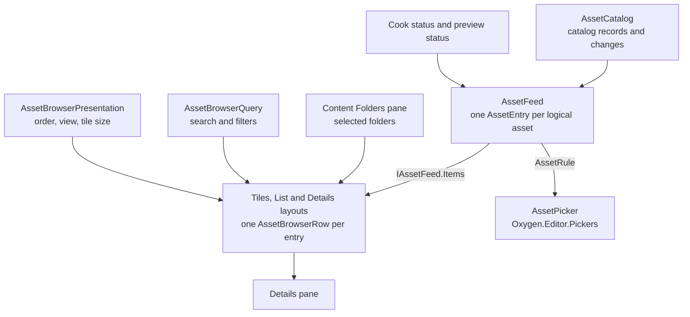

# Content Explorer And Asset Identity LLD

Status: `ED-M06 review-ready`

## 1. Purpose

Define the content explorer UX, asset identity model, asset-state reducer, typed
picker behavior, and missing/broken reference presentation for ED-M06. ED-M05
delivered the scalar material picker slice; ED-M06 turns that slice into the
reusable content explorer identity workflow.

ED-M07B extends the delivered baseline through
[content-cooking-workflows.md](content-cooking-workflows.md): correct navigation
and query lifetime, shared freshness/readiness, plain-language states, working
filters/details, and authored/built-in/cooked picking. The running-editor review
identified concrete gaps without changing ED-M06's historical validation scope.

The catalog captures records and cooking status from one retained publication.
The Cooked tree shows logical mount/folder paths; physical generation
directories remain storage details. If publication metadata cannot be admitted,
authored assets remain browsable with **Status unavailable** and the admission
diagnostic. Existing source errors remain visible and invalid sources remain
unselectable. Cooking and runtime mounting still reject invalid publication
metadata.

## 2. PRD Traceability

| ID            | Coverage                                                                                                                                                                         |
| ------------- | -------------------------------------------------------------------------------------------------------------------------------------------------------------------------------- |
| `GOAL-004`    | Material and future asset references are discoverable and assignable by identity.                                                                                                |
| `GOAL-005`    | Source, generated, descriptor, cooked, missing, broken, and runtime-availability overlay states are visible in the browser; authoritative mounted state is deferred to `ED-M07`. |
| `GOAL-006`    | Asset browsing, picking, and resolve failures produce visible diagnostics.                                                                                                       |
| `REQ-013`     | Users select material assets from a browser/picker using stable identity.                                                                                                        |
| `REQ-020`     | Content explorer shows scoped asset state.                                                                                                                                       |
| `REQ-021`     | Authoring stores asset identity, not raw cooked paths.                                                                                                                           |
| `REQ-022`     | Catalog/picker failures are visible.                                                                                                                                             |
| `REQ-024`     | Diagnostics identify asset identity, content-root, cook, mount, and missing-reference causes.                                                                                    |
| `REQ-036`     | Project content browsing supports the V0.1 authoring workflow without manual filesystem repair.                                                                                  |
| `REQ-037`     | Save/reopen preserves asset identities, including unresolved identities.                                                                                                         |
| `SUCCESS-006` | Import/cook/mount state is understandable and actionable.                                                                                                                        |
| `SUCCESS-007` | Material authoring and assignment uses content explorer identity.                                                                                                                |

## 3. Architecture Links

- `ARCHITECTURE.md`: asset identity, content explorer, content pipeline,
  diagnostics, and project content roots.
- `PROJECT-LAYOUT.md`: `Oxygen.Editor.ContentExplorer`, `Oxygen.Managed.Assets`,
  `Oxygen.Editor.ContentPipeline`, `Oxygen.Editor.Projects`.
- `asset-primitives.md`: catalog, URI, reference, and change primitives.
- `project-services.md`: project root, authoring roots, local roots, and
  cooked-root policy.
- `material-editor.md`: material create/open/edit/cook workflow.
- `property-inspector.md`: Geometry material slot consumes picker results.
- `diagnostics-operation-results.md`: operation kinds, domains, and code
  prefixes.

## 4. Building Blocks

- `Oxygen.Managed.Assets`: the catalog primitives (`IAssetCatalog`,
  `AssetRecord`, `AssetQuery`, `AssetChange`) and the identity types
  (`AssetPath`, `VirtualPath`).
- `Oxygen.Editor.Assets`: the asset catalog, the asset feed and its entries
  (`IAssetFeed`, `AssetEntry`, `AssetKind`, `AssetState`,
  `AssetRuntimeAvailability`), the identity rules (`AssetIdentityReducer`,
  `AssetIdentity`) and the status wording (`AssetStatusText`). Their design is
  [assets-module.md](assets-module.md); this LLD does not repeat it.
- `Oxygen.Editor.Pickers`: `AssetPicker` and `AssetPickerModel`, the one picker
  every asset property uses.
- `Oxygen.Editor.ContentExplorer`: the Content Folders pane, the assets pane
  with its rows, query, layouts and details, and the import, relocation and
  creation dialogs.

## 5. Target Design

The Content Explorer shows the asset feed's entries, one row per logical asset,
in the folders its Content Folders pane selects, through the search, filters,
order and view the user chose. It never presents a cooked file's path as an
asset's identity: an asset's identity is its `AssetPath`, and the source,
descriptor and cooked files are facts of its entry.



A source file, its descriptor and its cooked output are one entry: the feed's
reducer merges them by identity, and the entry keeps each file as a separate
fact for the details and the actions. Its `PrimaryState` and `DerivedState`
describe the authored and cooked side; its `RuntimeAvailability` is the
preview's overlay, kept apart because an asset can be both `Stale` and
`Mounted`, or `Cooked` and `NotMounted`.

## 6. Ownership

| Owner                           | Responsibility                                                                                                        |
| ------------------------------- | --------------------------------------------------------------------------------------------------------------------- |
| `Oxygen.Editor.ContentExplorer` | Rows, query, layouts, details, badge presentation, the folders tree, and the import, relocation and creation dialogs. |
| `Oxygen.Editor.Assets`          | The catalog, the feed and its entries, the identity rules and the status wording.                                     |
| `Oxygen.Editor.Pickers`         | The asset picker every property uses.                                                                                 |
| `Oxygen.Managed.Assets`         | Asset paths, references and the catalog query and change primitives.                                                  |
| `Oxygen.Editor.Projects`        | The active project, its authoring and local mounts, and the cooked-root policy.                                       |
| `Oxygen.Editor.ContentPipeline` | Import, cook, relocation and asset authoring, and the cook status the entries carry.                                  |
| Owners of asset properties      | What each property accepts (`AssetRule`), and the `AssetPath` it saves.                                               |

## 7. Data Contracts

The asset entry, its kind, state and runtime availability are Assets'
contracts: [assets-module.md §7](assets-module.md#7-data-contracts). The
explorer adds the presentation of entries.

### 7.1 Rows

`AssetBrowserRow` keeps one entry's visual container stable while the entry's
snapshot changes, so a status update never replaces a row or its selection.

- `Item` is the current `AssetEntry`; `Update` replaces it in place.
- `StatusText` and `StatusTone` are the entry's status (`AssetStatusText`), or,
  for a script with problems, its error and warning counts.
- `Location`, `SizeText` and `ModifiedText` come from `AssetFileFacts`, read
  once per snapshot.
- `BaseColor` is a material's swatch (`MaterialPreviewColor`); a row without
  one shows its kind's glyph.

### 7.2 Badges

A row's badge is `AssetEntry.PrimaryBadge` with its tooltip, and its tone is one
of `Neutral`, `Caution`, `Critical` and `Success` (`AssetStatusText.GetTone`).
The explorer only paints the tone: `StatusToneToBrushConverter` maps it to the
WinUI success, caution and critical fills. The wording and the tone are Assets'.

## 8. Services And Adapters

### 8.1 Query

`AssetBrowserQuery` is the session's search and filters, shared by every
layout. A row shows when its display name or path contains the search text and it
matches one selected type and one selected status; a group with nothing
selected matches everything.

- Types: Materials, Geometry, Scenes, Scripts, Input actions, Input mapping
  contexts, Input files, Physics scenes, Textures and images, Source models,
  Other.
- Statuses: Not imported, Needs cooking, Out of date, Unsaved changes, In
  progress, Cooked, Engine, Packages, and Problems (diagnostics, a broken or
  missing asset or source, missing cooked output, a failed cook or preview
  load).
- Each choice is an `AssetFilterOption`, a label and the test it applies to an
  entry; its chip removes it. `Changed` occurs once per effective change.

### 8.2 Presentation

`AssetBrowserPresentation` is how the session shows results, never authored
data: the `AssetBrowserView` (`Tiles`, `List`, `Details`), the `AssetSortField`
(`Name`, `Type`, `Status`, `Location`, `Size`, `Modified`) and its direction,
the tile size (96 to 256 pixels) and whether the details pane is open. `Sort`
orders rows by the field, then by name and identity.

### 8.3 Selection

`ContentExplorerState` holds what the panes share: the selected folders, the
query and presentation, the selected assets, the result and scope counts the
footer shows, and the clipboard of cut or copied items.

### 8.4 Picker

Every asset property picks through `AssetPicker` and its `AssetPickerModel`
(`Oxygen.Editor.Pickers`). The property's owner hands it the feed's entries
through an `AssetRule`, and the picker groups them as Engine, Packages and
Content by `AssetEntry.Origin`, with search and a clear choice. The user's
choice is an `AssetChoice`, whose `Asset` is the `AssetPath` the owner saves.
The picker never decides what a property accepts.

## 9. UI Design

ED-M06 Content Explorer is an operational tool: dense, clear, and optimized for
repeat asset browsing, not a gallery page.

### 9.1 Workspace Layout

ED-M08.7 redesign (supersedes the ED-M06 sketch):

```text
+---------------------------------------------------------------------------+
| < > ^ ⟳  Project › Content › Materials   [search…] [Filter ²] [▦ ☰ ▤] [ⓘ]  |
| [Material ×] [Needs cooking ×]                                 Clear all  |
+----------------+--------------------------------------------+-------------+
| ▾ Content      | New▾ Import▾ Cook▾ │ ✎ ✂ ⧉ ▤ ⊕ ✕ │ ⎘ ↗ Name▾  | (preview)  |
|   Materials •  |  +------+ +------+ +------+                | Glazed teal |
|   Geometry     |  |  ◯   | |  ◯   | |  ◯   |                | Material    |
|   Scenes       |  |Teal  | |Clay  | |Stone |                | • Cooked    |
| ▸ Cooked   🔒  |  |Mat • | |Mat • | |Mat • |                | Location …  |
| ▸ Studio   🔒  |  +------+ +------+ +------+                | Referrers 3 |
| [Mounts] [⇅]   |                                            | [Locate]    |
+----------------+--------------------------------------------+-------------+
| 6 of 6 assets · 1 selected                              Authoring source  |
+---------------------------------------------------------------------------+
```

Rules:

- the left tree selects folders; mounts are expandable subtrees with read-only
  badges, never a detached list. Project folders use a plain folder icon;
  mounted sources use an accent folder with a link badge and a lock when
  read-only. The tree root shows the project's name.
- the sources footer holds only Mounts and Content priority. Mounts opens the
  Content mounts dialog: each mount's virtual name, backing path and kind
  (project source, derived output, local library, pak file, engine content) with
  rename and unmount, and a form that adds Cooked, Imported, Build, a local
  folder or a pak file. Edits apply together; the project's own content cannot
  be renamed or unmounted, and project sources keep their names because asset
  paths start with them. The engine content is listed last with a lock: the
  SDK's `engine.pak` is always mounted beneath everything else.
- the engine pak and each declared pak show in the tree as read-only roots with
  a package glyph; their folders are the virtual folders of the assets they list
  (`/Engine/...` for the engine, the pak's own paths under its mount name for a
  user pak), and selecting one shows those assets.
- Tiles show a rendered thumbnail (ED-M08.11) or, until then, a material's base
  colour or the type glyph, with name, type and status; List and Details
  (sortable columns) show the same identity rows.
- the command row keeps New, Import and Cook as labelled menus and the asset
  commands as icons in Scene Explorer's order (Rename, Cut, Copy, Paste,
  Duplicate, Delete), then Copy path and Show in File Explorer. There is no
  hand-made overflow menu: toolbar overflow priorities fold path commands first,
  then asset commands, then Cook; New and Import stay longest. Item context
  menus mirror the row. Unavailable commands stay visible, disabled, and explain
  why.
- New Folder creates "New folder" in the current authoring folder and names it
  in place in the sources tree. Folder rename and drag-move relocate every asset
  inside and update their referrers (§9.5).
- the optional details pane shows identity facts, referrers and copy/locate
  actions; multi-selection shows aggregated counts. No hover tooltip carries
  information that is unavailable elsewhere.
- `.cooked` and other derived mounts are browsable and read-only; raw cooked
  paths appear only in details or diagnostics, never as the primary identity.

### 9.2 State Badges

| State / Overlay | Badge   | User behavior                                                |
| --------------- | ------- | ------------------------------------------------------------ |
| `Generated`     | `GEN`   | selectable; details show generated source.                   |
| `Source`        | `SRC`   | selectable when the consumer supports source identity.       |
| `Descriptor`    | `DESC`  | selectable; primary authoring record.                        |
| `Cooked`        | `COOK`  | selectable; cooked artifact is current.                      |
| `Stale`         | `STALE` | selectable; warning says cook is needed.                     |
| `Missing`       | `MISS`  | not a normal browse row; visible for unresolved references.  |
| `Broken`        | `ERR`   | not selectable for new assignment; details show diagnostics. |
| `Mounted`       | `MNT`   | overlay badge when runtime availability is known.            |

### 9.3 Picker UX

Material picker reuses the same state language:

```text
+-----------------------------------------------------------+
| Pick Material                                 [search...] |
| [Generated] [Source] [Descriptor] [Cooked] [Stale] [Miss] |
+-----------------------------------------------------------+
| [swatch] Default        Engine/Generated       GEN        |
| [swatch] Red            Content/Materials      COOK       |
| [swatch] Blue           Content/Materials      STALE      |
| [warn ] MissingGlass    Current assignment     MISS       |
+-----------------------------------------------------------+
| [Open] [Create New] [Clear] [Cancel]                      |
+-----------------------------------------------------------+
```

Opening from a missing/broken geometry slot pins the current unresolved row at
the top even when Missing/Broken filters are off.

### 9.4 Create/Open Policy

- Material creation target resolution is owned by
  `project-layout-and-templates.md`.
- Project root, `Config`, `Packages`, and derived roots resolve to
  `/Content/Materials`.
- Authored mount roots resolve to `/<Mount>/Materials`; selected material
  folders inside an authored mount are reused.
- Opening a material uses `IdentityUri`; the Material Editor resolves source
  descriptor path from project content roots.

### 9.5 Asset Relocation

Asset identity is the virtual path, and native asset keys derive from it.
Rename, move (tree drag, Cut/Paste) and folder rename/move therefore change
identity and must update every authored referrer in one transaction.

- **Reference index.** Built on demand from saved authored files, cached until a
  catalog change and rebuilt inside every relocation. Each file kind is read
  structurally: scene component and material-slot geometry/material URIs
  (component and targeted overrides), the exposure metering mask and
  `ExtraAssets`; material texture paths; geometry descriptor material, buffer
  and skeleton paths; texture descriptor `source`, `sources[].file` and
  `virtual_path`; import sidecar `BundleRoot`, `PrimaryRelativePath`, `Files`
  and `OutputDirectory`; input file action references (mapping `action`,
  `linked_action` and combo step `action` virtual paths), scene Play-section
  starting input contexts and script parameter overrides of input kinds.
  Identities compare without the scheme and `.json` suffix; a rewrite keeps the
  field's form (full URI, virtual path or file-relative path).
- **Input assets.** An input source is a container: each action and context it
  declares is named under the source's identity
  (`/Content/Input/Player.input/Jump.oiact`). Moving or renaming the source
  relocates all of its assets, since relocation maps the source's identity as a
  folder; renaming an action or context is a relocation request of its own
  (`InputProductRename`) that rewrites the source and every referrer
  ([content pipeline §24](content-pipeline.md#24-input-sources)).
- **Plan.** Source moves with their companion files (a texture's image, a
  model's sidecar), a folder prefix mapping and the rewritten references of
  every referrer, including a moved descriptor's own `virtual_path`. Rejected:
  collisions, invalid names, read-only or derived targets, moves out of
  authoring mounts or into the moved folder, renaming or moving a mount root or
  the importer's fixed type folders (`Materials`, `Geometry`, `Scenes`), moving
  a model file out of its bundle folder, and cooked-only imported outputs.
  Rename and move ask no confirmation; the result reports what moved and how
  many referrers were updated, and offers Undo.
- **Imported outputs.** A model import owns one output group in its mount,
  `Materials/<group>`, `Geometry/<group>` and `Scenes/<group>`, where the group
  is the sidecar's `OutputDirectory` and may be nested. Import creates no
  folders there, so **Rename output group…** on the model source or any of its
  outputs relocates the group; a real folder inside a type folder that is, or
  contains, a group expands the same way. The plan applies one prefix mapping
  under all three type folders, rewrites `OutputDirectory` in every affected
  sidecar and checks collisions in all three, including other imports' groups;
  the result reports the moved group folders. This is also how an import's
  destination changes. Moving a group to another mount is rejected. Renaming or
  moving the bundle folder rewrites `BundleRoot`; renaming the model file
  renames its sidecar and rewrites `PrimaryRelativePath` and `Files`.
- **Scenes.** Editor scenes live in `Content/Scenes` and are identified by name:
  they can be renamed (through the scene rename operation) and duplicated, not
  moved. Deleting the open scene is rejected.
- **Transaction.** Runs as the content cook coordinator's project writer. Any
  open document with unsaved changes rejects the operation with the names of the
  documents to save. A journal under `.build/relocation/<operation>/` records
  each move and edit with before/after hashes; files move and referrers are
  written through the atomic file store against their baselines; any failure
  restores every file, and project activation recovers an interrupted journal.
  After the commit, and before the writer is released, registered document
  participants bring open documents in step; then an explicit cook republishes
  the moved assets and their referrers. Every move, rewrite, restore, delete and
  document change is logged.
- **Open documents.** Nothing reloads or closes on a rename or move. A scene
  re-points the references of the affected nodes, slot targets, environment mask
  and `ExtraAssets` in memory; a material re-points its texture paths; a moved
  material document re-points its own path and keeps its history. These changes
  are outside undo history and leave the document clean: the owner records the
  transaction's written version as its saved state, so cooking accepts it. After
  the follow-up cook publishes, the runtime refreshes only the affected nodes
  and the environment. A deleted asset's open document closes.
- **Identity redirects.** A session-wide, in-memory table composes every
  committed relocation's old-to-new identities and resets when the project
  closes. Undo, redo and paste resolve restored asset references through it, so
  history is never rewritten or cleared. Restoring a deleted asset completes as
  a missing reference with the existing diagnostic and a warning, never blocking
  older undo steps.
- **Undo.** The operation result offers Undo, which plans and runs the reverse
  relocation. It is not part of scene history.
- Copy/Paste and Duplicate create unique new paths, give copied descriptors
  their new identity and rewrite no referrers; model sources and cooked-only
  outputs are not copied. Delete lists referrers, confirms when any exist and
  moves files and companions to the Recycle Bin, keeping an image another
  texture still uses; remaining referrers report the existing missing-reference
  diagnostics. The cooker treats a deleted texture as a warning: a material
  cooks with that slot unbound and a scene without its metering mask, so the
  rest of the project still cooks.

## 10. Persistence And Round Trip

- Asset properties persist only an `AssetPath`.
- The explorer persists, per project, its view and selected folders as its
  route (`ProjectUsage.ContentExplorerState`); search, filters, order and rows
  are session state.
- Missing and broken identities survive save and reopen unchanged.
- An entry's files, state, badges, swatches, diagnostics and runtime overlay
  are derived for the session.

## 11. Cook / Mount / Runtime Behavior

ED-M06 reads cook and mount state; it does not execute cook/mount workflows.

Allowed:

- query loose cooked indexes.
- display stale/cooked/missing/broken state.
- show actions that navigate to Material Editor or diagnostics.
- refresh browser rows after `AssetsChangedMessage` or validated content
  pipeline completion events. ED-M06 must not depend on save-time cooked-root
  refresh messages.

Forbidden in ED-M06:

- invoking full scene cook.
- mounting cooked roots.
- validating standalone runtime load.
- treating a cooked filesystem path as authored identity.

Full cook/inspect/mount refresh closes in ED-M07.

## 12. Operation Results And Diagnostics

Operation kinds:

| Operation Kind             | Producer                        | Domain                                  |
| -------------------------- | ------------------------------- | --------------------------------------- |
| `Asset.Browse`             | Content Explorer asset provider | `AssetIdentity`                         |
| `Asset.Query`              | catalog-backed provider/picker  | `AssetIdentity`                         |
| `Asset.Resolve`            | picker/slot/browser details     | `AssetIdentity`                         |
| `Asset.CopyIdentity`       | Content Explorer row/details    | `AssetIdentity`                         |
| `ContentExplorer.Navigate` | Content Explorer shell          | `AssetIdentity` / `ProjectContentRoots` |
| `ContentExplorer.Refresh`  | Content Explorer shell/provider | `AssetIdentity`                         |
| `Material.Pick`            | material picker                 | `AssetIdentity`                         |

Reducer failures are child diagnostics on the triggering `Asset.Browse`,
`Asset.Query`, or `Asset.Resolve` operation. ED-M06 does not publish a separate
top-level `Asset.ReduceState` result.

Diagnostic codes:

| Failure                           | Domain                    | Code                                        |
| --------------------------------- | ------------------------- | ------------------------------------------- |
| Catalog query exception           | `AssetIdentity`           | `OXE.ASSETID.QueryFailed`                   |
| Browser row reduction failed      | `AssetIdentity`           | `OXE.ASSETID.ReduceFailed`                  |
| Resolve URI missing               | `AssetIdentity`           | `OXE.ASSETID.Resolve.Missing`               |
| Descriptor cannot be parsed       | `AssetIdentity`           | `OXE.ASSETID.Descriptor.Broken`             |
| Cooked index entry missing target | `AssetIdentity`           | `OXE.ASSETID.Cooked.Missing`                |
| Selected content root is invalid  | `ProjectContentRoots`     | `OXE.PROJECT.CONTENT_ROOT.InvalidSelection` |
| Cooked output older than source   | `ContentPipeline` warning | `OXE.CONTENTPIPELINE.Asset.Stale`           |

`AffectedScope.AssetVirtualPath` carries the asset URI string. Diagnostics may
also carry `AffectedPath` for source/cooked filesystem paths.

## 13. Dependency Rules

Allowed:

- Content Explorer depends on `Oxygen.Managed.Assets`, `Oxygen.Editor.Projects`,
  `Oxygen.Managed.Core.Diagnostics`, and editor messaging.
- Material Editor opens material identities supplied by Content Explorer.
- WorldEditor consumes picker contracts and persists asset URIs.

Forbidden:

- Content Explorer must not depend on WorldEditor internals.
- Content Explorer must not mutate scene components.
- Content Explorer must not own import/cook primitive implementations.
- picker/browser rows must not persist descriptor/cooked paths into authoring
  data.
- `Oxygen.Managed.Assets` primitives must not depend on Content Explorer row
  types.

## 14. Validation Gates

ED-M06 is complete when:

1. content explorer list/tile rows show `Generated`, `Descriptor`, `Source`,
   `Cooked`, `Stale`, `Missing`, and `Broken` states where test data provides
   those states.
2. source descriptor and cooked index entries for the same logical material
   merge into one row with separate source/cooked details.
3. changing a descriptor after cook makes the row `Stale`.
4. deleting a descriptor for a referenced material shows a `Missing` row for the
   unresolved assignment and preserves the URI.
5. broken descriptor JSON produces a visible row diagnostic and does not crash
   the browser.
6. material picker uses the same reducer/provider state as the browser and still
   returns only typed material identity to Geometry assignment.
7. content explorer details can copy asset URI; source/cooked path copy appears
   only when those paths are known.
8. selecting `.cooked` or project infrastructure folders never changes the
   default material-create target away from a valid authoring content root.
9. `AssetChangeKind.Relocated` removes the previous URI row and adds/updates the
   new URI row.
10. serializer round-trip test confirms scene material slots contain only asset
    URIs, not browser state or filesystem paths.

Expected tests:

- `AssetIdentityReducer` merge/state tests for descriptor/cooked/stale/missing
  and broken descriptors.
- provider tests for `Added`, `Removed`, `Updated`, and `Relocated` changes.
- material picker projection test proving it consumes the shared provider.
- content-root target normalization tests for material create/open paths.

Manual validation belongs to the user: launching the editor, browsing a project
with source/cooked materials, filtering states, assigning material from picker,
deleting/breaking a descriptor, and confirming visible diagnostics.

## 15. Open Issues

- Thumbnails are rendered by the production renderer offscreen and cached
  locally by identity and content revision (ED-M08.11).
- ED-M06 does not claim authoritative runtime `Mounted`. It shows
  `Unknown`/`NotMounted` unless a later ED-M07 mount-refresh workflow supplies
  authoritative availability.
