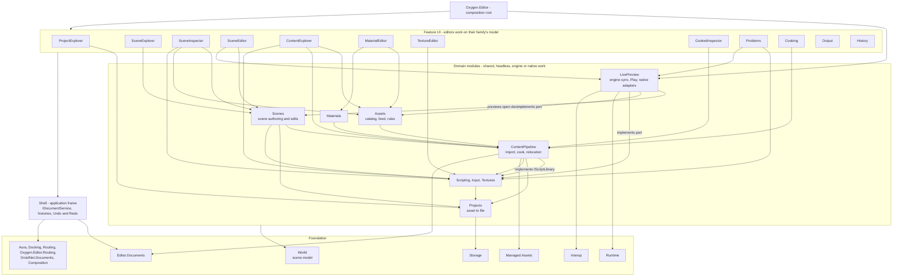

# Editor Module Architecture LLD

Status: `agreed`

Last Updated: 2026-10-22

## 1. Purpose

Define the project structure of the Oxygen Editor: which modules exist, what
each owns, how they are named, which references are allowed, and where logic may
live. The application frame (windows, panels, documents, commands,
notifications) is in [editor-shell.md](editor-shell.md), and
documents, histories, saving and cooking in
[editor documents](editor-documents.md). The scope chain and container
mechanics are in [scope-topology.md](scope-topology.md).

## 2. PRD Traceability

| ID         | Coverage                                                                                               |
| ---------- | ------------------------------------------------------------------------------------------------------ |
| `GOAL-001` | Each product area has one module that owns it, so a feature is found, changed and tested in one place. |
| `REQ-006`  | Authoring changes go through the domain modules' edits, recorded into the histories the Shell routes.  |
| `REQ-022`  | Operation results come from the domain modules and are presented by the Shell and passive panels.      |

## 3. Architecture Links

- [editor-documents.md](editor-documents.md): documents, histories, saving and
  cooking.
- [asset-family-modules.md](asset-family-modules.md): the family modules of the
  domain layer.
- [editor-shell.md](editor-shell.md),
  [assets-module.md](assets-module.md), [scenes-module.md](scenes-module.md),
  [live-preview.md](live-preview.md): the designs of the Shell and of the
  Assets, Scenes and LivePreview modules.
- [scope-topology.md](scope-topology.md): the scope chain and container
  mechanics.

## 4. Current Baseline

The modules of this design exist with the references of section 5.4;
`tooling/tests/test_editor_module_boundaries.py` checks them (section 14).

## 5. Target Design

### 5.1 Decisions

1. There is no world editor module. The generic workspace machinery is the
   Shell's and the scene editing parts are the scene modules'. "The editor" is
   the Shell plus the modules it hosts; the scene workspace is one window kind
   among several.
2. The Shell is the central application frame. Features plug into it through
   contributions and consume its services; they never reference Aura windowing,
   Docking, window routing or a `WindowId` directly.
3. UI projects contain views, view models and presentation only. Services,
   workflows and domain logic live in non-UI modules. Content pipeline logic
   (import, cook, publication, relocation, inspection) lives only in
   `Oxygen.Editor.ContentPipeline`.
4. A project's internals are visible only to its own module's tests (its test
   projects, test kit and test probes). No `InternalsVisibleTo` grant to any
   other assembly, test or production, except Moq's `DynamicProxyGenAssembly2`,
   so that the module's own tests can mock its internal types. A test that needs
   another module's private state uses that module's public API or moves to
   that module's tests.
5. Each module owns its outbound ports. A module that needs something from a
   lower-level capability it must not reference (the engine, for example)
   declares the interface; the module that may reference the capability
   implements it.
6. Classes, interfaces and APIs may be renamed when a name misstates what it
   owns. A move keeps names so the compiler checks it; the rename follows on
   its own.
7. Features and domain modules send no messages. There is no session bus and
   no messenger in any scope: each event belongs to its owner, as a .NET event
   of its service, and each cross-feature request is a call on its owner's
   port, so every dependency between parts is a project reference that the
   boundary test sees (section 14).

### 5.2 Layers

```text
Composition root        Oxygen.Editor
Shell                   Oxygen.Editor.Shell
Feature UI              editors, explorers, inspectors, passive panels
Shared feature UI       Oxygen.Editor.Pickers
Domain services         Scenes, Assets, LivePreview, ContentPipeline, Projects
                        families: Scripting, Input, Textures, Materials
UI kit                  Oxygen.Editor.Controls
Foundation              World, Documents, Schemas, Data, Runtime, Interop,
                        Managed.Core, Managed.Assets, Storage, Composition,
                        Aura, Docking, Routing, Oxygen.Editor.Routing
```

References point down only. A feature references the Shell, the domain modules
it uses, the shared feature UI and the UI kit. The shared feature UI is what
several features show alike (the asset picker); it references domain modules,
the UI kit and foundation, never the Shell or a feature. A domain module references other domain modules below it
and foundation, never the Shell or a feature. The Shell references foundation
only. The composition root references everything and is the only project that
does: `Oxygen.Editor.Composition` holds its registrations, so that tests can
compose them, and only the application host, `Oxygen.Editor`, references it.

`Oxygen.Editor.Routing` is foundation: it is the local routing over DroidNet
Routing that the Shell's layout and the panels' own navigation both use, and it
knows no editor module.

Every module names the layer it registers into with the layers of
`DroidNet.Composition`: `IApplicationLayer` is the editor scope, `ISessionLayer`
the project session, `IWindowLayer` a window and `IPanelLayer` a panel. Because
they are foundation, domain modules declare their layer as Shell and feature
modules do.

### 5.3 Naming conventions

Proposed conventions; the direction is agreed, individual names are open.

| Kind      | Purpose                                                                         | Name                | Examples                                              |
| --------- | ------------------------------------------------------------------------------- | ------------------- | ----------------------------------------------------- |
| Editor    | Creates and modifies a document                                                 | `XxxEditor`         | `SceneEditor`, `MaterialEditor`, `PhysicsEditor`      |
| Explorer  | Explores and discovers hierarchical or complex content; never "Browser"         | `XxxExplorer`       | `SceneExplorer`, `ContentExplorer`                    |
| Inspector | Shows, and optionally edits, the properties of one entity                       | `XxxInspector`      | `SceneInspector`, `CookedInspector`                   |
| Passive   | Panels and components that present information without owning an entity's state | Neutral noun        | `Output`, `Problems`, `Cooking`, `NotificationCenter` |
| Domain    | Non-UI services for one product area                                            | Plural noun or area | `Scenes`, `Assets`, `LivePreview`, `ContentPipeline`  |

Type names follow the module: a panel's view model is `<Module>ViewModel`, its
contracts carry the module's noun, and no public type carries the name of a
panel it does not belong to.

### 5.4 Dependency graph



Edges from features to `Managed.Core`, `World` and `Controls` are omitted for
legibility. LivePreview is the only domain module that references Runtime and
Interop; Scenes knows no engine (LivePreview previews its open documents), and
Assets and the family modules reach the engine and native code only through the
ports LivePreview implements. Of the editor's projects, Runtime references
Interop, World and `Oxygen.Managed.Core` only; it does not reference
`Oxygen.Editor.Documents`.

## 6. Ownership

| Module                             | Kind      | Owns                                                                                                                                                                                                                                                                                                                 | Must not own                                                               |
| ---------------------------------- | --------- | -------------------------------------------------------------------------------------------------------------------------------------------------------------------------------------------------------------------------------------------------------------------------------------------------------------------- | -------------------------------------------------------------------------- |
| `Oxygen.Editor`                    | Root      | `Program`, module composition (`Oxygen.Editor.Composition`), the project session host, workspace presets, activation of the first window                                                                                                                                                                             | Feature policy, services                                                   |
| `Oxygen.Editor.Shell`              | Shell     | Window kinds and their factory, docking workspace, document service, areas and tabs, histories, panel registry, placement, workbench context, command routing, context menus, close and exit, layout store, activity, clipboard and drag, notifications (contract, result policy, presentation), desktop integration | Scene, asset or pipeline policy                                            |
| `Oxygen.Editor.ProjectExplorer`    | Explorer  | Start experience: recent projects, templates, create and open                                                                                                                                                                                                                                                        | Project persistence rules (Projects)                                       |
| `Oxygen.Editor.SceneEditor`        | Editor    | Scene document editor: viewports, gizmos, transform tools, toolbar, play bar                                                                                                                                                                                                                                         | Scene commands (Scenes), engine sync (LivePreview)                         |
| `Oxygen.Editor.SceneExplorer`      | Explorer  | Hierarchy panel, drag and drop, adapter tree                                                                                                                                                                                                                                                                         | Mutation and organizer model (Scenes)                                      |
| `Oxygen.Editor.SceneInspector`     | Inspector | Node and component property editing                                                                                                                                                                                                                                                                                  | Commands and edit sessions' model (Scenes)                                 |
| `Oxygen.Editor.ContentExplorer`    | Explorer  | Asset navigation, filtering, views, import dialogs                                                                                                                                                                                                                                                                   | Relocation and creation logic (ContentPipeline, Assets)                    |
| `Oxygen.Editor.MaterialEditor`     | Editor    | Material document: edits Materials' `Material`                                                                                                                                                                                                                                                                       | Material file format (Managed.Assets), cook primitives                     |
| `Oxygen.Editor.TextureEditor`      | Editor    | Texture document: source image, cube layout, settings, preview                                                                                                                                                                                                                                                       | Import authoring (Textures), cook (ContentPipeline)                        |
| `Oxygen.Editor.CookedInspector`    | Inspector | Cooked package inspection panel                                                                                                                                                                                                                                                                                      | Inspection logic (ContentPipeline)                                         |
| `Oxygen.Editor.Output`             | Passive   | Log view over the output buffer                                                                                                                                                                                                                                                                                      | Log production                                                             |
| `Oxygen.Editor.Problems`           | Passive   | Problem list over every `IAssetProblemSource`: the family modules' problems and the runtime problems of LivePreview                                                                                                                                                                                                  | Problem production                                                         |
| `Oxygen.Editor.Cooking`            | Passive   | Cook job list over `ICookRunService`                                                                                                                                                                                                                                                                                 | Cook orchestration (ContentPipeline)                                       |
| `Oxygen.Editor.NotificationCenter` | Passive   | Notification history panel                                                                                                                                                                                                                                                                                           | Notification delivery (Shell)                                              |
| `Oxygen.Editor.History`            | Passive   | The active document's history and the global history; undo or redo to a chosen entry                                                                                                                                                                                                                                 | The histories (Shell)                                                      |
| `Oxygen.Editor.Scenes`             | Domain    | The scene document kind, scene authoring (`SceneAuthoring`) and its edits, selection, clipboard model, node lock and visibility                                                                                                                                                                                      | WinUI views, engine calls, histories (Shell)                               |
| `Oxygen.Editor.Assets`             | Domain    | The editor's live view of a project's assets: asset catalog and feed, identity rules, the rules of properties that reference assets; owns the `IAssetRuntimeStatusSource` port                                                                                                                                       | Browser state, engine calls, asset formats and file types (Managed.Assets) |
| `Oxygen.Editor.LivePreview`        | Domain    | Engine sync, content demand, mount changes, play session, runtime session start, the preview of open scene documents (`IScenePreview`), the engine adapters for the ports of Assets and Scripting (`IScriptAnalyzer`), runtime problems                                                                              | Authoring state                                                            |
| `Oxygen.Editor.ContentPipeline`    | Domain    | Import, cook, publication, relocation, inspection, the asset creation workflow over the families' templates; implements Scripting's `IScriptLibrary`                                                                                                                                                                 | Panels, prompts, family rules                                              |
| `Oxygen.Editor.Scripting`          | Family    | `Script`, `ScriptParameter`, script slot rules, script facts, the `IScriptAnalyzer` and `IScriptLibrary` ports, script tooling, templates and codes                                                                                                                                                                  | Views, the native call (LivePreview)                                       |
| `Oxygen.Editor.Input`              | Family    | `InputContainer`, `InputAction`, `InputMappingContext`, input rules and starting context priorities, input facts, templates                                                                                                                                                                                          | Views, the cook                                                            |
| `Oxygen.Editor.Textures`           | Family    | `Texture`, cube layouts, texture import authoring                                                                                                                                                                                                                                                                    | Views, the cook                                                            |
| `Oxygen.Editor.Materials`          | Family    | `Material`, its document kind, edits, validation, property catalog, templates and codes                                                                                                                                                                                                                              | Views                                                                      |
| `Oxygen.Editor.Controls`           | UI kit    | Reusable editor controls                                                                                                                                                                                                                                                                                             | Feature policy                                                             |

`Oxygen.Editor.Projects`, `Runtime`, `World`, `Documents`, `Schemas`, `Data` and
the DroidNet libraries keep their ownership, with the library changes listed in
[editor-shell.md](editor-shell.md) section 5.11.

## 7. Domain Modules

### 7.1 Assets

The editor's live view of the active project's assets: project assets, mounted
libraries and engine built-ins, one entry per logical asset, with cook and
preview state, the identity rules and the rules of properties that reference
assets. It is the editor's live view of a project's assets over the content
pipeline; `Oxygen.Managed.Assets` holds the asset formats, file types and cook
primitives shared with the engine and its tools. Its public surface, its ports
and its tests are specified in
[assets-module.md](assets-module.md). Script facts are Scripting's `Script`
([asset family modules](asset-family-modules.md)).

### 7.2 Scenes

Scene authoring: the scene document kind, `SceneAuthoring` and its edits, edit
sessions, selection, the Explorer layout, node lock and visibility and the
session clipboard model. Its changes are recorded into the history each document
is given (documents design decision 1). Scenes knows no engine: LivePreview
previews the open scene documents by observing their changes (`IScenePreview`,
[live-preview.md](live-preview.md) decision 3).

### 7.3 LivePreview

Everything that applies authoring state to the embedded engine: scene engine
sync, content demand, mount changes, runtime session start, play session, and
the runtime problem source. It is the only domain module that references
`Oxygen.Editor.Runtime`.

### 7.4 ContentPipeline

Import, cook, publication, relocation, inspection and asset creation. It grants
internals to its own tests only; other modules' tests arrange state through its
public API.

### 7.5 Family modules and editors

Each authored asset family has one domain module that owns its model, rules,
problems, facts, templates and codes: Scripting, Input, Textures and Materials
([asset family modules](asset-family-modules.md)). World holds the scene model
only. An editor edits its family's model: the material editor and the future
texture and input editors; scripts are edited in the external code editor. The
cook calls the family rules and never states them.

## 8. Logic In UI Code

The UI keeps the interaction (prompts, selection, focus); each operation lives
with its owner.

| Operation                                                                  | Owner                                                                                 |
| -------------------------------------------------------------------------- | ------------------------------------------------------------------------------------- |
| Knowing which inputs are unsaved before a cook                             | Shell (`IUnsavedDocuments`); the cook reads saved files only (documents design 5.3.3) |
| Launching the external code editor with its preferences                    | Shell desktop integration                                                             |
| Copy text, reveal in File Explorer, recycle bin                            | Shell desktop integration                                                             |
| Panel reveal, save, open document                                          | Shell placement and commands                                                          |
| Selecting a node                                                           | Scenes selection                                                                      |
| Runtime session start for a project                                        | LivePreview                                                                           |
| Merging script and runtime problems                                        | Problems, as presentation over the domain contracts                                   |
| Validation and file reading behind cooked inspection and the cooking panel | ContentPipeline                                                                       |

## 9. UI Surfaces

Feature UI projects (editors, explorers, inspectors, passive panels) contain
views, view models and presentation only (decision 3). They plug into the Shell
through contributions and consume its services (decision 2). One reaches the
engine: the SceneEditor's viewports draw through Runtime's surfaces, views and
input, which need the `SwapChainPanel` ([live preview](live-preview.md) decision
5); it never references Interop.

## 10. Persistence And Round Trip

Each module persists only what it owns: documents through their kinds and the
Shell's document service ([editor documents](editor-documents.md)), settings
through their owners, cooked content through ContentPipeline.

## 11. Cook / Mount / Runtime Behavior

ContentPipeline owns import, cook, publication, relocation and inspection;
LivePreview owns everything that applies authoring state to the embedded engine.
No other module references the engine, except the SceneEditor, whose viewports
use Runtime's surfaces, views and input and never Interop (section 9).

## 12. Operation Results And Diagnostics

Domain modules produce operation results and problems; the Shell and the passive
panels (Output, Problems, Cooking) present them.

## 13. Dependency Rules

References point down the layers of 5.2 only; a module's internals are visible
to its own tests only (decision 4); each module owns its outbound ports
(decision 5).

## 14. Validation Gates

Each module has its own test projects; a UI test project only where it has
XAML. A test lives with the module whose behavior it checks, and no test
project links another module's fixtures
([PROJECT-LAYOUT.md](../PROJECT-LAYOUT.md) section 13). Cross-module workflows
are tested at the highest owner (the composition root's integration suite).

A tooling unit test, `tooling/tests/test_editor_module_boundaries.py`, reads the
project files under `projects/` and the `InternalsVisibleTo` items and
attributes of their sources. A production project is one in a module's `src`
folder. The test checks:

- **Layers.** Every Oxygen production project has a layer of 5.2, and every
  layered project exists.
- **Production references.** Production projects reference only production
  projects: test kits and test support projects are referenced by tests only.
- **Layer rules.** References point down the layers of 5.2. The Shell, the UI
  kit and foundation reference foundation only; a feature references the Shell,
  the shared feature UI, domain modules, the UI kit and foundation; the shared
  feature UI references domain modules, the UI kit and foundation; a domain
  module references domain modules and foundation. Only the application host
  references the composition root (`Oxygen.Editor.Composition`).
- **Domain rank.** A domain module references only domain modules of a lower
  rank: Projects; then Scripting, Input and Textures; then ContentPipeline; then
  Assets, Materials and Scenes; then LivePreview.
- **Engine rule.** Only LivePreview and the composition root reference
  `Oxygen.Editor.Runtime` and `Oxygen.Editor.Interop`, with one exception: the
  SceneEditor references Runtime, never Interop (section 9).
- **Internals rule.** A production project grants its internals only to its own
  module's non-production projects outside `samples` (its tests, test kit, test
  hosts and probes), and to `DynamicProxyGenAssembly2` for Moq (decision 4). A
  grant to an assembly that no project builds fails.

## 15. Open Issues

Individual names of section 5.3 are open; the direction is agreed.
