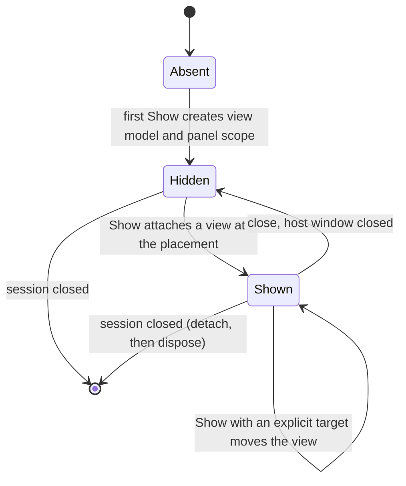

# Editor Shell LLD

Status: `agreed`

Last Updated: 2026-10-22

## 1. Purpose

Define `Oxygen.Editor.Shell`, the application frame of the Oxygen Editor: the
workbench model (window kinds and the parts they show), what feature modules
contribute, the services parts consume, window placement, panels across
windows, closing and exiting, notifications, and what the Shell needs from
Aura, Docking and Routing.

**Rule: features never reference Aura windowing, Docking, window routing or a
`WindowId`.** They contribute descriptors and consume services scoped to the
part they run as. The Shell alone turns that into Aura windows, Docking layouts
and document lifecycles.

Module boundaries and naming are in
[editor-module-architecture.md](editor-module-architecture.md); scopes and
container mechanics in [scope-topology.md](scope-topology.md); documents, their
histories and saving in [editor-documents.md](editor-documents.md) and
[document-identity.md](document-identity.md); the menu bar in
[workspace-title-bar.md](workspace-title-bar.md). The
[Shell README](../../../projects/Oxygen.Editor.Shell/README.md) describes the
behavior of each built service in detail.

## 2. PRD Traceability

| ID        | Coverage                                                                                                |
| --------- | ------------------------------------------------------------------------------------------------------- |
| `REQ-003` | Layouts and window placement are restored per project and window kind (section 5.4).                    |
| `REQ-006` | Undo and Redo reach the active document's history or the session's global history from every part.      |
| `REQ-022` | Operation results reach the user through the passive panels and the notification policy (section 5.10). |
| `REQ-047` | Every contributed panel can be shown again after it was closed (section 5.3).                           |
| `REQ-048` | Every contributed command has an identity, a label, a category and key gestures for the menu bar.       |

## 3. Architecture Links

- [ARCHITECTURE.md](../ARCHITECTURE.md) section 6: the Shell's ownership.
- [scope-topology.md](scope-topology.md): the scopes the Shell's modules
  register into, windows joining a session, retained panels, disposal.
- [editor-documents.md](editor-documents.md),
  [document-identity.md](document-identity.md): documents, tabs and document
  windows.
- [workspace-title-bar.md](workspace-title-bar.md): the menu bar over the
  contributed commands, panel reopening and the project switcher.
- [diagnostics-operation-results.md](diagnostics-operation-results.md):
  operation results, which the notification policy reads.

## 4. Current Baseline

The Shell has its document service, document areas and tabs, histories,
contributions of panels, commands and document editors, the window's command
service and key bindings, `IPlacementService` for the part's own window,
retained panels in the workspace window, document windows, close and exit, and
desktop integration.

Not built yet:

- Window kinds are keyed `Window` registrations (`wnd-pe`, `wnd-we`, `wnd-doc`)
  created through Aura's `IWindowFactory`; there are no `WindowKind`
  descriptors, workspace presets (the workspace's initial route is fixed in
  `WorkspaceViewModel`) or layout store, and window placement is keyed by the
  URL of the window's navigation
  ([#89](https://github.com/abdes/DroidNet/issues/89)).
- `WindowPlacement` has only `Current`
  ([#90](https://github.com/abdes/DroidNet/issues/90)).
- The context service, the activity service, the clipboard and drag service,
  context-menu contributions and Aura's per-window dialog gate (Aura's
  `DialogService` has one gate for the process)
  ([#91](https://github.com/abdes/DroidNet/issues/91)); the clipboard commands'
  behavior is [#86](https://github.com/abdes/DroidNet/issues/86).
- Panels across windows, with the panel registry and `IPanelHost`
  ([#88](https://github.com/abdes/DroidNet/issues/88)).
- Notifications ([#92](https://github.com/abdes/DroidNet/issues/92)).

## 5. Target Design

### 5.1 Decisions

1. **The Shell is the frame, features plug in.** Features contribute panels,
   commands, document editors and window kinds' content, and consume the
   Shell's services. The Shell references foundation modules only, and domain
   modules never reference the Shell.
2. **Window kinds are descriptors.** One factory creates every window from its
   kind; no keyed window registration exists (section 5.2).
3. **The dock layout is routed** (section 5.4).
4. **Panels are unique by default and retained.** One view model per panel,
   shown in at most one window at a time; closing a panel keeps its state. In
   the workspace window its view model is a singleton of the window's scope
   carrying `[RetainedViewModel]`; across windows the session's panel registry
   owns it (section 5.9).
5. **Documents are the session's, areas are the window's.** One editor per
   document, owned by the session's `IDocumentService`; each window's
   `IDocumentArea` shows the documents with a tab there. A document moves
   between windows by detaching and attaching its tab, and only its view is
   recreated ([scope-topology.md](scope-topology.md) decision 11).
6. **Every request that shows something names its placement** (section 5.8):
   the requesting window by default, a specific window, or a new window.
7. **Parts never hold a window.** A part reaches its window through services
   resolved at call time: its window's services, its `IPanelHost.Current`, or,
   for an editor, the `DocumentWindowServices` lent while its document has a
   tab there (`IDocumentWindowEditor`). Dialogs, pickers, drag and navigation
   find their window at call time.
8. **Commands are the automation surface.** A command takes no arguments and
   acts on the window's active document and its selection, so a script runs it
   by id without focus, as a key does. Behavior that needs arguments is a
   service call on a port, never a command.
9. **Closing is one negotiation.** The Shell is the only handler of Aura's
   `WindowClosing`; every part that has a say in a close is a participant of it
   (section 5.7).
10. **Domain modules never post notifications.** Deciding to interrupt the
    user is presentation policy (section 5.10).

### 5.2 Window kinds

A window kind is a descriptor: its frame, its areas, its Aura window category,
its decoration and its menu provider. The Shell creates every window through
one factory from its kind, so a second window of a kind (two workspaces of a
session, several document windows) needs no new registration, and the router
opens windows for dynamic targets created by that factory.

| Kind            | Scope                   | Areas                                                | Contributed by                                              |
| --------------- | ----------------------- | ---------------------------------------------------- | ----------------------------------------------------------- |
| Start           | Editor, no session      | One routed page                                      | ProjectExplorer                                             |
| Workspace       | A window of the session | Dock layout and a document area; a preset fills them | Shell (kind), composition root (the scene workspace preset) |
| Document window | A window of the session | One document area: torn-out tabs, a material window  | Shell                                                       |
| Panel window    | A window of the session | One floating panel (section 5.9)                     | Shell                                                       |

A window of a session carries the session in Aura's window metadata, and its
kind is its Aura category ([scope-topology.md](scope-topology.md) decision 10).

### 5.3 Parts

- **Panel**: contributed by a feature as a `PanelDescriptor`. Closing it
  destroys its view and keeps its view model and state;
  `IPlacementService.ShowPanelAsync` shows it again where it was. Its title is
  the descriptor's until a part sets another (`SetPanelTitle`).
- **Document**: one per file, with one editor and at most one tab in the
  session, in the area of one window. A kind whose descriptor allows one
  document per area (scenes) replaces the shown one, after asking about its
  unsaved changes. A pinned, pin-locked tab (the scene's) never detaches.

A panel is semantically unique when it presents one piece of project state, so
two simultaneous views would show the same thing twice or need to be kept in
sync. Uniqueness is enforced by the model (one view model, one attachment), not
by hiding commands; MVVM would allow several views on one view model, and the
design attaches at most one.

| Panel            | Multiplicity | Reason                                                                                                                                  |
| ---------------- | ------------ | --------------------------------------------------------------------------------------------------------------------------------------- |
| Content Explorer | Unique       | One project-wide navigation state, filter, selection and history; a second view would need its own state or constant syncing            |
| Scene Explorer   | Unique       | One hierarchy of the active scene document, driven by the session's selection                                                           |
| Scene Inspector  | Unique       | Follows the single selection; a second follower shows the same content. A pinned, independent inspector would be a different panel kind |
| Output           | Unique       | One log stream per project                                                                                                              |
| Cooking          | Unique       | One cook run list per project, over the session's cook coordinator                                                                      |
| Problems         | Unique       | One problem list per project                                                                                                            |
| Cooked Inspector | Unique       | One inspection of the selected cooked package                                                                                           |

Multiplicity is declared by the panel's descriptor and defaults to `Unique`. A
panel kind that needs several independent instances declares `Multiple`; each
instance then has its own state and its own panel scope. That is a property of
that panel, not a change to the infrastructure. The document area and the
document editors are not panels: many exist, one per document, in any window.

### 5.4 Layout and routing

**Decision: the layout is routed.** A window's content and its workspace's dock
layout are its router URL, and panel routes resolve the panel's retained view
model instead of creating one.

What routing gives the editor:

- **URL as serialized state.** A window's content and a workspace's dock layout
  are one string, so persisting and restoring them needs no other format. The
  Content Explorer restores its panes and selection this way.
- **History.** A sequence of URLs is a back and forward history; the Content
  Explorer keeps one for its navigation.
- **Uniform composition.** View models are created through routes, placed in
  outlets, and receive `IRoutingAware` navigation calls.
- **Addressability.** A URL names a place (a panel, a folder, a document view)
  for deep links, restore and tests.

| Option                    | Layout is                                                                                | Keeps                                                         | Needs                                                                                             |
| ------------------------- | ---------------------------------------------------------------------------------------- | ------------------------------------------------------------- | ------------------------------------------------------------------------------------------------- |
| A: routed layout (chosen) | The window's router URL; panel routes resolve the retained panel instead of creating one | URL persistence, history, uniform composition, addressability | Dock state per `IDocker`, `[RetainedViewModel]` in routing, runtime routes found by outlet (5.11) |
| B: shell layout model     | A shell-owned tree of areas and docks, serialized per project and window kind            | Direct ownership of panels by the registry                    | Its own serializer, its own history, a second composition path beside routing                     |

Panel-internal navigation (the Content Explorer's panes and history) is routed
too.

A workspace preset is the initial layout of a workspace window: its initial
URL. The layout store, on top of the editor's settings manager, keeps the
layout of each window per project and window kind, and the panels' remembered
placements (section 5.9). Window placement (position, size, state) is keyed by
window kind and instance, never by URL.

### 5.5 Contributions

Features register their contributions through their modules. A registry checks
them once: a duplicate id, or a reference to an unknown area, command or part,
fails.

| Contribution              | Content                                                                                                             | Registered by                                         |
| ------------------------- | ------------------------------------------------------------------------------------------------------------------- | ----------------------------------------------------- |
| `IFeatureModule`          | A feature's `Panels` and `Commands`, and its services, view models and views in each workspace window               | The feature, listed in the editor scope               |
| `PanelDescriptor`         | `Id`, `Title`, `ViewModelType`, `Multiplicity` (default `Unique`), `IconUri`, default area                          | The feature's `IFeatureModule.Panels`                 |
| `CommandDescriptor`       | `Id` (such as `Edit.Undo`), `Label`, `Category` (default `General`), `KeyGestures`, icon                            | The feature's `IFeatureModule.Commands`, or the Shell |
| `IDocumentEditorProvider` | A `DocumentEditorDescriptor`: the document kind, the editor factory, closable, pinned, pin lock, icon, one per area | The feature's session module                          |
| `IDocumentViewModule`     | The views of a feature's document editors, in every window that shows its documents                                 | The feature, listed in the editor scope               |
| `WindowKind`              | Frame, areas, Aura category, decoration, menu provider (section 5.2)                                                | The Shell, or the module that owns the window's page  |
| `WorkspacePreset`         | The initial panels and their positions in a workspace window: an initial URL (section 5.4)                          | The composition root (the scene workspace)            |
| `ContextMenuContribution` | A context (`scene-node`, `asset`, `folder`), a group, an order and a command id                                     | The feature that runs the command                     |

A command's category is its menu in the menu bar
([workspace-title-bar.md](workspace-title-bar.md) decision 8). A context menu
is built from the context-menu contributions of its context, so keys, toolbars,
menus and context menus run the same commands with the same enabled state.

### 5.6 Services offered to parts

| Service                                                | Shape                                                                                                                                                                                     | Scope   |
| ------------------------------------------------------ | ----------------------------------------------------------------------------------------------------------------------------------------------------------------------------------------- | ------- |
| `IPlacementService`                                    | `OpenDocumentAsync(asset, placement)`, `ShowPanelAsync(id, placement)`, `ShowPanelsAsync`, `SetPanelTitle`, `OpenWindowAsync(kind, preset)` (section 5.8)                                 | Window  |
| `IDocumentArea`                                        | The window's documents, the active one and its editor; opens a file once and shows it there; saves its documents and asks in its window                                                   | Window  |
| `IDocumentWindowEditor`                                | Implemented by an editor: receives `DocumentWindowServices` (window, area, commands, placement, asset reveal) while its tab is in a window                                                | Window  |
| `IPanelHost`                                           | A panel's host: `Current` (observable, null while hidden: window, dialog owner, navigate-out router, placement context), `IsShown`, `Title`, `Badge`, `Reveal()`, `Close()` (section 5.9) | Panel   |
| Context                                                | The active window, the active part and the active document per window, observable                                                                                                         | Editor  |
| `ICommandService`                                      | The window's commands; `Register(handler)` while a part lives; `CanExecute` and `ExecuteAsync` by id from a context element; key bindings per window frame                                | Window  |
| `IDocumentService`                                     | Every open document's editor; saving, saving before an operation, reloading, following relocated files                                                                                    | Session |
| `IHistoryService`                                      | The session's global history; each document has its own                                                                                                                                   | Session |
| `IUnsavedDocuments`                                    | Which inputs have unsaved changes, for the cook, Play, relocations and the asset feed                                                                                                     | Session |
| `IDocumentClosePrompt`, `IDocumentConfirmations`       | The close prompt and the confirmations of documents, in the window given with each call                                                                                                   | Editor  |
| `ICloseAndExit`, `IWindowCloseParticipant`             | Closing windows and exiting (section 5.7)                                                                                                                                                 | Editor  |
| Clipboard and drag                                     | Typed payloads, session scoped, bridged to the system clipboard; Cut, Copy, Paste and Delete act on the active part's selection                                                           | Session |
| Activity                                               | Long-running work with progress, shown by the frame and by notifications                                                                                                                  | Editor  |
| `INotificationService`                                 | Section 5.10                                                                                                                                                                              | Editor  |
| `IAssetReveal`, `IProblemReveal`, `ICookedInspections` | Ports the Shell declares and features implement: the Content Explorer reveals an asset, Problems a problem, the Cooked Inspector opens an inspection                                      | Window  |
| `IDesktopIntegration`                                  | Copy text, show in File Explorer, move to the Recycle Bin                                                                                                                                 | Window  |
| `ICodeEditorService`                                   | Opens scripts and input files in the user's code editor, over the project folder (`IProjectFolder`)                                                                                       | Window  |

A command goes from the part the user works in outwards, then to the active
document's editor, then to the handlers registered with the window's command
service. Text entry keeps its own Undo.

Example: the Scene Inspector is focused and the user presses Ctrl+Z. The
window's key binding runs `Edit.Undo`; the Inspector has no Undo handler, so
the command reaches the active document's editor, which undoes the scene
document's history. Undo works the same from every part in every window, and
the menu bar shows the same enabled state.

### 5.7 Close and exit

`CloseAndExit` is the only handler of Aura's `WindowClosing`. A participant
(`IWindowCloseParticipant`) declares its `WindowCloseLevel` (`Document`,
`Window`, `Session`, `Application`) and prepares a close; the close runs in
three phases, in level order:

1. **Prepare.** Each participant may veto or prompt and returns a
   `WindowCloseStep`. One prompt lists every dirty document of what closes.
2. **Commit.** Only when every participant prepared, each step commits:
   documents close, panels detach, windows close. A commit that returns false
   keeps the window open.
3. **Finalize.** The window's scope ends, then, when the editor exits, the
   session closes and the engine shuts down.

Participants by level: the window's documents (`WindowDocumentsClose`) and an
empty document window's own close; the window's scope (`WindowScopeClose`);
the composition root's window placement, its return to the Start window when a
session's last workspace window closes (`SessionWindowClose`), and the editor's
exit when its last window closes outside a session (`EditorExit`). Closing the
last workspace window of a session returns to the Start window instead of
exiting; the Start window opens before that window closes, so the editor always
has a window. Exiting is closing the Start window or an explicit command.

### 5.8 Window placement

Every request that results in something appearing in a window (opening a
document, showing a panel) carries one `WindowPlacement`, and the editor
supports all of its cases:

| Placement          | Meaning                                                                               |
| ------------------ | ------------------------------------------------------------------------------------- |
| `RequestingWindow` | The window that raised the request; the default for callers that do not say otherwise |
| `Window(WindowId)` | A specific existing window                                                            |
| `NewWindow(kind)`  | A new window of a kind (workspace window, document window, panel window)              |

- The placement service resolves the value to a target window, creating it from
  its kind for `NewWindow` and joining it to the session
  ([scope-topology.md](scope-topology.md) 5.7). `RequestingWindow` comes from
  the requesting part: its window's scope, or its `IPanelHost.Current`.
- A `Window(WindowId)` that no longer exists falls back to the requesting
  window, then to any workspace window of the session, and publishes a visible
  operation result; it never fails silently.
- Delivery is resolve-and-deliver: the placement service resolves the target,
  then hands the request to that window's document area or layout. Nothing is
  broadcast and filtered by window.
- Aura supports every case, and the placement value is the only thing a caller
  chooses; the editor does not pick one policy and refuse the others.

### 5.9 Panels across windows

A unique panel has exactly one view model, owned by the session, and exactly
one view at a time, hosted by any window or floating alone. The session's
`IPanelRegistry` is the only way a panel view appears.

| Request                                    | Result                                                                                                                              |
| ------------------------------------------ | ----------------------------------------------------------------------------------------------------------------------------------- |
| Show, panel never created                  | Creates the view model and its panel scope once, then attaches a view at the resolved placement                                     |
| Show, panel hidden                         | Attaches a new view of the retained view model at the resolved placement: the last remembered placement, else the requesting window |
| Show, panel visible, no explicit target    | Reveals and focuses it where it is; never creates a second view                                                                     |
| Show, panel visible, explicit target (5.8) | **Moves** it: detaches the view from the old host, attaches a new view to the target; the view model and panel scope are untouched  |
| User closes the panel                      | Detaches and destroys the view; the view model and its state stay, and the placement is remembered                                  |
| User undocks or docks the panel            | Same as a move, to a panel window or to another window's dock                                                                       |
| Host window closes                         | Panels hosted there are detached as when closed; no panel is destroyed                                                              |
| Project session closes                     | All panels are detached, then disposed by the registry in reverse creation order                                                    |



Rules:

- **The view model never knows its window.** It receives an `IPanelHost` whose
  `Current` (nullable, observable) exposes the window showing it. Dialogs, drag
  and navigation read it at call time; nothing caches a `WindowId` or a window
  router.
- **Hidden panels do no UI work.** Panels suspend subscriptions that only serve
  the view when hidden. State that must survive (filters, navigation history,
  selection) stays in the view model.
- **A panel module has two parts.** The panel scope is a sibling of the window
  scope, so the window's view locator cannot see a view registered in it: a
  session part (view model, state, local router services) and a window part
  (the top-level view type and its view-only dependencies), registered into
  whichever window shows the panel.
- **The view is transient and stateless,** created by the hosting window's view
  locator from the view model.
- **Routes name the panel, the registry owns it.** The window's routes keep
  naming the panel's view model type, and the window resolves the session's
  instance through its parent. The panel's view model carries
  `[RetainedViewModel]`, so a window's outlet detaches it without disposing it,
  and the registry is its only disposer. The dock loader asks the registry to
  attach instead of creating the view model, so a restored layout or a stale
  route cannot create a second panel: the registry refuses a second attachment
  and moves instead.
- **A move during an operation is safe.** The view model owns the operation,
  not the view; a moved or hidden host cancels only view-bound work.
- **A host that cannot perform a move** reports a visible failure and keeps the
  panel where it is.

### 5.10 Notifications

Any UI part can raise a notification, and every service reaches the user
through it indirectly. The user sees a notification as a toast in an editor
window, finds it later in the Notification Center, and receives it as a
Windows notification when no editor window is in the foreground.

The contract is the Shell's, beside its implementation and every presentation.
Feature modules reference the Shell, so every part can post.

```csharp
public interface INotificationService
{
    NotificationHandle Post(NotificationRequest request);
}

public sealed record NotificationRequest(
    NotificationSeverity Severity,          // Info, Success, Warning, Error
    string Title,
    string? Message = null)
{
    public string? Source { get; init; }                 // module or part id
    public string? GroupKey { get; init; }               // coalesces repeats
    public NotificationScope Scope { get; init; }        // Editor, Session, Window
    public IReadOnlyList<NotificationAction> Actions { get; init; } = [];
    public NotificationUrgency Urgency { get; init; }    // Normal, High
    public Guid? OperationId { get; init; }              // links an operation result
}

public sealed record NotificationAction(string Label, string CommandId, string? Argument = null);

public sealed class NotificationHandle
{
    public Guid Id { get; }
    public void Update(NotificationRequest request);     // progress, final state
    public void Dismiss();
}
```

- Actions name commands, not delegates. A command id with a string argument
  survives a Windows notification activation, which can arrive after the toast
  is gone; the command service resolves it in the current context.
- `Post` is callable from any thread; the Shell marshals presentation to the
  right dispatcher. A `Window` scope targets the window of the posting part
  (from its window's scope or `IPanelHost`); the others target the active
  editor window.
- **Attention is presentation policy.** A domain service reports what happened
  through the contracts it has. A Shell policy turns selected operation results
  into notifications (failures, partial successes and results with a primary
  action), linked by `OperationId`, so existing publishers get toasts without
  change. An event that needs the user's response (a file changed on disk) is
  raised by its service as its own event; the feature that owns the related UI
  posts the notification with the right actions. The service never learns about
  toasts.

| Surface              | Behavior                                                                                                                                                                                                                                                          |
| -------------------- | ----------------------------------------------------------------------------------------------------------------------------------------------------------------------------------------------------------------------------------------------------------------- |
| Toast                | In the target window's frame, stacked in a corner, at most three visible. Info and Success dismiss after a few seconds, Warning after longer, Error stays until dismissed. A repeat with the same `GroupKey` updates the toast. Announced to assistive technology |
| Notification Center  | A passive panel (`Oxygen.Editor.NotificationCenter`) listing the history, filterable by severity and source, with an unread count in the frame. Editor-scoped, bounded; a session's notifications keep their entries, with actions disabled once the session ends |
| Windows notification | When no editor window is in the foreground, notifications of High urgency or Warning and above go to Windows through the Windows App SDK app notifications. Activating one restores the editor window and runs the action                                         |

User settings control the Windows notification threshold and a do-not-disturb
mode (for example while playing a scene).

Operation results stay the diagnostic record of an operation, and every result
still goes to Output. Output is the log, Problems the list of persistent
problems, and the Notification Center the history of attention requests. A
"Details" action opens Output filtered to the linked operation.

### 5.11 What the Shell needs from the libraries

| Library | Property                                                                                                                                                                                            | Why                                                      |
| ------- | --------------------------------------------------------------------------------------------------------------------------------------------------------------------------------------------------- | -------------------------------------------------------- |
| Docking | Docks, dockables, ids and the docking maneuver per `IDocker`                                                                                                                                        | Two workspaces use the same panel ids                    |
| Docking | A floating mode; a floating panel is a Shell panel window                                                                                                                                           | Panel windows (5.9)                                      |
| Routing | `[RetainedViewModel]` and `RoutedViewModels.Release` in the router, outlets and Aura's `RoutedWindow`; runtime routes found by outlet; change-set deletes release; `NavigationError` per navigation | Retained panels, the routed layout, diagnosable failures |
| Routing | Window targets created by the window-kind factory                                                                                                                                                   | Several windows of one kind (5.2)                        |
| Aura    | Window categories, metadata and the per-window tab source; tab drag between windows (`DocumentTransfers`, `IDocumentWindowFactory`)                                                                 | Window kinds and document windows                        |
| Aura    | A dialog gate per window                                                                                                                                                                            | A dialog in one window must not block the others         |
| Aura    | An overlay layer in the window frame                                                                                                                                                                | Toasts                                                   |

## 6. Ownership

| Folder of `Oxygen.Editor.Shell` | Owns                                                                                                       |
| ------------------------------- | ---------------------------------------------------------------------------------------------------------- |
| `Contributions/`                | Feature modules, panel descriptors, editor providers, document view modules and their registry             |
| `Documents/`                    | The document service, each window's document area and tabs, histories, closing, prompts, banners           |
| `Commands/`                     | Command descriptors, the window's command service, key bindings and context menus                          |
| `Windows/`                      | Window kinds and their factory, placement, the context service, reveal ports, close and exit               |
| `Layout/`                       | The docking workspace: its routed layout, dock views, closed panels, the layout store, the Docking adapter |
| `Panels/`                       | The panel registry and `IPanelHost`                                                                        |
| `Activity/`                     | Long-running work and its progress                                                                         |
| `Desktop/`                      | File Explorer, Recycle Bin, the clipboard and drag service, the external code editor                       |
| `Notifications/`                | The notification service, result policy, toasts and Windows delivery                                       |

The Shell's modules register into each layer: `ShellModule` (editor),
`ShellSessionModule` (session), `ShellWindowModule` and `DockingWindowModule`
(workspace window), `ShellDocumentWindowModule` (document window). The Shell
composes none of them; the composition root lists them.
`Oxygen.Editor.NotificationCenter` owns the notification history panel.

## 7. Data Contracts

The descriptors of section 5.5, the placement values of section 5.8 and the
notification request of section 5.10.

## 8. Commands, Services, Or Adapters

`ShellCommands` declares the Shell's own commands: Undo, Redo, Cut, Copy, Paste
and Delete (`Edit.*`). The Docking placement adapter (`DockingPlacementService`)
implements `IPlacementService` for the workspace window, and
`DocumentWindowPlacement` for a document window.

## 9. UI Surfaces

The document area (`DocumentAreaView`) with its missing-file and
changed-on-disk banners, the close prompt, panel windows, toasts and the
Notification Center.

## 10. Persistence And Round Trip

The layout store keeps each window's layout per project and window kind, and
the panels' remembered placements. Window placement is kept per window kind and
instance. The code editor choice is a per-user setting.

## 11. Live Sync / Cook / Runtime Behavior

None. `IUnsavedDocuments` is how the cook, Play and relocations ask about
unsaved changes ([editor-documents.md](editor-documents.md) 5.3.3).

## 12. Operation Results And Diagnostics

The Shell publishes the failures of its own operations (a save that failed, a
Start window that did not open, a placement that fell back) as operation
results, and presents results through the notification policy.

## 13. Dependency Rules

- The Shell references foundation modules only: Aura, Docking, Routing,
  `DroidNet.Composition`, `DroidNet.Documents`, TimeMachine,
  `Oxygen.Editor.Documents`, `Oxygen.Editor.Data`, `Oxygen.Editor.Routing`,
  `Oxygen.Managed.Core` and `Oxygen.Managed.Assets`.
- Features reference the Shell; domain modules never do.
- No feature references Aura windowing, Docking, window routing or `WindowId`.

## 14. Validation Gates

The Shell's unit and UI tests cover the document service, areas and tabs,
closing and the close negotiation (`CloseAndExitTests`), commands and
placement. The composition root's tests cover its close participants
(`EditorCloseTests`).

## 15. Open Issues

1. The editor runs unpackaged. App notifications for unpackaged Windows App SDK
   applications need registration at startup and activation handling in
   `Program`; the requirements of the version in use are to be confirmed.
2. Notification history persistence across editor restarts.
3. Where user notification settings live (editor settings through
   `IEditorSettingsManager`, application scope).
4. Status bar, command palette and user key bindings are not designed.
