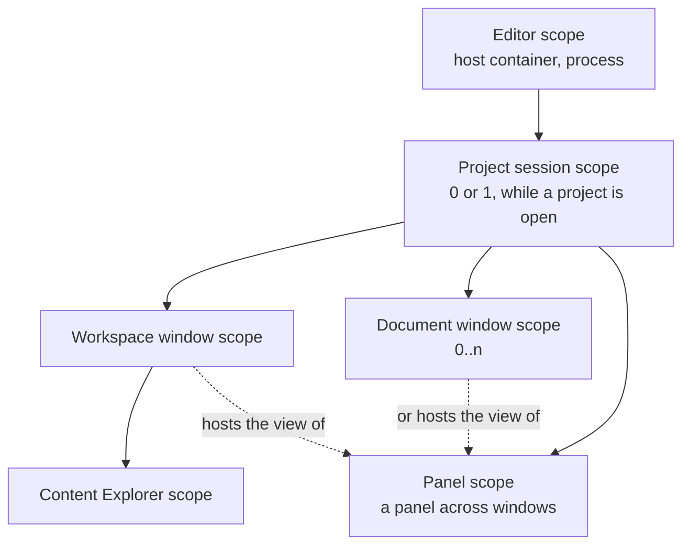
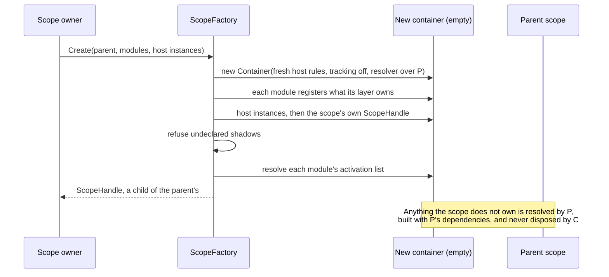
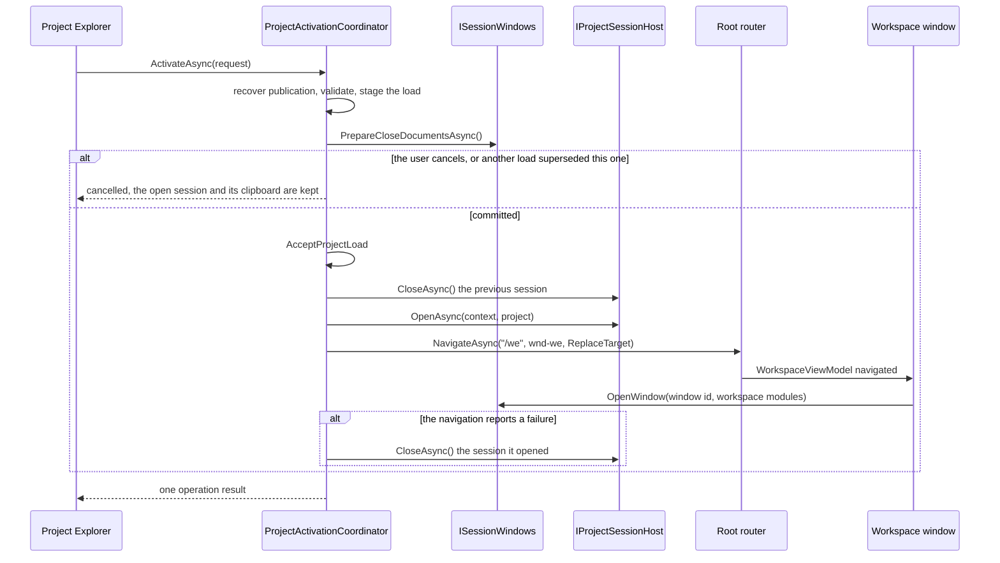

# Editor Scope Topology LLD

Status: `agreed`

Last Updated: 2026-10-22

## 1. Purpose

Define how the editor's services are composed and how long they live: the chain
of dependency-injection scopes (editor, project session, window, panel), what
each scope owns, how a scope is built and disposed, how a project session opens
and closes, how windows join a session, and the rules a topology test enforces.

The mechanism (a scope as an empty DryIoc container over its parent) is
[DroidNet.Composition](../../../projects/Composition/README.md). The module
structure is [editor-module-architecture.md](editor-module-architecture.md);
documents, tabs and their close are the Shell's
([Shell README](../../../projects/Oxygen.Editor.Shell/README.md),
[document-identity.md](document-identity.md)).

## 2. PRD Traceability

| ID        | Coverage                                                                                                   |
| --------- | ---------------------------------------------------------------------------------------------------------- |
| `REQ-001` | The Start window and its Project Explorer live in the editor scope, without any project.                   |
| `REQ-002` | Opening or creating a project opens its session, then navigates the workspace window into it.              |
| `REQ-003` | Everything restored for a project is a session or window service, created for that project only.           |
| `REQ-047` | A closed panel keeps its view model in the window's scope and shows again where it was.                    |
| `REQ-022` | A refused or failed activation publishes one operation result; the open session is kept or closed cleanly. |

## 3. Architecture Links

- [ARCHITECTURE.md](../ARCHITECTURE.md) section 8.1: startup and project open.
- [editor-module-architecture.md](editor-module-architecture.md): modules,
  layers and their registration modules.
- [project-workspace-shell.md](project-workspace-shell.md): project activation
  as the user sees it.
- [document-identity.md](document-identity.md) and
  [editor-documents.md](editor-documents.md): documents, tabs and document
  windows.
- [settings-architecture.md](settings-architecture.md): which settings are the
  editor's and which are a project's.

## 4. Current Baseline

The editor is composed this way. `Oxygen.Editor.Composition` is the
composition root; its tests check the topology (section 14). Not built yet:
window kinds (the three windows are keyed `Window` registrations, `wnd-pe`,
`wnd-we` and `wnd-doc`; [#89](https://github.com/abdes/DroidNet/issues/89)),
placement beyond the part's own window
([#90](https://github.com/abdes/DroidNet/issues/90)), and panels across
windows with their panel scopes
([#88](https://github.com/abdes/DroidNet/issues/88)). `SceneNodeInteraction`,
`ViewportStateService` and `PreviewSettingsService` still take a
`ProjectContext` with each call and reset on another project
([#94](https://github.com/abdes/DroidNet/issues/94)), and the Scene Explorer
falls back to the static `UndoRedo.Default` without a scene document
([#95](https://github.com/abdes/DroidNet/issues/95)).

## 5. Target Design

### 5.1 Decisions

1. **A scope is a lifetime.** A scope exists because something has a lifetime
   (the process, an open project, a window, a panel with its own router), never
   because a view model wants a private router.
2. **A scope is an empty container over its parent.** It registers only what
   its modules own and resolves the rest from its immediate parent, which builds
   and caches it. Shared identity therefore never depends on which scope
   resolves a service first. DryIoc's `CreateChild` is not used: it copies the
   registry and only the singletons that already exist, so a parent singleton
   first resolved from a child is built again inside it, with the child's
   router, view locator and container (section 5.2).
3. **Child containers, not DryIoc scopes.** `OpenScope` and `Reuse.ScopedTo`
   would avoid copying, but each scope needs its own registrations of the same
   abstractions (`IRouter`, `IViewLocator`, `ViewModelToView`, `WindowId`), and
   every tracked transient would attach to whichever scope is open.
4. **Each service has one owning scope,** fixed by the module that registers
   it. Dependencies flow down only: a scope sees its parent chain, never a
   sibling or a child. Two windows share nothing except through their session.
5. **One project session at a time.** The session is the open project: it holds
   the loaded `IProject` and itself (`IProjectSession`) as instances, and every
   project-bound service is created for it and disposed with it. No ambient
   "active project" service exists; a service that needs the project takes its
   session.
6. **The session's contracts are in Projects.** `IProjectSessionHost` and
   `IProjectSession` are declared by `Oxygen.Editor.Projects`, because the
   domain services of a session need its lifetime and its project's settings,
   and domain modules never reference the Shell. The composition root
   implements the host, because it composes the session's modules. The Shell
   knows no project: its session services register through its session module.
7. **A mount change keeps the session.** A change of the content mounts (local
   folders, libraries, cooked content order) gives the open project a new
   `ProjectContext`; its session stays open. `IProjectSession.Context` is the
   session's current project, an immutable value that only a mount change
   replaces, through the host's `ChangeContext`, which accepts only the same
   project id and root. `ContextChanged` fires once, after `Context` changed,
   on the thread of the change. Only the services whose state comes from the
   mounts follow it (the cook coordinator, the catalog and feed, the automatic
   cook and the preview's remount); relocation redirects, histories, the
   clipboard, preferences and documents survive it.
8. **No `ProjectContext` is registered.** A constructor in the session, a
   window or a panel never takes one: it would keep a context that a mount
   change replaced. Services read `IProjectSession.Context` when they act.
9. **No session bus.** Each event belongs to its owner, as a .NET event of its
   service, and each cross-feature request is a call on its owner's port. No
   messenger is registered in any scope, and no editor code uses
   `WeakReferenceMessenger.Default` or `StrongReferenceMessenger.Default`. A
   message bus breaks once parts live in different windows: a window's bus
   cannot reach a part in another window, a request answered by a hidden panel
   gets no answer, and a process-wide messenger reaches every window. A port
   call reaches its owner wherever it lives, and the boundary test sees it.
10. **Aura's window manager is the window registry.** A window's kind is its
    Aura category, and a window of a session carries the session in its
    metadata (`EditorWindows.SessionMetadataKey`). The editor keeps no window
    registry of its own.
11. **Documents and their editors are the session's; areas are the window's.**
    The session's `IDocumentService` owns each open document's editor from the
    tab's opening in any window until the document closes. The tabs of every
    window of a session are one session service, `IDocumentTabs`, keyed by
    window. A window's `IDocumentArea` opens documents there, knows its active
    editor, saves its documents and asks its confirmations in its own window.
    An editor gets its window's services through `IDocumentWindowEditor`, lent
    while its document has a tab in the window, so no editor holds a window
    past its tab.
12. **Panels are retained.** In the workspace window a panel's view model is a
    singleton of the window's scope that carries `[RetainedViewModel]`: closing
    the panel destroys its dock, dockable and view and keeps the view model and
    its state. A panel that moves between windows or floats is owned by the
    session's panel registry, with its own panel scope under the session's
    ([editor-shell.md](editor-shell.md) 5.9,
    [#88](https://github.com/abdes/DroidNet/issues/88)).
13. **The scene document never moves.** It is unique (one scene document is
    open at a time, [live-preview.md](live-preview.md) 5.3 decision 1) and its
    tab is pinned for good, so it stays in the workspace window and no engine
    surface or viewport changes window. Documents without engine views
    (materials, textures, scripts, input assets) move between windows.
14. **No service location.** Application services and view models receive
    their dependencies, or a typed factory, in their constructors. Only
    container infrastructure takes `IContainer`, `IResolver` or
    `IServiceProvider` (section 5.9). A module's delegate registrations resolve
    every dependency as required; no editor code resolves with
    `IfUnresolved.ReturnDefault`. A per-document editor that needs many session
    services takes one aggregate built once by the session (the scene editor's
    `SceneEditorServices`).
15. **Failure is loud.** An undeclared shadow refuses the scope, a scope whose
    registration or activation fails is disposed and leaves its parent
    unchanged, and a container error at startup aborts the editor.

### 5.2 DryIoc behavior the design rests on

DryIoc 6 with `DryIoc.Microsoft.DependencyInjection` 8, under the Microsoft
host rules the editor uses. Each fact was confirmed against the library under
those rules.

| #   | Fact                                                                                                                                                                                                                                                                                                                                | Consequence                                                                                                 |
| --- | ----------------------------------------------------------------------------------------------------------------------------------------------------------------------------------------------------------------------------------------------------------------------------------------------------------------------------------- | ----------------------------------------------------------------------------------------------------------- |
| D1  | `CreateChild` clones the registry (a snapshot) and the singleton scope (the instances created so far); the cache is dropped                                                                                                                                                                                                         | A child sees parent singletons only if they already exist                                                   |
| D2  | A `Reuse.Singleton` registered in the parent and first resolved from the child is built by the child, stored in the child's scope, invisible to the parent and disposed with the child                                                                                                                                              | Duplicate "singletons" and surprise disposal                                                                |
| D3  | When the child builds that singleton, the child resolves its constructor and `RegisterDelegate` lambdas, so a parent service built this way receives the child's `IViewLocator`, `IRouter` and `IContainer`                                                                                                                         | The duplicate also captures window-specific dependencies                                                    |
| D4  | Registrations added to the parent after the child exists are not visible to the child, and the reverse                                                                                                                                                                                                                              | Order of registration against child creation would matter                                                   |
| D5  | Re-registering a service type in the child shadows it (the Microsoft rules select the last registration), but `ResolveMany` returns both                                                                                                                                                                                            | Shadows are declared (5.4)                                                                                  |
| D6  | A second registration of the same type and key does not throw under the default policy; the last one wins silently                                                                                                                                                                                                                  | Shadows are declared and checked (5.4)                                                                      |
| D7  | Disposing a child disposes only what the child created; a parent never owns or disposes its children                                                                                                                                                                                                                                | `ScopeHandle` owns child scopes                                                                             |
| D8  | The host rules track disposable transients until their container is disposed, check captive dependencies, and allow registering disposable transients; children inherit the rules                                                                                                                                                   | Scopes turn tracking off; a layer opts in for what it owns                                                  |
| D9  | `Setup.With(allowDisposableTransient: true)` opts one registration out of tracking                                                                                                                                                                                                                                                  | Used where an outlet owns a view model (the Content Explorer's layouts)                                     |
| D10 | Under `CreateChild`, `IContainer` injected into a service is the container that resolved it, and `IServiceProvider` the root's provider                                                                                                                                                                                             | A service that took either would hold whichever scope built it: only infrastructure takes them              |
| D11 | A child that is a new empty container with the host rules and an unknown-service resolver returning `parent.Resolve(type, key)` gets the parent's own instances whichever side resolves first; keyed services, open generics, `Func<>`, `Lazy<>` and mappings resolve. Collections over parent registrations are empty in the child | The mechanism of every scope; no cross-layer collections                                                    |
| D12 | Copying the registry and replacing each parent singleton with a forwarding delegate breaks keyed registrations (`IfAlreadyRegistered.Replace` adds a duplicate), disposes parent singletons without `preventDisposal`, and cannot forward open generics                                                                             | Rejected in favor of D11                                                                                    |
| D13 | The Microsoft host registers singleton open generics (`ILogger<>`, `IOptions<>`, `IOptionsMonitor<>`, `IOptionsMonitorCache<>`, `ILoggerProviderConfiguration<>`), and `IsRegistered` answers no for `ILogger<T>` when only `ILogger<>` is registered                                                                               | The parent resolver also checks the generic type definition                                                 |
| D14 | `WithUnknownServiceResolvers` appends to the rules it is given                                                                                                                                                                                                                                                                      | Every scope starts from fresh host rules with exactly one resolver; a parent's rules object is never reused |
| D15 | A non-generic `ILogger` built through the parent loses the category of the type the child builds                                                                                                                                                                                                                                    | Accepted: editor services take `ILoggerFactory` or `ILogger<T>`                                             |

### 5.3 Scope chain

Solid arrows are container parentage: what a scope can resolve. Dotted
arrows are view hosting, not ownership. The Start window, the
Project Explorer and their view models are in the editor scope; there is no
session while no project is open. Windows are siblings under their session, so
they cannot see one another's services by construction. A panel that moves
between windows has a panel scope under the session's, a sibling of the
windows that host its view ([editor-shell.md](editor-shell.md) 5.9).

What is isolated: per-window UI state (routers and outlets, view location,
docking and layout, the document area and its views). What is shared: what is
the same for the whole editor (the editor scope) and what is bound to the open
project (the session), one instance for the whole subtree below its owner,
guaranteed by the parent resolver, never by creation order.

| Scope            | Layer               | Created by                                       | Lifetime                                   | Holds                                                                                                                                                                                                                                                                      |
| ---------------- | ------------------- | ------------------------------------------------ | ------------------------------------------ | -------------------------------------------------------------------------------------------------------------------------------------------------------------------------------------------------------------------------------------------------------------------------- |
| Editor           | `IApplicationLayer` | `EditorModule.Register`, over the host container | The process                                | Aura windowing and dialogs, settings, the state database, paths and storage, Project Explorer, project load and validation, publication recovery, the engine, diagnostics, window placement, the session host, close and exit, the root router and windows, `ScopeFactory` |
| Project session  | `ISessionLayer`     | `IProjectSessionHost.OpenAsync`                  | From activation to the project's close     | `IProject`, `IProjectSession`, the content pipeline, the asset catalog and feed, script and input facts, scene authoring, the preview and Play, problem sources, histories, open documents, tabs, the document service, project preferences                                |
| Workspace window | `IWindowLayer`      | `ISessionWindows.OpenWindow`                     | The window, at most the session            | `WindowId`, the local router and view location, docking, the document area and its view, commands, placement, the features' panels and their view models                                                                                                                   |
| Document window  | `IWindowLayer`      | `ISessionWindows.OpenWindow`                     | The window, at most the session            | `WindowId`, the document area, commands, placement and its own view locator                                                                                                                                                                                                |
| Content Explorer | `IPanelLayer`       | `ContentExplorerViewModel`                       | The panel's view model, at most its window | Its local router and view location, its panes and their state                                                                                                                                                                                                              |
| Panel            | `IPanelLayer`       | The session's `IPanelRegistry`                   | First show to the session's close          | A panel that moves between windows: its view model, state and local router services; the hosting window registers its view                                                                                                                                                 |

Placement rules, applied to each registration:

- Needs the project, or must change when another project opens: the session.
- Holds the UI state of one window (dock layout, outlets, document area): that
  window.
- The services only one panel uses, with its own router: that panel's scope.
- A panel that moves between windows: its panel scope under the session, owned
  by the panel registry; its top-level view is registered by the window that
  hosts it.
- Behaves the same for every project and window: the editor.
- A user preference kept across projects (gizmo snapping,
  `TransformToolSettingsService`) is the editor's; a preference stored per
  project (preview, viewport layout) is the session's. Persistence stays in the
  editor's settings manager.
- A session service takes no `WindowId`, router or other window-bound
  dependency, because it serves every window of its session. Where it needs a
  window only as an address, it takes the window with the call.
- A transient that must see a window's router, view location or dock is
  registered by that window's module: `DockPanelViewModel` and `DockPanel` are
  `DockingWindowModule`'s, never the editor's, because a parent transient is
  built with the parent's dependencies.
- A view is never a singleton, because a `UIElement` cannot be shared across
  windows, except where reviewed (`DocumentAreaView`, one per window, which the
  workspace's center dock presents again whenever its dock panel rebinds).

### 5.4 Scope construction

`ScopeFactory.Create<TLayer>(parent, modules, hostInstances)` builds a scope
([DroidNet.Composition](../../../projects/Composition/README.md)):

1. A new container from the host's Microsoft rules, with disposable-transient
   tracking off and one unknown-service resolver that asks the immediate
   parent. The resolver answers only when the parent chain registers the type
   and key (a constructed generic through its definition); otherwise optional
   parameters and `IfUnresolved.ReturnDefault` get their default. Negative
   answers are not cached.
2. Each module registers what its subsystem owns at this layer, in order.
3. The host instances follow (a window's `WindowId`, the session's `IProject`
   and `IProjectSession`), then the scope's own `ScopeHandle`.
4. A registration of a type and key the parent chain provides, that no module
   lists in `Shadows`, throws `UndeclaredShadowException`.
5. Each module's `Activation` list is resolved, module by module, in order.
6. The new handle becomes a child of its parent's. When any step fails, the new
   container is disposed and the parent is unchanged.

The root is the host's own container: `ScopeFactory.CreateRoot(host, modules)`
registers the editor modules into it, then the root handle, then activates
them. The root handle never disposes the host container.

The declared shadows of the editor are those of a routed scope and of the state
database: `RouterScopeModule` (`Oxygen.Editor.Routing`) declares the router,
its services, the local router context, `IViewLocator` and `ViewModelToView`;
`ProjectSessionModule` declares `PersistentState`, so the session's services
share one context rented from the editor's pool and returned when the session
closes; `ShellDocumentWindowModule` declares its own `IViewLocator`.

### 5.5 Registration modules

Each subsystem registers what it owns through a module beside its code, one per
layer it has services in (`IScopeModule<IApplicationLayer>`,
`IScopeModule<ISessionLayer>`, `IScopeModule<IWindowLayer>`,
`IScopeModule<IPanelLayer>`). A module of `IScopeLayer` itself is accepted at
every layer and is for infrastructure every routed scope repeats, such as
`RouterScopeModule`. A module also lists its activation: the services created
when the scope opens, in order, instead of eager resolves scattered through
startup code. No view model registers services.

The composition root lists each scope's modules in one place:

| Scope            | List                            | Modules, in registration and activation order                                                                                                                                                                                                                                                                 |
| ---------------- | ------------------------------- | ------------------------------------------------------------------------------------------------------------------------------------------------------------------------------------------------------------------------------------------------------------------------------------------------------------- |
| Editor           | `EditorModule`                  | Shell, Projects, ProjectExplorer, ContentPipeline, LivePreview, Materials, Textures, SceneEditorSettings, then the composition root's Application, EditorData, Diagnostics, Engine, Workspace and DocumentWindows modules                                                                                     |
| Project session  | `ProjectSessionModule.Compose`  | ShellSession, ContentPipelineSession, AssetsSession, ScriptingSession, InputSession, LivePreviewSession, ProblemsSession, MaterialsSession, ScenesSession, SceneEditorSession, MaterialEditorSession, then `ProjectSessionModule` (open documents, preview content demand, project folder, `PersistentState`) |
| Workspace window | `EditorWindowModules.Workspace` | `RouterScopeModule` over the window's routes, `DockingWindowModule`, `ShellWindowModule` over the features, each `IFeatureModule`, each `IDocumentViewModule`                                                                                                                                                 |
| Document window  | `EditorWindowModules.Document`  | `ShellDocumentWindowModule`, each `IDocumentViewModule`                                                                                                                                                                                                                                                       |
| Content Explorer | `ContentExplorerViewModel`      | `RouterScopeModule` over its routes, `ContentExplorerPanelModule`                                                                                                                                                                                                                                             |

The session's order is load-bearing: the automatic cook listens to the catalog
before the preview and Play sessions are created, then the preview content
demand starts; problem sources register in order scripts, input, then Play.

Features join a window through the Shell's `IFeatureModule`, registered in the
editor scope by `WorkspaceModule`: each contributes its panels (id, title,
default dock, view model type) and commands, and registers its window services.
The window's routes are built from the panels, one outlet per panel id. A
feature whose documents can move between windows also contributes an
`IDocumentViewModule`, which registers its editors' views in every window that
shows documents. Editor providers (`IDocumentEditorProvider`) are registered
by the features' session modules.

### 5.6 Project session lifecycle

Rules:

- Staging, publication recovery (`CookPublicationRecovery`, an editor service)
  and the close of the open session's documents happen before any session
  changes. Only one activation runs at a time.
- The router reports a failed navigation as a `NavigationError` event, not as
  an exception. `EditorWindows.NavigateAsync` watches the events of its own
  navigation and returns whether it succeeded. Only the startup navigation to
  the Project Explorer stops the application; a failed workspace navigation
  closes the session it opened, never one another activation opened since.
- The Start window stays open until the workspace window replaces it, so the
  editor never has zero windows during a replacement.
- `IProjectSession.Lifetime` is cancelled when the session starts to close,
  before any service is disposed. Work that may outlive its project runs under
  it; nothing reacts to a project change, because services are created for one
  project.
- `CloseAsync` closes the session's open windows through Aura's window manager
  (their documents were already closed by whoever closes the session, so
  nothing is asked again), unbinds and untags any window still open, cancels
  the lifetime, then disposes the session's scope, which disposes what is left
  of its window scopes before its own services. A window already closing
  finishes its own close.
- `IProjectSessionHost.Current` and `SessionChanged` are the only global view
  of the open project. Their consumers are the editor's own: activation, the
  windows that open in the session, the mount change and closing and exiting.

### 5.7 Windows

- **Joining a session.** `ISessionWindows.OpenWindow(window, modules)` is the
  one way a window joins its session: it creates the window's scope under the
  session's with the window's id, tags the window with the session in Aura's
  window manager, and binds the window's tab strip to the session's tabs
  (`IManagedWindow.DocumentTabSource`). A window must be known to the window
  manager first. `WorkspaceViewModel` and `DocumentWindowViewModel` open their
  windows this way and resolve only through their window's scope.
- **Window kinds.** Every window is created from its window kind by one
  factory, and the root router opens windows for the dynamic targets that
  factory creates ([editor-shell.md](editor-shell.md) 5.2). The kinds are the
  Start window (`/pe/home`), the workspace window (`/we`), document windows
  (`/doc`, Aura's `Document` category) and panel windows.
- **Document windows.** A tab dropped outside every strip opens a document
  window at the drop point through Aura's `IDocumentWindowFactory` hook,
  implemented by `DocumentWindowFactory` over the application's router. Aura's
  `DocumentTransfers` completes the drag: the strip a tab is dropped on attaches
  it, a document no window takes goes back where it came from, and a drop on a
  strip bound to another session's tabs goes back too. Only the view is
  recreated in the target window; the document, its editor and its history
  stay in the session. A document window closes once its last tab leaves it.
- **Closing.** The Shell's `CloseAndExit` is the only handler of Aura's
  `WindowClosing`; participants (`IWindowCloseParticipant`) run in its prepare,
  commit and finalize phases. A window's own participants close its documents
  with the usual unsaved prompt (Cancel keeps the window open) and end its
  scope, awaited, on its UI thread (`WindowScopeClose`). The composition root's
  participants save the placement of the Start and workspace windows, return to
  the Start window when the session's last workspace window closes (the
  documents of the session's other windows close with it, the Start window
  opens before that window closes, then the session closes), and exit the
  editor when its last window closes otherwise: any session closes, then the
  engine shuts down. Exit runs on the UI dispatcher before the host disposes
  its container, so the engine is still available to the session's teardown.
- **Placement.** A part never names a window. It opens documents and shows
  panels through the `IPlacementService` of the window it runs in, and each
  request carries a `WindowPlacement`: the requesting window, a specific window
  or a new window of a kind ([editor-shell.md](editor-shell.md) 5.8). The
  placement service resolves the target and delivers the request there; nothing
  is broadcast and filtered by window.
- **Dialogs and focus** find their window at call time, through the area or
  placement service of the window a part runs in.

### 5.8 Panels

- A panel's view model is a singleton of the workspace window's scope with
  `[RetainedViewModel]`. Routing (the router, outlet containers and Aura's
  `RoutedWindow`) disposes the view models it stops showing through one rule,
  `RoutedViewModels.Release`, which only lets go of a retained one; the window's
  scope disposes it with the window.
- Closing a panel destroys its dock, dockable and view. `ClosedPanels`
  remembers where it was docked, and `ShowPanelAsync` recreates its dockable
  from its route with the retained view model, docked where it was. The View
  menu and an explicit cook (which reopens Cooking) show panels this way.
- Docking state is per `IDocker`: each docker creates and finds its own docks
  and dockables and runs its own docking maneuver, so two workspaces with the
  same panel ids (during a project switch the new workspace activates before
  the old window closes) never collide.
- A panel that needs its own router creates a panel scope under its window's,
  as the Content Explorer does, and owns its handle.

### 5.9 Lifetime and disposal

| Kind                                                    | Registration                                                                           | Disposed by                                                          |
| ------------------------------------------------------- | -------------------------------------------------------------------------------------- | -------------------------------------------------------------------- |
| A service shared across its layer                       | `Reuse.Singleton` in the module of its owning scope                                    | The scope, through its handle                                        |
| A panel view model                                      | `Reuse.Singleton` in the window's scope, with `[RetainedViewModel]`                    | The window's scope                                                   |
| A panel view model across windows                       | `Reuse.Singleton` in its panel scope, with `[RetainedViewModel]` and `preventDisposal` | The panel registry, in reverse creation order                        |
| A disposable view model or view an outlet creates       | `Reuse.Transient` with `Setup.With(preventDisposal: true)`                             | The outlet or router that shows it (`RoutedViewModels.Release`)      |
| A disposable transient a layer owns and nobody disposes | `Reuse.Transient` with `Setup.With(trackDisposableTransient: true)`                    | The scope                                                            |
| A disposable object created by code, not by an outlet   | A typed factory (`Func<…>`), or `Reuse.Transient` with `preventDisposal`               | The code that created it                                             |
| A document's editor                                     | Created from its kind's `DocumentEditorDescriptor` by the session's document service   | The document service, once the document closed                       |
| An async disposable a scope owns                        | `ScopeHandle.Own`                                                                      | The handle, awaited, after its child scopes and before its container |

`ScopeHandle.DisposeAsync` disposes its child scopes, the most recent first,
then its owned async disposables, then its container, on the caller's context,
because scopes own UI objects. It is idempotent, and a child disposed on its
own leaves its parent's list. Because tracking is off, a scope never disposes a
parent instance it returned.

Every disposable transient names its owner: its scope
(`trackDisposableTransient`), or its outlet or creator (`preventDisposal`). The
editor scope is the host's container and runs on the host rules, which track
disposable transients until the editor exits; without `preventDisposal`, every
rented `PersistentState` and every workspace and Start shell view model would
stay alive for the editor's lifetime. The other scopes never track, so an
unmarked disposable transient there would be disposed by nobody.

Container infrastructure is the only code that locates services: the router,
the window context provider, the view locator, the window factory, the
settings manager, the UI thread and the dock view factory. A scope owner takes
the `ScopeHandle` of the scope that builds it (`ProjectSessionHost`,
`ContentExplorerViewModel`, `WindowScopeClose`); a handle is not a service
locator.

### 5.10 Undo, clipboard and engine

- The session's `IHistoryService` holds its global history, which every window
  of the session undoes and redoes; each document has its own history, created
  with it by `OpenDocuments` and keyed by the document. All end with the
  session ([editor-documents.md](editor-documents.md)).
- The Scene Explorer's clipboard is session state: it survives window changes
  and a cancelled project replacement, and ends with the session.
- The engine is the editor's. The preview session (the session's) mounts the
  project's content, and a viewport surface belongs to the scene editor's view
  in the window that shows it.
- The application's `VmToViewConverter` resource resolves from the editor scope
  and serves editor-scope views only; every window and panel scope has its own
  `ViewModelToView`.

## 6. Ownership

| Owner                       | Owns                                                                                                                                                          |
| --------------------------- | ------------------------------------------------------------------------------------------------------------------------------------------------------------- |
| `DroidNet.Composition`      | `ScopeFactory`, `ScopeHandle`, the layers, `IScopeModule<TLayer>`, `ScopeRegistrations`, `UndeclaredShadowException`; editor-agnostic                         |
| `Oxygen.Editor.Composition` | The module lists of every scope, the top-level routes and window targets, `ProjectSessionHost`, `ISessionWindows`, project activation, its close participants |
| `Oxygen.Editor.Projects`    | `IProjectSessionHost`, `IProjectSession`, `ProjectContext`                                                                                                    |
| `Oxygen.Editor.Shell`       | Its modules per layer, `CloseAndExit`, `WindowScopeClose`, the session's tabs and document service, a window's document area, placement and `ClosedPanels`    |
| `Oxygen.Editor.Routing`     | `RouterScopeModule`                                                                                                                                           |
| `DroidNet.Routing`          | `[RetainedViewModel]` and `RoutedViewModels.Release` (`Routing.Abstractions`)                                                                                 |
| `DroidNet.Docking`          | Docks, dockables and docking maneuvers per `IDocker`, with no process-wide registry                                                                           |
| Each subsystem              | Its modules, one per layer it has services in                                                                                                                 |

## 7. Data Contracts

- `IProjectSession`: `Context`, `Settings`, `Project`, `Lifetime`,
  `UpdateSettings`, `ContextChanged`, `SettingsChanged`.
- `IProjectSessionHost`: `Current`, `SessionChanged`, `OpenAsync(context,
project)` (refuses a second session), `ChangeContext(next)` (same project id
  and root only), `CloseAsync()` (does nothing without a session).
- `ISessionWindows`: `OpenWindow(window, modules)`,
  `PrepareCloseDocumentsAsync(except)`, which prepares closing the documents of
  the session's windows, leaving out a window whose own close prepares them.
- `EditorWindows`: the targets, pages, categories and session metadata key;
  `WindowsOf(windows, session)` and `IsLastWorkspaceWindow`.

## 8. Commands, Services, Or Adapters

None beyond section 5. Activation, close and exit are services, not commands.

## 9. UI Surfaces

None. The windows are those of section 5.7.

## 10. Persistence And Round Trip

The session's services share one `PersistentState` context, rented from the
editor's pool when the session opens and returned when it closes, so no
database context of a closed project stays in the editor scope.

## 11. Live Sync / Cook / Runtime Behavior

The content pipeline, the automatic cook, the preview and Play are session
services: closing a project cancels their work through the session's lifetime
before disposing them, and a mount change reaches them through
`ContextChanged`.

## 12. Operation Results And Diagnostics

Project activation publishes one operation result
([project-workspace-shell.md](project-workspace-shell.md) section 12), including
a cancelled close of the documents and a failed workspace navigation. Scope
construction failures are exceptions: an undeclared shadow or a failed
activation refuses the scope.

## 13. Dependency Rules

- `DroidNet.Composition` references DryIoc and nothing of the editor.
- Domain modules register their session services and never reference the
  Shell; the Shell references foundation modules only.
- Only `Oxygen.Editor.Composition` composes modules into scopes; the
  application host, `Oxygen.Editor`, references it and builds the host.

## 14. Validation Gates

`Oxygen.Editor.Composition.UI.Tests` composes the editor scope over a
host-equivalent container (`HostContainer` in `TestHelpers`) and creates the
session, workspace window, document window and Content Explorer scopes through
the real factory.

Topology rules (`TopologyTests`):

- every scope declares its shadows, and every activated service is provided;
- an editor, session or window singleton resolved first from the Content
  Explorer is the owning scope's instance, and the host's open generics resolve
  through the chain;
- no constructor takes a service locator outside the container infrastructure
  of section 5.9;
- every disposable transient names its owner (`trackDisposableTransient` or
  `preventDisposal`), and `preventDisposal` keeps the host rules from tracking;
- only scope owners take a `ScopeHandle`;
- no constructor under the editor scope takes a collection of a service only a
  parent registers;
- session services resolve without any window and take no `WindowId`;
- no constructor under the editor scope takes a `ProjectContext`, and the
  session registers none;
- window and explorer constructors resolve, except arguments passed through a
  `Func<>` factory;
- no singleton view except the reviewed ones;
- every delegate registration is in the reviewed list of its scope, because a
  delegate's dependencies are opaque to reflection;
- the dock panels are the window's, not the editor's.

A reviewed exception list in a test fails when its entry no longer occurs, so
exceptions cannot outlive their cause.

Lifecycle tests: one session at a time holding its project, a window it opens
gets its id and is recorded as the session's, closing it cancels its lifetime
and disposes its windows and services (`ProjectSessionTests`); a cancelled
close keeps the open session, a failed navigation closes the session it opened
(`ProjectActivationTests`); closing the session's last workspace window opens
the Start window and keeps the process up, the last window outside a session
exits (`EditorCloseTests`); the next session gets its own history and project
preferences while the gizmo preferences stay the editor's
(`ProjectSwitchTests`). `DroidNet.Composition` tests cover the chain, shadows,
activation and disposal.
