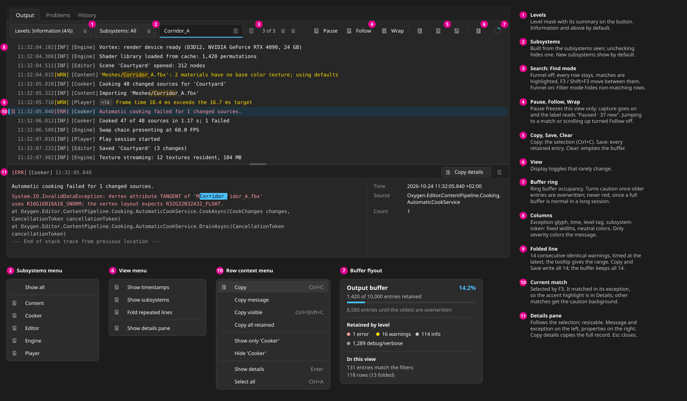

# Proposal: OutputConsole Enhancements

**Status:** `Proposed`
**Area:** `DroidNet.Controls.OutputConsole`, `Oxygen.Editor.Output`,
`DroidNet.Bootstrap`, `Oxygen.Editor.Interop`
**Target:** Oxygen Editor V0.1

The Output panel becomes a log tool a developer can work in: every line says
which subsystem wrote it, errors open into their stack traces, and anything on
screen can be copied or saved. Capture and display are rebuilt so a long session
at engine `Verbose` stays smooth and selection survives a full buffer.



## 1. User scenarios

| #   | Scenario                                                                                                                                                                               | What the console must do                                                                                                   |
| --- | -------------------------------------------------------------------------------------------------------------------------------------------------------------------------------------- | -------------------------------------------------------------------------------------------------------------------------- |
| S1  | A cook fails. The developer finds the error line, opens its stack trace, and pastes the error with its trace into an issue.                                                            | Subsystem token on each line; exception glyph; details pane; `Ctrl+C` copies the line and its exception.                   |
| S2  | The engine runs at `Verbose` for an hour while the developer plays the scene. They scroll back to a warning from ten minutes ago, select it and copy it while new lines keep arriving. | Appends never rebuild the list; selection and scroll position survive eviction; following stops when the user scrolls up.  |
| S3  | A render-loop warning repeats 60 times a second and buries everything else.                                                                                                            | Consecutive duplicates fold into one row with a `×N` badge; nothing is dropped from the buffer.                            |
| S4  | The developer only cares about the cooker right now, then wants the engine lines around one cooker error.                                                                              | Subsystems filter; "Show only" and "Hide" from the row menu; Find mode jumps between matches without hiding context.       |
| S5  | A tester attaches the full log to a bug report.                                                                                                                                        | Save writes every retained entry, whatever the filters; the buffer flyout says whether older entries were already evicted. |
| S6  | The developer pauses the stream to read, then resumes.                                                                                                                                 | Pause freezes this view only; capture continues; the Pause button counts what arrived meanwhile; resume shows it all.      |

## 2. Today's code and its defects

All paths are under
[projects/Controls/OutputConsole/src](../../../projects/Controls/OutputConsole/src)
unless stated.

| #   | Fact (verified in code)                                                                                                                                                                                                                                                        | Consequence                                                                                                                                                                                                      |
| --- | ------------------------------------------------------------------------------------------------------------------------------------------------------------------------------------------------------------------------------------------------------------------------------ | ---------------------------------------------------------------------------------------------------------------------------------------------------------------------------------------------------------------- |
| D1  | `OutputLogBuffer.Append` raises `Reset` instead of `Add` whenever the buffer is full ([OutputLogBuffer.cs](../../../projects/Controls/OutputConsole/src/Model/OutputLogBuffer.cs) `Append`, `wasRotation`).                                                                    | Once 10,000 entries are retained, every append triggers `RebuildView`, sampled every 100 ms: the view clears and re-adds up to 10,000 rows ten times a second, losing the selection each time. S2 is impossible. |
| D2  | `RebuildView` calls `viewItems.Clear()` then `Add` per entry ([OutputConsoleView.xaml.cs](../../../projects/Controls/OutputConsole/src/Controls/OutputConsoleView.xaml.cs) `RebuildView`).                                                                                     | One `CollectionChanged` per row on every filter keystroke and every rotation.                                                                                                                                    |
| D3  | `Append` raises `CollectionChanged` and two `PropertyChanged` events synchronously on the producer thread, which includes the engine's logging thread through the interop log handler.                                                                                         | Every native log line allocates three event-args objects and runs view code (Rx buffer lock) on the engine thread. Any UI binding to `Count` would be updated off the UI thread.                                 |
| D4  | `ContainerContentChanging`, `ApplyViewOptions` and `RefreshHighlights` find `TimestampBlock`/`MessageBlock` with a recursive `VisualTreeHelper` walk; `ApplyViewOptions` and `RefreshHighlights` loop over all `List.Items.Count` (up to 10,000) calling `ContainerFromIndex`. | Tree walks per realized row while scrolling; O(n) loops on every option toggle.                                                                                                                                  |
| D5  | `ApplyHighlight` clears `Inlines` and creates `Run`s for every realized row, and `DimBrush` allocates a new `SolidColorBrush` per Verbose/Debug row.                                                                                                                           | Allocation and text re-layout on every realization even with no filter.                                                                                                                                          |
| D6  | `ScrollToBottom` calls `List.UpdateLayout()` on each appended batch.                                                                                                                                                                                                           | Forced synchronous layout up to 60 times a second.                                                                                                                                                               |
| D7  | `PassesFilter` uses `CurrentCultureIgnoreCase`, calls `TextFilter.Trim()` per entry, and calls `Exception.ToString()` per entry with an exception on every rebuild; each keystroke rebuilds.                                                                                   | Culture-aware compare is several times slower than ordinal; stack traces are re-rendered on every keystroke.                                                                                                     |
| D8  | `OutputLogBuffer.IsPaused` is buffer state, so pausing one view pauses every view of the shared buffer.                                                                                                                                                                        | Pause is not a view concern today; a second console on the same buffer would freeze too.                                                                                                                         |
| D9  | `BufferedSink` sets `Source` to Serilog's `SourceContext`, which for `ILogger<T>` is the full type name (`Oxygen.Editor.Cooking.CookingService`). Only the engine (`Oxygen.Engine`), the player (`Player`) and operation results (`OperationResult`) have short sources.       | `Source` is not a subsystem; showing it as a token or listing it in a filter menu gives hundreds of distinct values.                                                                                             |
| D10 | The interop `LogHandler::HandleLog` composes loguru's preamble into the message text; the engine enables `g_preamble_thread` and `g_preamble_file` ([Logging.cpp](../../../projects/Oxygen.Engine/src/Oxygen/EditorInterface/Logging.cpp)).                                    | Every engine line starts with `[thread] file.cpp:123` text, which the new columns would duplicate and which cannot be filtered or copied separately.                                                             |
| D11 | `OnFindNextAccelerator`/`OnFindPrevAccelerator` move the selection to the next or previous row, whether or not it matches.                                                                                                                                                     | `F3` is a row stepper, not a find.                                                                                                                                                                               |
| D12 | `OutputLogEntry.RepeatCount` is a mutable property nothing reads or writes.                                                                                                                                                                                                    | Dead state on an otherwise immutable record.                                                                                                                                                                     |
| D13 | `CommandBar` has `IsDynamicOverflowEnabled="False"`.                                                                                                                                                                                                                           | In a narrow dock the right-hand commands are clipped instead of moving to the overflow menu.                                                                                                                     |
| D14 | `PlayerLogOutput.OnLogReceived` calls `buffer.Clear()` when the player raises `PlayerLogEventArgs.SessionStarted()` ([PlayerLogOutput.cs](../../../projects/Oxygen.Editor.Output/src/PlayerLogOutput.cs)).                                                                     | Pressing Play erases every editor, engine and cooker line from the shared buffer, including the errors that led to the play.                                                                                     |

The control has two kinds of sources, and both stay supported:

- the shared `OutputLogBuffer` (Output panel, DemoApp), fed from any thread;
- an `ObservableCollection<OutputLogEntry>` changed on the UI thread (each cook
  run's transcript in `CookingRunViewModel.Output`, shown by `CookOutput` in
  `CookingPanelView.xaml` with the toolbar collapsed and `IsScrollEnabled` off).

## 3. Decisions

1. **Producers never notify.** `OutputLogBuffer.Append` takes a short lock,
   writes into a fixed array ring and returns. It raises at most one
   `EntriesAvailable` event per drain cycle (the first append after a view has
   drained). Views pull new entries on the UI thread. Rationale: removes D1 and
   D3 at the root; producer cost is O(1) and independent of the number of views.
2. **Eviction is incremental.** Each view tracks the sequence numbers it shows;
   when the buffer evicts, the view removes only its rows older than the first
   retained sequence, from the head. A full rebuild happens only when a filter
   changes, after `Clear`, or when more entries arrived than the buffer holds.
   Rationale: S2; selection and scroll position survive.
3. **Rebuilds swap, never clear-and-add.** A rebuild computes the new row list
   and assigns a new `ObservableCollection` to `List.ItemsSource`. Rationale: one
   notification instead of N (D2).
4. **A subsystem is its own field, resolved by a host-supplied map.**
   `OutputLogEntry` gains `Subsystem`. `OutputLogBuffer` sets it on `Append`
   from `Source`, through the `SubsystemMap` its creator must pass; the control
   contains no map, no default map and no fallback rule. Producers only set
   `Source`. `Source` keeps the full producer name and is shown in the details
   pane. Rationale: D9; a short, stable set of tokens and filter entries, owned
   by the application that knows its own subsystems; one resolution point for
   Serilog and direct producers alike.
5. **Subsystem tokens are neutral.** `[Engine]` in `TextFillColorSecondaryBrush`,
   normal weight, in a fixed-width column. No per-subsystem colors. Rationale:
   color is reserved for severity; a rainbow console competes with warnings and
   errors.
6. **Severity is a three-letter tag** (`VRB DBG INF WRN ERR FTL`, Serilog's
   `u3`) in its own column, and the message text takes the severity color for
   Warning, Error and Fatal. Rationale: the tag survives color blindness and
   copying; `INF` stays secondary so the most common level does not draw the
   eye.
7. **Pause is per view.** `OutputLogBuffer.IsPaused` is removed. A paused view
   stops draining; the buffer keeps capturing. Rationale: D8; S6.
8. **Folding is a view projection.** Consecutive entries in the filtered stream
   with the same level, subsystem, source and message, and no exception, fold
   into one row with a `×N` badge. No time window. Entries with exceptions never
   fold. Rationale: S3 without data loss; same behavior as browser consoles; a
   time window would make folding depend on timing.
9. **Details live in a docked pane, not inline.** Opening details on a row shows
   a pane below the list that follows the selection until closed. Rationale: an
   inline drawer fights virtualization and covers neighbouring rows; a pane
   updates with arrow keys (same pattern as the Unity console).
10. **Copy expands folds; Copy is lines plus exceptions.** The plain-text line
    format excludes properties (for Serilog entries they repeat the message
    arguments and `SourceContext`); the details pane's **Copy details** copies the
    complete record. Rationale: pasted logs stay readable; the full record is one
    click away.
11. **Save writes every retained entry**, whatever the filters. Rationale: S5;
    filtered subsets are covered by **Copy visible**.
12. **Find and Filter are two modes of the one search box.** Filter (default)
    hides non-matching rows; Find keeps all rows, highlights matches and moves
    between matching rows with `F3`/`Shift+F3`. Rationale: S4; fixes D11.
13. **Highlighting uses `TextBlock.TextHighlighters`**, never `Run`s. Message
    text is always assigned through `TextBlock.Text`. Rationale: D5.
14. **Follow uses the panel's scroll mode.** While following,
    `ItemsStackPanel.ItemsUpdatingScrollMode` is `KeepLastItemInView`;
    otherwise `KeepItemsInView`. `UpdateLayout` is never called. Rationale: D6;
    head removals do not move what the user is reading.
15. **Text matching is `OrdinalIgnoreCase`**, debounced 150 ms after typing, and
    an entry's exception text is rendered once and cached. Rationale: D7.
16. **Engine lines carry thread and file as properties.** The interop log
    handler stops composing loguru's preamble into the message and passes
    `Thread`, `File` and `Line` as structured state. Rationale: D10.
17. **Only the user's Clear removes entries.** The Clear button empties the
    shared buffer, as today; capacity eviction is the only other way an entry
    leaves it, and the buffer flyout counts it. No producer clears the buffer: a
    player session start appends a `Play session started` line instead (D14).
    Rationale: the lines before a play are often why the user is looking.
18. **Levels and Subsystems keep their own dropdowns** with a summary label;
    display options move to an icon-only **View** menu. Rationale: the filter
    state must be readable on the toolbar at a glance; display options rarely
    change.

## 4. Capture path

```text
 Serilog loggers ──► BufferedSink ─┐   (any thread)
 PlayerLogOutput ──────────────────┤   Append(entry): lock, ring write,
 OperationResultOutputLogAdapter ──┘   assign Sequence, update counters
                                   │
                                   ▼
                     OutputLogBuffer (ring, capacity N)
                                   │  EntriesAvailable  (≤ 1 per drain cycle)
                                   ▼
            OutputConsoleView: DispatcherQueue.TryEnqueue(Drain)
                                   │  (UI thread)
                                   ▼
          buffer.ReadSince(lastSequence) ──► OutputLogProjection
            (new entries + first retained      filter → fold → row ops
             sequence)                                │
                                                      ▼
                         ObservableCollection<OutputLogRow> ──► ListView
```

### 4.1 `OutputLogEntry` (Model/OutputLogEntry.cs)

| Member                                     | Change                                                                                                                                                                                                    |
| ------------------------------------------ | --------------------------------------------------------------------------------------------------------------------------------------------------------------------------------------------------------- |
| `string? Subsystem { get; internal set; }` | **New.** Short subsystem name (`Engine`, `Editor`, `Cooker`, `Player`), set by `OutputLogBuffer.Append` from its map (4.3). `null` when the map has no match, and for entries never appended to a buffer. |
| `long Sequence { get; internal set; }`     | **New.** Assigned by `OutputLogBuffer.Append`, starting at 1, strictly increasing for the buffer's lifetime (not reset by `Clear`). `0` for entries never appended to a buffer.                           |
| `string? ExceptionText`                    | **New**, get-only. `Exception?.ToString()`, computed on first read and cached in a private field. Used by the filter, the formatter and the details pane.                                                 |
| `int RepeatCount`                          | **Removed** (D12). Fold counts live on `OutputLogRow`.                                                                                                                                                    |
| `Source`, `Channel`, other members         | Unchanged. `Source` is the full producer name.                                                                                                                                                            |

`Sequence` and `Subsystem` have `internal` setters; the buffer is the only
writer.
An entry must be appended to at most one buffer; `Append` throws
`ArgumentException` when `entry.Sequence != 0`.

### 4.2 `OutputLogBuffer` (Model/OutputLogBuffer.cs)

Rewrite as a ring over `OutputLogEntry[]` with `head` and `count` fields. The
class no longer implements `INotifyCollectionChanged` or
`INotifyPropertyChanged`; it keeps `IEnumerable<OutputLogEntry>` (snapshot
enumeration, oldest first). Nothing outside the control and its tests
subscribes to the removed events (checked with `rg` across `projects/`).

| Member                                                                         | Contract                                                                                                                                                                                                                                                                                                                                                                                                                                                              |
| ------------------------------------------------------------------------------ | --------------------------------------------------------------------------------------------------------------------------------------------------------------------------------------------------------------------------------------------------------------------------------------------------------------------------------------------------------------------------------------------------------------------------------------------------------------------- |
| `OutputLogBuffer(SubsystemMap subsystems, int capacity = 10000)`               | `subsystems` is required (`ArgumentNullException.ThrowIfNull`); capacity validation unchanged. Exposed as `SubsystemMap Subsystems`.                                                                                                                                                                                                                                                                                                                                  |
| `int Capacity`, `int Count`                                                    | Unchanged meaning; `Count` read under the lock.                                                                                                                                                                                                                                                                                                                                                                                                                       |
| `void Append(OutputLogEntry entry)`                                            | Before the lock: `entry.Subsystem = this.Subsystems.Resolve(entry.Source)` (the map is immutable, so resolution needs no lock). Under the lock: if full, overwrite the oldest slot, increment `EvictedCount`, decrement that entry's level and subsystem counters; write the entry; set `entry.Sequence = ++lastSequence`; increment counters. After the lock: if `Interlocked.Exchange(ref signaled, 1) == 0`, raise `EntriesAvailable`. Never raises anything else. |
| `long LastSequence`                                                            | Sequence of the newest entry ever appended (`Volatile.Read`).                                                                                                                                                                                                                                                                                                                                                                                                         |
| `OutputLogRead ReadSince(long afterSequence)`                                  | Under the lock: first sets `signaled = 0`, then returns the entries with `Sequence > afterSequence` (oldest first, as a new array), `FirstRetainedSequence` (sequence of the oldest retained entry, or `LastSequence + 1` when empty) and `ClearGeneration`. O(returned).                                                                                                                                                                                             |
| `OutputLogEntry[] Snapshot()`                                                  | All retained entries, oldest first.                                                                                                                                                                                                                                                                                                                                                                                                                                   |
| `void Clear()`                                                                 | Under the lock: empty the ring, zero the counters (not `LastSequence`), increment `ClearGeneration`. Then raise `EntriesAvailable` the same way as `Append`.                                                                                                                                                                                                                                                                                                          |
| `OutputLogStatistics GetStatistics()`                                          | Snapshot record: `Capacity`, `Count`, `EvictedCount` (since the last `Clear`), `CountsByLevel` (`int[6]` indexed by `LogEventLevel`), `Subsystems` (name → retained count, sorted by name; entries without a subsystem under `null`).                                                                                                                                                                                                                                 |
| `event EventHandler? EntriesAvailable`                                         | Raised on the producer thread, at most once until the next `ReadSince`. Handlers must only schedule work (no reads, no UI).                                                                                                                                                                                                                                                                                                                                           |
| `IsPaused`, `BeginUpdate`, `EndUpdate`, `CollectionChanged`, `PropertyChanged` | **Removed.**                                                                                                                                                                                                                                                                                                                                                                                                                                                          |

`OutputLogRead` is a `readonly record struct (OutputLogEntry[] Entries, long
FirstRetainedSequence, int ClearGeneration)`. A view that sees a new
`ClearGeneration` rebuilds.

Several views may share one buffer. Every raise reaches every subscribed view,
and any view's `ReadSince` re-arms the event, so the next append after any read
notifies all views again; no view can miss entries. Each view coalesces its own
drains:

```csharp
private void OnEntriesAvailable(object? sender, EventArgs e)
{
    if (Interlocked.Exchange(ref this.drainQueued, 1) == 0)
    {
        _ = this.DispatcherQueue.TryEnqueue(this.Drain);
    }
}
```

`Drain` starts with `Volatile.Write(ref this.drainQueued, 0)` before it calls
`ReadSince`, so an event raised during the drain queues the next one.

### 4.3 Subsystem assignment

The application that sets up the console owns its subsystem names. The control
ships the `SubsystemMap` type and nothing else: no built-in map, no default, no
fallback rule.

`SubsystemMap` (new, `src/Model/SubsystemMap.cs`, `public sealed`):

- constructed from `IEnumerable<KeyValuePair<string, string>>` of
  `(prefix, subsystem)` pairs; throws `ArgumentException` on an empty or
  duplicate prefix or an empty subsystem; copies and sorts the pairs by prefix
  length, longest first, and is immutable afterwards;
- `string? Resolve(string? source)` returns the subsystem of the longest prefix
  that equals `source` or is followed by `.` in `source` (so `Oxygen.Editor`
  matches `Oxygen.Editor.Output.X` but not `Oxygen.EditorTools`), compared
  ordinally; `null` when nothing matches or `source` is `null`/empty;
- `IReadOnlyList<KeyValuePair<string, string>> Entries`, for tests and
  diagnostics.

`OutputLogBuffer.Append` calls `Resolve(entry.Source)` (after the
`Sequence != 0` check) and stores the result in `entry.Subsystem`. Every
producer therefore only sets `Source`:

| Producer                                 | `Source`                                                   | Where                                                                                                                                |
| ---------------------------------------- | ---------------------------------------------------------- | ------------------------------------------------------------------------------------------------------------------------------------ |
| Serilog events (`BufferedSink`)          | `SourceContext` (unchanged)                                | [BufferedSink.cs](../../../projects/Controls/OutputConsole/src/Sinks/BufferedSink.cs)                                                |
| Engine (`ILogger` category, via Serilog) | `Oxygen.Engine` (`EngineConstants.LogCategory`)            | unchanged                                                                                                                            |
| Player                                   | `Player` (`PlayerLogOutput.PlayerSource`, unchanged)       | [PlayerLogOutput.cs](../../../projects/Oxygen.Editor.Output/src/PlayerLogOutput.cs)                                                  |
| Operation results                        | `OperationResult` (unchanged)                              | [OperationResultOutputLogAdapter.cs](../../../projects/Oxygen.Editor.Composition/src/Diagnostics/OperationResultOutputLogAdapter.cs) |
| Cook run transcripts (collection source) | none; never appended to a buffer, so `Subsystem` is `null` | unchanged `CookingRunViewModel`; the panel hides the column                                                                          |

**Where the map is passed.** The map goes to whoever creates the buffer:

- through Bootstrap, `BootstrapOptions.WithOutputConsole(object subsystems, …)` takes the map as its new **first, required**
  parameter (`ArgumentNullException.ThrowIfNull`). Bootstrap does not reference
  the control, so the parameter is typed `object` and stored as
  `OutputConsoleSubsystems`; its XML doc names `SubsystemMap`.
  `LoggerSinkConfigurationOutputConsoleExtensions.OutputConsole` gains a
  `SubsystemMap subsystems` parameter after `container` and passes it to
  `new OutputLogBuffer(subsystems, capacity)`. `Bootstrapper.ConfigureOutputConsole`
  finds that method **by reflection with an exact parameter-type list**: it
  resolves the type from the loaded assembly
  (`assembly.GetType("DroidNet.Controls.OutputConsole.Model.SubsystemMap")`),
  inserts it into the type list after `IContainer`, and inserts the stored map
  into the argument list at the same position. If the stored object is not a
  `SubsystemMap`, throw `ArgumentException` naming the parameter. If the method
  lookup fails, the bootstrapper silently skips the console, so the bootstrap
  test must assert that the buffer is registered;
- directly, `new OutputLogBuffer(map, capacity)` (DemoApp view models, tests).

**The editor's map** is `EditorOutputSubsystems.Map` (new, `public static`, in
[Oxygen.Editor.Composition/src/Diagnostics](../../../projects/Oxygen.Editor.Composition/src/Diagnostics),
next to `OperationResultOutputLogAdapter`, namespace
`Oxygen.Editor.Diagnostics`). The editor's `Program.cs` passes it
when it sets up the host: `.WithOutputConsole(EditorOutputSubsystems.Map)`. The
composition tests' `EditorScopes` registers
`new OutputLogBuffer(EditorOutputSubsystems.Map)` so tests see the editor's
subsystems.

| Prefix                                  | Subsystem | Example source                                              |
| --------------------------------------- | --------- | ----------------------------------------------------------- |
| `Oxygen.Engine`                         | `Engine`  | the interop log handler (`EngineConstants.LogCategory`)     |
| `Oxygen.Editor.ContentPipeline.Cooking` | `Cooker`  | `AutomaticCookService`                                      |
| `Oxygen.Editor.Cooking`                 | `Cooker`  | the Cooking panel                                           |
| `Oxygen.Editor.ContentPipeline`         | `Content` | import, mounting, catalog                                   |
| `Oxygen`                                | `Editor`  | every other `Oxygen.Editor.*` and `Oxygen.Managed.*` logger |
| `DroidNet`                              | `Editor`  | Aura, routing, controls                                     |
| `OperationResult`                       | `Editor`  | `OperationResultOutputLogAdapter`                           |
| `Player`                                | `Player`  | `PlayerLogOutput`                                           |

So the editor shows five subsystems: `Engine`, `Cooker`, `Content`, `Editor`
and `Player`. A source the map does not cover (a third-party library's
logger) has no subsystem and is listed as `Other`. The DemoApp's
`Program.cs` passes its own small map (`DroidNet` → `Demo`).

### 4.3.1 Player session start (D14)

`PlayerLogOutput.OnLogReceived` no longer calls `buffer.Clear()`. On a session
start it appends:

```csharp
new OutputLogEntry
{
    Timestamp = args.Timestamp,
    Level = LogEventLevel.Information,
    Source = PlayerSource,
    Message = "Play session started",
}
```

so each session's lines start under a visible marker. In
[PlayerLogEventArgs.cs](../../../projects/Oxygen.Editor.LivePreview/src/Play/PlayerLogEventArgs.cs)
the `clear` parameter and `Clear` property become `sessionStart` /
`IsSessionStart`, documented as "a new session starts here"; the
`SessionStarted()` factory keeps its name. Update the class summary, the
`PlayerLogOutput` summary ("a new session's start clears the buffer")
and its test `SessionStartClearsTheOutput`, which becomes
`SessionStartMarksTheOutput`: an earlier editor line survives and the marker
follows it.

### 4.4 Engine log handler (D10)

In
[EngineRunner_logging.cpp](../../../projects/Oxygen.Editor.Interop/src/EngineRunner_logging.cpp)
`LogHandler::HandleLog`:

- stop prepending `message.preamble`; keep the indentation and prefix handling;
- log with a state object implementing
  `IReadOnlyList<KeyValuePair<String^, Object^>>` holding
  `{OriginalFormat}` = `"{Message:l}"`, `Message` = the composed text,
  `Thread` = the thread name (from `loguru::get_thread_name`), `File` = the file
  name without directories (`message.filename`), `Line` = `message.line`.
  Serilog's `Microsoft.Extensions.Logging` bridge turns these into event
  properties, so they appear in the details pane and the message stays clean.
  The text goes in a property, never in `{OriginalFormat}`: engine text that
  contains `{` would otherwise be parsed as a message template. `:l` renders
  the string without quotes.

The engine's own preamble flags stay as they are; they still serve the engine's
file and console logs.

## 5. View pipeline

### 5.1 Row model

`OutputLogRow` (new, `src/Controls/OutputLogRow.cs`, `public sealed`):

| Member                                  | Meaning                                                                                                          |
| --------------------------------------- | ---------------------------------------------------------------------------------------------------------------- |
| `OutputLogEntry First`                  | The first entry of the row.                                                                                      |
| `OutputLogEntry Last`                   | The latest entry folded into the row (`First` when not folded).                                                  |
| `IReadOnlyList<OutputLogEntry> Entries` | All entries of the row, oldest first. A single-entry row returns a one-element list without allocating a `List`. |
| `int Count`                             | `Entries.Count`.                                                                                                 |
| `long FirstOrdinal`, `long LastOrdinal` | Ordinals of `First` and `Last` (see 5.2).                                                                        |

Rows are created and mutated only by `OutputLogProjection`. The only mutations
are appending an entry to the tail row (fold) and removing entries from the
head row (eviction).

### 5.2 Projection (`src/Controls/OutputLogProjection.cs`, `internal sealed`)

A UI-free class holding the filter state and the current `List<OutputLogRow>`.
Unit-tested without XAML.

- **Ordinals.** For a buffer source the ordinal is `entry.Sequence`. For a
  collection source the view's adapter numbers entries `1, 2, 3…` in collection
  order; a `Remove`, `Replace`, `Move` or `Reset` on the collection triggers a
  rebuild with fresh ordinals.
- **`Rebuild(IEnumerable<(long Ordinal, OutputLogEntry Entry)>)`** returns the
  new row list.
- **`Append(entries, firstRetainedOrdinal)`** returns a `ProjectionDelta`:
  `RemovedFromHead` (row count to remove at index 0), `HeadChanged` (head row
  lost entries but survives), `TailChanged` (tail row gained folded entries),
  `Added` (new rows, in order). Steps, in order:
  1. Evict: drop rows with `LastOrdinal < firstRetainedOrdinal`; trim entries
     with ordinal `< firstRetainedOrdinal` from the head row.
  2. For each new entry that passes the filter: fold it into the tail row if
     folding is on and the fold key matches; otherwise start a new row.
- **Fold key:** `Level`, `Subsystem`, `Source`, `Message` equal (ordinal), and
  both entries have `Exception == null`.
- **Filter:** level in `LevelFilter`; subsystem not in `HiddenSubsystems`
  (`null` subsystem is shown unless `HiddenSubsystems` contains the empty
  string, which the menu labels "Other"); in Filter mode, the trimmed text
  (trimmed once per filter change) occurs, `OrdinalIgnoreCase`, in `Message`,
  `Subsystem`, `Source`, `Channel` or `ExceptionText`.

### 5.3 Applying a delta (UI thread)

`OutputConsoleView.Drain()`:

1. `Volatile.Write(ref drainQueued, 0)`. If the view is paused, return (see
   below).
2. `read = buffer.ReadSince(lastSequence)`. If `read.ClearGeneration` differs
   from the last one seen, or `read.Entries.Length >= 1024` (a burst, or the
   view fell behind), rebuild from `buffer.Snapshot()`, set `lastSequence` to
   the snapshot's last sequence, and go to step 5.
3. `delta = projection.Append(read.Entries, read.FirstRetainedSequence)`; set
   `lastSequence` to the last entry's `Sequence` (unchanged when none).
4. `viewItems.RemoveAt(0)` `RemovedFromHead` times; re-bind the realized
   containers at index 0 if `HeadChanged` and at the last index if
   `TailChanged` (`List.ContainerFromIndex`; `null` when not realized); add the
   `Added` rows.
5. Update the buffer button and, if open, the buffer flyout from
   `buffer.GetStatistics()`.

**Pause.** While `IsPaused` is true, a 500 ms `DispatcherQueueTimer` sets the
Pause button's label to `Paused · 37 new` from
`buffer.LastSequence - lastSequence`. Unpausing stops the timer, restores the
label `Pause` and calls `Drain` at once.

A rebuild (`RebuildView`) assigns `viewItems = new ObservableCollection<…>(rows)`
and `List.ItemsSource = viewItems`, restores selection by entry identity (5.6),
and either scrolls to the end (following) or restores the vertical offset.

For a collection source, `CollectionChanged` `Add` events (UI thread) feed
`projection.Append` directly with ordinals continuing from the last one;
everything else rebuilds.

### 5.4 Row presentation

`OutputLogRowView` (new, `src/Controls/OutputLogRowView.cs`, `internal sealed`,
derives from `Grid`) builds its children in its constructor; the item template
is only `<local:OutputLogRowView />`, with no bindings. Columns (no
`ColumnSpacing`; spacing is in each column's width so a collapsed column takes
no space):

| Column     | Width                             | Content                                                                                                                                                                                                                                                          |
| ---------- | --------------------------------- | ---------------------------------------------------------------------------------------------------------------------------------------------------------------------------------------------------------------------------------------------------------------- |
| Gutter     | 18 px                             | `FontIcon` `` (Bug), 12 px, critical brush, when `Last.Exception != null`; tooltip "Has an exception. Press Enter for details."                                                                                                                                 |
| Timestamp  | 12 chars + 8 px, or 0 when hidden | `Last.Timestamp` as `HH:mm:ss.fff`, tertiary brush.                                                                                                                                                                                                              |
| Level      | 5 chars + 8 px                    | `[INF]` etc., brush per 5.5.                                                                                                                                                                                                                                     |
| Subsystem  | longest token chars + 8 px, or 0  | `[Cooker]`, secondary brush; tokens longer than 16 characters are cut with `CharacterEllipsis`.                                                                                                                                                                  |
| Fold badge | Auto, or 0 when `Count == 1`      | `Border` (corner radius 4, `ControlFillColorSecondaryBrush`, padding 4,0) with `×14`, caption size, secondary text; tooltip "14 occurrences from 11:32:05.100 to 11:32:07.412". Placed before the message so long unwrapped messages cannot push it out of view. |
| Message    | `*`                               | `TextBlock`, `Text = First.Message`, wrapping per `WordWrap`, brush per 5.5, `TextHighlighters` per 6.3.                                                                                                                                                         |

"chars" means the advance width of `0` in the list's font, measured once per
font change into a `ConsoleColumns` record (char width, the three widths, the
visibility flags). `OutputLogRowView.Bind(OutputLogRow row, ConsoleColumns
columns, ConsoleBrushes brushes)` sets everything.

`ContainerContentChanging`: `args.ItemContainer.ContentTemplateRoot` is the
`OutputLogRowView`; call `Bind` in phase 0, set `args.Handled = true`; when the
search text is non-empty, register phase 1 with `args.RegisterUpdateCallback`
and apply highlighters there (fast scrolling shows plain text first).

Option changes (`ShowTimestamps`, `ShowSubsystem`, `WordWrap`, theme, new
longest subsystem) rebuild `ConsoleColumns`/`ConsoleBrushes` and re-bind only
realized containers: indices `FirstCacheIndex..LastCacheIndex` of the
`ItemsStackPanel` (`List.ItemsPanelRoot`). There is no `FindDescendant`
anywhere in the item path.

List settings: `FontFamily="Consolas"`, `FontSize="12"`, item `MinHeight="20"`,
`Padding="4,0"`, `SelectionMode="Extended"`, recycling `ItemsStackPanel`, no
item transitions (as today).

### 5.5 Brushes

Resolved from the control's theme dictionary on load and on
`ActualThemeChanged`, cached in `ConsoleBrushes`; never allocated per row.

| Level          | Tag brush                      | Message brush                  |
| -------------- | ------------------------------ | ------------------------------ |
| Verbose, Debug | `TextFillColorTertiaryBrush`   | `TextFillColorTertiaryBrush`   |
| Information    | `TextFillColorSecondaryBrush`  | `TextFillColorPrimaryBrush`    |
| Warning        | `SystemFillColorCautionBrush`  | `SystemFillColorCautionBrush`  |
| Error, Fatal   | `SystemFillColorCriticalBrush` | `SystemFillColorCriticalBrush` |

Timestamps use `TextFillColorTertiaryBrush`, subsystem tokens
`TextFillColorSecondaryBrush`. All text uses normal weight.

## 6. Filtering and search

### 6.1 Levels dropdown

Unchanged behavior: `LevelsDropDown` with six `ToggleMenuFlyoutItem`s and the
summary `Levels: Information (4/6)`. Default mask stays Information and above.

### 6.2 Subsystems dropdown

`SubsystemsDropDown` (`DropDownButton`) next to Levels. Its `MenuFlyout` is
rebuilt in `Opening` from `GetStatistics().Subsystems` (buffer source) or from
the distinct subsystems of the projection's source (collection source):

- `Show all` (`MenuFlyoutItem`, clears `HiddenSubsystems`), separator;
- one `ToggleMenuFlyoutItem` per subsystem, alphabetical, checked when shown;
  entries without a subsystem appear last as `Other`.

Summary label: `Subsystems: All`, `Subsystems: Cooker` (one shown), or
`Subsystems: 3 of 5`.

New dependency property `HiddenSubsystems` (`IReadOnlyCollection<string>`,
default empty; `""` stands for Other). It is an exclusion list so a subsystem
that appears later is shown by default.

### 6.3 Search box: Filter and Find

The search box is the existing `AutoSuggestBox` (`Ctrl+F` focuses it), followed
by a `ToggleButton` `SearchModeToggle` (glyph `` Filter, checked =
Filter mode, tooltip "Hide lines that don't match"). New dependency property
`SearchMode` (`OutputSearchMode.Filter` | `Find`, default `Filter`).

- **Filter:** as today, plus the 150 ms debounce (`DispatcherQueueTimer`,
  restarted on each keystroke) before rebuild; matches are highlighted.
- **Find:** no rebuild. Matching rows are those whose message, subsystem,
  source, channel or exception text contains the text. After the debounce, one
  pass counts matches; a `TextBlock` after the box shows `3 of 3` (or
  `No results`), and two borderless icon buttons (``, ``, tooltips
  "Previous match (Shift+F3)", "Next match (F3)") move between them. `F3`, and
  `Enter` in the search box (`QuerySubmitted`), select and scroll to the next
  matching row after the selected one, wrapping; `Shift+F3` the previous. A
  match inside the exception text only is highlighted in the details pane. The current match row gets the
  selection; highlights use two `TextHighlighter`s: other matches
  `Background = SystemFillColorCautionBackgroundBrush`, the current match
  `Background = AccentFillColorDefaultBrush` with
  `Foreground = TextOnAccentFillColorPrimaryBrush`.

## 7. Selection, clipboard and export

### 7.1 Selection

`List.SelectedItems` hold `OutputLogRow`s. The public API stays in entry terms:

- `SelectedItem` (DP, `OutputLogEntry?`) is set from `List.SelectionChanged` to
  the `Last` entry of the last row in `AddedItems` (or `null` when nothing is
  selected); setting it from outside selects the row containing it;
- `CaptureSelection()` returns the entries of the selected rows, ordered by
  ordinal (not by click order);
- `RestoreSelection(entries)` builds a `HashSet` of the entries and selects the
  rows containing any of them (O(rows)).

The cooking panel's reading-position code
([CookingPanelView.Reading.cs](../../../projects/Oxygen.Editor.Cooking/src/CookingPanelView.Reading.cs))
keeps working unchanged.

### 7.2 Plain-text format (`src/Controls/OutputLogFormatter.cs`, `internal static`)

```text
2026-10-24 11:32:05.840 [ERR] [Cooker] Automatic cooking failed for 1 changed sources.
  System.IO.InvalidDataException: Vertex attribute TANGENT of 'Meshes/Corridor_A.fbx' uses R16G16B16A16_SNORM; the vertex layout expects R32G32B32A32_FLOAT.
     at Oxygen.Editor.ContentPipeline.Cooking.AutomaticCookService.CookAsync(CookChanges changes, CancellationToken cancellationToken)
```

- Timestamp `yyyy-MM-dd HH:mm:ss.fff` in the entry's captured offset,
  invariant culture.
- `[Subsystem] ` is omitted when the subsystem is `null`.
- `ExceptionText` follows on its own lines, each indented two spaces.
- Lines end with `Environment.NewLine`.
- `AppendLine(StringBuilder, OutputLogEntry)` and `Format(IEnumerable<…>)` are
  the only entry points; the details pane's record format is
  `AppendDetails(StringBuilder, OutputLogEntry)`: the line, then `Source:`,
  `Channel:`, each property as `  Key = Value` (sorted by key, values formatted
  with invariant culture), then the exception.

### 7.3 Commands

| Command           | Gesture                                   | Scope                                                                        |
| ----------------- | ----------------------------------------- | ---------------------------------------------------------------------------- |
| Copy              | `Ctrl+C`, row menu, toolbar Copy          | Selected rows; every entry of a folded row; ordered by ordinal; line format. |
| Copy message      | Row menu                                  | `Message` of each selected row, once per row, one per line.                  |
| Copy visible      | `Ctrl+Shift+C`, row menu                  | All rows in the view, folds expanded.                                        |
| Copy all retained | Row menu                                  | `buffer.Snapshot()` (buffer source) or the whole collection.                 |
| Copy details      | Details pane button                       | `AppendDetails` for the pane's entry.                                        |
| Select all        | `Ctrl+A` (built into Extended mode), menu | All rows.                                                                    |
| Show details      | `Enter`, double-click, gutter glyph, menu | Opens the details pane on the selected row.                                  |
| Show only 'X'     | Row menu                                  | Hides every subsystem except the row's.                                      |
| Hide 'X'          | Row menu                                  | Adds the row's subsystem to `HiddenSubsystems`.                              |
| Save              | Toolbar Save                              | Every retained entry, line format.                                           |

Keyboard accelerators for `Ctrl+C`, `Ctrl+Shift+C` and `Enter` are declared on
the `ListView` (not the `UserControl`), with
`KeyboardAcceleratorPlacementMode="Hidden"`, so `Ctrl+C` in the search box
still copies the search text. The existing `F3`, `Shift+F3` and `Ctrl+F`
accelerators stay on the `UserControl`.

Copy formats on the thread pool from the immutable entries
(`await Task.Run(() => OutputLogFormatter.Format(entries))`), then on the UI
thread creates a `DataPackage`, calls `SetText` and `Clipboard.SetContent`.
Entries are immutable, so formatting off-thread is safe.

### 7.4 Save

1. `var picker = new Microsoft.Windows.Storage.Pickers.FileSavePicker(this.XamlRoot.ContentIslandEnvironment.AppWindowId)`
   with `SuggestedFileName = $"output-{DateTime.Now:yyyyMMdd-HHmmss}"` and file
   types `Log file` → `.log`, `Text file` → `.txt` (the same picker family as
   Aura's `DialogService`; the control cannot depend on Aura, and Aura has no
   save picker).
2. If a path was picked: snapshot on the UI thread, then on the thread pool
   write with `File.CreateText`-equivalent `StreamWriter` (UTF-8 without BOM)
   through `OutputLogFormatter`.
3. On an `IOException` or `UnauthorizedAccessException`, show the control's
   `ErrorInfoBar` (an `InfoBar` between the toolbar and the list,
   `Severity="Error"`, closable) with "Couldn't save the output to {path}.
   {exception.Message}". There is no success message; the file is where the
   user chose.

## 8. Details pane

A second row of the control's grid, below the list, separated by a
CommunityToolkit `GridSplitter` (already used by `CookingPanelView`), initial
height 200 px, minimum 96 px, collapsed by default. New DP
`IsDetailsPaneOpen` (bool).

- **Header** (32 px): the row's tag, subsystem token and timestamp in the row
  colors, then `Copy details` (`Button` with ``, label "Copy details") and
  a close button (``, tooltip "Close details (Esc)").
- **Left, `*`:** a read-only, selectable `RichTextBlock` (Consolas 12) with the
  full message, then the exception: type and message in the critical brush,
  stack frames in the secondary brush.
- **Right, 320 px:** `Time` (`yyyy-MM-dd HH:mm:ss.fff zzz`), then `Source`,
  `Channel`, `Thread`, `File:Line` (each only when present),
  then the remaining properties except `SourceContext` and `Channel` (already
  shown), as two-column key/value text (keys tertiary, values primary, wrapping),
  sorted by key. Values render like Serilog: scalars with invariant culture,
  strings in quotes, sequences as `[a, b]`, structures and dictionaries as
  `{ Key: Value, … }`. For a folded row: `Occurrences: 14`,
  `First: 11:32:05.100`, `Last: 11:32:07.412`.

The pane follows `SelectedItem`; with several rows selected it shows the most
recently selected row (the last of `SelectionChanged.AddedItems`, which is also
what `SelectedItem` is set to). `Esc` in the list closes it.

## 9. Toolbar and flyouts

`CommandBar` with `DefaultLabelPosition="Right"` and
`IsDynamicOverflowEnabled="True"` (D13). Content (left):
`LevelsDropDown`, `SubsystemsDropDown`, `SearchBox` (`MinWidth="220"`),
`SearchModeToggle`, and in Find mode the match count and arrows. Primary
commands (right), in order:

| Name               | Control                                           | Icon                              | Label / tooltip                                                            |
| ------------------ | ------------------------------------------------- | --------------------------------- | -------------------------------------------------------------------------- |
| `PauseToggle`      | `AppBarToggleButton`                              | `Pause`                           | "Pause", or "Paused · 37 new" (5.3) / "Pause this view; capture continues" |
| `FollowTailToggle` | `AppBarToggleButton`                              | `` (Down)                        | "Follow" / "Keep the newest line in view"                                  |
| `WrapToggle`       | `AppBarToggleButton`                              | `SymbolIcon AlignLeft` (as today) | "Wrap" / "Wrap long lines"                                                 |
| separator          |                                                   |                                   |                                                                            |
| `CopyButton`       | `AppBarButton`, `LabelPosition="Collapsed"`       | `` (Copy)                        | tooltip "Copy (Ctrl+C)"                                                    |
| `SaveButton`       | `AppBarButton`, `LabelPosition="Collapsed"`       | `` (Save)                        | tooltip "Save output to a file"                                            |
| `ClearButton`      | `AppBarButton`, `LabelPosition="Collapsed"`       | `Delete`                          | tooltip "Clear the output"                                                 |
| separator          |                                                   |                                   |                                                                            |
| `ViewButton`       | `AppBarButton` with `MenuFlyout`, collapsed label | `` (View)                        | tooltip "View options"                                                     |
| `BufferButton`     | `AppBarButton` with `Flyout`, collapsed label     | 16 px determinate `ProgressRing`  | tooltip "Buffer: 14% (1,420 of 10,000)"                                    |

The Follow icon changes from `Play` to Down because Play reads as "resume" next
to Pause. `Copy` is disabled when nothing is selected. `ShowTimestampsToggle`
leaves the bar for the View menu.

**View menu:** `Show timestamps`, `Show subsystems`, `Fold repeated lines`
(`ToggleMenuFlyoutItem`s bound to `ShowTimestamps`, `ShowSubsystem`,
`FoldDuplicates`), separator, `Show details pane` (bound to
`IsDetailsPaneOpen`).

**Buffer flyout** (only when `ItemsSource` is an `OutputLogBuffer`; otherwise the
button is collapsed). Refreshed on each drain while open:

- title `Output buffer`, value `14.2%`; `1,420 of 10,000 entries retained`;
  `ProgressBar`; then `8,580 entries until the oldest are overwritten`, or,
  when `EvictedCount > 0`, `2,317 older entries overwritten since the last clear`
  in the caution brush;
- `Retained by level`: four counts (`1 error` — Error and Fatal, `16 warnings`,
  `114 info`, `1,289 debug/verbose`), each after a dot in the level's tag brush;
- `In this view`: `131 entries match the filters, shown as 118 rows (13
folded)`; when paused, `Paused: 37 new entries not shown`.

Ring color: `AccentFillColorDefaultBrush` normally; `SystemFillColorCautionBrush`
once `EvictedCount > 0`. There is no red state: a full buffer is the normal
state of a long session, and red stays reserved for errors.

**Row context menu** (`MenuFlyout` on the list's `ContextFlyout`; right-click
selects the row first if it is not selected): `Copy` (Ctrl+C), `Copy message`,
`Copy visible` (Ctrl+Shift+C), `Copy all retained`, separator, `Show only
'Cooker'`, `Hide 'Cooker'` (hidden when the row has no subsystem), separator,
`Show details` (Enter), `Select all` (Ctrl+A).

## 10. Public API changes and consumers

| Type / member                                                                                                                      | Change                                                                                                                                                                                                               |
| ---------------------------------------------------------------------------------------------------------------------------------- | -------------------------------------------------------------------------------------------------------------------------------------------------------------------------------------------------------------------- |
| `OutputConsoleView` new DPs                                                                                                        | `ShowSubsystem` (default `true`), `HiddenSubsystems`, `FoldDuplicates` (default `false`), `SearchMode`, `IsDetailsPaneOpen` (default `false`). Register in `OutputConsoleView.Properties.cs` like the existing ones. |
| `OutputConsoleView.IsPaused`                                                                                                       | Now pauses the view's drain only.                                                                                                                                                                                    |
| `OutputLogBuffer`                                                                                                                  | Per 4.2.                                                                                                                                                                                                             |
| `OutputLogEntry`                                                                                                                   | Per 4.1.                                                                                                                                                                                                             |
| `OutputViewModel` ([OutputViewModel.cs](../../../projects/Oxygen.Editor.Output/src/OutputViewModel.cs))                            | Add `ShowSubsystem`, `HiddenSubsystems`, `FoldDuplicates`, `SearchMode`, `IsDetailsPaneOpen` observable properties.                                                                                                  |
| `OutputView.xaml(.cs)`                                                                                                             | Bind the new properties two-way and extend the property-changed callbacks the same way as the existing six.                                                                                                          |
| `CookingPanelView.xaml` `CookOutput`                                                                                               | Add `ShowSubsystem="False"`.                                                                                                                                                                                         |
| `PlayerLogOutput`, `PlayerLogEventArgs`                                                                                            | Per 4.3.1.                                                                                                                                                                                                           |
| `BootstrapOptions`, `Bootstrapper`, `LoggerSinkConfigurationOutputConsoleExtensions`                                               | Required map, per 4.3.                                                                                                                                                                                               |
| `EditorOutputSubsystems` (new), editor `Program.cs`, DemoApp `Program.cs`, `EditorScopes`, every `new OutputLogBuffer(…)` in tests | Pass a map, per 4.3.                                                                                                                                                                                                 |
| DemoApp `OutputConsoleDemoView`                                                                                                    | Show every new option; add buttons that log a burst of 20,000 lines and a repeated line, for manual checks of S2 and S3.                                                                                             |
| Control README                                                                                                                     | Rewrite the features, API and threading sections for the new model.                                                                                                                                                  |

## 11. Files

| File (under `projects/Controls/OutputConsole/src/`)      | Content                                                                                   |
| -------------------------------------------------------- | ----------------------------------------------------------------------------------------- |
| `Model/OutputLogEntry.cs`                                | 4.1                                                                                       |
| `Model/OutputLogBuffer.cs`                               | 4.2                                                                                       |
| `Model/OutputLogRead.cs`, `Model/OutputLogStatistics.cs` | The read and statistics records.                                                          |
| `Model/SubsystemMap.cs`                                  | 4.3                                                                                       |
| `Model/OutputSearchMode.cs`                              | The enum.                                                                                 |
| `Controls/OutputLogRow.cs`                               | 5.1                                                                                       |
| `Controls/OutputLogProjection.cs`                        | 5.2                                                                                       |
| `Controls/OutputLogRowView.cs`                           | 5.4, with `ConsoleColumns` and `ConsoleBrushes` as nested or sibling records.             |
| `Controls/OutputLogFormatter.cs`                         | 7.2                                                                                       |
| `Controls/OutputConsoleView.xaml`                        | Toolbar, InfoBar, list, splitter, details pane, menus.                                    |
| `Controls/OutputConsoleView.xaml.cs`                     | Loading, theme, scroll/follow, accelerators (trimmed of the removed code).                |
| `Controls/OutputConsoleView.Source.cs`                   | Replaces `CollectionLifetime.cs`: buffer and collection adapters, `Drain`, `RebuildView`. |
| `Controls/OutputConsoleView.Search.cs`                   | Debounce, Filter/Find, highlighters, match navigation.                                    |
| `Controls/OutputConsoleView.Clipboard.cs`                | Copy commands and Save.                                                                   |
| `Controls/OutputConsoleView.Details.cs`                  | Details pane.                                                                             |
| `Controls/OutputConsoleView.Selection.cs`                | 7.1                                                                                       |
| `Controls/OutputConsoleView.Properties.cs`               | New DPs.                                                                                  |

The Rx dependency of the view goes away with `CollectionLifetime.cs`; remove
the `System.Reactive` package reference if nothing else in the project uses it.

## 12. Tests

Follow the [MSTest guidance](../../../.github/prompts/csharp-mstest.prompt.md).

`Controls.OutputConsole.Tests` (existing; rewrite `OutputLogBufferTests` for
the new contract):

- buffer: sequences increase across `Clear`; eviction order and
  `FirstRetainedSequence`; `EvictedCount` and per-level/per-subsystem counters
  after wraparound; `EntriesAvailable` raised once until `ReadSince`;
  concurrent appends from 8 threads lose no sequence; appending an entry twice
  throws;
- `SubsystemMap`: longest prefix, the `.` boundary, ordinal comparison, no
  match and `null` source give `null`, invalid pairs throw;
- buffer: `Append` sets `Subsystem` from the map; the constructor rejects a
  `null` map;
- `OutputLogProjection`: filter by level, subsystem, Other, text in each field;
  fold key (exceptions never fold, different subsystem does not fold); eviction
  inside a folded head row; `ProjectionDelta` values for each case;
- `OutputLogFormatter`: line format with and without subsystem, exception
  indentation, details format ordering.

`Controls.OutputConsole.UI.Tests` (new, scaffolded with the
[UI scaffolding prompt](../../../.github/prompts/dn-create-test-project-ui.prompt.md)):

- appending past capacity keeps the selection and does not replace
  `List.ItemsSource`;
- a filter change replaces `List.ItemsSource` once;
- `Ctrl+C` with a folded row selected puts every entry on the clipboard; in the
  search box it does not;
- pausing stops rows from being added and the Pause badge counts; resuming adds
  them;
- toggling `ShowTimestamps` changes only realized rows' column width;
- Find mode: `F3` moves only between matching rows and wraps.

Bootstrap tests: `WithOutputConsole(map)` registers a buffer whose
`Subsystems` is that map (guards the reflection lookup in 4.3);
`WithOutputConsole(null!)` throws. Composition tests: `EditorOutputSubsystems.Map`
resolves each example source of the table in 4.3. Output module tests: a player
line resolves to `Player`; `SessionStartMarksTheOutput` (4.3.1).

## 13. Slices

Each slice builds, passes its tests and leaves the panel usable.

| Slice                       | Content                                                                                                                                                        | Done when                                                                                                                             |
| --------------------------- | -------------------------------------------------------------------------------------------------------------------------------------------------------------- | ------------------------------------------------------------------------------------------------------------------------------------- |
| 1. Capture and projection   | 4.1, 4.2, 4.3 (`SubsystemMap`, its plumbing and the editor's map; the constructor requires it), 5.1–5.5, 6.1, follow mode, per-view pause; removes D1–D8, D12. | During a DemoApp burst of 20,000 lines a selected row stays selected and the list stays scrollable; buffer and projection tests pass. |
| 2. Subsystems               | Player marker (4.3.1, D14), 4.4, subsystem column, 6.2, consumer updates.                                                                                      | Engine, editor, cooker and player lines show their tokens; engine lines have no preamble text; pressing Play keeps earlier lines.     |
| 3. Search                   | 6.3, highlighters, debounce; removes D11.                                                                                                                      | Find mode navigates matches; Filter mode no longer rebuilds per keystroke.                                                            |
| 4. Clipboard and export     | 7.1–7.4, row menu, toolbar Copy and Save, InfoBar.                                                                                                             | Every command in 7.3 works on single, multiple and folded selections.                                                                 |
| 5. Folding, details, buffer | Fold (5.2), details pane (8), View menu and buffer flyout (9), overflow (D13).                                                                                 | The mockup's states are reachable in the editor.                                                                                      |
