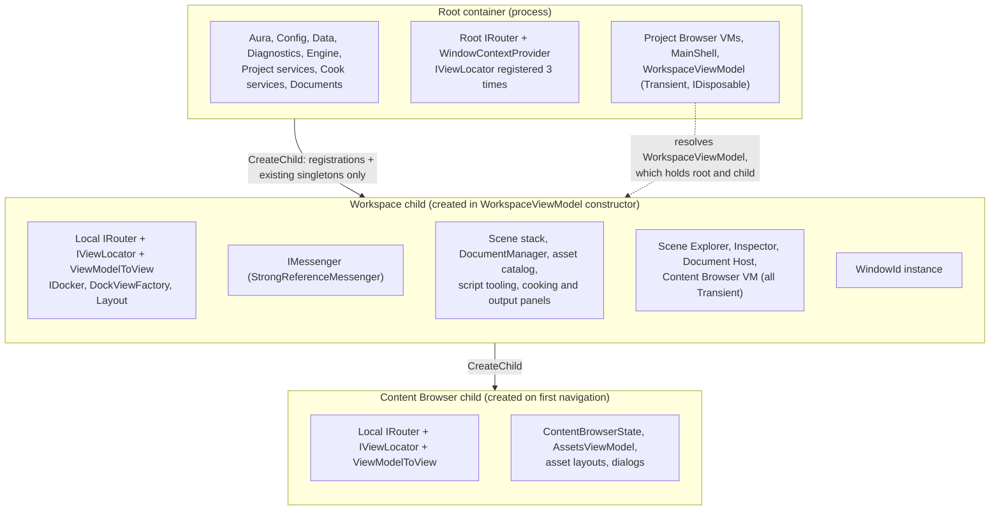
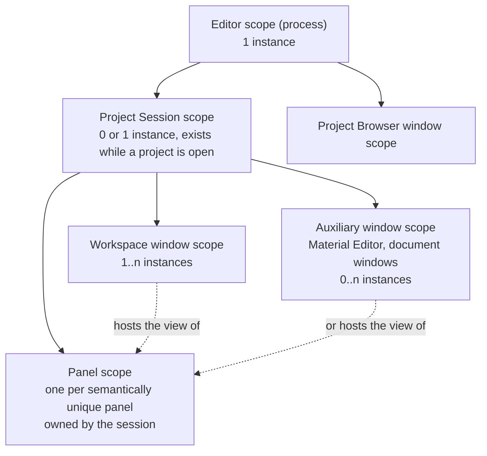
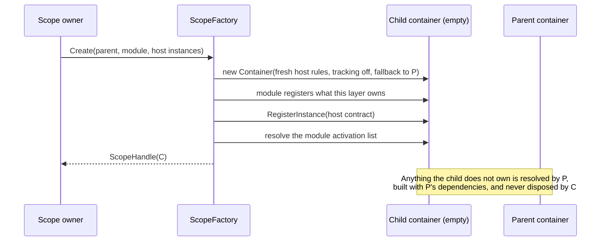
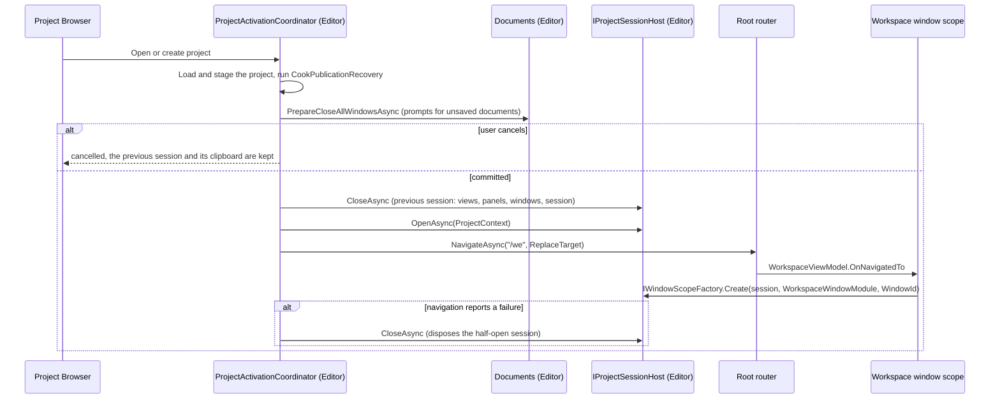
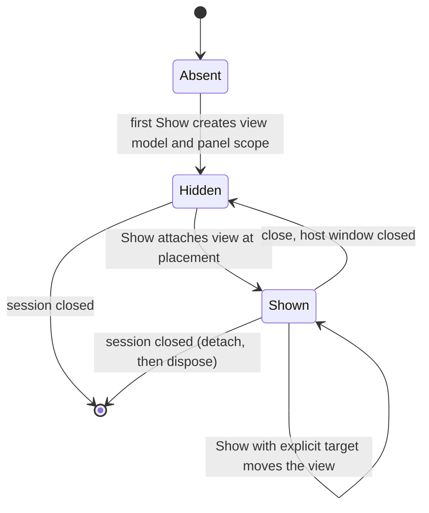
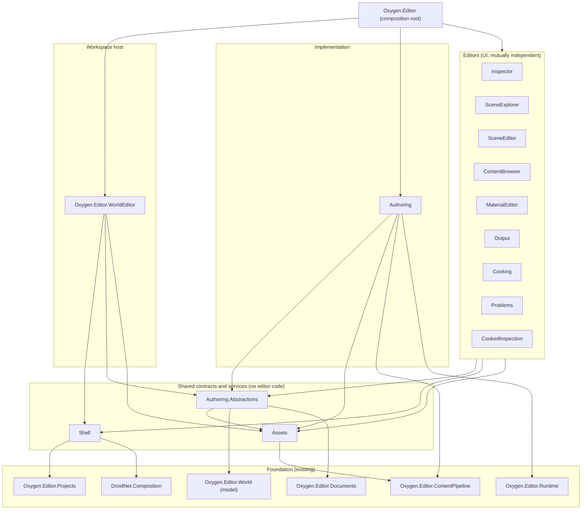

# Editor dependency-injection topology: analysis and refactoring plan

Status: **proposal, awaiting review** (no code changed)

Last Updated: 2026-10-20 01:32

Section 7 (project decomposition, rules R1 to R6) and the project lists of
section 9 Phase 1 are being replaced by the drafts
[editor-module-architecture.md](../lld/editor-module-architecture.md) and
[editor-shell.md](editor-shell.md): no `Authoring` or `Authoring.Abstractions`
projects, no World Editor host, the Shell as application frame.

Scope: how `Oxygen.Editor`, the World Editor workspace and the Content Browser
use DryIoc containers and child containers, what leaks or is duplicated between
them, and the target container topology that supports multi-window authoring.

## 1. Summary

The editor already treats a container as an isolation boundary: the workspace
and the Content Browser each create a child container so that each gets its own
router, view locator, docker and message bus. The intent is right. The
implementation relies on three DryIoc behaviors that nobody has written down,
and one of them silently produces duplicated singletons.

1. `CreateChild` copies registrations **and the singletons that already exist**
   at that instant. A root singleton that has not been created yet is created
   again inside the child. The editor works today only because other code
   happens to resolve the relevant services first, plus one hand-written
   workaround in `Program.cs`.
2. The root container runs the Microsoft DI rules, which **track every
   disposable transient for the lifetime of its container**. Transient view
   models that implement `IDisposable` are retained after they are disposed.
3. Project state is not a scope. It is ambient (`IProjectContextService`) and
   seven types reset themselves from a `ProjectChanged` observable.

A fourth problem blocks doing the work cheaply: `Oxygen.Editor.WorldEditor` is
one 60,000-line project with 28 XAML files in the Inspector alone and four test
projects (30,000 test lines), so any change rebuilds and retests everything. The
plan therefore starts by decomposing it into one project per editor over a small
set of contract projects (section 7). That decomposition is also what makes the
scope design (section 6) implementable: each module registers its own layer.

The target design replaces the two ad-hoc child containers with a small fixed
chain of **scopes** (Editor → Project Session → Window, with session-owned
unique panels), built by one factory that makes root singletons shared by
construction instead of by luck, owned by explicit scope objects, and populated
by per-subsystem registration modules instead of by view models. This is what
allows the Content Browser, the Material Editor or any document host to live
docked or in its own window. `IProjectContextService` is replaced by the session
scope, unique panels are owned by the session and moved between windows by a
registry, and every document or panel request carries an explicit window
placement.

## 2. DryIoc behavior this design depends on

DryIoc 6.0.0-preview-07 with `DryIoc.Microsoft.DependencyInjection`
8.0.0-preview-02. Every item below was confirmed against the real library under
the same rules the editor's host uses, not inferred from documentation.

| #   | Fact                                                                                                                                                                                                                                                                                                                                                                                                                                                                                                                                                                                                     | Consequence for the editor                                                                                                          |
| --- | -------------------------------------------------------------------------------------------------------------------------------------------------------------------------------------------------------------------------------------------------------------------------------------------------------------------------------------------------------------------------------------------------------------------------------------------------------------------------------------------------------------------------------------------------------------------------------------------------------- | ----------------------------------------------------------------------------------------------------------------------------------- |
| D1  | `CreateChild` clones the registry (snapshot) and the singleton scope (copy of the instances created so far). The cache is dropped.                                                                                                                                                                                                                                                                                                                                                                                                                                                                       | The child sees parent singletons only if they already exist.                                                                        |
| D2  | A `Reuse.Singleton` registered in the parent and **first resolved from the child** is built by the child, stored in the child's scope, invisible to the parent and disposed with the child.                                                                                                                                                                                                                                                                                                                                                                                                              | Duplicate "singletons" and surprise disposal.                                                                                       |
| D3  | When that singleton is built by the child, the child is the resolver for its constructor and for `RegisterDelegate` lambdas. A root service created this way receives the child's shadowed `IViewLocator`, `IRouter`, `IMessenger` and `IContainer`.                                                                                                                                                                                                                                                                                                                                                     | The duplicate also captures child-specific dependencies.                                                                            |
| D4  | Registrations added to the parent after the child exists are not visible to the child, and the reverse.                                                                                                                                                                                                                                                                                                                                                                                                                                                                                                  | Order of registration versus child creation matters.                                                                                |
| D5  | Re-registering a service type in the child shadows it (last registration wins, Microsoft rules use `SelectLastRegisteredFactory`) but **`ResolveMany` still returns both**. `CreateChild(IfAlreadyRegistered.Replace)` removes the duplicate.                                                                                                                                                                                                                                                                                                                                                            | `WithMvvm`, `WithLocalRouting` shadow silently.                                                                                     |
| D6  | A second registration of the same service type and **same service key** does not throw under the default policy; the last one wins silently.                                                                                                                                                                                                                                                                                                                                                                                                                                                             | Duplicate registrations in the editor are invisible today (section 4, F7).                                                          |
| D7  | Disposing a child disposes only what the child created. Parent singletons are untouched. A parent does **not** own or dispose its children.                                                                                                                                                                                                                                                                                                                                                                                                                                                              | Ownership of a child must be explicit.                                                                                              |
| D8  | The root host container has `TrackingDisposableTransients = true`, `ThrowIfDependencyHasShorterReuseLifespan = true` (captive check) and `ThrowOnRegisteringDisposableTransient = false`. Children inherit these rules.                                                                                                                                                                                                                                                                                                                                                                                  | Disposable transients are retained until their container is disposed, even after the owner disposed them.                           |
| D9  | `Setup.With(allowDisposableTransient: true)` opts a registration out of tracking; the container will not dispose it.                                                                                                                                                                                                                                                                                                                                                                                                                                                                                     | The Content Browser layouts already use this; the policy is not applied consistently.                                               |
| D10 | `IContainer` injected into a service is the container that performed the resolution. `IServiceProvider` resolves to the **root** `DryIocServiceProvider` even from a child.                                                                                                                                                                                                                                                                                                                                                                                                                              | `IContainer` in a root singleton can silently point at a child; `IServiceProvider` silently points at root.                         |
| D11 | A child that is a **new empty container** carrying the parent rules and an unknown-service resolver that returns `parent.Resolve(type, key)` resolves parent services as the parent's own instances: singletons are shared whichever side resolves first, keyed registrations and open generics (`ILogger<T>`) work, and parent transients are built in the parent context. Collections (`ResolveMany`, `IEnumerable<T>`) over parent registrations are **empty** in the child. Returned instances are tracked and disposed with the child unless the child rules disable disposable-transient tracking. | This is the mechanism the design uses (6.3). Cross-layer collections are forbidden and disposable tracking is explicit in children. |
| D12 | The alternative of copying the registry and replacing each parent singleton registration with a forwarding delegate works for plain, keyed, multiple and aliased registrations, but: `IfAlreadyRegistered.Replace` on a keyed registration adds a duplicate and then breaks resolution (it must be `Unregister`ed first); without `preventDisposal` disposing the child disposes the parent singleton; and it cannot forward open generics.                                                                                                                                                              | Rejected in favor of D11 (6.3).                                                                                                     |
| D13 | The Microsoft host registers singleton open generics: `ILogger<>`, `IOptions<>`, `IOptionsMonitor<>`, `IOptionsMonitorCache<>`, `ILoggerProviderConfiguration<>`. The editor resolves `ILogger<T>` in child containers.                                                                                                                                                                                                                                                                                                                                                                                  | Any scope mechanism must handle open generics; D11 does.                                                                            |

## 3. Current state

### 3.1 Inventory

| Container       | Created by                                          | When                                    | Registers                                                                                                                                          | Disposed by                         |
| --------------- | --------------------------------------------------- | --------------------------------------- | -------------------------------------------------------------------------------------------------------------------------------------------------- | ----------------------------------- |
| Root            | `Bootstrapper.Configure` through the Microsoft host | Process start                           | Roughly 90 registrations in `Program.cs`, plus `WithAura`, `WithConfig`, `WithSpatialMapping`, `ConfigureRouter`, `WithMvvm`                       | `Bootstrapper.Dispose`              |
| Workspace       | `DockingWorkspaceViewModel` field initializer       | Construction of the view model          | Roughly 70 registrations written by `WorkspaceViewModel.OnSetupChildContainer`, plus `WithMvvm`, `WithLocalRouting`, `IDocker`, `IDockViewFactory` | `DockingWorkspaceViewModel.Dispose` |
| Content Browser | `ContentBrowserViewModel.InitializeChildContainer`  | First navigation to the Content Browser | `WithMvvm`, `WithLocalRouting`, browser state, shell, dialogs, layouts, `AssetsViewModel`                                                          | `ContentBrowserViewModel.Dispose`   |

Nothing else creates containers. There is no scope (`OpenScope`) and no
`Reuse.Scoped` in any production code. The Project Browser lives entirely in the
root container.

### 3.2 Topology today

### 3.3 Where state actually belongs today

The code already encodes three lifetimes that the containers do not express.

| Lifetime              | Evidence in code                                                                                                                                                                                                                  | Where it lives today                |
| --------------------- | --------------------------------------------------------------------------------------------------------------------------------------------------------------------------------------------------------------------------------- | ----------------------------------- |
| Process (editor-wide) | Settings, data stores, path finder, engine service, diagnostics, native tool locator, user preferences "kept across projects" (`TransformToolSettingsService`)                                                                    | Root                                |
| Project session       | `ProjectChanged` subscribers that reset themselves: `ContentCookCoordinator`, `AutomaticCookService`, `AssetRedirects`, `ContentBrowserAssetProvider`, `ScriptAnalysisService`, plus `PreviewSettingsService.Activate/Deactivate` | Root singletons and workspace child |
| Window                | `WindowId` instance, `EditingViewMaskService` ("per-window on purpose"), `DocumentManager` filtering messages by `WindowId`, `EditorDocumentService` keyed by `WindowId`, `WorkspaceCloseCoordinator`                             | Workspace child and root            |
| Panel / outlet        | Local router and outlets of the Content Browser                                                                                                                                                                                   | Content Browser child               |

## 4. Findings

Severity: **High** can produce wrong behavior today or blocks the multi-window
goal; **Medium** is a latent defect or a maintenance trap; **Low** is hygiene.

### F1. Singletons are shared by timing, not by construction (Medium today, High once a second window exists)

`DockingWorkspaceViewModel.cs:41` creates the child in a field initializer, so
the snapshot (D1) is taken when the view model is constructed.
`WorkspaceViewModel.OnSetupChildContainer`
([WorkspaceViewModel.cs:235](../../../projects/Oxygen.Editor.WorldEditor/src/Workspace/WorkspaceViewModel.cs:235))
then resolves many root-registered singletons from the **child**:
`PreviewSettingsService`, `WorkspaceInteractionService`,
`IOperationResultPublisher`, `CookPublicationService` and the dependencies of
`ProjectAssetCatalog`. Each is either the root's instance (already created) or a
private child copy (D2, D3), depending on what ran earlier in the process.

The code base contains the evidence that this is a known trap:

- [Program.cs:478](../../../projects/Oxygen.Editor/src/Program.cs:478) eagerly
  resolves `AssetRedirects` "so a workspace child container never creates a
  second instance that the root's services would not see".
- [WorkspaceViewModel.cs:380](../../../projects/Oxygen.Editor.WorldEditor/src/Workspace/WorkspaceViewModel.cs:380)
  eagerly resolves `IAssetRelocationService` so "the Content Browser's child
  container must reach the same instance".
- `ContentBrowserAssetProvider` (stateful, holds a `BehaviorSubject`) is
  consumed by the Inspector view models and by the Content Browser child. The
  single instance exists because `OnSetupChildContainer` eagerly resolves
  `ISceneContentDemandService` (line 270), whose constructor takes the provider.
  That is a side effect of an unrelated line, not a stated rule.

`CookPublicationService` is shared correctly only because
`ProjectActivationCoordinator` (a root singleton, created earlier) takes it in
its constructor. Nothing enforces or documents that.

Services at risk are the root singletons that no root-resolved type depends on,
so nothing creates them in the root before the workspace needs them. From the
code, these include `PreviewSettingsService`, `ViewportStateService`,
`WorkspaceInteractionService`, `TransformToolSettingsService` and
`SceneCookInputRegistrar`. A source search finds consumers of each only inside
the World Editor workspace, so the child builds its own copy when it resolves
them first. With a single workspace those copies behave as per-workspace
singletons, so no misbehavior is demonstrated today. The defect is latent: it
becomes real as soon as a second child needs the same instance or a root service
starts depending on one of them.

### F2. Workspace code mixes root and child resolution (High)

`WorkspaceViewModel` is resolved from the root, so its `container` field is the
**root** and `childContainer` is the child. It uses both without a rule:

- Root: `Resolve<IMessenger>()` fallback
  ([line 165](../../../projects/Oxygen.Editor.WorldEditor/src/Workspace/WorkspaceViewModel.cs:165)),
  `Resolve<CookedContentMountService>()`, `Resolve<CookPublicationService>()`
  ([lines 438-439](../../../projects/Oxygen.Editor.WorldEditor/src/Workspace/WorkspaceViewModel.cs:438)).
- Child: everything in `OnSetupChildContainer`, including the same
  `CookPublicationService` at
  [line 413](../../../projects/Oxygen.Editor.WorldEditor/src/Workspace/WorkspaceViewModel.cs:413).

The `IMessenger` fallback at line 165 is dead code (`OnSetupChildContainer`
always assigns the messenger first) and `IMessenger` is registered only in the
child, so it would fail if it ever ran. The class summary states the correct
rule ("resolutions inside the workspace must always use the child container")
and the class does not follow it.

### F3. Disposable transients are retained forever (Medium)

Under D8 and D9, `WorkspaceViewModel` (registered `Transient` in the root,
implements `IDisposable` through `DockingWorkspaceViewModel`) is tracked by the
root's singleton scope. Every workspace activation leaves one disposed view
model, and its references, alive until process exit. The same applies to every
`IDisposable` transient registered without `allowDisposableTransient` in the
workspace child (scene editors, inspector view models, dock panel view models)
for the life of the workspace. Disposing them twice at container disposal is
harmless only if every `Dispose` is idempotent.

The Content Browser already applies the right policy to its layouts (D9) with a
comment explaining who owns them. The policy is not stated anywhere else.

### F4. Service locator through `IContainer` (Medium)

`DocumentHostViewModel`
([lines 215-260](../../../projects/Oxygen.Editor.WorldEditor/src/Documents/DocumentHostViewModel.cs:215)),
`SceneEditorViewModel` (stores the container; `Cameras`, `Gizmo`, `Relocation`,
`Selection`, `Viewports` partials call `Resolve(IfUnresolved.ReturnDefault)`),
`WorkspaceViewModel`, `ContentBrowserViewModel`, `DefaultViewLocator`, `Router`,
`WindowContextProvider`, `DefaultWindowFactory` and `ScopedMenuProvider` all
take `IContainer`. Several of these construct a view model with a 16-argument
`new` by pulling each argument from the container.

Consequences:

- Dependencies are invisible in constructors, so the topology cannot be checked
  statically and tests must build a `Container` and register mocks (see
  `NativeSceneFixture.CreateDocumentTransitionHost`).
- `IfUnresolved.ReturnDefault` turns a registration mistake into a silently
  disabled feature (for example gizmo settings or relocation).
- By D10 a root singleton that takes `IContainer` and is first created from a
  child holds that child.

Only the router, window factory and view locator are legitimately container
infrastructure.

### F5. Project state is ambient instead of scoped (High for the multi-window goal)

`IProjectContextService.ActiveProject` is host-level. Services that need
project-bound state subscribe and reset (section 3.3), each with its own
partial-failure behavior, and each needs to be correct when the project changes
under a running operation. A session scope would make "no project" and "a
different project" unrepresentable for those services: they would be created
with a `ProjectContext` and die with it.

### F6. Document and message routing assumes one window per workspace (High for the multi-window goal)

`DocumentManager` is constructed with a `WindowId` and ignores messages for
other windows; `IMessenger` is created per workspace child; the `WindowId` is
registered only when the navigation target is a `Window`
([DockingWorkspaceViewModel.cs:82](../../../projects/Oxygen.Editor.WorldEditor/src/Workspace/DockingWorkspaceViewModel.cs:82)).
`EditorDocumentService` already tracks documents per `WindowId` at root, so the
data model is multi-window-capable while the service graph is not. A second
window (Material Editor, floating Content Browser) has no container that can
give it the project's services without also giving it the first window's docker,
router and document host.

Process-global messengers also bypass the container:
`WeakReferenceMessenger.Default` in
[SceneNodeDetailsViewModel.cs:288](../../../projects/Oxygen.Editor.WorldEditor/src/Inspector/SceneNodeDetailsViewModel.cs:288),
[line 315](../../../projects/Oxygen.Editor.WorldEditor/src/Inspector/SceneNodeDetailsViewModel.cs:315)
and the registrations in `SceneNodeEditorViewModel` (lines 630 and 633), and
`StrongReferenceMessenger.Default` in the Docking library's
`DockPanelViewModel.cs:133`.

### F7. Silent duplicate registrations and swallowed container errors (Medium)

- `IViewLocator` is registered three times at root:
  [Bootstrapper.cs:249](../../../projects/Bootstrap/src/Bootstrapper.cs:249),
  [HostBuilderExtensions.cs:101](../../../projects/Routing/Routing.WinUI/src/HostBuilderExtensions.cs:101)
  and [Program.cs:312](../../../projects/Oxygen.Editor/src/Program.cs:312).
  `ViewModelToView` and the keyed `"VmToView"` converter are registered twice
  with different implementations
  ([Program.cs:313](../../../projects/Oxygen.Editor/src/Program.cs:313) versus
  `Bootstrapper.WithMvvm`). By D6 the last one wins with no diagnostic.
- `RegisterViewsAndViewModels` runs twice: at the end of
  `ConfigureApplicationServices`
  ([line 319](../../../projects/Oxygen.Editor/src/Program.cs:319)) and again in
  `Main` ([line 124](../../../projects/Oxygen.Editor/src/Program.cs:124)).
- `Main` wraps container setup in
  `catch (ContainerException or InvalidOperationException)` with the comment "No
  EditorSettingsManager registered"
  ([Program.cs:126](../../../projects/Oxygen.Editor/src/Program.cs:126)). Any
  real wiring error during setup is swallowed and the editor continues half
  configured.

### F8. Registrations live in the wrong place (Medium)

`Program.cs` is a 480-line registry of every subsystem, and `WorkspaceViewModel`
registers about 75 types, including the Content Browser's services, the
Inspector's editors and the Scripting services. A view model should not know the
registration list of other subsystems, and the lists cannot be reused by a
second host (a floating Content Browser window would have to duplicate them).

### F9. Child creation is hand-built three times (Medium)

`WithMvvm` + `WithLocalRouting` + `RegisterInstance(WindowId)` + `Docker`
registration is open-coded in `DockingWorkspaceViewModel`, and `WithMvvm` +
`WithLocalRouting` again in `ContentBrowserViewModel`. The
`LocalRoutingExtensions.WithMvvm` shadows the three root registrations from F7
through D5, so `ResolveMany<IViewLocator>` in a child returns more than one.

### F10. Lifecycle ownership of containers is implicit (Medium)

Each child is disposed by the view model that created it, reached only if the
router disposes that view model. The workspace child does not own the Content
Browser child; if the workspace container is disposed first (D7), the Content
Browser child keeps a copied scope of instances that are now disposed. There is
no object that represents "the set of containers of this window".

### F11. No test guards the topology (Medium)

There is no `Validate` call and no test that resolves a workspace graph. The
only protection is the two eager-resolve comments.

### F12. One 60,000-line project holds every editor (High for delivery)

`Oxygen.Editor.WorldEditor` (`net10.0-windows`, `UseWinUI`) contains the
workspace, the document host, the scene command service, the live engine sync,
the Scene Explorer, the Inspector, the viewport editor, three output panels, the
cooked-asset inspector and the workspace preferences. Measured from the source
tree:

| Folder (under `src/`)           | C# files | C# lines | XAML | Role                                                                       |
| ------------------------------- | -------- | -------- | ---- | -------------------------------------------------------------------------- |
| `Inspector`                     | 118      | 15,495   | 28   | Property editors for every component                                       |
| `Documents`                     | 73       | 14,616   | 1    | Document host **and** the scene command service, selection and descriptors |
| `SceneEditor`                   | 36       | 8,189    | 2    | Viewport document editor                                                   |
| `SceneExplorer`                 | 23       | 8,007    | 2    | Hierarchy panel and the scene mutation operations                          |
| `Services`                      | 40       | 5,772    | 0    | Live engine sync, content demand, mount changes                            |
| `Workspace`                     | 25       | 4,238    | 1    | Workspace host **and** four preference services                            |
| `Scripting`                     | 6        | 1,075    | 0    | Script analysis and tooling                                                |
| `Cooking`, `Output`, `Problems` | 16       | 1,713    | 4    | Three small panels                                                         |
| `Inspection`                    | 7        | 656      | 1    | Cooked-asset inspector document editor                                     |
| `Messages`                      | 21       | 595      | 0    | Cross-editor message vocabulary                                            |

Tests add 182 files and about 29,700 lines in four projects (`Unit`, `Unit.UI`,
`Integration.UI`, `Benchmarks.UI`) plus a shared `testsupport`, and all of them
reference the single source project. Only the application references the
project, so the monolith is a pure build and test boundary, not an API boundary.

The cross-folder references show why the folders are not separable today, and
which links are real. Counting distinct types used across folders (identifier
matches against uniquely owned type names; common-word false positives excluded
after inspection):

| From → to                                          | Types       | What actually flows                                                                                                                         |
| -------------------------------------------------- | ----------- | ------------------------------------------------------------------------------------------------------------------------------------------- |
| Inspector → Documents                              | 18          | Command descriptors, edit sessions, `ISceneDocumentCommandService`, `ISceneSelectionService`                                                |
| SceneEditor → Documents                            | 15          | Same command and selection vocabulary                                                                                                       |
| SceneExplorer → Documents                          | 16          | Same, plus scene install and reload requests                                                                                                |
| SceneExplorer / SceneEditor / Inspector → Messages | 20 / 14 / 8 | The message vocabulary                                                                                                                      |
| Documents → Services                               | 14          | Engine field keys and `ISceneEngineSync`, used by the command service                                                                       |
| Workspace → Inspector                              | 24          | Registering every inspector view and view model                                                                                             |
| SceneEditor → Workspace                            | 7           | Concrete `PreviewSettingsService`, `ViewportStateService`, `TransformToolSettingsService`                                                   |
| Inspector → Workspace, SceneExplorer → Workspace   | 1, 2        | `WorkspaceInteractionService`, `SceneCategories`                                                                                            |
| Documents → SceneEditor, Inspection                | 3, 2        | The document host constructs the editors by hand                                                                                            |
| Documents → Inspector, SceneExplorer               | 2, 2        | `PropertyDescriptor` and `DirectionalLightOrientation`; `ISceneMutator` and `ISceneOrganizer`, which are declared inside the Scene Explorer |
| Inspector → SceneExplorer, Scripting, Problems     | 1, 1, 1     | `SceneNodeDragData`, `ScriptSlotEdits`, `ShowScriptProblemMessage`                                                                          |

Two facts drive the decomposition:

1. The editors do not depend on each other. Every edge between Inspector,
   SceneExplorer and SceneEditor is a shared vocabulary that happens to live in
   a third folder (`Documents`, `Messages`, `Workspace`) or in the wrong editor
   (`ISceneMutator`, `SceneNodeDragData`, `PropertyDescriptor`).
2. The logic is already almost headless. Of 51 files in `Documents/Commands`,
   one references WinUI (`using Microsoft.UI` for `WindowId`). In `Services`
   three of 40 do (the dispatcher and `WindowId`); in `Messages` three of 21.
   The `Selection` folder and `Diagnostics` have none.

### F13. The Docking library cannot host two workspaces (High for the multi-window goal)

`Dockable.Factory` and `Dock.Factory` keep process-static `ConcurrentDictionary`
registries keyed by id and throw on a duplicate id
([Dockable.Factory.cs:101](../../../projects/Docking/src/Dockable.Factory.cs:101),
[line 149](../../../projects/Docking/src/Dockable.Factory.cs:149)). Workspace
dockable ids are route outlet names (`renderer`, `se`, `props`, `cb`, `log`,
`cook`, `problems`), so a second workspace window throws when it creates
`renderer`. Editor code also reaches dockables through the global
`Dockable.FromId(...)` (`WorkspaceViewModel.Cooking.cs`, `ContentFailure.cs`,
`DockingWorkspaceViewModel.cs`, `DockingWorkspaceLayout.cs`), and
`DockPanelViewModel` broadcasts docking mode on
`StrongReferenceMessenger.Default` (Docking `DockPanelViewModel.cs:133-182`), so
every window would enter docking mode together. The factory APIs
(`Dockable.New`, `ToolDock.New`, `CenterDock.New`, `RoutedDockable.New`) carry
no docker, and `Dock.Factory` has a static id counter (`NextId`). Routing is
single-window-shaped too: the workspace window is one keyed registration
(`Target { Name = "wnd-we" }`, `Program.cs:389-397`) and `WindowContextProvider`
resolves `Window` by that key, so a second workspace window needs a window
factory with dynamic targets. Moving a panel between windows is impossible while
these exist.

### F14. Several "session" candidates are window-bound today (High for the placement table)

`SceneDocumentCommandService` (line 54), `SceneContentDemandService` (line 56)
and `DocumentManager` take a `WindowId` in their constructors, and `WindowId`
exists only in a window scope. The two services use it only as an address, for
calls such as `UpdateMetadataAsync(this.windowId, context.DocumentId, …)`
(command service lines 1452 and 1582 and its `Reload`, `Relocation` and
`SceneRename` partials, content demand line 190), so the window can be derived
from the document id. They must stay Session services, because the session-owned
panels (`SceneExplorerViewModel`, `SceneNodeEditorViewModel`) depend on them and
a session singleton cannot resolve a window-scoped service. `DocumentManager`
genuinely serves one window's documents and stays Window-scoped.

The panels themselves also take a `WindowId` and an `IRouter`
(`SceneExplorerViewModel` takes `IMessenger`, `IRouter` and `WindowId`;
`SceneNodeEditorViewModel` takes `WindowId`). Those become `IPanelHost.Current`
reads when the panel is migrated (Phase 5). A constructor audit of the other
session candidates found them free of window-bound parameters; the one exception
is `MaterialPickerService`, which takes an optional `IMessenger` to subscribe to
asset changes and moves to `ISessionEvents`.

## 5. Principles for the redesign

1. **A scope is a lifetime, not a view model.** A container exists because
   something has a lifetime (process, project open, window, unique panel), never
   because a view model needs a private router.
2. **Each service has exactly one owning scope**, fixed by its registration
   module. Services never get a second instance because of resolution order.
3. **Dependencies flow down only.** A scope sees its parent chain, never a
   sibling and never a child. Sibling windows share nothing except through the
   session.
4. **Domain state in the session, UI state in the window or the panel.** View
   models are created by a scope and die with it.
5. **Composition roots own registrations.** Each subsystem exposes a module next
   to its code. A view model never registers services.
6. **`IContainer` is infrastructure.** Application services and view models take
   their dependencies, or a typed factory, in the constructor.
7. **Failure is loud.** Duplicate registrations throw unless explicitly declared
   as shadowing; setup errors abort startup.
8. **Editors depend on shared contracts, never on each other or on their host.**
   An editor project references the abstractions, shell and assets projects
   (none contains editor code) and never an implementation project.
   Implementations are referenced by the composition root and by integration
   tests (section 7).
9. **One identity per document.** Every per-document store that outlives a view
   model (undo and redo history, clipboard entries, engine-sync registration,
   save gates, authoring gates, window placement) is keyed by `DocumentId`. Weak
   tables keyed by an object are allowed only as caches that die with that
   object. For a scene document `DocumentId` is the scene id by construction
   (`DocumentManager` creates `SceneDocumentMetadata(loadedScene.Id)`, and the
   Scene Explorer builds its `SceneAdapter` from the same loaded scene, so
   `Scene.AttachedObject.Id` and `Metadata.DocumentId` are the same value
   today). That equality is accidental while the code spells the key two ways,
   so `IDocumentHistory` and every store accept a `DocumentId` only, and the
   Scene Explorer reads it from the document metadata. Today
   `SceneAuthoringGate.States` and `SceneDocumentCommandService.SaveGates` are
   static `ConditionalWeakTable<Scene, …>` and `SceneEngineSync.registrations`
   is keyed by the metadata object; Phase 4 moves the two static tables into
   session services keyed by `DocumentId`.

## 6. Target design

### 6.1 Scope chain

Solid arrows are **container parentage** (what a scope can see). Dotted arrows
are **view hosting**, not ownership. A window never owns a unique panel: the
session does. A window only hosts the panel's view, and the same panel can be
docked in one window, undocked into another, or floating, without the panel's
view model or container being touched (6.8).

### 6.2 What each scope owns

| Scope                    | Created by                                              | Lifetime                                         | Owns                                                                                                                                                                                                                                                                                                                                                                                                                                                                                                                                                                                                                                                                                                                                                                                                                                                                                                                                                                                                                                                                                                             |
| ------------------------ | ------------------------------------------------------- | ------------------------------------------------ | ---------------------------------------------------------------------------------------------------------------------------------------------------------------------------------------------------------------------------------------------------------------------------------------------------------------------------------------------------------------------------------------------------------------------------------------------------------------------------------------------------------------------------------------------------------------------------------------------------------------------------------------------------------------------------------------------------------------------------------------------------------------------------------------------------------------------------------------------------------------------------------------------------------------------------------------------------------------------------------------------------------------------------------------------------------------------------------------------------------------- |
| Editor                   | Host bootstrap                                          | Process                                          | Aura windowing and dialogs, theming, settings manager and all editor-wide settings services (`EditorSettingsManager`, `TransformToolSettingsService`), data stores and recents, path finder, storage, templates, project browser/creation/validation, `IProjectManagerService` (load, staging, save), `IEngineService`, diagnostics (`OperationResultStore`, reducers), native compatibility and tool locator, the root router and window factory, `IProjectSessionHost`, `CookPublicationRecovery` (the pre-session part of `CookPublicationService`, 6.5). **No `IProjectContextService`** (6.10)                                                                                                                                                                                                                                                                                                                                                                                                                                                                                                              |
| Project Session          | `IProjectSessionHost.OpenAsync(ProjectContext)`         | From activation to project close                 | `ProjectContext` and the loaded `IProject` as instances; `IProjectSession` (lifetime token); `ISessionEvents` (broadcast-only session bus; window-addressed requests stay on the per-window `IMessenger` and panel-answered requests become service calls, 6.11); content pipeline state (`ContentCookCoordinator`, `CookDocumentRegistry`, `CookPublicationService`, `CookedContentMountService`, `AutomaticCookService`, `ContentPipelineService`, `AssetRedirects`, `AssetRelocationService`); asset stack (`ProjectAssetCatalog`, `AssetIdentityReducer`, `ContentBrowserAssetProvider`, `MaterialPickerService`); material services; scene stack (`SceneEngineSync`, `SceneMutator`, `SceneOrganizer`, `SceneSelectionService`, `SceneDocumentCommandService`, `SceneContentDemandService`, `SceneCookInputRegistrar`); project-bound preference services (`PreviewSettingsService`, `WorkspaceInteractionService`, `ViewportStateService`); script tooling; the **window registry**, the **placement service** (6.9) and the **panel registry** with every unique panel's view model and panel scope (6.8) |
| Window (Workspace)       | `IWindowScopeFactory` from the window's navigation      | Window open to window closed                     | `WindowId`, `Window` reference, the window's local `IRouter` and router services, `IViewLocator` and `ViewModelToView`, `IDocker`, `IDockViewFactory`, `DockingWorkspaceLayout`, `DocumentHostViewModel`/`View`, this window's `DocumentManager` (the only editor service that stays tied to one window, F14), the window's `IMessenger`, `EditingViewMaskService`, `WorkspaceCloseCoordinator`, the **views** of whichever unique panels are currently docked here, and the window-local factories for per-document editors                                                                                                                                                                                                                                                                                                                                                                                                                                                                                                                                                                                     |
| Window (Auxiliary)       | `IWindowScopeFactory`                                   | Window open to window closed                     | The same router and view services, plus what that window hosts (a document host for a Material Editor window, a panel view for a floating panel). No docker unless the window is dockable                                                                                                                                                                                                                                                                                                                                                                                                                                                                                                                                                                                                                                                                                                                                                                                                                                                                                                                        |
| Window (Project Browser) | `IWindowScopeFactory` under the **Editor** scope        | While the Project Browser exists                 | Its router and the Project Browser view models. There is no session                                                                                                                                                                                                                                                                                                                                                                                                                                                                                                                                                                                                                                                                                                                                                                                                                                                                                                                                                                                                                                              |
| Panel                    | `IPanelRegistry` (session) through `IPanelScopeFactory` | Created on first show, disposed with the session | The panel's view model and, if it needs one, its local router and router services (Content Browser: `ContentBrowserState`, `AssetsViewModel`, layouts, dialog views, `AssetDetailsViewModel`, `ScriptAssetCreation`, `WindowsAssetShell`)                                                                                                                                                                                                                                                                                                                                                                                                                                                                                                                                                                                                                                                                                                                                                                                                                                                                        |

Placement rules used to decide the table, applied to each registration:

- Needs the `ProjectContext`, or must change when the project changes → Session.
- Holds UI state of one window (dock layout, outlet, document host) → Window.
- Is a panel with a single semantic identity (6.8) → Panel, owned by the
  session.
- A service whose constructor takes a `WindowId`, a router or any other
  window-bound dependency is not a Session service. Where the dependency is only
  an address (the service uses the window id to call `IEditorDocumentService` by
  window and document), the dependency is **removed**, not the service demoted:
  the window is derived from the document id through the document service or the
  window registry. Phase 1 audits every Session candidate's constructor; the
  topology test enforces it.
- A view or a view model created inside a Window or Panel scope is Transient or
  owned by the registry. A view is never a singleton: a `UIElement` cannot be
  shared across `XamlRoot`s (`AssetsView` and `DocumentHostView` are singletons
  today and become transient).
- Same behavior regardless of project and window → Editor.
- A user preference that outlives projects (gizmo snapping) → Editor. A
  preference stored per project (preview, hidden/locked, viewport layout) →
  Session. The persistence stays in `IEditorSettingsManager` (Editor).

### 6.3 Scope construction

A scope is a DryIoc container with a parent. **The child is a new, empty
container** built from a fresh copy of the host's Microsoft rules (not the
parent's rules object) and a single unknown-service resolver that delegates to
the **immediate** parent: when the child has no registration of its own for a
(type, key) and the parent chain can provide it, it returns
`parent.Resolve(type, key)`. Child containers remain the isolation mechanism;
`CreateChild` (copy of the registry and of the existing singletons) is no longer
used, because it cannot guarantee shared identity (F1) and its repair, copying
and forwarding each parent singleton, has defects (D12, D13).

Verified behavior (D11): parent singletons are the parent's instances whichever
side resolves first; keyed registrations, open generics (`ILogger<T>`,
`IOptions<T>`), `Func<>`, `Lazy<>` and `RegisterMapping` aliases resolve;
disposing the child does not dispose parent singletons; the captive-dependency
check still applies. Two details of the recipe are load-bearing, both found by
probing a root > session > window chain:

- **Fresh rules, immediate parent only.** `WithUnknownServiceResolvers` appends
  to the rules it is given, so a child built from the parent's rules would run
  the root's resolver first and throw for a type that only the session
  registers. Each scope therefore starts from fresh host rules and holds exactly
  one resolver, which asks its immediate parent.
- **Honor optional dependencies.** The resolver returns no factory when the
  parent chain cannot provide the (type, key). The check asks, in each scope and
  then up its parent link, `IsRegistered(type, key)` or, for a constructed
  generic type, `IsRegistered(type.GetGenericTypeDefinition(), key)`: a plain
  check fails for `ILogger<T>` and `IOptions<T>`, which the host registers only
  as open generics. Negative answers are not cached, so a registration added to
  a parent later is visible. Without this, `IfUnresolved.ReturnDefault` and
  optional constructor parameters throw instead of returning the default (the
  editor has eight `ReturnDefault` calls). The resolver caches one factory per
  (type, key) in a thread-safe map, so each request does not allocate a new one.

In a scope built this way `IServiceProvider` resolves to the scope's own
container, not to the root (D10 describes the `CreateChild` behavior only).

One limitation is accepted: a non-generic `ILogger` injected into a type that
the child builds loses its category, because the parent builds it in a fresh
request. Only two adapters take a non-generic `ILogger`, and neither is
container-built.

Rules enforced by the factory and the topology test:

1. **Each layer registers only what it owns,** through its module. Shared
   identity cannot depend on resolution order, because the parent builds and
   caches the instance.
2. **Parent transients are built by the parent.** A transient that must see the
   window's router, view locator, messenger, dock or `WindowId` (for example
   `DockPanelViewModel`, `DockPanel`, view models and views) must be registered
   by the window or panel module, not at the root. `Program.cs` registers
   `DockPanelViewModel` and `DockPanel` at the root today; they move.
3. **Shadowing is declared.** A module that registers a service type that a
   parent also registers lists it in `Shadows`. `RouterScopeModule` declares
   `IRoutes`, `IRouterStateManager`, `IRouteActivator`, `IUrlParser`,
   `IUrlSerializer`, `IContextProvider<NavigationContext>`, `IContextProvider`,
   `RouterContextManager`, `IRouter`, `IViewLocator` and `ViewModelToView`. The
   topology test fails on any undeclared shadow, which replaces the
   `IfAlreadyRegistered.Throw` policy considered earlier (D6).
4. **No cross-layer collections.** `IEnumerable<T>` and `ResolveMany` see only a
   scope's own registrations (D11). The topology test rejects a constructor
   parameter of collection type in a Window, Panel or Session layer whose
   element type is registered in a parent.
5. **Disposal is explicit.** Child rules turn disposable-transient tracking off,
   because otherwise the child would dispose the parent singletons it returned.
   A disposable transient that a layer owns opts in with
   `trackDisposableTransient: true`; the outlet-owned policy of 6.6 stays as it
   is. The scope handle disposes its container and never a parent's instance.
6. **Ownership is a tree of handles.** `ScopeHandle` disposes the handles it
   created in reverse order, then awaits async-disposable panels, then disposes
   its container. DryIoc has no async disposal, so the handle drives it
   explicitly.
7. **Each scope uses a fresh copy of the host's Microsoft rules** (captive-
   dependency check on), with tracking off (rule 5) and its single parent
   resolver.

The same factory builds every window and panel scope. The duplicated
`WithMvvm` + `WithLocalRouting` becomes one `RouterScopeModule` that every
window and panel scope includes.

### 6.4 Host contract

A window hosts a panel view or an auxiliary tool through a small explicit
contract instead of by being its parent container:

| Contract member               | Today                                                                    | Provided by                                   |
| ----------------------------- | ------------------------------------------------------------------------ | --------------------------------------------- |
| `WindowId`                    | `RegisterInstance(window.AppWindow.Id)` in the workspace child           | The window scope, for window-owned services   |
| Navigation target             | Passed through `LocalRouterContext(NavigationTarget)`                    | The window's router context                   |
| Parent router                 | Constructor argument `IRouter parentRouter` (the workspace local router) | The window, only for panels that navigate out |
| Dispatcher / `HostingContext` | Editor-wide                                                              | Editor scope                                  |
| Dialog owner                  | `IDialogService` (Editor) given a window                                 | `IPanelHost.Current`, see 6.8                 |

Window-owned services read `WindowId` from their scope. **Panel view models do
not store a `WindowId` or a window router**, because the window they are shown
in can change while the view model lives (6.8).

### 6.5 Project Session lifecycle

Two things in the current code constrain this flow. `Router.NavigateAsync` does
not throw: it emits a `NavigationError` event, and `App.xaml.cs:106` stops the
application on any root `NavigationError`, so a failed `/we` navigation ends the
process before the coordinator can roll back. Phase 4 therefore defines the
failure contract: the coordinator observes the navigation result, and the
application-level stop applies only to startup navigation. And `CloseAsync`
closes the previous session's workspace windows but not the Project Browser
window, which stays open until the replacement workspace is shown (the
`ReplaceTarget` navigation closes it afterwards), so the application never has
zero windows during a replacement. Today the coordinator is invoked only from
Project Browser view models, and `WindowContextProvider.ActivateContext` closes
the source window only after activating the new one. A future close-project
command issued from a workspace must open the Project Browser window before
`CloseAsync` closes the workspace windows. Whether WinAppSDK 2.5.1 ends the
process when its last window closes is not established by reading the code (the
repo has no shutdown-mode setting and no last-window logic in Aura, the App or
Hosting; the UI thread ends the app only through `IsLifetimeLinked`), so the
Phase 4 gate covers it.

The coordinator keeps today's order: staging, publication recovery and the
close-all-documents commit all happen before any session exists, which is why
`CookPublicationRecovery` is an Editor service and not part of the session.

Closing a project (command or replacement) runs, in order: prepare-close all
documents through `EditorDocumentService` (Editor) with prompts; detach panel
views and close the project's windows; dispose the panels; dispose window
scopes; dispose the session scope; clear the project's documents from the
Editor-level document service. Application exit runs the same sequence on the UI
dispatcher before `EngineShutdownService` stops and before
`Bootstrapper.Dispose`, so the engine is still available to project teardown.

Consequences:

- Session services receive the `ProjectContext` in their constructor.
  `IProjectContextService` and its `ProjectChanged` stream are removed (6.10).
- Closing a project disposes everything project-bound in one operation, in
  reverse dependency order, instead of through route disposal.
- The engine remains editor-wide. The workspace window still triggers the first
  engine start; the session owns which cooked roots are mounted.

### 6.6 Lifetime and disposal policy

| Kind                                                                     | Registration                                                                        | Owner of disposal        |
| ------------------------------------------------------------------------ | ----------------------------------------------------------------------------------- | ------------------------ |
| Service shared across the layer                                          | `Reuse.Singleton` in the module of its owning scope                                 | The scope handle         |
| Unique panel view model (6.8)                                            | `Reuse.Singleton` in the session; carries the `IRetainedViewModel` marker           | The panel registry       |
| View model or view created by a router outlet                            | `Reuse.Transient` + `trackDisposableTransient: false`; a view is never a singleton  | The outlet that hosts it |
| Disposable transient a layer owns and nobody else disposes               | `Reuse.Transient` + `trackDisposableTransient: true`                                | The scope handle         |
| Transient created by code, not by an outlet                              | Registered through a typed factory (`Func<…>` or a named factory)                   | The code that created it |
| Per-document objects (`SceneEditorViewModel`, `MaterialEditorViewModel`) | Created by a factory registered in the Window scope, not by `new` + container pulls | The document host        |
| Static messengers                                                        | Not allowed in editor code                                                          | -                        |

Why panels need a marker and not a disposal trick. Today the panels
(`ContentBrowserViewModel`, `SceneExplorerViewModel`,
`SceneNodeEditorViewModel`, `CookingPanelViewModel`, `ProblemsViewModel`) are
`IDisposable` transients, and five of the six are `IDisposable` and stay so:
`ContentBrowserViewModel` and `SceneExplorerViewModel` through
`AbstractOutletContainer` and `DynamicTreeViewModel`, and
`SceneNodeEditorViewModel`, `CookingPanelViewModel` and `ProblemsViewModel`
directly. Three things dispose view models in the current code:

- `AbstractOutletContainer` disposes the previous view model on every
  `LoadContent` and on its own `Dispose`.
- `Router.DisposeRouteTree` disposes every `IDisposable` view model of a route
  tree when the navigation context is destroyed. This is a real disposer for the
  root router. For a local router, `Router.Dispose` unsubscribes first, so the
  local tree is in practice not route-disposed.
- DryIoc tracking in the workspace child disposes the tracked transients when
  the child is disposed. For the panels this is the disposer that actually runs
  today.

A session-owned panel that a window's outlet or router could dispose would be
destroyed by whichever window hosts it. The design therefore adds one small
marker, `IRetainedViewModel`, in `Routing.Abstractions`.
`AbstractOutletContainer`, `RoutedWindow.LoadContent` (Aura, which also disposes
the previous content view model, so a floating-panel window would destroy the
panel) and `Router.DisposeRouteTree` skip a view model that carries it, and the
panel registry is its only disposer. A panel registered `Reuse.Singleton` in the
session container is also disposed by that container when the session scope is
disposed, after the registry has already disposed it; panel registrations use
`preventDisposal`, so the registry stays the single disposer. `Dockable`,
`DockViewFactory` and `DockingWorkspaceViewModel` do not dispose view models.
This is a change to shared routing libraries and is scheduled with the registry
(Phase 5). Replacing the DryIoc tracking safety net needs no extra work: the
scope handle disposes whatever the layer registered with
`trackDisposableTransient: true`.

### 6.7 Registration modules

Every subsystem exposes a module beside its code, as `WithAura` and `WithConfig`
already do. A module takes the layer it registers into, so that a misplacement
is a compile or startup error rather than a convention. A module also declares
its **activation list**: the services that must be created at scope open, in
order. This replaces the scattered `_ = Resolve<…>()` lines in `Program.cs` and
`OnSetupChildContainer`.

| Module (project)                                                                                                                                                                                                           | Layer           | Replaces                                                                                                                                                                                                         |
| -------------------------------------------------------------------------------------------------------------------------------------------------------------------------------------------------------------------------- | --------------- | ---------------------------------------------------------------------------------------------------------------------------------------------------------------------------------------------------------------- |
| `EditorModule`, split by subsystem (`Oxygen.Editor`)                                                                                                                                                                       | Editor          | The body of `Program.ConfigureApplicationServices`, `RegisterEditorDataServices`, `RegisterDiagnosticsServices`, `RegisterAssetServices`, `ConfigureWindows`                                                     |
| `ShellModule` (`Oxygen.Editor.Shell`)                                                                                                                                                                                      | Editor          | Session host, window scope factory, placement and panel registry registrations                                                                                                                                   |
| `ContentPipelineSessionModule` (`Oxygen.Editor.ContentPipeline`)                                                                                                                                                           | Session         | The content, cook, mount and publication registrations now split between `Program.cs` and `RegisterContentServices`                                                                                              |
| `AssetsModule` (`Oxygen.Editor.Assets`)                                                                                                                                                                                    | Session         | `ProjectAssetCatalog`, identity reducer, asset provider, picker service                                                                                                                                          |
| `AuthoringModule` (`Oxygen.Editor.Authoring`)                                                                                                                                                                              | Session, Window | Session: command service, content demand, selection, mutator, organizer, preference services, script tooling, engine sync, mount changes, runtime session startup. Window: `EditingViewMaskService`              |
| `WorkspaceWindowModule` (`Oxygen.Editor.WorldEditor`)                                                                                                                                                                      | Window          | `OnSetupChildContainer`, docker, layout and document host registrations                                                                                                                                          |
| One module per editor project (`InspectorModule`, `SceneExplorerModule`, `SceneEditorModule`, `ContentBrowserModule`, `OutputModule`, `CookingModule`, `ProblemsModule`, `CookedInspectionModule`, `MaterialEditorModule`) | Window or Panel | Each editor's registrations, its panel or editor descriptor, and its view model and view types. Replaces `RegisterInspectorEditors`, `InitializeChildContainer` and the per-editor lines in `WorkspaceViewModel` |
| `RouterScopeModule` (`DroidNet.Composition` consumers)                                                                                                                                                                     | Window, Panel   | `WithMvvm` + `WithLocalRouting`                                                                                                                                                                                  |

### 6.8 Unique panels

**Decision.** A panel is semantically unique when it presents one piece of
project state, so two simultaneous views would either show the same thing twice
or need to be kept in sync. Unique panels have exactly one view model, owned by
the session, and exactly one view at a time, hosted by any window or floating
alone. Uniqueness is enforced by the model (one view model, one attachment), not
by hiding commands. MVVM would allow several views on one view model; the design
deliberately attaches at most one.

Classification of today's panels, applied once and recorded here:

| Panel           | Multiplicity | Reason                                                                                                                                           |
| --------------- | ------------ | ------------------------------------------------------------------------------------------------------------------------------------------------ |
| Content Browser | Single       | One project-wide navigation state, filter, selection and history. A second view would need its own state or constant syncing.                    |
| Scene Explorer  | Single       | One hierarchy of the active scene document, driven by the session selection.                                                                     |
| Inspector       | Single       | Follows the single session selection; a second follower shows the same content. A pinned, independent inspector would be a different panel kind. |
| Output          | Single       | One log stream per project.                                                                                                                      |
| Cooking         | Single       | One cook job list per project, backed by the session's cook coordinator.                                                                         |
| Problems        | Single       | One diagnostics list per project.                                                                                                                |

The document host and the document editors are not panels: many can exist, one
per document, in any window (6.9).

Multiplicity is declared by the panel's descriptor and defaults to `Single`. A
panel kind that later needs several independent instances declares `Many`, and
each instance then has its own state and its own panel scope; that is a property
of that panel, not a change to the infrastructure.

**Behavior.** The session's `IPanelRegistry` is the only way a panel view
appears.

| Request                                    | Result                                                                                                                                         |
| ------------------------------------------ | ---------------------------------------------------------------------------------------------------------------------------------------------- |
| Show, panel never created                  | Creates the view model and its panel scope once, then attaches a view at the resolved placement                                                |
| Show, panel hidden                         | Attaches a new view of the retained view model at the resolved placement; default is the last remembered placement, else the requesting window |
| Show, panel visible, no explicit target    | Reveals and focuses it where it is; never creates a second view                                                                                |
| Show, panel visible, explicit target (6.9) | **Moves** it: detaches the view from the old host, attaches a new view to the target. The view model and panel scope are untouched             |
| User closes the panel                      | Detaches and destroys the view; the view model and its state stay alive and the placement is remembered                                        |
| User undocks or docks the panel            | Same as a move, to a floating window or to another window's dock                                                                               |
| Host window closes                         | Panels hosted there are detached as in "closes"; no panel is destroyed                                                                         |
| Project session closes                     | All panels are detached, then disposed by the registry in reverse creation order                                                               |

Rules that make this safe:

- **The view model never knows its window.** It receives an `IPanelHost` whose
  `Current` (nullable, observable) exposes the window currently showing it:
  window id, dialog owner, navigate-out router, and the placement context used
  for `RequestingWindow`. Dialogs, drag and navigation read it at call time.
  Nothing caches a `WindowId` or a window router. This replaces the
  `parentRouter` and `LocalRouterContext(NavigationTarget)` that
  `ContentBrowserViewModel` captures at construction; `AssetsViewModel` already
  reads the window id at call time.
- **Hidden panels do no UI work.** Panels implement `OnShown` and `OnHidden` to
  suspend subscriptions that only serve the view. State that must survive
  (filters, navigation history, selection) stays in the view model.
- **A panel's top-level view is registered in the hosting window's layer.** The
  panel scope is a sibling of the window, so the window's view locator cannot
  see a view registered in it. A panel module therefore has two parts: a session
  part (view model, state, local router services) and a window part (the
  top-level view type and its view-only dependencies), registered into whichever
  window shows the panel.
- **The view is transient and stateless.** It is created by the hosting window's
  view locator from the view model and holds no state. Views registered as
  singletons today (`AssetsView`, `DocumentHostView`) become transient.
- **Routes still name the panel's view model type.** The window's route
  configuration keeps working because the window resolves the session singleton
  through its parent (6.3). The dock loader asks the registry to attach instead
  of creating the view model, so a restored layout cannot create a second panel.
- **Docking is a prerequisite, Aura limitations are not.** The Docking library's
  static dockable and dock registries and static messenger (F13) are scoped per
  `IDocker` before panels can move or a second workspace can exist (Phase 5).
  Beyond that, moving a view between windows is the registry's contract; a host
  that cannot yet perform the move reports a visible failure and keeps the panel
  where it is.
- **Routes name the panel, the registry owns it.** The panel view model carries
  `IRetainedViewModel` (6.6) so a window's outlet detaches it without disposing
  it.

### 6.9 Window placement

**Decision.** Every request that results in something appearing in a window
(opening a document, showing a panel) carries one `WindowPlacement` value, and
the editor supports all of its cases:

| Placement            | Meaning                                                                                       |
| -------------------- | --------------------------------------------------------------------------------------------- |
| `RequestingWindow`   | The window that raised the request. This is the default for callers that do not say otherwise |
| `Window(WindowId)`   | A specific existing window                                                                    |
| `NewWindow(options)` | Create a window of a given kind (workspace window, single-document window, floating panel)    |

The session's placement service resolves the value to a target `WindowId`,
creating the window through `IWindowScopeFactory` for `NewWindow`, and registers
it in the session's window registry. A `Window(WindowId)` that no longer exists
falls back to the requesting window, then to any workspace window, and publishes
a visible operation result; it never fails silently. The editor does not pick
one policy and refuse the others: Aura supports every case and the placement
value is the only thing a caller chooses.

Delivery changes from broadcast-and-filter to resolve-and-deliver. Today each
`DocumentManager` receives every request through the shared messenger and
ignores those whose `WindowId` differs. With placement, the placement service
resolves the target first and sends the request to that window's
`DocumentManager` through the window registry. Requests carry `WindowPlacement`
in place of the bare `WindowId` field used by the document and panel requests.

### 6.10 Fate of `IProjectContextService`

**Decision: it is removed.** It is replaced by the Project Session scope.

The service does one job: expose "which project is active" to code that cannot
otherwise know. In the target design that is a structural fact, not a runtime
query. Evidence for removal, from the current code:

- About 40 production files use it and there are about 147 `ActiveProject`
  references. Every one is inside the Content Browser, Content Pipeline,
  Material Editor or World Editor, all of which are session-bound subsystems.
  The only Editor-level references are the registration in `Program.cs` and the
  producer, `ProjectActivationCoordinator`. The Project Browser and the shell do
  not use it, so there is no consumer for a "shell-level" survivor.
- Seven types subscribe to `ProjectChanged` (`ContentCookCoordinator`,
  `AutomaticCookService`, `AssetRedirects`, `ContentBrowserAssetProvider`,
  `ScriptAnalysisService`, the Scene Explorer clipboard and, per operation,
  `ContentPipelineService`). Each reimplements "project changed under me", with
  its own partial-failure behavior.
- Nearly every consumer starts with `ActiveProject is not { } project` and
  handles `null`, a state the session scope makes unrepresentable.

Replacement:

| Today                                                                                        | Target                                                                                                                                                 |
| -------------------------------------------------------------------------------------------- | ------------------------------------------------------------------------------------------------------------------------------------------------------ |
| `ActiveProject` (nullable) read                                                              | `ProjectContext` injected into the constructor (never null)                                                                                            |
| `ProjectChanged` subscription and self-reset                                                 | None. The service is created for one project and disposed with the session                                                                             |
| Staleness checks such as `ReferenceEquals(current, ActiveProject)`                           | `IProjectSession.Lifetime` cancellation token for in-flight work                                                                                       |
| `Activate(context)` / `Close()`                                                              | `IProjectSessionHost.OpenAsync(context)` / `CloseAsync()`                                                                                              |
| `IProjectManagerService.CurrentProject` (about 18 reads in World Editor and Content Browser) | `IProject` registered as a session instance. `CurrentProject` is removed from `IProjectManagerService`, which keeps load, staging, acceptance and save |

The single remaining global is `IProjectSessionHost.Current` (nullable) and its
`SessionChanged` event, at the Editor scope. Its consumers are Editor-level code
only: the activation coordinator, the close-project command and menu enabling.
It is a host for scopes, not a context that leaks into services.

Migration is compile-enforced: consumers move cluster by cluster to the injected
`ProjectContext` while both exist, and deleting `IProjectContextService` is the
last step of Phase 4.

### 6.11 Cross-cutting concerns

| Concern              | Decision                                                                                                                                                                                                                                                                                                                                                                                                                                                                                                                                                                                                                                                                                                                                                                                                                                                                                                                                                                                                                                                                                                                                                                                                                                                                                                                                                                                                                                                                                                                                                                                                                                               |
| -------------------- | ------------------------------------------------------------------------------------------------------------------------------------------------------------------------------------------------------------------------------------------------------------------------------------------------------------------------------------------------------------------------------------------------------------------------------------------------------------------------------------------------------------------------------------------------------------------------------------------------------------------------------------------------------------------------------------------------------------------------------------------------------------------------------------------------------------------------------------------------------------------------------------------------------------------------------------------------------------------------------------------------------------------------------------------------------------------------------------------------------------------------------------------------------------------------------------------------------------------------------------------------------------------------------------------------------------------------------------------------------------------------------------------------------------------------------------------------------------------------------------------------------------------------------------------------------------------------------------------------------------------------------------------------------ |
| Messaging            | Three classes. (1) **Window bus**: the window `IMessenger` carries messages whose sender and responder both live in that window's scope (document host, scene editors, `DocumentManager`). A session panel never holds it; when a panel must reach a document's editor (`SceneCameraViewportStateRequestMessage` and `SceneCameraCommandMessage` from the Scene Explorer), it calls a session service that resolves the document's window through the window registry and delivers there. (2) **Session events**: `ISessionEvents` carries broadcasts (`AssetsChangedMessage`, scene loaded, selection changed, component added); window components publish to it. (3) **Service call**: every request sent from a panel or panel scope becomes a session service call. Open and create requests (`OpenSceneRequestMessage`, `OpenMaterialRequestMessage`, `CreateMaterialRequestMessage`, `OpenCookedInspectionRequestMessage`) go to the placement service with `WindowPlacement.RequestingWindow` taken from `IPanelHost.Current`. `ShowAssetRequestMessage` goes to the panel registry. `ChangeContentMountsRequestMessage` goes to `RuntimeSessionService`. Requests answered by the Scene Explorer (`SceneNodeSelectionRequestMessage`, `InspectSceneNodeMessage`, `SceneEditRequestMessage`) go to `ISceneSelectionService` and the command service. `SceneShortcutMessage`, which has two responders today (the scene editor and the Scene Explorer), goes to a session shortcut service that dispatches to the focused window's editor, then to the Scene Explorer. Phase 1 classifies every message once while moving it to the abstractions |
| Undo and redo        | Histories are keyed by document and live in the static `UndoRedo` root of the TimeMachine library, whose constructor is `internal` and whose stores (`Histories`, `GuidHistories`) are static, with only a global `Clear()` and no per-id removal. `HistoryKeeper` has a public constructor, so the session owns document histories as `HistoryKeeper` instances behind an `IDocumentHistory` service that clears and drops them on session close (`HistoryKeeper` is not `IDisposable`). Every call site moves to it (`SceneNodeEditorViewModel` lines 298 and 671, `SceneEditorViewModel` 222, 228 and 487, `SceneExplorerViewModel` 387); all call sites key by `DocumentId` (principle 9). The Material editor keeps its own `MaterialHistory` per document id in `MaterialDocumentService`; it stays there and already satisfies principle 9                                                                                                                                                                                                                                                                                                                                                                                                                                                                                                                                                                                                                                                                                                                                                                                                      |
| Clipboard            | The Scene Explorer clipboard is session state. It survives window changes and a cancelled project replacement (6.5) and dies with the session                                                                                                                                                                                                                                                                                                                                                                                                                                                                                                                                                                                                                                                                                                                                                                                                                                                                                                                                                                                                                                                                                                                                                                                                                                                                                                                                                                                                                                                                                                          |
| Document service     | `EditorDocumentService` and the close coordinator stay at the Editor scope and are driven by the session close sequence (6.5); they hold no project object after it ends                                                                                                                                                                                                                                                                                                                                                                                                                                                                                                                                                                                                                                                                                                                                                                                                                                                                                                                                                                                                                                                                                                                                                                                                                                                                                                                                                                                                                                                                               |
| Layout persistence   | The workspace layout is a hard-coded URL today. A layout store keyed by project and window role is added at the Editor scope on top of `IEditorSettingsManager`, and it records remembered panel placement (6.8). The store is created with the registry in Phase 5                                                                                                                                                                                                                                                                                                                                                                                                                                                                                                                                                                                                                                                                                                                                                                                                                                                                                                                                                                                                                                                                                                                                                                                                                                                                                                                                                                                    |
| Engine and viewports | The engine stays editor-wide. A viewport surface belongs to the scene editor's view in the window that shows it, so it is created and destroyed with that window scope                                                                                                                                                                                                                                                                                                                                                                                                                                                                                                                                                                                                                                                                                                                                                                                                                                                                                                                                                                                                                                                                                                                                                                                                                                                                                                                                                                                                                                                                                 |
| App-level converter  | The `VmToView` converter used as an application resource resolves from the root. It serves root-level views only; every window and panel uses its own `ViewModelToView`                                                                                                                                                                                                                                                                                                                                                                                                                                                                                                                                                                                                                                                                                                                                                                                                                                                                                                                                                                                                                                                                                                                                                                                                                                                                                                                                                                                                                                                                                |
| Test containers      | Fixtures that build `new Container()` with default rules (for example `NativeSceneFixture`) move to one shared host-equivalent container builder in `TestHelpers`, so tests run under the Microsoft rules, and scope tests use the real `ScopeFactory`                                                                                                                                                                                                                                                                                                                                                                                                                                                                                                                                                                                                                                                                                                                                                                                                                                                                                                                                                                                                                                                                                                                                                                                                                                                                                                                                                                                                 |

## 7. Project decomposition

This section defines how the code is divided into projects so that each editor
builds, tests and ships on its own. It happens first (Phase 1) because every
later phase then touches only the projects it concerns.

### 7.1 Goals and rules

- Changing the Inspector rebuilds the Inspector, its tests and the application,
  and nothing else. The same holds for every editor.
- Logic without XAML lives in projects that skip the XAML compiler. "XAML-free"
  is the claim; it is not "WinUI-free": these projects still reference the
  Windows App SDK for `WindowId` and `HostingContext`, and `Authoring`
  references `Oxygen.Editor.Runtime`, which itself references the native interop
  project. Their tests run in plain `MSTest.Sdk` projects, as `tests/Unit` does
  today against the `UseWinUI` WorldEditor project, passing a `HostingContext`
  with null dispatcher fields; services that observe on
  `HostingContext.DispatcherScheduler` (`ScriptAnalysisService`) get an
  immediate scheduler. Phase 1 step 3 exit: `Authoring.Tests` passes under
  `traverse Invoke-Tests` without the WinUI host.
- The graph is enforced, not described: a tooling test checks it (7.6).

| #   | Rule                                                                                                                                                                                                                                                                                                                                                                                                                             |
| --- | -------------------------------------------------------------------------------------------------------------------------------------------------------------------------------------------------------------------------------------------------------------------------------------------------------------------------------------------------------------------------------------------------------------------------------- |
| R1  | An editor project references `Oxygen.Editor.Authoring.Abstractions`, `Oxygen.Editor.Shell`, `Oxygen.Editor.Assets` (none of which contain editor code) and existing foundation projects. It never references another editor, `Oxygen.Editor.WorldEditor` or `Oxygen.Editor.Authoring`                                                                                                                                            |
| R2  | `Authoring` and `Shell` reference abstractions and foundation projects, never an editor                                                                                                                                                                                                                                                                                                                                          |
| R3  | Only `Oxygen.Editor` (the composition root) references editors and `Authoring`. Integration test projects may reference implementations                                                                                                                                                                                                                                                                                          |
| R4  | `Oxygen.Editor.WorldEditor` (the workspace host) references only abstractions, `Shell` and foundation projects. It discovers panels and document editors through descriptors, not types                                                                                                                                                                                                                                          |
| R5  | `Authoring.Abstractions` contains interfaces, records, enums, messages and pure helpers. No I/O, no XAML                                                                                                                                                                                                                                                                                                                         |
| R6  | A moved file keeps its namespace, so the compiler finds every reference. A type that now crosses a project boundary changes from `internal` to `public` (82 top-level types in these folders are `internal` today, including 19 of the 21 messages), and `InternalsVisibleTo` is removed for moved code; tests move with their code. XAML resource URIs (`ms-appx:///Oxygen.Editor.WorldEditor/...`) are rewritten with the move |

### 7.2 Target projects

New projects are marked **new**. Line counts are measured from the current
folders and are approximate.

| Project                                        | Kind                                    | Contents (from today's folders)                                                                                                                                                                                                                                                                                                                                                                                                                                                                                                                                             | About lines |
| ---------------------------------------------- | --------------------------------------- | --------------------------------------------------------------------------------------------------------------------------------------------------------------------------------------------------------------------------------------------------------------------------------------------------------------------------------------------------------------------------------------------------------------------------------------------------------------------------------------------------------------------------------------------------------------------------- | ----------- |
| `DroidNet.Composition` **new**                 | Foundation                              | `ScopeFactory`, `ScopeHandle`, module and activation-list contracts, `RouterScopeModule` support (6.3). Generic, reusable by other DroidNet applications                                                                                                                                                                                                                                                                                                                                                                                                                    | 0.6k        |
| `Oxygen.Editor.Shell` **new**                  | Contracts and implementation, XAML-free | `IProjectSession`, `IProjectSessionHost` and its implementation, window scope factory, window registry, placement service, `IPanelRegistry`, `IPanelHost`, `PanelDescriptor`, `IDocumentEditorProvider`, `ISessionEvents`                                                                                                                                                                                                                                                                                                                                                   | 2.5k        |
| `Oxygen.Editor.Authoring.Abstractions` **new** | Contracts, XAML-free                    | `ISceneDocumentCommandService` with its descriptors, edits and results (3.9k lines of the 12k in `Documents/Commands`), `ISceneSelectionService` and selection types, `SceneDocumentMetadata`, the 21 messages, the model-level scene mutation contracts, `ISceneEngineSync` with its field and wire types, `ISceneContentDemandService`, `PropertyDescriptor`, `DirectionalLightOrientation`, `SceneNodeDragData`, `ScriptSlotEdits`, `SceneCategories`, `SceneShortcut`, and interfaces for the four preference services with their value records                         | 6k          |
| `Oxygen.Editor.Authoring` **new**              | Implementation, XAML-free               | `SceneDocumentCommandService` and its partials (7.8k), selection service, `SceneMutator` and the model part of `SceneOrganizer` (about 2k), `WorkspaceInteractionService`, `ViewportStateService`, `TransformToolSettingsService`, `EditingViewMaskService`, `PreviewSettingsService` (1.8k), script analysis and tooling (1.1k), and the live engine sync: `SceneEngineSync`, `SceneContentDemandService`, `ContentMountChangeService`, coalescing and path mappers (4.7k), with the engine-start and cooked-root refresh logic now in `WorkspaceViewModel.Mounts/Cooking` | 18k         |
| `Oxygen.Editor.Assets` **new**                 | Implementation, XAML-free               | Extracted from `Oxygen.Editor.ContentBrowser`: `AssetIdentity`, `Infrastructure`, `Materials`, `Messages`, `Models` and the non-UI part of `Scripts` (about 5.6k lines; only `CodeEditorService` and `ScriptAssetCreation` touch WinUI and stay behind)                                                                                                                                                                                                                                                                                                                     | 5.6k        |
| `Oxygen.Editor.ContentBrowser`                 | Editor, UI                              | What remains: panes, shell, importing, relocation workflow, state, styles                                                                                                                                                                                                                                                                                                                                                                                                                                                                                                   | 10k         |
| `Oxygen.Editor.SceneExplorer` **new**          | Editor, UI                              | Scene Explorer view models and views, drag and drop, the adapter refresher for the explorer tree, thumbnails (`Utils`)                                                                                                                                                                                                                                                                                                                                                                                                                                                      | 6k          |
| `Oxygen.Editor.SceneEditor` **new**            | Editor, UI                              | Scene document editor: viewports, gizmos, transform tools, toolbar, viewport input. Registers the scene `IDocumentEditorProvider`                                                                                                                                                                                                                                                                                                                                                                                                                                           | 8k          |
| `Oxygen.Editor.Inspector` **new**              | Editor, UI                              | Node and component inspector with all component editors, controls, editing, presentation                                                                                                                                                                                                                                                                                                                                                                                                                                                                                    | 15.5k       |
| `Oxygen.Editor.Output` **new**                 | Editor, UI                              | Output panel                                                                                                                                                                                                                                                                                                                                                                                                                                                                                                                                                                | 0.2k        |
| `Oxygen.Editor.Cooking` **new**                | Editor, UI                              | Cooking panel                                                                                                                                                                                                                                                                                                                                                                                                                                                                                                                                                               | 1.1k        |
| `Oxygen.Editor.Problems` **new**               | Editor, UI                              | Problems panel                                                                                                                                                                                                                                                                                                                                                                                                                                                                                                                                                              | 0.4k        |
| `Oxygen.Editor.CookedInspection` **new**       | Editor, UI                              | Cooked-asset inspector document editor                                                                                                                                                                                                                                                                                                                                                                                                                                                                                                                                      | 0.7k        |
| `Oxygen.Editor.MaterialEditor`                 | Editor, UI                              | Unchanged; registers its `IDocumentEditorProvider` through `MaterialEditorModule`                                                                                                                                                                                                                                                                                                                                                                                                                                                                                           | 4k          |
| `Oxygen.Editor.WorldEditor`                    | Workspace host, UI                      | What remains: `WorkspaceViewModel`/`View`, docking host, `DockViewFactory`, document host and manager, prompts, publication preview, window module. References abstractions, `Shell` and foundation only                                                                                                                                                                                                                                                                                                                                                                    | 4.5k        |
| `Oxygen.Editor`                                | Composition root                        | `Program`, startup, activation coordinator, module composition. The only project that references everything                                                                                                                                                                                                                                                                                                                                                                                                                                                                 | -           |

Granularity decisions:

- The Inspector stays one project. Its 6.8k top-level lines are shared
  infrastructure (edit sessions, mixed-value handling, property editor base
  types) used by every subfolder, so splitting `Environment`, `Geometry` or
  `Scripting` would need a further Inspector abstractions project for a few
  dozen shared types, for little gain. The folders keep their boundaries.
- The live engine sync lives in `Authoring`, not in its own project: it shares
  the sync contract with the command service and both need
  `Oxygen.Editor.Runtime`.
- The shell contracts and implementation are one project: a second consumer of
  the contracts without the implementation does not exist.
- The small editors (`Output`, `Cooking`, `Problems`, `CookedInspection`) are
  separate projects rather than merged, so that no editor is forced to share a
  project with another. The cost per project is one project file and one test
  project.
- Editors depend on `Assets` directly, accepting that a change to the asset
  catalog rebuilds the editors; its contracts are used by nearly every editor.

### 7.3 Dependency graph

All arrows point down and the graph has no cycle. One edge is easy to get
backwards, and the code confirms its direction:
`Authoring.Abstractions → Assets`, because `ISceneContentDemandService` and the
command service use the asset identity and asset messages. Nothing in the
`Assets` candidate folders references any WorldEditor namespace.
`Authoring.Abstractions` does not reference `Runtime`: the two engine types its
sync contract needs move into it (C4). `WindowPlacement` is defined in
`Oxygen.Editor.Documents` (foundation) so that request contracts have their
target shape from Phase 1.

### 7.4 What a change rebuilds

| Change in                                             | Rebuilds                                                                                | Tests that run                                             |
| ----------------------------------------------------- | --------------------------------------------------------------------------------------- | ---------------------------------------------------------- |
| Inspector                                             | Inspector, application                                                                  | `Inspector` unit and UI tests                              |
| Scene command service or engine sync                  | Authoring, application                                                                  | `Authoring` unit tests                                     |
| A contract in Abstractions                            | Everything that references it (the intentional cost of changing a contract)             | Those projects' tests; contracts are kept small and stable |
| Scene Explorer, Scene Editor, Content Browser, panels | That project and the application                                                        | That project's tests                                       |
| Anything, for the workspace integration suite         | The integration project references the implementations, so it rebuilds with any of them | `WorldEditor` integration tests, run on demand             |

Per-module solutions already work through
`./tooling/GenerateSolution.ps1 -Scope projects/<module>`, and
`traverse Invoke-Tests --start projects/<module>/tests` runs only that module's
tests. Test projects that reference Runtime or the native interop still need the
64-bit Visual Studio MSBuild described in `AGENTS.md`.

### 7.5 The cut list

Moving folders is not enough; these edges point the wrong way today and must be
cut before the projects can separate. Each is a refactor of a defined size,
listed in the order the phases perform them.

| #   | Edge today                                                                                                                                                                                                                     | Cut                                                                                                                                                                                                                                                                                                                                               |
| --- | ------------------------------------------------------------------------------------------------------------------------------------------------------------------------------------------------------------------------------ | ------------------------------------------------------------------------------------------------------------------------------------------------------------------------------------------------------------------------------------------------------------------------------------------------------------------------------------------------- |
| C1  | Editors → `Documents` for command descriptors, edits, results, selection types                                                                                                                                                 | Move the contract files to `Authoring.Abstractions`; the 7.8k-line implementation stays in `Authoring`                                                                                                                                                                                                                                            |
| C2  | `Messages` → `Documents` (`SceneDocumentMetadata`, selection kinds); every message on one bus                                                                                                                                  | Move those types with the messages to `Authoring.Abstractions`; classify each message as window bus, session event or service call (6.11)                                                                                                                                                                                                         |
| C3  | `Documents` → `SceneExplorer` for `ISceneMutator`, `ISceneOrganizer`. `ISceneOrganizer`'s signatures take `SceneAdapter`, `FolderAdapter` and `TreeItemAdapter`, which are DynamicTree (WinUI) types                           | `ISceneMutator` moves as is. Split the organizer: a model-level contract (nodes, folders, ids; used by the command service) goes to `Authoring.Abstractions` and `Authoring`; the explorer-side adapter refresh stays in `SceneExplorer` and subscribes to the model-level results                                                                |
| C4  | `Documents` → `Services` for field keys and `ISceneEngineSync`                                                                                                                                                                 | Contract and field types (1k lines) to `Authoring.Abstractions`; `SceneEngineSync` to `Authoring`. `ISceneEngineSync` needs only two Runtime types, `EnginePropertyValueEntry` and `RuntimeEnvironmentState`; they move to `Authoring.Abstractions` so the contract project does not reference `Oxygen.Editor.Runtime` (UseWinUI, native interop) |
| C5  | `Documents` → `Inspector` for `PropertyDescriptor`, `DirectionalLightOrientation`                                                                                                                                              | Move both to `Authoring.Abstractions` with the property pipeline vocabulary                                                                                                                                                                                                                                                                       |
| C6  | `Inspector` → `SceneExplorer` (`SceneNodeDragData`), → `Scripting` (`ScriptSlotEdits`), → `Problems` (message)                                                                                                                 | `SceneNodeDragData` and `ScriptSlotEdits` to `Authoring.Abstractions`; the message joins the other messages                                                                                                                                                                                                                                       |
| C7  | `SceneEditor`, `SceneExplorer`, `Inspector` use the concrete `PreviewSettingsService`, `ViewportStateService`, `TransformToolSettingsService`, `WorkspaceInteractionService`, also referenced fully qualified from `Documents` | Introduce interfaces (`IPreviewSettings`, `IViewportStateStore`, `ITransformToolSettings`, `IWorkspaceInteraction`) and value records in `Authoring.Abstractions`; implementations move to `Authoring`. Constructors take the interface                                                                                                           |
| C8  | `Authoring`, `Inspector` and others use `ContentBrowser.AssetIdentity`, `.Messages`, `.Materials`, `.Scripts`                                                                                                                  | Extract `Oxygen.Editor.Assets`; the Content Browser panel depends on it like every other editor. The workspace's use of the concrete `CodeEditorService` becomes an interface in `Assets`                                                                                                                                                         |
| C9  | `DocumentHostViewModel` constructs `SceneEditorViewModel`, `MaterialEditorViewModel`, `CookedInspectionViewModel` by hand; `Documents` also uses `MaterialEditor` types in four files                                          | `IDocumentEditorProvider` keyed by document metadata type, registered by each editor's module; the host resolves by metadata. This is the Phase 6 `IContainer` removal for this class, done here                                                                                                                                                  |
| C10 | `Workspace` registers 24 inspector types and names every panel view model in `RoutesConfig`                                                                                                                                    | Each editor module registers its types and a `PanelDescriptor` (id, title, default dock position, view model type); the workspace builds its default layout from descriptors                                                                                                                                                                      |
| C11 | `WorkspaceViewModel` also does session work: engine start, cooked-root refresh, mounts, content failure, initial scene                                                                                                         | Engine start, mounts and cooked roots to `Authoring` (`RuntimeSessionService`); initial scene open to the document manager; the view model keeps only hosting                                                                                                                                                                                     |
| C12 | `Cooking` panel calls back into the workspace through `ICookingWorkspaceActions`, implemented by `WorkspaceViewModel`                                                                                                          | The contract moves to `Authoring.Abstractions` (or `Shell`); the workspace implements it. The host never references `Cooking`                                                                                                                                                                                                                     |
| C13 | `SceneEditor` uses `EngineInteropExceptionPolicy` from `Services`                                                                                                                                                              | Move the policy to `Authoring.Abstractions` (it is a pure helper over exception types)                                                                                                                                                                                                                                                            |
| C14 | Eight `SceneEditor` files use the namespace `Oxygen.Editor.LevelEditor`                                                                                                                                                        | Normalise to `Oxygen.Editor.World.*` during the move so the namespace matches the owner                                                                                                                                                                                                                                                           |
| C15 | Session candidates that take `WindowId`: `SceneDocumentCommandService`, `SceneContentDemandService` (F14)                                                                                                                      | Remove the `WindowId` parameter: derive the window from the document id through `IEditorDocumentService` or the window registry. `DocumentManager` stays Window-scoped. `MaterialPickerService`'s messenger becomes `ISessionEvents`. The constructor audit of the other session candidates is a Phase 1 step and a topology-test rule            |

C3, C7, C9, C10, C11 and C15 are the cuts that change constructors or flow; the
rest move files and fix namespaces and visibility.

### 7.6 Tests

Tests follow the code. Each project gets a unit test project, and a UI test
project only where the module has XAML.

| Today                                                             | Becomes                                                                                                                |
| ----------------------------------------------------------------- | ---------------------------------------------------------------------------------------------------------------------- |
| `tests/Unit/Documents` (8.1k lines, command service)              | `Authoring.Tests`; host and manager tests to `WorldEditor.Tests`                                                       |
| `tests/Unit/Services` (1.7k), `tests/Unit/Scripting` (0.6k)       | `Authoring.Tests`                                                                                                      |
| `tests/Unit/Inspector` (0.8k), `Unit.UI/Inspector` (5.3k)         | `Inspector.Tests`, `Inspector.UI.Tests`                                                                                |
| `tests/Unit/SceneExplorer` (2.3k), `Unit.UI/SceneExplorer` (1.1k) | `SceneExplorer.Tests`, `SceneExplorer.UI.Tests`                                                                        |
| `tests/Unit/SceneEditor` (1.7k), `Unit.UI/SceneEditor`            | `SceneEditor.Tests`, `SceneEditor.UI.Tests`                                                                            |
| `tests/Unit/Cooking`, `Unit.UI/Cooking`, `Unit.UI/Inspection`     | `Cooking.Tests` / `.UI.Tests`, `CookedInspection.UI.Tests` (`Output` and `Problems` get their own small test projects) |
| `tests/Unit/Workspace`, `Unit.UI/Workspace`                       | `WorldEditor.Tests`, `WorldEditor.UI.Tests`                                                                            |
| `tests/Integration.UI` (2.2k) and `Benchmarks.UI`                 | Stay as the workspace integration suite in `WorldEditor`, the only test project that references implementations (R3)   |
| `testsupport/Authoring`, `Native`, `UI`                           | `Authoring.TestSupport` (fixture, test data, native workload), shared UI helpers beside `WorldEditor` integration      |

Test fixtures that build `new Container()` by hand (`NativeSceneFixture`, the
inspection tests) move to the shared host-equivalent container builder (6.11).
The tests of moved code depend on `InternalsVisibleTo` today; they move with
their code, so the attribute moves with them (R6).

The project-graph check is a Python `unittest` under `tooling/tests`, run with
the other tooling regression checks (`AGENTS.md`), not an MSBuild step. It
evaluates the project references and fails on any violation of R1 to R5.

## 8. Direct answers to the questions in scope

**What must be isolated?** Per-window UI state: routers and outlets, view
locator and converter, docker and layout, document host, per-document editors.
Windows are siblings under the session, so they cannot see one another's
services by construction, not by convention. Unique panels are isolated from
every window and are only shown by one.

**What must be shared?** Everything that is the same for the whole editor
(Editor scope) and everything bound to the open project (Session scope). Shared
means one instance for the whole subtree below the owner, guaranteed by the
parent fallback (6.3), never by creation order.

**What does not need a container?** A window scope that exists only to hold a
router and a view model could instead use a lightweight router scope with no
docker. Per-document objects should not be container-built at all (6.6).

**Why not DryIoc scopes (`OpenScope` / `Reuse.ScopedTo`) instead?** They would
remove registration copying, but the editor genuinely needs different
registrations of the same abstractions per scope (`IRouter`, `IViewLocator`,
`ViewModelToView`, `WindowId`). With scopes, every such service would resolve
through a scope-name conditional, and every Microsoft-rules-tracked transient
would attach to whichever scope happens to be open. Child containers with a
strict factory express that directly. The chosen mechanism stays with child
containers.

## 9. Refactoring plan

Phases are ordered so that each leaves a working editor and a passing build.
None is a big-bang change. The decomposition comes first: every later phase then
builds and tests only the projects it touches. Phase 1 is behavior-preserving,
not "mechanical": types change visibility, tests rehome and six cuts (C3, C7,
C9, C10, C11, C15) change constructors or flow.

### Phase 0: startup hygiene (no behavior change)

- Remove the three duplicate `IViewLocator`/`ViewModelToView` registrations and
  the second `RegisterViewsAndViewModels` call. Keep one owner for each.
- Replace the `catch (ContainerException …)` in `Main` with a startup failure
  that reports and aborts.

Exit: the application starts with one registration of each service and no
swallowed container error.

### Phase 1: project decomposition

In this order (lowest coupling first); the solution builds and the existing
tests pass after every step.

1. **Assets.** Extract `Oxygen.Editor.Assets` from `ContentBrowser` (C8).
2. **Contracts and audit.** Create `Oxygen.Editor.Authoring.Abstractions`. Move
   the contract files and perform cuts C1 to C7 and C13. Classify every message
   (C2). Audit every Session candidate's constructor for `WindowId`, routers and
   other window-bound parameters (C15). Write the new contracts in their
   **target shape** behind adapters over today's implementations, so that Phases
   4 and 5 do not rewrite them: preference interfaces take no `ProjectContext`
   parameter (the adapter supplies today's active project), requests carry
   `WindowPlacement` instead of a bare `WindowId`, and the command and
   content-demand services derive the window from the document id (C15). Create
   the `Shell` project with the panel and editor descriptors and
   `IDocumentEditorProvider` (C9, C10 contracts). `WorldEditor` references the
   new projects while it still contains everything else.
3. **Authoring.** Create `Authoring` (command service, selection, mutator,
   organizer model part, workspace preferences, scripting, live engine sync,
   runtime session startup: C11). Re-home its tests and test support (7.6).
   Exit: `Authoring.Tests` passes without the WinUI host (7.1).
4. **Editors**, one at a time, each with its module and its tests: `Output`,
   `Problems`, `Cooking` and `CookedInspection` (smallest, C12), `SceneExplorer`
   (C3's explorer side), `SceneEditor` (C14), `Inspector`. For each, the
   Workspace stops registering its types and the document host stops
   constructing its editor (C9, C10).
5. **Host.** `WorldEditor` is reduced to the workspace host (R4).
   `Oxygen.Editor` composes the modules.
6. **Enforcement.** Add the project-graph check (R1 to R5), remove the old
   monolithic test projects, and move hand-built test containers to the shared
   builder.

Exit: no editor project references another editor, `WorldEditor` or `Authoring`;
the graph check passes; building or testing one editor touches only that editor
and the application; `WorldEditor` has no editor type in its source. F12 is
closed. Contracts are written in their final shape in step 2; Phases 4 and 5
change only the implementations behind them, so editors are not rebuilt for
contract reasons.

### Phase 2: topology tests, scope factory and handles

- Introduce `DroidNet.Composition` (`ScopeFactory`, `ScopeHandle`,
  `RouterScopeModule`) with the rules of 6.3.
- Add the **topology test** on the shared host-equivalent container builder. It
  builds the Editor, Session and Window layer registrations and asserts: every
  parent singleton resolves to the identical instance from a child, including a
  child that resolves it first, and `ILogger<T>`/`IOptions<T>` resolve; no
  undeclared shadowing; no cross-layer collection injection; no
  `IServiceProvider` or `IContainer` in a non-infrastructure type; no Session
  type whose constructor needs a window-bound dependency; no singleton view;
  disposal never reaches a parent instance; optional dependencies resolve to
  their default through the fallback. The transient-graph checks walk the roots
  of `ContainerTools.GenerateResolutionExpressions` for reflection-based
  registrations; `RegisterDelegate` registrations appear in its `Errors`, have
  opaque bodies, and are listed in a reviewed allowlist in the test.
  `Container.Validate` does not report these cases.
- Move the Workspace and Content Browser child creation onto the factory,
  keeping their current registrations. The four preference services that are
  registered at the root today but effectively live per workspace
  (`PreviewSettingsService`, `WorkspaceInteractionService`,
  `ViewportStateService` and the keyed `EditorSettingsManager`) move from
  `Program.cs` to the window module (removed at the root, so this is not a
  shadow), so their lifetime does not silently become process-wide before Phase
  4 moves them to the session. `TransformToolSettingsService` stays at the root
  and intentionally becomes process-wide (a per-user preference, 6.2). The
  project-switch test asserts both behaviors. Move the window-sensitive root
  transients (`DockPanelViewModel`, `DockPanel`) into the window module. Delete
  the eager-resolve workarounds (`Program.cs:478`, `WorkspaceViewModel.cs:380`).
- Make `WorkspaceViewModel` resolve only through its scope handle (fixes F2).

Exit: F1, F2, F9 and F11 are closed; no behavior change observable in the
editor.

### Phase 3: registration modules

- Finish splitting `Program.cs` into the Editor modules of 6.7. Each editor
  already owns its module from Phase 1; move today's eager resolves into module
  activation lists.

Exit: F8 closed; view models contain no `Register` calls.

### Phase 4: Project Session scope and removal of the project context service

- Add `IProjectSessionHost`, `IProjectSession`, `ISessionEvents` and the
  `ProjectContext` and `IProject` session instances in `Shell`. Split
  `CookPublicationRecovery` out of `CookPublicationService` as an Editor
  service. Rework `ProjectActivationCoordinator` as in 6.5 (cancel, replace,
  failure paths), including the failure contract for `NavigationError` and
  `App.StopApplication`. Introduce `IDocumentHistory` (6.11) and the
  session-owned clipboard.
- Move project-bound services to the session modules one cluster at a time, in
  this order (low coupling first): preference services; asset stack; content
  pipeline and cooking; scene stack; script tooling. Per cluster, inject
  `ProjectContext`, delete the `ProjectChanged` self-reset, and replace
  staleness checks with the session lifetime token. `DocumentManager` stays in
  the window module; the command and content-demand services move to the session
  without their `WindowId` (C15).
- Remove `CurrentProject` from `IProjectManagerService` and delete
  `IProjectContextService` and `ProjectContextService` (6.10).

Exit: F5 closed; neither interface exists; no service in the session subscribes
to a project change; a test closes the last workspace window while the Project
Browser is open and asserts the process stays up.

### Phase 5: Docking, window scopes, placement and unique panels

- **Docking and routing first.** Scope the dockable and dock registries per
  `IDocker` (the factory APIs take the docker, and the id counter becomes
  per-docker), replace the static messenger in `DockPanelViewModel`, and remove
  `Dockable.FromId` from editor code (F13). Replace the single keyed `wnd-we`
  window registration with a window factory that creates workspace windows for
  dynamic targets (`WindowContextProvider`). Without this a second workspace
  window throws.
- Introduce `IRetainedViewModel` in `Routing.Abstractions` and honor it in
  `AbstractOutletContainer`, Aura's `RoutedWindow.LoadContent` and
  `Router.DisposeRouteTree` (6.6).
- Introduce `IWindowScopeFactory`, the window registry, the placement service
  (6.9) and the layout store in `Shell`. `DockingWorkspaceViewModel` shrinks to
  a docking host over a window handle. `DocumentManager` stays window-scoped and
  requests carry `WindowPlacement`.
- Introduce `IPanelRegistry`, `IPanelHost` and the panel behavior (6.8) on top
  of the Phase 1 panel descriptors. Migrate the six panels one at a time,
  starting with the Content Browser: view model to the session,
  `IRetainedViewModel`, `OnShown`/`OnHidden`, `IPanelHost` instead of the
  captured parent router, navigation target and `WindowId`
  (`SceneExplorerViewModel`, `SceneNodeEditorViewModel`,
  `ContentBrowserViewModel`), transient views, and the service-call replacement
  for the request/reply messages their panels answer. The dock loader attaches
  through the registry.
- Prove the move contract with a floating-window host, even if it ships behind a
  setting.

Exit: F6, F10 and F13 closed; a second window and a moved panel are created
without touching another window's container; the topology test asserts that
every panel view model carries `IRetainedViewModel`.

### Phase 6: remove service location and static messengers

- Replace `IContainer` in `SceneEditorViewModel`, `WorkspaceViewModel` and
  `ContentBrowserViewModel` with explicit constructor dependencies and typed
  factories (6.6); `DocumentHostViewModel` is already done by cut C9. Remove the
  `IfUnresolved.ReturnDefault` paths by making the dependency required or an
  explicit optional parameter.
- Replace `WeakReferenceMessenger.Default` and
  `StrongReferenceMessenger.Default` in editor code with the window or session
  bus.
- Apply the disposal policy of 6.6 to every registration.

Exit: F3 and F4 closed; `IContainer` appears only in router, window factory,
view locator, scope factory and modules.

### Phase 7: documentation

- Update `design/editor/ARCHITECTURE.md` (section 8.1 diagram, "Workspace child
  container") and `lld/project-workspace-shell.md` to describe the project
  decomposition and the scope chain, and replace this review with the final
  topology reference.

## 10. Decisions

1. **Unique panels** are session-owned, shown by at most one window at a time,
   movable between windows, undockable to a floating window, and enforced by the
   panel registry (6.8). The classification of the six current panels is final.
2. **Window placement** is a value on every request: requesting window by
   default, a specific window, or a new window. The editor supports all three
   (6.9).
3. **`IProjectContextService` is removed.** The Project Session scope, the
   injected `ProjectContext` and `IProject` replace it (6.10).
4. **`Oxygen.Editor.WorldEditor` is decomposed first**, into one project per
   editor over a contract project, a shell project and an assets project, with
   the dependency rules R1 to R6 enforced by a tooling test (section 7, Phase
   1). The Inspector stays one project.

## 11. Risk mitigation strategy

Each risk has a mitigation and a gate that proves it. A risk is closed only when
its gate passes in the phase named.

| Risk                                                                                                                                                           | Mitigation                                                                                                                                                                                                                      | Gate                                                                                                             |
| -------------------------------------------------------------------------------------------------------------------------------------------------------------- | ------------------------------------------------------------------------------------------------------------------------------------------------------------------------------------------------------------------------------- | ---------------------------------------------------------------------------------------------------------------- |
| A grandchild chain throws for a session-only type, or an optional dependency throws instead of defaulting                                                      | Fresh host rules per scope with a single immediate-parent resolver, and a resolver that returns no factory when the parent chain cannot provide the service (6.3)                                                               | Phase 2 topology test: root > session > window > panel chain, `ReturnDefault`, optional constructor parameters   |
| A child resolves a parent service as a private copy                                                                                                            | The child is an empty container that resolves everything it does not own from the parent, so the parent builds and caches the instance (6.3)                                                                                    | Phase 2 topology test: identity of every parent singleton from every child, child-first resolution, `ILogger<T>` |
| A parent transient that depends on window state is built with the parent's router or locator                                                                   | Window-sensitive transients are registered by the window or panel module (`DockPanelViewModel`, `DockPanel`, views, view models)                                                                                                | Phase 2 topology test flags a parent transient whose graph includes a layer-shadowed service                     |
| A module silently shadows a parent service                                                                                                                     | Shadowing is declared in the module; undeclared shadowing fails                                                                                                                                                                 | Phase 2 topology test                                                                                            |
| A collection of parent services is injected in a child and arrives empty                                                                                       | Cross-layer collections are forbidden; a collection of a layer-wide set is owned by one layer                                                                                                                                   | Phase 2 topology test                                                                                            |
| A child disposes a parent instance, or the session container disposes a panel the registry already disposed                                                    | Child rules disable disposable-transient tracking; owned disposables opt in explicitly; panel registrations use `preventDisposal`                                                                                               | Phase 2 scope-handle test: dispose a child, assert parent singletons are alive; panel double-dispose test        |
| Session candidates cannot resolve because they need `WindowId`, or session panels depend on a window-scoped service                                            | Constructor audit in Phase 1; the window id of the command and content-demand services is removed by deriving it from the document id (C15); only `DocumentManager` stays window-scoped                                         | Phase 1 audit list; Phase 2 topology test                                                                        |
| Moving services into the session changes when their constructors and background work run                                                                       | Eager services move into explicit module activation lists, in dependency order, replacing today's scattered resolves. One cluster per change, each cluster built and its tests run before the next                              | Phase 4: per-cluster exit; activation order covered by a session-open test                                       |
| Disposal order differs from route-driven disposal                                                                                                              | Handles dispose children first (panel views, windows, panels, session); `Dispose` methods stay idempotent; DryIoc has no async disposal so the handle awaits async disposables explicitly                                       | Phase 2 scope-handle tests for order and idempotence; Phase 4 session close test                                 |
| A session-owned panel is disposed by a window's outlet, a floating window or the router                                                                        | `IRetainedViewModel` is honored by `AbstractOutletContainer`, `RoutedWindow.LoadContent` and `Router.DisposeRouteTree`; the registry is the only disposer (6.6)                                                                 | Phase 5 topology assertion and Phase 5 test closes a window hosting a panel and asserts it survives              |
| A second workspace window throws on duplicate dockable ids, cannot be created because `wnd-we` is one registration, or all windows enter docking mode together | Docking registries and id counter scoped per `IDocker`; static messenger replaced; no `Dockable.FromId` in editor code; window factory with dynamic targets (F13)                                                               | Phase 5 test creates two workspaces with the same outlet names                                                   |
| A failed workspace navigation ends the application before the coordinator can roll back, or the app has no window during a replacement                         | The failure contract of 6.5: the coordinator observes the navigation result, the application-level stop applies only to startup navigation, and the Project Browser window outlives the session swap                            | Phase 4 tests: navigation failure disposes the half-open session and the app stays up                            |
| Phase 2 changes preference-service lifetimes (per workspace today, process-wide after)                                                                         | Move the three project-bound services from the root to the window module until Phase 4 (`TransformToolSettingsService` intentionally becomes process-wide); project-switch test                                                 | Phase 2 project-switch test                                                                                      |
| A panel moves while one of its operations is in flight                                                                                                         | The view model owns the operation, not the view; dialogs and navigation read `IPanelHost.Current` at call time, and a moved or hidden host cancels only view-bound work                                                         | Phase 5 move-during-operation test on the Content Browser                                                        |
| A restored layout or a stale route creates a second panel                                                                                                      | The dock loader attaches only through the registry, which refuses a second attachment and moves instead                                                                                                                         | Phase 5 test: restoring a layout that names a visible panel yields one view                                      |
| A view singleton is reparented across windows                                                                                                                  | Views in window and panel scopes are transient; `AssetsView` and `DocumentHostView` change                                                                                                                                      | Phase 2 topology test rejects singleton views                                                                    |
| A scene editor in one window needs a reply from a panel docked in another window, or from a hidden panel                                                       | Requests sent or answered by session panels become service calls (6.11); only requests whose sender and responder share a window stay on the window bus; broadcasts use the session bus; every message is classified in Phase 1 | Phase 1 classification table; Phase 5 two-window request test                                                    |
| Removing `IProjectContextService` touches about 40 files                                                                                                       | Migration is mechanical and compile-enforced: consumers move per cluster while both exist, and deleting the interface is the last step                                                                                          | Phase 4: the solution builds with the interface deleted                                                          |
| In-flight work outlives its project, because there is no `ProjectChanged` to react to                                                                          | `IProjectSession.Lifetime` token passed to every long operation; session close cancels it before disposing anything                                                                                                             | Phase 4 session close test cancels a running cook and a running catalog refresh                                  |
| Project replacement or application exit leaves engine or documents in a bad state                                                                              | The close sequence of 6.5 is one ordered operation, run on the UI dispatcher before the engine shutdown service and `Bootstrapper.Dispose`; cancel and failure paths are tested                                                 | Phase 4 tests: cancel keeps the session, navigation failure disposes the half-open session, exit order           |
| A placement target disappears between request and delivery                                                                                                     | The placement service falls back deterministically and publishes a visible operation result                                                                                                                                     | Phase 5 test with a closed target window                                                                         |
| A decomposition step breaks behavior, because it moves code across assemblies and changes visibility                                                           | Namespaces are preserved; moved types become public; tests move with their code and run after every step; only cuts C3, C7, C9, C10, C11 and C15 change constructors or flow                                                    | Phase 1: build and tests pass after each step                                                                    |
| A new upward reference re-creates a cycle or couples editors                                                                                                   | The project-graph rules R1 to R5 are executable                                                                                                                                                                                 | Phase 1 tooling unit test fails on a violation                                                                   |
| Moving XAML between assemblies breaks resource URIs and generic themes                                                                                         | `ms-appx:///Oxygen.Editor.WorldEditor/...` references are rewritten with the move, and the application merges each editor's theme dictionary through its module                                                                 | Phase 1: each editor's UI tests load its views                                                                   |
| A change to a contract rebuilds every editor                                                                                                                   | Contracts are limited to interfaces, records and messages (R5), and kept small and stable                                                                                                                                       | Phase 1: the graph check rejects implementation in the contract project                                          |
| "XAML-free" projects still need the WinUI test host or native interop                                                                                          | The claim is XAML-free only; their tests run in plain `MSTest.Sdk` projects with a null-dispatcher `HostingContext`, as today's `tests/Unit` does                                                                               | Phase 1 step 3 exit: `Authoring.Tests` passes without the WinUI host                                             |
