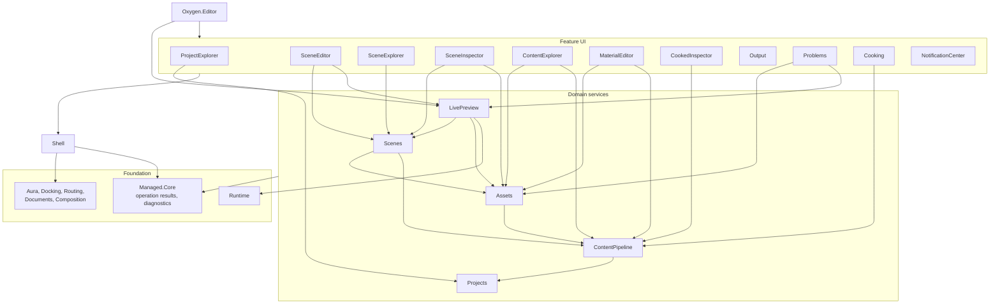

# Editor module architecture

Status: **early draft, under discussion** (no code follows it yet)

Scope: the project structure of the Oxygen Editor after the decomposition of
`Oxygen.Editor.WorldEditor` (issue #69): which modules exist, what each owns,
how they are named, which references are allowed, and where logic may live. The
application frame (windows, panels, documents, commands, notifications) is
specified in [editor-shell.md](editor-shell.md). The scope chain and container
mechanics remain specified in [di-container-topology.md](di-container-topology.md)
sections 2 to 6; this document replaces its section 7.

## 1. Decisions

1. `Oxygen.Editor.WorldEditor` is dissolved. It is not a host and not an
   editor: its generic workspace machinery moves to the Shell and its scene
   editing parts move to the scene modules. "The editor" is the Shell plus the
   modules it hosts; the scene workspace is one window kind among several.
2. The Shell is the central application frame. Features plug into it through
   contributions and consume its services; they never reference Aura windowing,
   Docking, window routing or a `WindowId` directly.
3. UI projects contain views, view models and presentation only. Services,
   workflows and domain logic live in non-UI modules. Content pipeline logic
   (import, cook, publication, relocation, inspection) lives only in
   `Oxygen.Editor.ContentPipeline`.
4. A project's internals are visible only to its own test project. No
   `InternalsVisibleTo` grant to any other assembly, test or production. A test
   that needs another module's private state uses that module's public API or
   moves to that module's tests.
5. Each module owns its outbound ports. A module that needs something from a
   lower-level capability it must not reference (the engine, for example)
   declares the interface; the module that may reference the capability
   implements it.
6. Classes, interfaces and APIs may be renamed when a name misstates what it
   owns. A move commit keeps names so the compiler checks the move; a rename
   commit follows it.

## 2. Layers

```text
Composition root        Oxygen.Editor
Shell                   Oxygen.Editor.Shell
Feature UI              editors, explorers, inspectors, passive panels
Domain services         Scenes, Assets, LivePreview, ContentPipeline, Projects
UI kit                  Oxygen.Editor.Controls, Oxygen.Editor.Routing
Foundation              World, Documents, Schemas, Data, Runtime, Interop,
                        Managed.Core, Managed.Assets, Storage, Composition,
                        Aura, Docking, Routing
```

References point down only. A feature references the Shell, the domain modules
it uses and the UI kit. A domain module references other domain modules below it
and foundation, never the Shell or a feature. The Shell references foundation
only. The composition root references everything and is the only project that
does.

## 3. Naming conventions

Proposed conventions; the direction is agreed, individual names are open.

| Kind      | Purpose                                                                         | Name                | Examples                                              |
| --------- | ------------------------------------------------------------------------------- | ------------------- | ----------------------------------------------------- |
| Editor    | Creates and modifies a document                                                 | `XxxEditor`         | `SceneEditor`, `MaterialEditor`, `PhysicsEditor`      |
| Explorer  | Explores and discovers hierarchical or complex content; never "Browser"         | `XxxExplorer`       | `SceneExplorer`, `ContentExplorer`                    |
| Inspector | Shows, and optionally edits, the properties of one entity                       | `XxxInspector`      | `SceneInspector`, `CookedInspector`                   |
| Passive   | Panels and components that present information without owning an entity's state | Neutral noun        | `Output`, `Problems`, `Cooking`, `NotificationCenter` |
| Domain    | Non-UI services for one product area                                            | Plural noun or area | `Scenes`, `Assets`, `LivePreview`, `ContentPipeline`  |

Type names follow the module: a panel's view model is `<Module>ViewModel`, its
contracts carry the module's noun, and no public type carries the name of a
panel it does not belong to (today `ContentBrowserAssetItem` and
`IContentBrowserAssetProvider` describe project assets, not the browser).

## 4. Module catalogue

| Module (target)                    | From today                                                                                                    | Kind      | Owns                                                                                                                                                                                                                                                           | Must not own                                            |
| ---------------------------------- | ------------------------------------------------------------------------------------------------------------- | --------- | -------------------------------------------------------------------------------------------------------------------------------------------------------------------------------------------------------------------------------------------------------------- | ------------------------------------------------------- |
| `Oxygen.Editor`                    | same                                                                                                          | Root      | `Program`, module composition, workspace presets, activation of the first window                                                                                                                                                                               | Feature policy, services                                |
| `Oxygen.Editor.Shell`              | parts of `Oxygen.Editor`, `WorldEditor/Workspace`, `WorldEditor/Documents` host, Aura glue                    | Shell     | Session host, window kinds and frames, docking host, document host and manager, panel registry, placement, workbench context, command routing, menus, close and exit, layout store, notifications (contract, result policy, presentation), desktop integration | Scene, asset or pipeline policy                         |
| `Oxygen.Editor.ProjectExplorer`    | `Oxygen.Editor.ProjectBrowser`                                                                                | Explorer  | Start experience: recent projects, templates, create and open                                                                                                                                                                                                  | Project persistence rules (Projects)                    |
| `Oxygen.Editor.SceneEditor`        | `WorldEditor/SceneEditor`, play bar from `WorldEditor/Play`                                                   | Editor    | Scene document editor: viewports, gizmos, transform tools, toolbar, play bar                                                                                                                                                                                   | Scene commands (Scenes), engine sync (LivePreview)      |
| `Oxygen.Editor.SceneExplorer`      | `WorldEditor/SceneExplorer` view side, thumbnails                                                             | Explorer  | Hierarchy panel, drag and drop, adapter tree                                                                                                                                                                                                                   | Mutation and organizer model (Scenes)                   |
| `Oxygen.Editor.SceneInspector`     | `WorldEditor/Inspector`                                                                                       | Inspector | Node and component property editing                                                                                                                                                                                                                            | Commands and edit sessions' model (Scenes)              |
| `Oxygen.Editor.ContentExplorer`    | `Oxygen.Editor.ContentBrowser` panes, query, layouts, rows                                                    | Explorer  | Asset navigation, filtering, views, import dialogs                                                                                                                                                                                                             | Relocation and creation logic (ContentPipeline, Assets) |
| `Oxygen.Editor.MaterialEditor`     | same                                                                                                          | Editor    | Material document editor                                                                                                                                                                                                                                       | Material cook and asset primitives                      |
| `Oxygen.Editor.CookedInspector`    | `WorldEditor/Inspection`                                                                                      | Inspector | Cooked package inspection document                                                                                                                                                                                                                             | Inspection logic (ContentPipeline)                      |
| `Oxygen.Editor.Output`             | `WorldEditor/Output`                                                                                          | Passive   | Log view over the output buffer                                                                                                                                                                                                                                | Log production                                          |
| `Oxygen.Editor.Problems`           | `WorldEditor/Problems`                                                                                        | Passive   | Problem list over the script problems of Assets and the runtime problems of LivePreview                                                                                                                                                                        | Problem production                                      |
| `Oxygen.Editor.Cooking`            | `WorldEditor/Cooking`                                                                                         | Passive   | Cook job list over `ICookRunService`                                                                                                                                                                                                                           | Cook orchestration (ContentPipeline)                    |
| `Oxygen.Editor.NotificationCenter` | new                                                                                                           | Passive   | Notification history panel                                                                                                                                                                                                                                     | Notification delivery (Shell)                           |
| `Oxygen.Editor.Scenes`             | `WorldEditor/Documents/Commands`, selection, mutator, organizer model, preferences, `SceneCookInputRegistrar` | Domain    | Scene documents' command service, selection, history, clipboard model, scene preferences; owns the `ISceneEngineSync` port                                                                                                                                     | WinUI views, engine calls                               |
| `Oxygen.Editor.Assets`             | asset services of `ContentBrowser`                                                                            | Domain    | Asset feed, composed catalog, identity rules, material choices, asset-change events; owns the `IAssetRuntimeStatusSource` port                                                                                                                                 | Browser state, engine calls                             |
| `Oxygen.Editor.LivePreview`        | `WorldEditor/Services`, play and runtime-session services                                                     | Domain    | Engine sync, content demand, mount changes, play session, runtime session start, the engine adapters for the ports of Scenes and Assets, runtime problems                                                                                                      | Authoring state                                         |
| `Oxygen.Editor.ContentPipeline`    | same, plus relocation and creation workflows now in UI                                                        | Domain    | Import, cook, publication, relocation, inspection, script and asset creation from templates                                                                                                                                                                    | Panels, prompts                                         |
| `Oxygen.Editor.Controls`           | same                                                                                                          | UI kit    | Reusable editor controls                                                                                                                                                                                                                                       | Feature policy                                          |

`Oxygen.Editor.Projects`, `Runtime`, `World`, `Documents`, `Schemas`, `Data` and
the DroidNet libraries keep their current ownership, with the library changes
listed in [editor-shell.md](editor-shell.md) section 9.

## 5. Dependency graph



Edges to `Managed.Core`, `World` and `Controls` from features are omitted for
legibility. LivePreview is the only domain module that references Runtime;
Scenes and Assets reach the engine only through the ports LivePreview
implements.

## 6. Logic currently in UI code

Each row is a cut. The UI keeps the interaction (prompts, selection, focus);
the operation moves to its owner.

| Today                                                          | Where                       | What it does                                                   | Target                                                                                                             |
| -------------------------------------------------------------- | --------------------------- | -------------------------------------------------------------- | ------------------------------------------------------------------------------------------------------------------ |
| `AssetRelocationWorkflow`                                      | ContentBrowser `Relocation` | Rename, move, copy, delete with undo, then refresh             | Operations and undo to ContentPipeline (beside `AssetRelocationService`); name prompts stay in ContentExplorer     |
| `ScriptAssetCreation`                                          | ContentBrowser `Scripts`    | Validates a name and folder, writes a template, opens the file | Validation and template writing to ContentPipeline; the prompt stays in ContentExplorer                            |
| `SceneCookInputRegistrar`                                      | WorldEditor `SceneEditor`   | Connects a scene document's saved state to cook capture        | Scenes                                                                                                             |
| `CodeEditorService`                                            | ContentBrowser `Scripts`    | Launches the external code editor with preferences             | Shell desktop integration                                                                                          |
| `IAssetShell`, `WindowsAssetShell`                             | ContentBrowser              | Copy text, reveal in File Explorer, recycle bin                | Shell desktop integration                                                                                          |
| `ICookingWorkspaceActions`, `IPlayWorkspace`                   | WorldEditor                 | Panel reveal, save, open document, select node                 | Shell placement and commands; selection through Scenes                                                             |
| `WorkspaceViewModel` engine start, mounts, cooked roots        | WorldEditor `Workspace`     | Runtime session start for a project                            | LivePreview                                                                                                        |
| `ProblemsViewModel` aggregation of script and runtime problems | WorldEditor `Problems`      | Merges two producers                                           | Stays in Problems as presentation over the two domain contracts; each new producer is one more adapter in Problems |

To verify during the cut: `CookedInspectionViewModel` (425 lines) and
`CookingPanelViewModel` (366 lines) appear to be presentation over pipeline
services; any validation or file reading found in them moves to
ContentPipeline.

## 7. Domain modules

### 7.1 Assets

The editor's live view of the active project's assets: project assets, mounted
libraries and engine built-ins, one entry per logical asset, with cook and
preview state, the identity rules, the material choices and the asset-change
events. Its public surface, its ports and its tests are specified in
[assets-module.md](assets-module.md). Script facts are not in Assets; they wait
for the Scripting design (open question 5).

### 7.2 Scenes

Scene authoring: the command service, edit sessions, selection, history keyed by
`DocumentId`, the organizer and mutator model, scene preferences and the
session clipboard model. The command service awaits a `SyncOutcome` on about 45
edit paths, so the engine boundary stays an awaited call: Scenes declares
`ISceneEngineSync` with its outcome and field types, and LivePreview implements
it.

### 7.3 LivePreview

Everything that applies authoring state to the embedded engine: scene engine
sync, content demand, mount changes, runtime session start, play session, and
the runtime problem source. It is the only domain module that references
`Oxygen.Editor.Runtime`.

### 7.4 ContentPipeline

Unchanged ownership, extended with the relocation and creation operations
listed in section 6. It grants internals to its own tests only; the nine grants
to other assemblies are removed, and the tests that used them either arrange
state through public API or move into ContentPipeline's tests.

## 8. Tests

Each module has its own test project; a UI test project only where it has XAML.
A test lives with the module whose behavior it checks. Cross-module workflows
are tested at the highest owner (the composition root's integration suite). A
tooling unit test under `tooling/tests` enforces the layer rules of section 2
and the internals rule of section 1.

## 9. Open questions

1. `ProjectExplorer` for the start experience. It lists, creates and opens
   projects; "explorer" fits its project list, but a neutral `Start` may fit the
   whole surface better.
2. The Content Browser's left pane is namespaced `ProjectExplorer` today and
   would collide with the module above; it needs a pane name such as
   `ContentFolders`.
3. `Cooking` as the passive cook-jobs panel name, or a more specific noun such
   as `CookJobs`.
4. `CookedInspector` or `CookedContentInspector`.
5. Script analysis implementation: it calls native scripting interop. Its
   contract is in Assets; the implementation needs a module that may reference
   Interop (LivePreview, or a small `Scripting` domain module).
6. Whether `Scenes` may reference ContentPipeline (for `SceneCookInputRegistrar`)
   or whether cook capture is a port that ContentPipeline implements.
