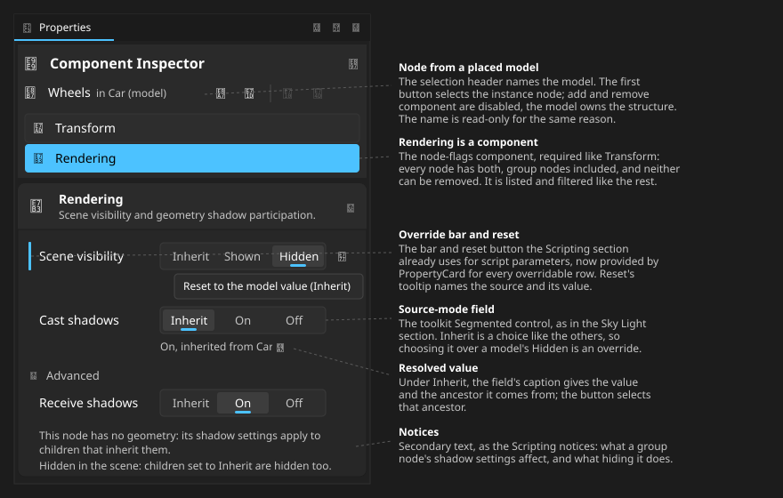
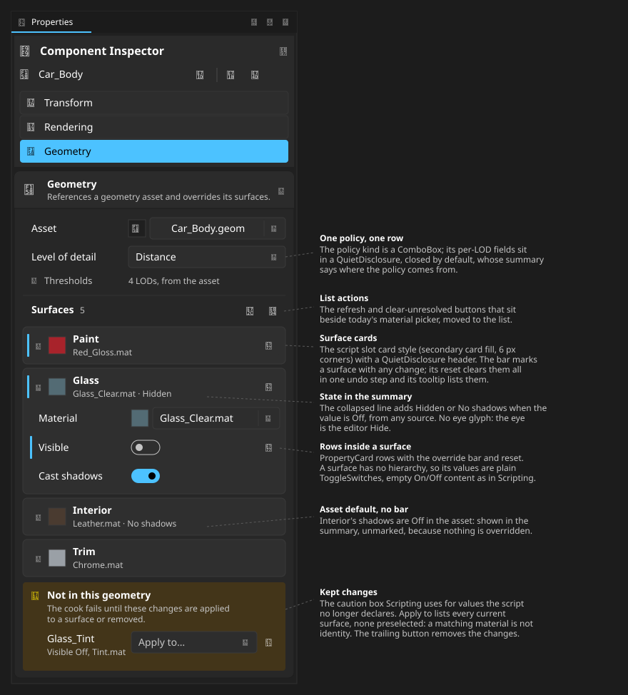
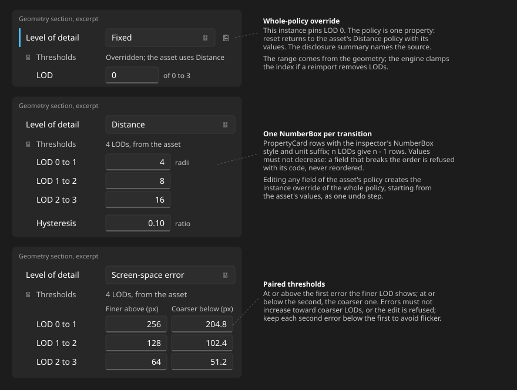
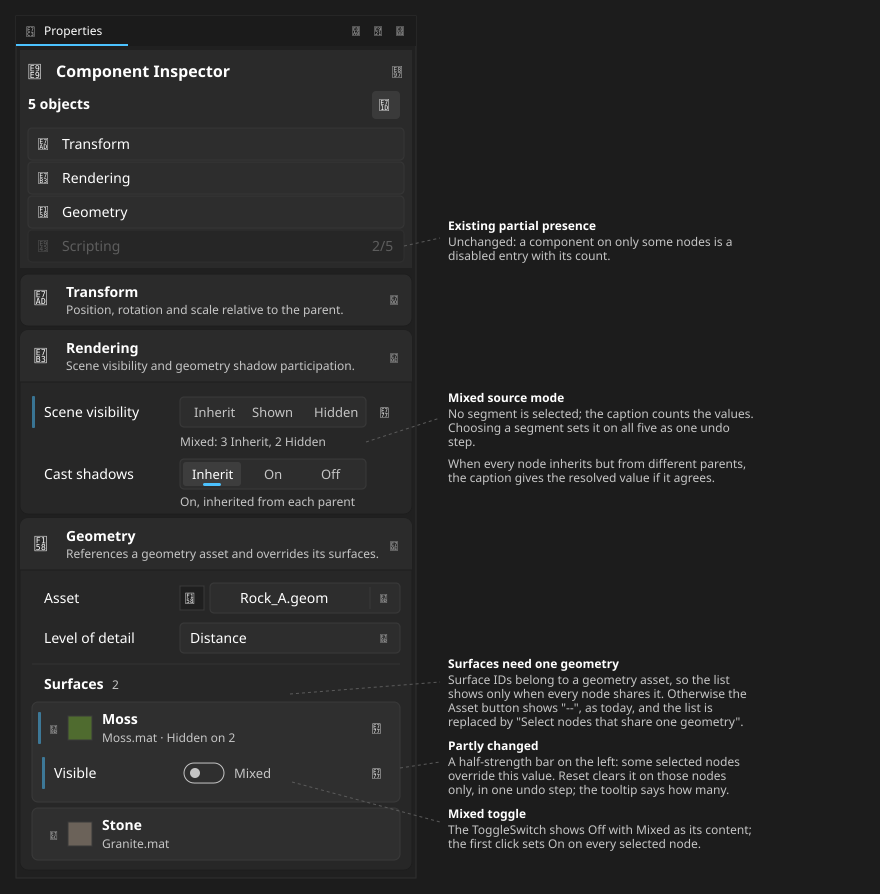

# Instance Overrides In The Scene Inspector

Status: proposal for owner review. This is the inspector side of the override
model in the [scene model](../lld/scene-authoring-model.md) sections 4 and 5:
node flags with Inherit, surfaces with asset defaults, LOD policy and nodes
inside placed models. Field rules stay in the
[property inspector](../lld/property-inspector.md).

## 1. Scenarios

1. **Hide the glass of a car.** Select the body, expand Glass in Surfaces, turn
   Visible off. The row gains the override bar; the glass disappears in every
   view; the rest of the body stays.
2. **Foliage cards cast no shadows.** Turn Cast shadows off on the Leaves
   surface only. The node's own Cast shadows, in Rendering, would also remove
   the trunk's shadow.
3. **Undo a change at its source.** Reset on a row removes one override; reset
   on a surface card removes every override of that surface in one undo step.
4. **Override inside a placed model, then reimport.** Hide `Wheel_FL` inside
   the Car model. After a reimport with proven node and surface IDs the change
   survives; otherwise it is kept in a caution box (scenario 7).
5. **Pin a hero prop to LOD 0.** Choose Fixed on one instance whose asset uses
   Distance. Reset returns to the asset's policy.
6. **Five rocks, two with moss hidden.** Moss's Visible row is mixed and partly
   overridden. Setting it applies to all five; reset clears it on the two.
7. **A surface lost on reimport.** The kept changes are listed with a choice of
   target surface or removal; the scene does not cook until one is chosen.

## 2. Presentation rules

The inspector keeps its current shell: the selection header, the component
list and All components mode with stacked sections. A node is a container of
components (scene model section 3), so Rendering, the node-flags component,
becomes a list entry right after Transform for every node, group nodes
included: required components come first, then the optional ones in today's
alphabetical order, and All mode stacks sections in the same order. Like Transform it is required: Remove component is disabled while it
is selected. Name and hierarchy are components too but keep their own UI: the
selection header and the Scene Explorer.

- **Override bar and reset.** An overridden row shows the 3 px
  `AccentFillColorDefaultBrush` bar at its leading edge and a trailing reset
  button (`E777`), the pattern script parameters use today. Rows that follow
  their source are unmarked. A half-opacity bar means some selected nodes
  override the value.
- **The source is named where it is needed:** in the reset tooltip ("Reset to
  the model value (Inherit)"), in the summary of a disclosure ("4 LODs, from
  the asset") and in the Inherit caption. Reset never writes the source's value
  as an override.
- **Inherit is a value.** Node flags use the toolkit `Segmented` control, as in
  the Sky Light section, with Inherit / Shown / Hidden or Inherit / On / Off.
  Under Inherit, a caption gives the resolved value and its ancestor, with a
  button that selects that ancestor. Choosing Inherit over a model's local
  value is an override.
- **Surfaces** are cards in the script slot card style, each with a
  `QuietDisclosure` header: material thumbnail, surface name, and a summary of
  the material plus Hidden or No shadows when that value is off, from any
  source. Inside, Material, Visible and Cast shadows are ordinary rows.
  Visible and Cast shadows are plain `ToggleSwitch`es: a surface has no
  hierarchy. No eye glyph is used: the eye is the editor Hide.
- **Kept changes** for a surface or template node no longer proven use the
  caution box Scripting uses for values a script no longer declares.
- **Model nodes.** The selection header adds "in Car (model)" and a button that
  selects the instance node. The name, Add component and Remove component are
  disabled with tooltips naming the model; only schema-declared properties are
  editable.
- **Consequence notices** use the secondary notice text Scripting uses, for
  example when hiding a node whose children inherit. On a node without
  geometry, the shadow rows say they apply to children that inherit.
- **Mixed values.** A mixed `Segmented` selects nothing and its caption counts
  the values; a mixed `ToggleSwitch` shows Off with "Mixed" as its content and
  the first click sets On on every node. The Surfaces list shows only when all
  selected nodes share one geometry; otherwise the Asset button shows "--", as
  today, and the list says "Select nodes that share one geometry".
- **Keyboard.** Tab reaches the editor, then reset. Enter or Space toggles a
  disclosure. Delete on a focused overridden row resets it, through the #86
  editing commands.
- **Disabled states** follow today's: `PropertyCard`'s disabled opacity, the
  "Locked for editing" InfoBar and the no-scene empty state.

## 3. Mockups

Rendering section of a group node inside a placed model:

Geometry section with the Surfaces list and kept changes:

Level-of-detail rows, each policy with its thresholds open:

Five nodes selected that share one geometry:

## 4. Decisions

| Question                                   | Decision and reason                                                                                          |
| ------------------------------------------ | ------------------------------------------------------------------------------------------------------------ |
| How a changed value is marked              | The existing script-parameter bar and reset, so one marker means "overridden" everywhere                     |
| Where the source is shown                  | Reset tooltip, disclosure summary and Inherit caption; a source line on every row doubles the section height |
| Inline toggles on collapsed surfaces       | No; the summary states Hidden or No shadows, and editing happens in the open card                            |
| Reset on a surface card                    | Resets every override of that surface in one undo step; the tooltip lists them                               |
| Marking model nodes                        | The selection header line and select-instance button; section tints would compete with the override bar      |
| Retarget choices for a lost surface        | Every current surface, none preselected; a matching material is not identity (content pipeline rules)        |
| Receive Shadows placement                  | Stays under Advanced, as the [property inspector](../lld/property-inspector.md) states                       |
| LOD fields while the policy is the asset's | Editable; the first edit creates the whole-policy override from the asset's values, as one undo step         |
| Invalid LOD thresholds                     | Refused with their diagnostic code; never reordered                                                          |
| Reset versus clear glyphs                  | `E777` resets to the source everywhere; `E711` only removes (kept changes, unresolved values)                |

## 5. Editor control changes

These are general inspector enhancements; Scripting and every other section
move to them, so no section keeps its own copy.

| Control                                      | Change                                                                                                                                                                  |
| -------------------------------------------- | ----------------------------------------------------------------------------------------------------------------------------------------------------------------------- |
| `PropertyCard`                               | `OverrideState` (None, Partial, Full) draws the bar; `ResetCommand` and `ResetToolTip` add the trailing reset button. Scripting's hand-written bar and reset move to it |
| Source-mode field (`Oxygen.Editor.Controls`) | Wraps the toolkit `Segmented`: modes, mixed state (no selection) and a caption line                                                                                     |
| Toggle field (`Oxygen.Editor.Controls`)      | `ToggleSwitch` with a mixed state; used by Rendering, surfaces and Scripting's toggle fields                                                                            |
| Item card and caution box styles             | Scripting's slot card and "not declared" box become shared inspector styles, used by surfaces and kept changes                                                          |
| `SceneNodeDetailsView`                       | Model-origin line, select-instance button and read-only structure for template nodes                                                                                    |
| Component list                               | Required components (Transform, Rendering) cannot be removed and show for every node                                                                                    |

Unchanged and reused: `PropertiesExpander`, `QuietDisclosure`, `Thumbnail`,
`AssetPicker` in a `SplitButton`, the inspector `NumberBox` style with
`SceneUnitSuffix`, `MixedValue<T>` bindings, and the component list with its
partial-presence counts.

| Today                                                         | Change                                                   |
| ------------------------------------------------------------- | -------------------------------------------------------- |
| `NodeRenderingView`: three `ToggleSwitch` rows                | Three source-mode fields; Receive shadows under Advanced |
| Rendering appended in All mode for geometry or light nodes    | A component-list entry after Transform for every node    |
| `GeometryView`: a `Slot` `ComboBox` and one `Material` picker | Removed; Level of detail row and the Surfaces list       |
| Refresh and clear-unresolved buttons beside the picker        | Move to the Surfaces header                              |
| `SurfaceChoice`, `GeometryViewModel.Surfaces`                 | Surface view models, one per card                        |
