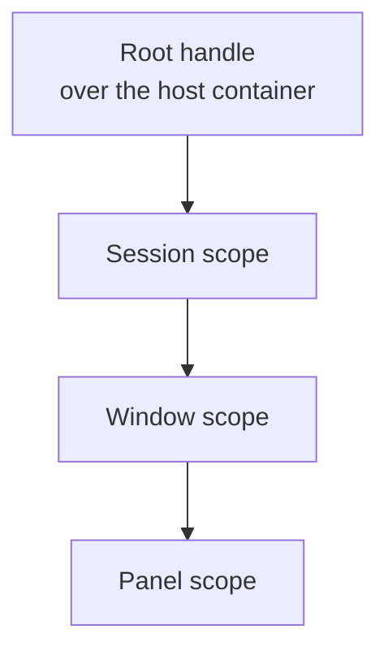

# DroidNet.Composition

A chain of DryIoc scopes. Each scope is a new, empty container over its parent.
Registration modules fill it, and a tree of scope handles owns it.

## At a glance

| Type                                                                | Role                                                                                            |
| ------------------------------------------------------------------- | ----------------------------------------------------------------------------------------------- |
| `IScopeLayer`                                                       | Marker of a layer; the base of the four layers below                                            |
| `IApplicationLayer`, `ISessionLayer`, `IWindowLayer`, `IPanelLayer` | The layers of the chain, from the root down                                                     |
| `IScopeModule<in TLayer>`                                           | Registers what one subsystem owns in a scope of its layer; declares shadows and activation list |
| `ScopeFactory`                                                      | Creates the root handle over the host container and every child scope                           |
| `ScopeHandle`                                                       | Owns one scope: its container, its child scopes and the async disposables it awaits             |
| `ScopeRegistrations`                                                | What a scope chain provides, by type and key; finds undeclared shadows                          |
| `UndeclaredShadowException`                                         | Thrown when a scope re-registers a parent service that no module declares                       |



Arrows are container parentage: a scope sees its own registrations, then asks
its immediate parent.

## Layers

Each scope belongs to one layer, and a module names the layer it registers
into, so a module composed into the wrong scope is a compile error.

| Layer               | Scope                                                                                      |
| ------------------- | ------------------------------------------------------------------------------------------ |
| `IApplicationLayer` | The root: one per process, over the host's container; what every session and window shares |
| `ISessionLayer`     | One unit of work the application opens and closes as a whole, shared by its windows        |
| `IWindowLayer`      | One window: its router, view location and what its content shows                           |
| `IPanelLayer`       | One panel inside a window: the services only that panel uses                               |

All four derive from `IScopeLayer`. A subsystem that registers into several
layers has one module per layer; a module of `IScopeLayer` itself is accepted
at every layer and is meant only for infrastructure that every routed scope
repeats, such as a local router.

## How a scope resolves

A scope starts from the host's Microsoft dependency injection rules
(`DryIocAdapter.MicrosoftDependencyInjectionRules`). The captive-dependency check is on, disposable-transient tracking is off,
and the scope has one unknown-service resolver, which asks its immediate parent.

- A service the scope does not register is resolved by the parent, when the
  parent chain registers its type and key. The parent builds and caches it, so a
  parent singleton is one instance whichever scope resolves it first, and a
  parent transient is built with the parent's dependencies.
- A constructed generic type is provided by a registration of its definition, so
  `ILogger<T>` resolves where the host registers only `ILogger<>`.
- When the chain does not provide a service, the resolver returns nothing:
  optional constructor parameters and `IfUnresolved.ReturnDefault` get their
  default. Negative answers are not cached, so a registration added to a parent
  later is seen.
- `Func<>`, `Lazy<>` and keyed services resolve through the chain. Collections
  (`IEnumerable<T>`, `ResolveMany`) see only the scope's own registrations.
- `IServiceProvider` and `IContainer` resolve to the scope itself.
- `ScopeHandle` resolves to the scope's own handle: `CreateRoot` registers the
  root handle in the host, and every scope registers its own, an implicit
  declared shadow. A scope owner, such as a view model that creates its child
  scopes, takes `ScopeHandle` and receives the handle of the scope that builds
  it.

A rules object of a parent is never reused: DryIoc appends resolvers to the
rules it is given, so the root's resolver would run first and throw for a
service only an intermediate scope registers.

## Modules

```csharp
public interface IScopeModule<in TLayer> where TLayer : IScopeLayer
{
    IReadOnlyCollection<Type> Shadows { get; }
    IReadOnlyList<Type> Activation { get; }
    void Register(IRegistrator scope);
}
```

- `Register` adds what the subsystem owns at this layer, nothing else.
- `Shadows` lists the parent-registered types the module registers again. A
  generic type definition covers its constructed types. `ScopeFactory.Create`
  throws `UndeclaredShadowException` for any other registration of a type and
  key the parent chain provides, including a closed type over a parent's open
  generic and an open generic over a parent's closed type.
- `Activation` lists the services created when the scope opens, module by
  module, in order, after every module has registered.
- The layer is a contravariant type parameter: `Create<IWindowLayer>` accepts
  only window modules, and a module of `IScopeLayer` (such as
  `Oxygen.Editor.Routing`'s `RouterScopeModule`) is accepted at every layer.

```csharp
var factory = new ScopeFactory();
await using var root = ScopeFactory.CreateRoot(hostContainer);
var session = factory.Create<ISessionLayer>(root, sessionModules);
var window = factory.Create<IWindowLayer>(
    session,
    [new RouterScopeModule(routes, context), .. windowModules],
    scope => scope.RegisterInstance(windowId));
```

When registration or activation fails, the new container is disposed and the
parent is unchanged.

The root scope is the host's own container. `ScopeFactory.CreateRoot(host,
rootModules)` registers the root's modules into it, registers the root handle
and then creates their activation lists. The root has no parent, so its modules
declare no shadows, and the host container stays the caller's when activation
fails.

## Disposal

`ScopeHandle.DisposeAsync` disposes, in order:

1. its child scopes, the most recently created first;
2. the async disposables given to `Own`, the most recently owned first;
3. its container, which disposes what the scope created and never a parent
   instance.

Disposal continues on the caller's context, because a scope may own UI objects.
A second call does nothing, and a child disposed on its own leaves its parent's
list. The root handle never disposes the host container.

Tracking is off in every scope, because a scope would otherwise dispose the
parent instances it returns. A disposable transient that a layer owns opts in
with `Setup.With(trackDisposableTransient: true)`.

## Decisions

- **Empty child, not `CreateChild`.** `CreateChild` copies the registry and only
  the singletons that already exist, so a parent singleton first resolved from a
  child is built again inside it. An empty container that asks its parent makes
  shared identity independent of resolution order.
- **One shadow check.** `ScopeRegistrations.FindUndeclaredShadows` is the check
  the factory runs and the one an application's topology test reuses.
- **Handles own scopes.** A DryIoc parent does not own or dispose its children,
  and DryIoc has no async disposal, so the handle tree owns both.

## Build and test

See [build workflows](../../tooling/doc/build.md). The tests are in
`tests/Composition.Tests.csproj`.
