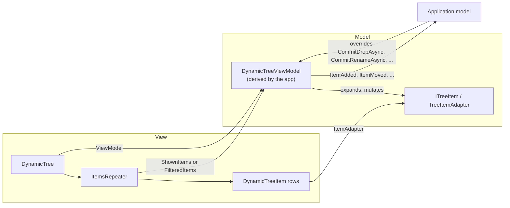
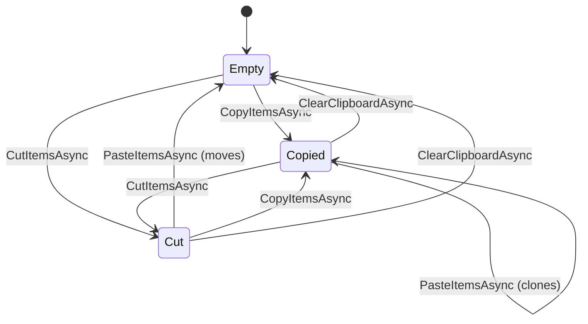

# DroidNet DynamicTree

`DynamicTree` is a WinUI 3 tree control for large, lazily loaded hierarchies.
The control renders a flat list of rows; an application-derived
`DynamicTreeViewModel` owns which items are shown, selection, focus, the
clipboard and every mutation, and raises events so the application keeps its
own model in step.

## At a glance

| Concern       | Where it lives                                                                            |
| ------------- | ----------------------------------------------------------------------------------------- |
| Rows          | `DynamicTree` hosts an `ItemsRepeater` in a `ScrollView`; each row is a `DynamicTreeItem` |
| Data          | `ITreeItem`, usually through the abstract `TreeItemAdapter`                               |
| State         | `DynamicTreeViewModel`: shown items, expansion, selection, focus, filter, clipboard       |
| Lazy loading  | `TreeItemAdapter.LoadChildren`, called when an item first expands                         |
| Mutations     | Insert, remove, move, copy/cut/paste, duplicate; vetoable events before, events after     |
| Owner hooks   | Overridable rename, drop, clipboard and selection-policy members                          |
| Input         | Pointer, keyboard, type-ahead, drag and drop, in-place rename                             |
| Accessibility | Automation peers for the tree, its rows and the expander                                  |



## Getting started

Reference the `DynamicTree` project and give the control a view model; the
control binds its rows to the view model itself:

```xml
<Page xmlns:dnc="using:DroidNet.Controls">
    <dnc:DynamicTree ViewModel="{x:Bind ViewModel, Mode=OneWay}" />
</Page>
```

Derive the view model and an item adapter. `InitializeRootAsync` builds the
shown rows; with `skipRoot: true` (the default) the root is hidden and its
children are the top-level rows.

```csharp
public sealed class ProjectTreeViewModel : DynamicTreeViewModel
{
    public Task LoadAsync(Folder root)
        => this.InitializeRootAsync(new FolderAdapter(root), skipRoot: false);
}

public sealed class FolderAdapter(Folder folder) : TreeItemAdapter, ICanBeCloned
{
    public override string Label
    {
        get => folder.Name;
        set => folder.Name = value;
    }

    public override bool ValidateItemName(string name) => !string.IsNullOrWhiteSpace(name);

    public ITreeItem CloneSelf()
    {
        var clone = new FolderAdapter(folder.Copy());
        this.CopyBasePropertiesTo(clone);
        return clone;
    }

    protected override int DoGetChildrenCount() => folder.Children.Count;

    protected override Task LoadChildren()
    {
        foreach (var child in folder.Children)
        {
            this.AddChildInternal(new FolderAdapter(child));
        }

        return Task.CompletedTask;
    }
}
```

The [demo app](../DemoApp/Tree) shows a complete scene tree with filtering,
row actions, thumbnails, undo and the clipboard.

## Items

| Contract          | Meaning                                                                                                                            |
| ----------------- | ---------------------------------------------------------------------------------------------------------------------------------- |
| `ITreeItem`       | Label, depth, parent, children, expansion, selection, `IsCut`, `CanAcceptChildren`, name validation                                |
| `TreeItemAdapter` | Base implementation: depth, async children, change notification; also `DisplayLabel`, `Annotation` and `IsDimmed` for presentation |
| `ICanBeLocked`    | `IsLocked` items are not moved, cut, removed or given children; the root is always locked                                          |
| `ICanBeCloned`    | `CloneSelf` returns a detached copy without parent or children; required to copy or duplicate                                      |

`LoadChildren` runs once, when the item first needs its children. Children of
collapsed items are not loaded, so a large tree costs only what is shown.

## Expansion

`ExpandItemAsync` and `CollapseItemAsync` change expansion; the rows forward
the expander, Left and Right to them. Collapsing a parent keeps its
descendants' expansion, so expanding it again restores the branch as it was.

## Selection and focus

`SelectionMode` is `None`, `Single` or `Multiple`. Selection is stored on the
items, so it survives collapsing and re-expanding.

| Member                                                                                      | Purpose                                                                        |
| ------------------------------------------------------------------------------------------- | ------------------------------------------------------------------------------ |
| `SelectedItem`, `SelectedItemsCount`                                                        | Current selection                                                              |
| `ActiveItem`                                                                                | The selected item the user last chose explicitly, whatever the selection order |
| `SelectionSettled`                                                                          | Raised once per selection transaction, with its final membership               |
| `SelectAllCommand`, `SelectNoneCommand`, `InvertSelectionCommand`, `ToggleSelectAllCommand` | Bulk selection                                                                 |
| `AllowsCoSelection` (override)                                                              | Makes some rows exclusive, for example a root that never shares a selection    |
| `IsIncludedInBulk` (override)                                                               | Leaves rows out of ranges, Select All and invert                               |
| `FocusItem`, `BringItemIntoView`                                                            | Programmatic focus and scrolling                                               |

`DynamicTree.SelectionScope` decides what ranges, Select All and keyboard
navigation walk: `ShownItems` (default) covers every expanded row,
`DisplayedItems` only the rows the filter shows. See
[interaction scope](design/filtering.md#interaction-scope).

### Keyboard and pointer

| Input                          | Effect                                                            |
| ------------------------------ | ----------------------------------------------------------------- |
| Up, Down, PageUp, PageDown     | Move focus                                                        |
| Home, End (Ctrl for the tree)  | First or last row of the parent, or of the tree                   |
| Left, Right                    | Collapse or expand the focused item                               |
| Enter, Space                   | Select the focused item, or deselect it when selected             |
| Click, Ctrl+Click, Shift+Click | Select, toggle, extend                                            |
| Ctrl+A, Ctrl+Shift+I           | Select all (toggles), invert selection                            |
| Letters                        | Type-ahead to the next matching label (`IsTypeAheadEnabled`)      |
| Escape                         | Cancel a drag, then type-ahead, then the staged clipboard         |
| Double-tap the label           | Rename (`RenameOnDoubleTap`); elsewhere on the row, `ItemInvoked` |

Copy, cut, paste, delete and rename have no keyboard shortcuts in the control:
they are application commands that call the view model.

## Filtering

Set `FilterPredicate` on the view model and `IsFilteringEnabled` on the tree.
`FilteredItems` shows the matches with their ancestors as context; the tree
switches its rows to it. The built-in filter bar (`IsFilterBarEnabled`,
`FilterText`, `FilterBarPlaceholderText`, `FilterBarAccessoryContent`,
`FilterBarInputStyle`) edits the text the application turns into a predicate.
See [filtering](design/filtering.md).

## Mutations

Every mutation goes through the view model, which raises a vetoable event
before and a notification after. Set `Proceed = false` on the `Being…` event
args to refuse.

| Operation                                | Events                            |
| ---------------------------------------- | --------------------------------- |
| `InsertItemAsync(item, parent, index)`   | `ItemBeingAdded`, `ItemAdded`     |
| `RemoveItemAsync`, `RemoveSelectedItems` | `ItemBeingRemoved`, `ItemRemoved` |
| `MoveItemsAsync`, `ReorderItemsAsync`    | `ItemBeingMoved`, `ItemMoved`     |

- An insert under a shown parent expands it and selects the new row. Under a
  parent that is not shown, such as one inside a collapsed branch, the item
  joins its parent only; its row appears when the branch expands.
- A removal keeps the selection on the same items. When it removes every
  selected row, the row that takes their place is selected.
- `ItemRemoved.RelativeIndex` is the item's index in its parent before the
  removal: use it with `InsertItemAsync` to undo. `ShownItems` indices change
  with expansion and are not stable.
- A hidden root accepts children like a shown one: top-level rows can be
  inserted, moved, dropped and pasted.

See [tree mutation](design/tree-mutation-ui.md) and
[undo and redo](design/undo-redo.md).

## Clipboard

The clipboard belongs to the view model: it survives `ClearRoot` and the
control unloading, and is shared by every command that uses it.

| Operation             | Effect                                                                                                 |
| --------------------- | ------------------------------------------------------------------------------------------------------ |
| `CopyItemsAsync`      | Stages the items and their subtrees; items that are not `ICanBeCloned` are left out with their subtree |
| `CutItemsAsync`       | Stages the unlocked items and marks them and their descendants `IsCut`                                 |
| `PasteItemsAsync`     | Into the given parent, or the focused item; selects what was pasted                                    |
| `DuplicateItemsAsync` | Copies items to a destination without touching the clipboard (drag-copy uses it)                       |
| `ClearClipboardAsync` | Empties the clipboard and removes cut marks; Escape calls it                                           |



- A copy can be pasted again. A pasted cut is consumed: the items moved, so
  the clipboard empties and the cut marks go.
- A copy paste is one transaction: the owner approves every pasted root first,
  and a refusal rolls back the clones already inserted. A refused paste leaves
  the clipboard unchanged.
- Removing or moving a staged item, or one of its ancestors, makes the
  clipboard invalid (`IsClipboardValid`); pasting it then throws.
- `CurrentClipboardState`, `ClipboardItems` and `ClipboardContentChanged`
  report the clipboard for command state.

An application whose payload lives on its own clipboard (the Scene Explorer
keeps scene node identities) overrides `CopyItemsAsync`, `CutItemsAsync` and
`PasteItemsAsync`, and keeps the tree's state in step with:

| Member (protected)     | Use                                                          |
| ---------------------- | ------------------------------------------------------------ |
| `StageClipboard`       | Report staged rows as copied or cut; cut rows are dimmed     |
| `ReleaseClipboardRows` | Drop rows that no longer show the payload, keeping its state |
| `ClearClipboard`       | Empty the clipboard and the cut marks                        |
| `OnClipboardCleared`   | Override to clear the application's payload with the tree's  |

## Drag and drop

Rows can be dragged within the tree. The drop position is `Before`, `Inside`
or `After` the target row, shown by a drop cue; hovering over a collapsed
parent expands it after a short delay. Holding Ctrl copies instead of moving,
when every dragged item is `ICanBeCloned`.

The drop calls `CommitDropAsync(TreeDropRequest)`. The default moves the items,
or duplicates them for a copy, without changing the clipboard. Override it to
commit a domain transaction and return `TreeDropResult.Committed(items)` or
`TreeDropResult.Rejected`. `DynamicTree.ItemsDragStarting` lets the
application add its own formats to the drag's `DataPackage`. See
[drag and drop](design/tree-mutation-ui.md#3-drag-drop-implementation).

## Rename

`DynamicTree.BeginRenameAsync(item)` scrolls the row into view and opens the
in-place editor; double-tapping the label does the same unless
`RenameOnDoubleTap` is off. The editor opens over the label with its text in
the label's place and font, and has no clear button: Enter commits, Escape
cancels, and losing focus commits a valid name.

The commit calls `CommitRenameAsync(item, newName)`. The default validates the
name and sets `Label`. Override it to rename through a document or service:
return `TreeItemRenameResult.Success`, or `TreeItemRenameResult.Rejected(message)`
to keep the editor open with the message as its error. Before a command
changes the selection, `SettleRenameAsync` commits any open rename and reports
whether it succeeded.

## Context requests

`ItemContextRequested` reports the item, the realized row to anchor a flyout
to, and the pointer position when the request came from a pointer. The control
shows no menu; the application decides what to offer.

## Presentation

| Property                                                                             | Effect                                            |
| ------------------------------------------------------------------------------------ | ------------------------------------------------- |
| `ItemRowHeight`, `ItemFontSize`                                                      | Minimum row height and label size                 |
| `ItemIconSize`, `ItemIconMargin`, `ItemIndentWidth`                                  | Thumbnail size and spacing, indentation per level |
| `ThumbnailTemplateSelector`                                                          | Picks each row's thumbnail template from its item |
| `TrailingContentTemplate`, `TrailingContentTemplateSelector`, `TrailingContentWidth` | Per-row content after the label, such as actions  |

The row height is a minimum: larger text or trailing content can grow a row.

### Density

`TreeDensityStyles.xaml` and `CompactTreeDensityStyles.xaml`, under
`ms-appx:///DroidNet.Controls.DynamicTree/DynamicTree/`, provide
`TreeDensityStyle` with 40 and 32 DIP minimum rows and 14-point labels. Merge
one dictionary into the tree's resources and assign the style; remove the
previous dictionary when switching. Local property values take precedence over
the style. The [demo helper](../DemoApp/Tree/TreePresentation.cs) switches
profiles while keeping its own icon size and indentation.

### Trailing content

`TrailingContentTemplate` takes precedence over the selector; both bind to the
row's `ITreeItem`. A positive `TrailingContentWidth` reserves the same width on
every row, so actions stay aligned across depths. At width zero, empty slots
collapse and populated ones size to their content. Interactive trailing
controls do not select or drag the row, and the tree's keyboard handling leaves
their keys alone.

A single action needs no selector:

```xml
<dnc:DynamicTree TrailingContentWidth="56">
    <dnc:DynamicTree.TrailingContentTemplate>
        <DataTemplate>
            <Button Content="…" Command="{Binding MoreCommand}"
                    AutomationProperties.Name="More actions" />
        </DataTemplate>
    </dnc:DynamicTree.TrailingContentTemplate>
</dnc:DynamicTree>
```

For several actions, use fixed-width cells and hide their children, not the
columns, so nothing moves when an action appears:

```xml
<Grid>
    <Grid.ColumnDefinitions>
        <ColumnDefinition Width="32" />
        <ColumnDefinition Width="32" />
    </Grid.ColumnDefinitions>
    <Button Command="{Binding LockCommand}" Content="L"
            AutomationProperties.Name="Lock or unlock item" />
    <Button Grid.Column="1" Command="{Binding VisibilityCommand}" Content="V"
            AutomationProperties.Name="Show or hide item" />
</Grid>
```

Commands, state, hover behavior and accessible names belong to the
application. The demo's `EntityRowActions` shows hover-only lock and
visibility buttons beside a document icon in three aligned cells.

### Templates

A replacement `DynamicTree` template must host the repeater in a `ScrollView`
(`PartScrollView`), not a `ScrollViewer`: the repeater virtualizes from the
viewport its scroll host reports, which a `ScrollViewer` leaves stale while it
animates, and no rows are realized.

| `DynamicTreeItem` template parts                                                                    |
| --------------------------------------------------------------------------------------------------- |
| `PartRootGrid`, `PartContentGrid`, `PartExpander`, `PartThumbnailPresenter`, `PartContentPresenter` |
| `PartItemName`, `PartInPlaceRename`, `PartItemNameEdit`, `PartItemNameError`                        |
| `PartTrailingContentPresenter`, `PartDropIntoIndicator`                                             |

| Visual state group     | States                                                     |
| ---------------------- | ---------------------------------------------------------- |
| `CommonStates`         | `Normal`, `PointerOver`, `Selected`, `PointerOverSelected` |
| `ExpansionStates`      | `Expanded`, `Collapsed`                                    |
| `HasChildrenStates`    | `WithChildren`, `NoChildren`                               |
| `CutStates`            | `Cut`, `NotCut`                                            |
| `DimStates`            | `Dimmed`, `NotDimmed`                                      |
| `NameValidationStates` | `NameIsValid`, `NameIsInvalid`                             |

## One tree per view model

A `DynamicTreeViewModel` is shown by one live `DynamicTree` at a time: its
focus, keyboard scope and bring-into-view requests belong to that tree.

- A second tree loaded over a view model that another loaded tree shows is
  rejected: it shows no rows, the view model logs an error, and Debug builds
  throw `InvalidOperationException`.
- A tree lets go when it unloads or moves to another view model; another tree
  can then attach.
- Expansion and selection live on the items, so they are the same wherever the
  items show.

Hosts that keep one view per view model (`DroidNet.Mvvm.HostedViews`) never
build a second tree by accident.

## XAML optimizations

`DynamicTreeXamlSettings.EnableOptimizations()`, called before
`Application.Start`, enables `IconNoGridOptimization`, `OptimizeApplyStyles`
and `DeferContextFlyoutInit`. The settings are process-wide and leave default
templates unchanged; calling it after WinUI starts throws. Oxygen and the
controls demo enable it at startup.

## Design documents

| Document                                          | Covers                                          |
| ------------------------------------------------- | ----------------------------------------------- |
| [Filtering](design/filtering.md)                  | Predicates, ancestor context, interaction scope |
| [Tree mutation](design/tree-mutation-ui.md)       | Move, clipboard, drag and drop                  |
| [Type-ahead and focus](design/typeahead-focus.md) | Focus model, type-ahead matching                |
| [Undo and redo](design/undo-redo.md)              | Reversing mutations from their events           |
