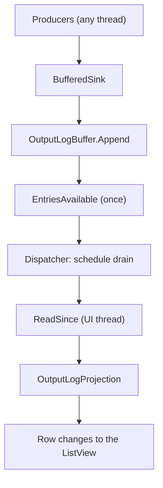

# OutputConsole

## At a glance

`OutputConsoleView` is a WinUI 3 log viewer for developer tools. Producers
append log entries to a bounded `OutputLogBuffer` from any thread, and the view
shows them as a virtualized list of rows with level and subsystem filters,
search, duplicate folding, a details pane and copy/save commands. A Serilog sink
feeds the buffer.

| Feature             | What it does                                                                         |
| ------------------- | ------------------------------------------------------------------------------------ |
| Bounded buffer      | A ring of `OutputLogEntry` that overwrites the oldest entries when it is full        |
| Subsystems          | An application-supplied `SubsystemMap` attributes each entry to a subsystem          |
| Level filter        | `LevelMask` selects the levels shown                                                 |
| Subsystem filter    | `HiddenSubsystems` hides chosen subsystems; "Other" covers unmapped sources          |
| Search              | Filter mode hides non-matching lines; Find mode keeps them and steps through matches |
| Folding             | Consecutive identical lines collapse into one row with a count                       |
| Follow and pause    | Follow keeps the newest line in view; pause freezes the view while capture goes on   |
| Details pane        | Shows one entry's message, exception, source, channel and properties                 |
| Copy and save       | Plain-text records of the selection, the visible rows or every retained entry        |
| Buffer status       | A toolbar ring and flyout show buffer fill, evictions and per-level counts           |
| Serilog integration | `OutputConsole(...)` sink extension and `BufferedSink` fill the buffer               |

## Setting up

The application always supplies the `SubsystemMap`. The control has no default
map: a map from source prefixes to subsystem names is application knowledge. A
prefix matches a source equal to it, or one that continues with a `.`; the
longest matching prefix wins, and a source with no match has no subsystem.

```csharp
using DroidNet.Controls.OutputConsole.Model;

var map = new SubsystemMap(
[
    new("MyApp.Rendering", "Render"),
    new("MyApp", "App"),
]);

var buffer = new OutputLogBuffer(map, capacity: 10000);
```

With the Bootstrapper, `WithOutputConsole` takes the map as its first argument
(see the [Bootstrap](../../Bootstrap/README.md) README). It registers the Serilog
sink and puts the `OutputLogBuffer` in the DI container:

```csharp
bootstrap.Configure(options => options.WithOutputConsole(map, capacity: 10000));
```

Without the Bootstrapper, configure Serilog directly:

```csharp
Log.Logger = new LoggerConfiguration()
    .WriteTo.OutputConsole(container, map, 10000, LogEventLevel.Verbose, levelSwitch: null)
    .CreateLogger();
```

`BufferedSink` converts each `LogEvent` into an `OutputLogEntry` (the
`SourceContext` and `Channel` properties become `Source` and `Channel`) and
appends it to the buffer. Code that does not use Serilog can append entries to
the buffer itself.

## Using the view

Bind `ItemsSource` to the buffer, usually resolved from the container:

```xml
<oc:OutputConsoleView
    xmlns:oc="using:DroidNet.Controls.OutputConsole"
    ItemsSource="{x:Bind ViewModel.Buffer}"
    FollowTail="True"
    ShowTimestamps="True"
    WordWrap="False"
    FoldDuplicates="False" />
```

| Property            | Type                          | Default   | Meaning                                                                 |
| ------------------- | ----------------------------- | --------- | ----------------------------------------------------------------------- |
| `ItemsSource`       | `IEnumerable?`                | `null`    | The source: an `OutputLogBuffer` or an observable collection of entries |
| `TextFilter`        | `string`                      | empty     | The search text; trimmed, case-insensitive                              |
| `SearchMode`        | `OutputSearchMode`            | `Filter`  | `Filter` hides non-matching lines; `Find` highlights and navigates      |
| `LevelFilter`       | `LevelMask`                   | see below | The levels shown                                                        |
| `HiddenSubsystems`  | `IReadOnlyCollection<string>` | empty     | Subsystems not shown; the empty string `""` stands for "Other"          |
| `FoldDuplicates`    | `bool`                        | `false`   | Folds consecutive identical lines into one row                          |
| `SelectedItem`      | `OutputLogEntry?`             | `null`    | The selected entry                                                      |
| `FollowTail`        | `bool`                        | `true`    | Keeps the newest row in view; scrolling away turns it off               |
| `IsPaused`          | `bool`                        | `false`   | Freezes the rows; the buffer keeps capturing                            |
| `ShowTimestamps`    | `bool`                        | `false`   | Starts each row's prefix with the time                                  |
| `ShowSubsystem`     | `bool`                        | `true`    | Ends each row's prefix with the subsystem                               |
| `WordWrap`          | `bool`                        | `false`   | Wraps long messages instead of scrolling horizontally                   |
| `IsDetailsPaneOpen` | `bool`                        | `false`   | Shows the details pane below the list                                   |
| `DetailsSplitRatio` | `double`                      | `0.6`     | The message's share of the details pane; the properties take the rest   |
| `IsScrollEnabled`   | `bool`                        | `true`    | `false` lets the console expand inside a scrolling host                 |
| `ToolbarVisibility` | `Visibility`                  | `Visible` | Shows or hides the toolbar                                              |

`LevelFilter` defaults to `LevelMask.All` in the property metadata, but when the
host leaves it unset the view starts with Information, Warning, Error and Fatal.
Set it explicitly to choose the levels.

The view raises `ClearRequested` when the user clears the output,
`FollowTailChanged` and `PauseChanged` (with `ToggleEventArgs.IsOn`) when those
options change. `CaptureSelection` returns the entries of the selected rows,
every entry of a folded row included, and `RestoreSelection` selects the rows
that hold given entries.

## Sources

| Source                                 | Behavior                                                                                                                                   |
| -------------------------------------- | ------------------------------------------------------------------------------------------------------------------------------------------ |
| `OutputLogBuffer`                      | The view pulls new entries by `OutputLogEntry.Sequence`. Clear empties the buffer.                                                         |
| `ObservableCollection<OutputLogEntry>` | The view follows `CollectionChanged`. Change it on the UI thread; append-only changes are incremental, any other change rebuilds the rows. |

The buffer is the source for live capture: it gives each entry a sequence and a
subsystem, counts evictions, and offers `ReadSince`, `Snapshot`, `Clear`,
`GetStatistics`, `LastSequence` and the `EntriesAvailable` event. Entries that
never entered a buffer have no subsystem and sequence, and the buffer status
controls are shown only for a buffer.

## Threading and performance

Producers call `OutputLogBuffer.Append` from any thread. An append takes a short
lock and is O(1): it writes the entry into the ring, overwriting the oldest one
when full. Producers never run view code. The buffer raises `EntriesAvailable`
on the producer's thread at most once until the view's next `ReadSince`, and the
handler only schedules a drain on the UI dispatcher.

On the UI thread the view reads the entries after its last sequence and applies
them to the row collection as incremental changes. Entries the buffer evicted
are removed from the head of the rows, new rows are added at the tail, and a
folded tail row is updated in place. The view replaces the whole row collection
(a rebuild) when a filter, the search or a view option changes, when the buffer
was cleared, or when a very large burst arrives at once.

Follow uses the list panel's `ItemsUpdatingScrollMode`
(`KeepLastItemInView` while following, `KeepItemsInView` otherwise). Search
matches are highlighted with `TextHighlighters` on the realized rows.



## Keyboard and commands

| Input                     | Where      | Action                                  |
| ------------------------- | ---------- | --------------------------------------- |
| `Ctrl+F`                  | Console    | Focus and select the search box         |
| `F3`                      | Console    | Next match                              |
| `Shift+F3`                | Console    | Previous match                          |
| `Enter` in the search box | Search box | Next match                              |
| `Ctrl+C`                  | List       | Copy the selected rows                  |
| `Ctrl+Shift+C`            | List       | Copy every visible row                  |
| `Ctrl+A`                  | List       | Select all rows                         |
| `Enter`                   | List       | Show the details pane for the selection |
| `Escape`                  | List       | Close the details pane                  |
| Double-click a row        | List       | Show the details pane                   |

The row context menu offers Copy, Copy message, Copy visible, Copy all
retained, Show only or Hide the row's subsystem, Show details and Select all.

The toolbar is a compact DroidNet `ToolBar` (from `Controls.ToolBars`). Its
primary items are the Levels menu, the Subsystems filter and the search box with the
Filter/Find toggle and match navigation, each in a `ToolBarElementHost`. Its
secondary items are the Pause, Follow and Wrap toggles, the Copy, Save and
Clear buttons, the View menu and the buffer ring; commands that do not fit move
to the toolbar's overflow menu. The View menu toggles timestamps, subsystems, folding
and the details pane. The buffer ring opens a flyout with the fill percentage,
how many older entries were overwritten, the retained count per level and how
many entries the view shows. While paused the Pause button counts the new
entries not shown.

Separators, element hosts and the buffer ring are not tab stops, so Tab reaches
only the buttons and the controls inside the hosts, in toolbar order; the
arrow keys also move between toolbar items.

## Subsystems filter

The Subsystems dropdown opens a multi-select flyout that stays open while you
check, and applies each change at once. A three-state All subsystems check box
shows or hides everything; it is mixed when only some are shown. Below it, one
check box per subsystem the buffer's map defines, with its line count; a
subsystem with no line in the buffer has a dimmed label but works as any other.
The counts are the buffer's running per-subsystem counts, so opening the
flyout never scans the entries.

## Layering

The console follows the WinUI two-layer system: the toolbar sits on the base
layer and stays transparent; the list and the details pane share one content
layer, a `LayerFillColorDefaultBrush` surface with a `CardStrokeColorDefaultBrush`
border and `OverlayCornerRadius`, as WinUI's own content areas draw it. Inside
it, regions are separated by `DividerStrokeColorDefaultBrush` lines, never by
more fills. With `ToolbarVisibility="Collapsed"` the console is embedded in its
host's content and draws no layer of its own.

Rows use Cascadia Mono (Consolas as the fallback) at `SemiLight` weight. Search
matches use the theme's selection colors: the current find match looks like
selected text; other matches use the accent text color on a subtle fill.

## Folding

With `FoldDuplicates` on, consecutive entries that have the same level,
subsystem, source, channel and message, and no exception, share one row with a `×N`
count. A tooltip gives the time of the first and last occurrence, and the
details pane lists the occurrence count. When the buffer evicts the oldest
occurrences of a folded row, the count shrinks with them.

## Details pane

The pane shows the selected row's last entry: a header with the level tag,
subsystem and time; the message and exception text, with search matches
highlighted; and a property list with the full time, `Source`, `Channel`,
`Thread`, `File` (with `Line`), the remaining entry properties sorted by key,
and, for a folded row, the occurrence count with the first and last times. The
pane has a Copy details button and a splitter to resize it. A second splitter
divides the message from the properties: `DetailsSplitRatio` is the message's
share of the width, 0.6 (60/40) by default, kept between 0.2 and 0.8; the view
updates it when the user drags the splitter, so a host can persist it.

## Copy and save formats

`OutputLogFormatter` renders entries as plain text. A line is:

```text
[2026-10-24 14:03:21.457 INF (Engine)] Message text
```

The console's rows read the same way without the date, and without the time
(and its space) when timestamps are hidden: `[14:03:21.457 INF (Engine)]` or
`[INF (Engine)]`. A subsystem name longer than 14 characters is cut with `…` in
the rows; copies keep it whole. The prefix sits in a fixed-width column in the console's
fixed-width font, so messages line up.

The level tag is one of `VRB`, `DBG`, `INF`, `WRN`, `ERR` or `FTL`. The
subsystem part is omitted for an entry without one. An exception follows the
line, indented by two spaces. A folded row copies every entry it holds.

- Copy and Copy visible write these lines to the clipboard; Copy message writes
  only the message of each selected row.
- Copy details (and the details record) adds `Source:`, `Channel:` and a
  `Properties:` block, sorted by key, before the exception.
- Save writes every retained entry in the line format as UTF-8 without a byte
  order mark, to a `.log` or `.txt` file chosen in the save picker. A write
  failure is reported in an error bar above the list.
