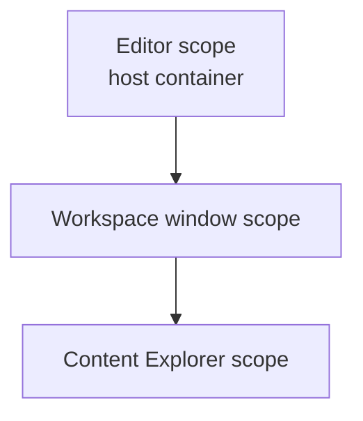

# Oxygen.Editor.Composition

The editor's composition root: the registrations of the editor scope and of
each workspace window's scope, and the workspace window that creates its scope.
The application host, `Oxygen.Editor`, is the only project that references it;
it is a library so that tests can compose the same registrations.

Design: [di-container-topology.md](../../design/editor/review/di-container-topology.md)
(sections 6.1 to 6.7) and
[editor-module-architecture.md](../../design/editor/lld/editor-module-architecture.md).

## Layout

| Path              | Holds                                                                            |
| ----------------- | -------------------------------------------------------------------------------- |
| `EditorModule.cs` | The editor scope's registrations and the top-level routes                        |
| `Workspace/`      | The workspace window: its view model, its view and `WorkspaceWindowModule`       |
| `Services/`       | Activation, project activation, window placement and the active project's folder |
| `Diagnostics/`    | The operation-result store and its output-log adapter                            |

## Scopes

Arrows are container parentage: a scope registers only what it owns and
resolves the rest from its parent ([DroidNet.Composition](../Composition/README.md)).

- `Program` builds the host, then calls `EditorModule.Register`, which also
  registers the `ScopeFactory` and the editor scope's handle.
- `WorkspaceViewModel` creates its window's scope from the router's and the
  docking's modules, `WorkspaceWindowModule` and every feature's module, in that
  order. It resolves only through that scope.
- The Content Explorer creates its own scope under the window's.

`WorkspaceWindowModule` registers the window's documents and their area, the
project's content as the window sees it, the preview, Play, script tooling and
the preferences stored per project (preview settings, hidden and locked nodes,
viewport layouts). Those preferences belong to the window until the project
session owns them; the gizmo preferences, kept across projects, stay in the
editor scope.

Registrations whose final home is another module stay here until the
registration modules of each subsystem take them over.

## Tests

`tests/Oxygen.Editor.Composition.UI.Tests.csproj` composes the editor scope over
a host-equivalent container (`HostContainer` in `TestHelpers`) and creates the
window and Content Explorer scopes through the real factory.

- **Topology**: no undeclared shadow, activated services provided, shared
  identity whichever scope resolves first, no service locator outside the
  container infrastructure, scope handles only for scope owners, no collection
  of a parent's services, resolvable constructors, no singleton view, and the
  reviewed delegate registrations.
- **Project switch**: the next window gets its own project preferences; the
  gizmo preferences are the editor's.

The scope checks read constructors by reflection. A delegate registration is
opaque to them, so each one is listed, reviewed, in the test.

## Build and test

See [build workflows](../../tooling/doc/build.md).
