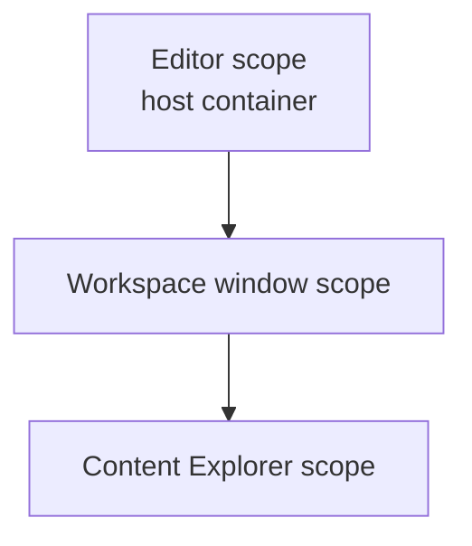

# Oxygen.Editor.Composition

The editor's composition root: the registrations of the editor scope and of
each workspace window's scope, and the workspace window that creates its scope.
The application host, `Oxygen.Editor`, is the only project that references it;
it is a library so that tests can compose the same registrations.

Design: [di-container-topology.md](../../design/editor/review/di-container-topology.md)
(sections 6.1 to 6.7) and
[editor-module-architecture.md](../../design/editor/lld/editor-module-architecture.md).

## Layout

| Path                   | Holds                                                                                             |
| ---------------------- | ------------------------------------------------------------------------------------------------- |
| `EditorModule.cs`      | The editor scope's modules, in order, the host's settings and windowing, and the top-level routes |
| `ApplicationModule.cs` | Paths, storage, activation, window placement, the windows and the scope factory                   |
| `EditorDataModule.cs`  | The state database, editor settings and project and template usage                                |
| `EngineModule.cs`      | The embedded engine and its shutdown with the host                                                |
| `Workspace/`           | The workspace window: its view model and view, `WorkspaceModule` and `WorkspaceWindowModule`      |
| `Services/`            | Activation, project activation, window placement and the active project's folder                  |
| `Diagnostics/`         | The operation-result store, its output-log adapter and `DiagnosticsModule`                        |

## Scopes

Arrows are container parentage: a scope registers only what it owns and
resolves the rest from its parent ([DroidNet.Composition](../Composition/README.md)).

- `Program` builds the host, then calls `EditorModule.Register`. It extends the
  host's container with its settings and windowing, then
  `ScopeFactory.CreateRoot` registers the editor scope's modules
  (`IApplicationLayer`) and their activation lists: those of the Shell,
  Projects, Project Explorer, ContentPipeline, LivePreview, Materials, Textures
  and the Scene Editor's settings, then this project's own.
- `WorkspaceViewModel` creates its window's scope from the router's and the
  docking's modules, then `WorkspaceWindowModule.Compose`: the window modules
  of Assets, Scenes, Scripting, Input and LivePreview, `WorkspaceWindowModule`,
  the Shell's and ContentPipeline's window modules, and every feature's module,
  in that order. It resolves only through that scope.
- The Content Explorer creates its own scope under the window's.

Each subsystem registers what it owns through its module, beside its code. The
editor has no session scope yet, so a subsystem whose services belong to the
project session (ContentPipeline, Assets, LivePreview, Scenes, Scripting,
Input) keeps them where they live today, with one module per layer; the
project session merges them. `WorkspaceWindowModule` keeps what composes
several subsystems: the panels and commands of the features, the window's open
documents with the scene and material kinds, and the preview content demand.

## Tests

`tests/Oxygen.Editor.Composition.UI.Tests.csproj` composes the editor scope over
a host-equivalent container (`HostContainer` in `TestHelpers`) and creates the
window and Content Explorer scopes through the real factory.

- **Topology**: no undeclared shadow, activated services provided, shared
  identity whichever scope resolves first, no service locator outside the
  container infrastructure, scope handles only for scope owners, no collection
  of a parent's services, resolvable constructors, no singleton view, and the
  reviewed delegate registrations.
- **Project switch**: the next window gets its own project preferences; the
  gizmo preferences are the editor's.

The scope checks read constructors by reflection. A delegate registration is
opaque to them, so each one is listed, reviewed, in the test.

## Build and test

See [build workflows](../../tooling/doc/build.md).
