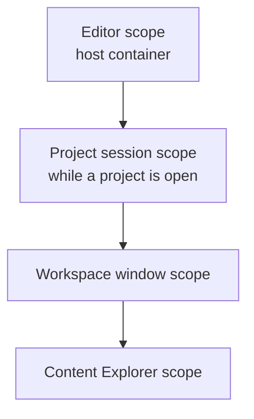

# Oxygen.Editor.Composition

The editor's composition root: the registrations of the editor scope, of the
project session's scope and of each workspace window's scope, the host that opens
and closes the session, and the workspace window that creates its scope.
The application host, `Oxygen.Editor`, is the only project that references it;
it is a library so that tests can compose the same registrations.

Design: [di-container-topology.md](../../design/editor/review/di-container-topology.md)
(sections 6.1 to 6.7 and 6.10) and
[editor-module-architecture.md](../../design/editor/lld/editor-module-architecture.md).

## Layout

| Path                   | Holds                                                                                             |
| ---------------------- | ------------------------------------------------------------------------------------------------- |
| `EditorModule.cs`      | The editor scope's modules, in order, the host's settings and windowing, and the top-level routes |
| `ApplicationModule.cs` | Paths, storage, activation, window placement, the windows and the scope factory                   |
| `EditorDataModule.cs`  | The state database, editor settings and project and template usage                                |
| `EditorWindows.cs`     | The top-level windows' targets and pages, and a navigation that reports its failure               |
| `EngineModule.cs`      | The embedded engine and its shutdown with the host                                                |
| `Sessions/`            | The project session's host, `ProjectSessionModule`, the project's folder and its last window      |
| `Workspace/`           | The workspace window: its view model and view, `WorkspaceModule` and `WorkspaceWindowModule`      |
| `Services/`            | Activation, project activation, window placement and the editor's exit                            |
| `Diagnostics/`         | The operation-result store, its output-log adapter and `DiagnosticsModule`                        |

## Scopes

Arrows are container parentage: a scope registers only what it owns and
resolves the rest from its parent ([DroidNet.Composition](../Composition/README.md)).

- `Program` builds the host, then calls `EditorModule.Register`. It extends the
  host's container with its settings and windowing, then
  `ScopeFactory.CreateRoot` registers the editor scope's modules
  (`IApplicationLayer`) and their activation lists: those of the Shell,
  Projects, Project Explorer, ContentPipeline, LivePreview, Materials, Textures
  and the Scene Editor's settings, then this project's own.
- `ProjectSessionHost` (`IProjectSessionHost`, declared by Projects) opens the
  session of a project under the editor scope, from
  `ProjectSessionModule.Compose`: the session modules of the Shell,
  ContentPipeline, Assets, Scripting, Input, LivePreview, Problems, Materials,
  Scenes and the Scene Editor's settings, then this project's own, which gives
  the session the open documents with the scene and material kinds, the
  preview content demand, and its own contexts over the state database. The
  session registers the loaded project and itself (`IProjectSession`) as
  instances, never a `ProjectContext`: a content mount change replaces the
  session's context through `ChangeContext`, and the services whose state
  comes from the mounts follow `ContextChanged`. The project's settings live
  on the session too. Closing the session closes its windows, cancels its
  lifetime, then disposes its scope, with its windows' scopes first.
- `ProjectActivationCoordinator` stages the project, recovers its publication
  and asks every window's documents to close before any session changes. A
  cancelled close keeps the open session. Once committed, the previous session
  closes, the new one opens and the workspace window navigates into it; a
  navigation that reports a failure closes the new session again. Only the
  startup navigation to the Project Explorer stops the application.
- Closing a window goes through the Shell's `CloseAndExit`. The composition
  root's participants save the window's placement, return to the Start window
  when the session's last workspace window closes (the Start window opens
  before that window closes, then the session closes), and exit the editor when
  its last window closes otherwise: any session closes, then the engine shuts
  down. The workspace window attaches to its session while it is open.
- `WorkspaceViewModel` creates its window's scope under the session's, from the
  router's and the docking's modules, then `WorkspaceWindowModule.Compose`:
  `WorkspaceWindowModule`, the Shell's window module, and every feature's
  module, in that order. It resolves only through that scope.
- The Content Explorer creates its own scope under the window's.

Each subsystem registers what it owns through its module, beside its code, one
module per layer it has services in. `WorkspaceWindowModule` keeps the panels
and commands of the features, and `ProjectSessionModule` what composes several
subsystems in the session: the open documents and the preview content demand.

## Tests

`tests/Oxygen.Editor.Composition.UI.Tests.csproj` composes the editor scope over
a host-equivalent container (`HostContainer` in `TestHelpers`) and creates the
session, window and Content Explorer scopes through the real factory.

- **Topology**: no undeclared shadow, activated services provided, shared
  identity whichever scope resolves first, no service locator outside the
  container infrastructure, scope handles only for scope owners, no collection
  of a parent's services, resolvable constructors, no singleton view, and the
  reviewed delegate registrations; a session service takes no window-bound
  dependency.
- **Project session**: one session at a time, holding its project; closing it
  cancels its lifetime and disposes its windows and services.
- **Project activation**: a cancelled close of the documents keeps the open
  session, a failed workspace navigation closes the session it opened, and a
  successful one replaces the open session.
- **Closing**: the session's last window opens the Start window, then closes
  the session, and stays open when the Start window does not open; the last
  window outside a session exits the editor.
- **Project switch**: the next session gets its own global history and its
  window its own project preferences; the gizmo preferences are the editor's.

The scope checks read constructors by reflection. A delegate registration is
opaque to them, so each one is listed, reviewed, in the test.

## Build and test

See [build workflows](../../tooling/doc/build.md).
