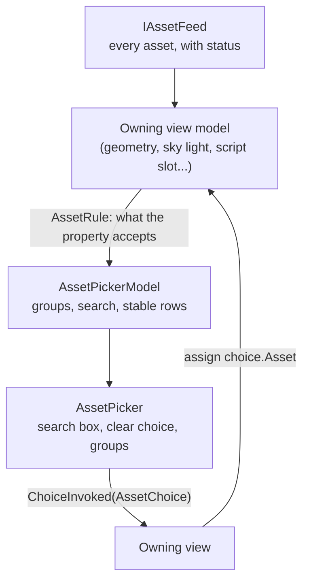

# Oxygen.Editor.Pickers

The editor's shared pickers. Every property that is assigned an asset (a node's
geometry and materials, a sky cubemap, a metering mask, a scene's script and
input references, a script slot, a script asset parameter, a material's texture
channels) picks it through one control, `AssetPicker`, so assets look and group
the same everywhere.

## Why one picker

An asset can come from three places, and the user must see which one before
assigning it:

| Group    | Origin (`AssetOrigin`) | What it holds                                                  | Can the user change it?        |
| -------- | ---------------------- | -------------------------------------------------------------- | ------------------------------ |
| Engine   | `Engine`               | The engine content pak's assets, under `/Engine`               | No; shipped with the engine    |
| Packages | `Package`              | Assets of user paks the project mounts                         | No; rebuilt from their sources |
| Content  | `Content`              | The project's authored assets and its cooked libraries' assets | Yes                            |

The groups are always shown in that order, and an empty group is hidden. The
origin comes from the asset itself (`AssetEntry.Origin`): anything under
`/Engine` is Engine, any other packaged asset is a Package, the rest is Content.
The picker does not decide what a property accepts; its owner does, usually with
an `AssetRule`, and hands the accepted assets over.

The library lives outside the Content Browser and the World Editor because the
Material Editor and the World Editor both use it, and neither should depend on
the other or on the Content Browser to show a list of assets. It depends only on
`Oxygen.Editor.Assets` (the asset model) and the DroidNet controls.

## How it fits



| Type               | Role                                                                                                                                                                                |
| ------------------ | ----------------------------------------------------------------------------------------------------------------------------------------------------------------------------------- |
| `AssetChoice`      | One row: name, the asset it assigns, type and status line, location, whether it can be picked, glyph. `AssetChoice.For(asset, type, glyph)` builds it from an asset.                |
| `AssetPickerModel` | The choices of one property. `Update` replaces them with the accepted assets; `SearchText` filters names and locations; `Find` looks up an asset's current choice for display text. |
| `AssetChoiceGroup` | One origin's header and its matching rows.                                                                                                                                          |
| `AssetChoiceRow`   | A row that keeps its identity while the asset's status changes, so an open picker does not flicker during a cook.                                                                   |
| `AssetPicker`      | The control. `Model`, `ShowSearch`, `EmptyText` and `MaxListHeight` configure it; `ChoiceInvoked` reports the picked choice.                                                        |

## Rules

- A row assigns the asset it describes; `Update` throws when a describe function
  returns a choice for another asset.
- A property that can be cleared passes a clearing choice to the model; that
  choice assigns no asset (`Asset` is null) and is shown above the groups.
- An asset appears once, even if the accepted list repeats it.
- A disabled choice (an asset that is not selectable, such as one whose cook
  failed) is shown but cannot be picked; owners also check `IsEnabled` before
  assigning.
- The owner keeps the assigned value. When the assigned asset is not offered
  (deleted, or no longer accepted), the owner shows it as missing; the picker
  only lists what can be assigned now.

## Usage

```xml
<DropDownButton Content="{x:Bind ViewModel.MaterialName, Mode=OneWay}">
    <DropDownButton.Flyout>
        <Flyout x:Name="MaterialFlyout">
            <pickers:AssetPicker ChoiceInvoked="OnMaterialChoiceInvoked" Model="{x:Bind ViewModel.MaterialChoices}" />
        </Flyout>
    </DropDownButton.Flyout>
</DropDownButton>
```

```csharp
public AssetPickerModel MaterialChoices { get; } = new(static asset => AssetChoice.For(asset, "Material", ""));

private void OnAssets(IReadOnlyList<AssetEntry> assets)
    => this.MaterialChoices.Update(AssetRule.ForCooked(AssetKind.Material).Apply(assets));
```

## Tests

`tests/` covers the model: group order and hiding, search, row identity across
updates, duplicates, and the clearing and row-identity contracts. The World
Editor's UI tests exercise the control inside the inspector.
