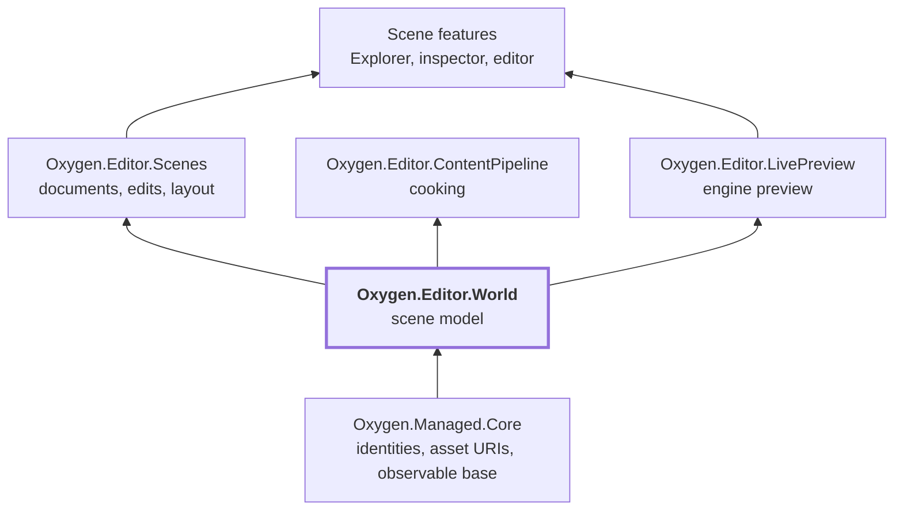
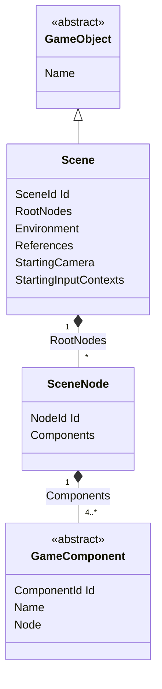
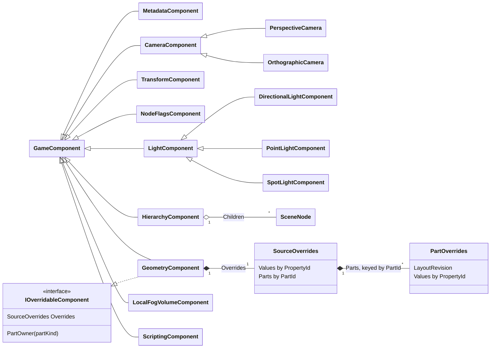
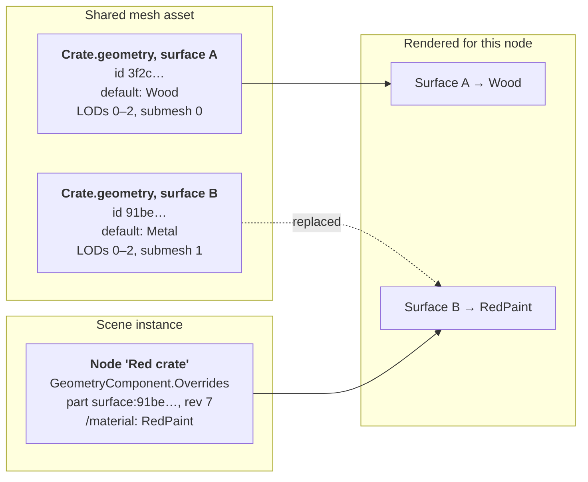
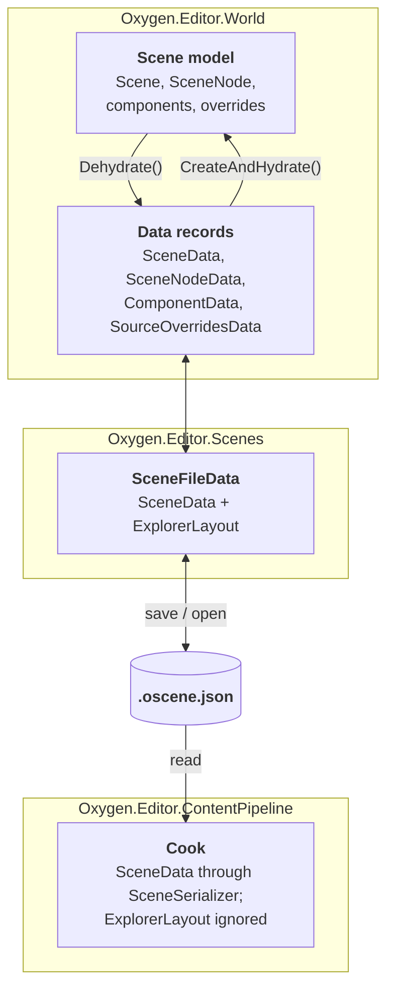
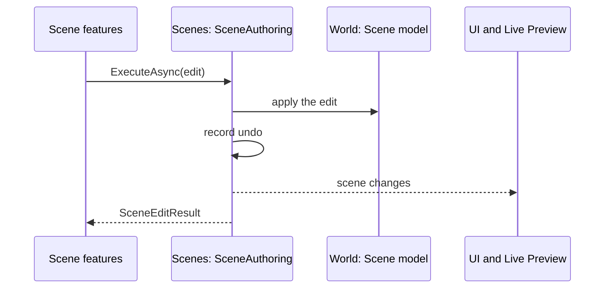

# Oxygen.Editor.World

The editor's scene model: a scene, its node hierarchy, the components on each
node, the overrides of the values an asset supplies, and the data records a
scene file is written as. It has no UI, no engine and no file system: it can be
built, edited, saved and compared in memory, in a unit test, without a
viewport.

A scene does not know where it is stored, which project opened it or how the
Scene Explorer arranges it. Whoever holds the scene knows that.

**At a glance**

- **Scene → nodes → components.** A scene holds a tree of nodes; every node has
  a transform and any other components.
- **Overrides** replace the values a node's asset supplies, on one node's
  geometry or on one of its parts, such as a surface.
- **Data records are the file format.** The model dehydrates to records and
  hydrates from them; JSON only ever sees the records.
- **Edits live elsewhere.** `Oxygen.Editor.Scenes` changes open scenes, with
  undo, dirty state and change notifications.

## Where it sits

World is at the bottom of the editor's scene stack. The modules above it read
and change the model; World knows none of them.



| Concern                                                                | Module                                                                                     |
| ---------------------------------------------------------------------- | ------------------------------------------------------------------------------------------ |
| Projects, mount points and project settings                            | `Oxygen.Editor.Projects`                                                                   |
| Scene documents, edits, undo, dirty state, Explorer folders and layout | `Oxygen.Editor.Scenes`                                                                     |
| Cooking scenes into engine descriptors                                 | `Oxygen.Editor.ContentPipeline`                                                            |
| Showing a scene in the engine while it is edited                       | `Oxygen.Editor.LivePreview`                                                                |
| Script problems; script analysis and tooling                           | `Oxygen.Editor.Scripting`, `Oxygen.Editor.LivePreview`                                     |
| Scene Explorer, inspector and viewport UI                              | `Oxygen.Editor.SceneExplorer`, `Oxygen.Editor.SceneInspector`, `Oxygen.Editor.SceneEditor` |

## Source layout

| Folder               | Contents                                                                                                                                                                                                                                                    |
| -------------------- | ----------------------------------------------------------------------------------------------------------------------------------------------------------------------------------------------------------------------------------------------------------- |
| `src/` (root)        | `Scene` and its `GameObject` base, `SceneNode`, the hierarchy queries in `SceneNodeExtensions`, `IPersistent<TData>`                                                                                                                                        |
| `src/Components/`    | The components a node carries: metadata, hierarchy, transform, node flags, geometry, cameras, lights, local fog volume and scripting, plus `LightValidation` and the override store (`IOverridableComponent`, `SourceOverrides`, `PartOverrides`, `PartId`) |
| `src/Serialization/` | The data records a scene is written as (`SceneData`, `SceneNodeData`, one record per component, and the override data), the source-generated `SceneJsonContext` and `SceneSerializer`; see its [README][ser]                                                |
| `src/Utils/`         | The vector and quaternion JSON converters, `TransformConverter` (engine transform and Euler-angle conversions) and `SceneTraversal`                                                                                                                         |

## The model



The components have their own small hierarchy, and the geometry component holds
its overrides:



A small scene, as the Scene Explorer would show it with its optional components
(every node also has its metadata, hierarchy, transform and node flags):

```text
Scene "Courtyard"
├── SceneNode "Sun"
│   └── DirectionalLightComponent      (drives the primary atmosphere light)
├── SceneNode "Fountain"
│   ├── GeometryComponent              (overrides the material of one surface)
│   └── SceneNode "Water"
│       └── LocalFogVolumeComponent
└── SceneNode "Player"
    ├── PerspectiveCamera              (the scene's StartingCamera)
    └── ScriptingComponent
```

### Scene

`Scene` holds:

- `Id`, a `SceneId` written in the file, and `Name`.
- `RootNodes`, the top of the hierarchy; `AllNodes` walks the whole hierarchy in
  order.
- `Environment`: sky atmosphere, sky sphere, sky light, fog, post process and
  background.
- `References`: the scripts, input actions, physics sidecars and extra native
  assets the scene needs at run time.
- `StartingCamera`, the camera node the scene starts viewing through, and
  `StartingInputContexts`, the input mapping contexts active when it starts.
  With no starting camera, `EffectiveStartingCamera` is the first camera in
  hierarchy order.

The scene-level values change only as a whole, through `SetEnvironment`,
`SetReferences`, `SetStartingCamera` and `SetStartingInputContexts`. Each raises
a change notification only when the value differs.

### SceneNode

A `SceneNode` is an identity and a container of components, as the engine's
node is. It belongs to one scene for its whole life and has:

- `Id`, a `NodeId` written in the file.
- `Components`, which hold exactly one of each required component, created with
  the node and never added, removed or replaced, then the optional ones.
  `AddComponent` and `RemoveComponent` refuse required components and set and
  clear each component's `Node`. Typed accessors return the required ones:
  - `Metadata`, a `MetadataComponent` whose `Name` is the node's name, nonempty
    after trimming;
  - `Hierarchy`, a `HierarchyComponent` with `Parent` and the ordered
    `Children`. `SetParent`, `AddChild` and `RemoveChild` keep both sides in
    step and refuse a parent that would make a cycle;
  - `Transform`, the `TransformComponent`;
  - `Flags`, a `NodeFlagsComponent` with `IsVisible`, `CastsShadows`,
    `ReceivesShadows`, `IsStatic`, `IsRayCastingSelectable` and
    `IgnoreParentTransform`.
    Whether a node is present in the engine is Live Preview's state, not the
    node's.

`Descendants`, `Ancestors`, `DescendantsAndSelf`, `AncestorsAndSelf`,
`HierarchyPath` and `Scene.FindByPath` query the hierarchy. `FindByPath` accepts
exact names and the `*` and `**` wildcards.

### Components

Every component derives from `GameComponent`, has a `ComponentId` and a name,
and knows its `Node`. The transform reports `IsLocked`, so it cannot be removed.

| Component                                                                | Holds                                                                                                      |
| ------------------------------------------------------------------------ | ---------------------------------------------------------------------------------------------------------- |
| `TransformComponent`                                                     | Local position, rotation and scale                                                                         |
| `GeometryComponent`                                                      | The geometry asset (always set) and the overrides of its own values and of its surfaces                    |
| `PerspectiveCamera`, `OrthographicCamera`                                | Clip planes and exposure (aperture, shutter rate, ISO), plus field of view or orthographic size            |
| `DirectionalLightComponent`, `PointLightComponent`, `SpotLightComponent` | Color, intensity, shadows and exposure compensation; a directional light can drive one atmosphere light    |
| `LocalFogVolumeComponent`                                                | Fog extinction, falloff, albedo, emission and sort priority                                                |
| `ScriptingComponent`                                                     | Script slots: the script asset, the execution order and the parameter values that differ from the defaults |

`LightValidation` checks light values and the scene-wide light rules: at most
one light per node and one directional light per atmosphere light.

#### Links to assets

A scene links to an asset by its URI, an absolute `asset:` URI such as
`asset:///Content/Geometry/Crate.ogeo`. `GeometryComponent.Geometry`,
and a material override's `AssetPath` value are required and check the form
when set (`AssetUris.EnsureAssetUri`), so neither code nor a file
can put a missing link, a file path or a web address in a scene. A link to an
asset that does not exist is still a valid link: Live Preview and the cook
report the missing asset.

The scene holds no facts about the linked asset. Code that needs them asks the
module that owns the asset's family, by the URI: the asset feed for its kind,
files and availability, and the content pipeline for a mesh's surfaces.

### Overrides

#### Why overrides exist

A geometry asset is shared. Every node that shows the same mesh gets that mesh's
own values, such as the material on each of its surfaces. A level designer often
wants _this_ crate painted red while every other crate keeps the material it was
imported with. Changing the mesh asset would repaint every crate; copying the
mesh would lose the link to it.

An override records, on one scene instance, the values that differ from what the
asset supplies, and nothing else:

- **The asset stays untouched.** An override changes one node's instance. The
  shared mesh and material assets never change.
- **Only the intent is stored.** The file records what was overridden, not the
  asset's defaults. When the asset changes later, every value the scene did not
  override follows it.
- **Clearing restores the asset's value.** An absent override is the source's
  (the geometry asset's) value. Choosing the engine's default material is a
  separate, explicit assignment, not a clear.

#### The override store

`GeometryComponent`, the engine's renderable component, implements
`IOverridableComponent` and holds `Overrides`, an immutable `SourceOverrides`
value:

| Member                | Holds                                                                                              |
| --------------------- | -------------------------------------------------------------------------------------------------- |
| `Values`              | Overrides of the component's own properties, by `PropertyId`                                       |
| `Parts`               | Overrides of each part, by `PartId(Kind, Id)`, each a `PartOverrides(LayoutRevision, Values)`      |
| `PartOwner(partKind)` | On `IOverridableComponent`: the asset that owns the IDs of a part kind (the geometry for surfaces) |

A `PropertyId` (in `Oxygen.Managed.Core`) names a component kind, an optional
part kind and a JSON pointer. Only the properties in the generated
`SceneSchema.Overridable`, the properties with `sources` in the engine schema,
can be overridden, on their component and part kinds and with a value of their
type. Today the only one is `SceneSchema.Geometry.Surface.Material`: part kind
`surface`, key `/material`, an `AssetPath`.

#### Material overrides follow the engine's surface identity

A mesh's surfaces belong to the engine. Its geometry inventory gives each
surface an opaque surface ID, says which LODs and submeshes the surface binds,
and carries a layout revision. A material override is an entry of
`Overrides.Parts` for the part `PartId("surface", <surface id>)`:

| Field            | Purpose                                                                                        |
| ---------------- | ---------------------------------------------------------------------------------------------- |
| `PartId.Id`      | The engine's identity of the surface; names, list order and indices are for display only       |
| `LayoutRevision` | The inventory revision seen when the override was chosen, so stale assignments can be detected |
| `Values`         | The overridden properties of the surface; `/material` is the material to use                   |

Because the engine maps the surface to every LOD and submesh it binds, one override
covers all of them. The editor never derives a surface from a name or an index, so
a reimport that reorders or renames surfaces cannot silently move an override to
another part of the mesh.



What each module does with an override:

| Module                          | Role                                                                                                                                                                            |
| ------------------------------- | ------------------------------------------------------------------------------------------------------------------------------------------------------------------------------- |
| `Oxygen.Editor.Scenes`          | `SetOverrides` writes or resets it after checking the property, part kind, value and surface against the geometry's inventory; `SetGeometry` keeps those the new mesh still has |
| `Oxygen.Editor.LivePreview`     | Sends each surface material override to the engine with its surface id and layout revision, and clears the ones that went away                                                  |
| `Oxygen.Editor.ContentPipeline` | Writes each material override as a material override record of the renderable; an override with no matching geometry or surface id fails the scene's cook                       |
| `Oxygen.Editor.SceneInspector`  | Lists the mesh's surfaces in the inspector and offers Reassign or Clear for overrides whose surface no longer resolves                                                          |

An override whose surface no longer exists after a reimport is kept, with its
material and surface context, until it is reassigned or cleared. It blocks only the
cook of the scenes that hold it. The full identity and reimport contract is in
[content-pipeline.md §20][surface-identity].

## Persistence

The model never goes to JSON directly. It dehydrates to data records, and the
records are what is written. Scenes saves and opens the file; the cook only
reads it:



Each persistent type implements `IPersistent<TData>`: `Dehydrate()` returns its
data record and `Hydrate(data)` restores it. `Scene.CreateAndHydrate`,
`SceneNode.CreateAndHydrate` and `GameComponent.CreateAndHydrate` create the
right type from a record. A geometry component converts its overrides with
`SourceOverridesJson`, which reads each value as the type
`SceneSchema.Overridable` gives its property. Hydration
suppresses change notifications.

`SceneJsonContext` serializes the records with the source generator, writes
vectors and quaternions as `{ "X": … }` objects, and omits null values.
Components carry a `$type` discriminator. Identities are written as
GUID strings.

A geometry component writes its overrides as an `Overrides` object, omitted
when empty:

```json
"Overrides": {
  "Parts": [
    {
      "Kind": "surface",
      "Id": "<surface id>",
      "LayoutRevision": "<64 lowercase hex>",
      "Values": { "/material": "asset:///Content/Materials/RedPaint.omat" }
    }
  ]
}
```

`SceneData` has these top-level properties:

| Property                | Written                |
| ----------------------- | ---------------------- |
| `Id`, `Name`            | Always                 |
| `RootNodes`             | Always                 |
| `Environment`           | Always                 |
| `References`            | When the scene has any |
| `StartingCamera`        | When one is authored   |
| `StartingInputContexts` | When the scene has any |

`Oxygen.Editor.Scenes` reads and writes scene files. Its file record extends
`SceneData` with the Explorer layout, so readers of `SceneData`, such as the
cook, ignore it. `SceneSerializer` reads and writes a bare `SceneData` stream;
the cook and the tests use it.

### What hydration rejects

| Problem                                                                                                 | Result                                                                           |
| ------------------------------------------------------------------------------------------------------- | -------------------------------------------------------------------------------- |
| A node without exactly one transform                                                                    | `JsonException`                                                                  |
| Lights that fail `LightValidation`                                                                      | `ArgumentException` when hydrating, `InvalidOperationException` when dehydrating |
| A geometry or material link that is missing or not an absolute `asset:` URI                             | `JsonException`                                                                  |
| An override of a property that is not overridable, or with a value of the wrong type                    | `JsonException`                                                                  |
| A member a record does not declare, such as a removed key in `GeometryComponentData` or `SceneNodeData` | `JsonException`; the scene fails to open                                         |
| Component identities empty or repeated in a node                                                        | Not rejected: they are replaced with new identities                              |

`Scene.Hydrate` builds every node before replacing any, so data it rejects
leaves the scene as it was.

## Changing a scene

Setting a property on the model changes the model and raises
`INotifyPropertyChanged`; it does nothing else. Editor code changes an open
scene through the edits of `Oxygen.Editor.Scenes`, which add undo, the dirty
state and the change stream that the UI and Live Preview follow:



The model is not thread-safe. Its owner uses it from one thread at a time, and
notifications are raised on the thread that made the change.

## Adding a component

1. Add the component under `src/Components/`, derived from `GameComponent`, with
   `Hydrate` and `Dehydrate`. Its static constructor registers how it is created
   from its record with `Register<TData>`.
2. Add its record under `src/Serialization/`, derived from `ComponentData`, and
   declare it on `ComponentData` with `[JsonDerivedType]` and on
   `SceneJsonContext` with `[JsonSerializable]`.
3. Run its static constructor in `GameComponent.EnsureBuiltInFactories` and in
   `SceneSerializer`, so hydration finds its factory.
4. Add round-trip tests in `tests/`.

The edits, the inspector, the cook and Live Preview each support the component
in their own module.

## Dependencies

- `Oxygen.Managed.Core`: the identity types, `AssetUris` and
  `ScopedObservableObject`. World references no other project.

## Tests

[tests/](tests/) holds the unit tests: scene and node behavior, identities in
JSON, the starting camera and input contexts, components, overrides, vector
serialization and the transform conversions.

## Related documentation

- [Scene authoring model](../../design/editor/lld/scene-authoring-model.md)
- [Scenes module](../../design/editor/review/scenes-module.md)
- [Editor architecture](../../design/editor/ARCHITECTURE.md)

## License

Distributed under the MIT License. See [LICENSE](../../LICENSE) or
[opensource.org/licenses/MIT](https://opensource.org/licenses/MIT).

[ser]: src/Serialization/README.md
[surface-identity]: ../../design/editor/lld/content-pipeline.md#20-canonical-surface-identity-and-reimport
