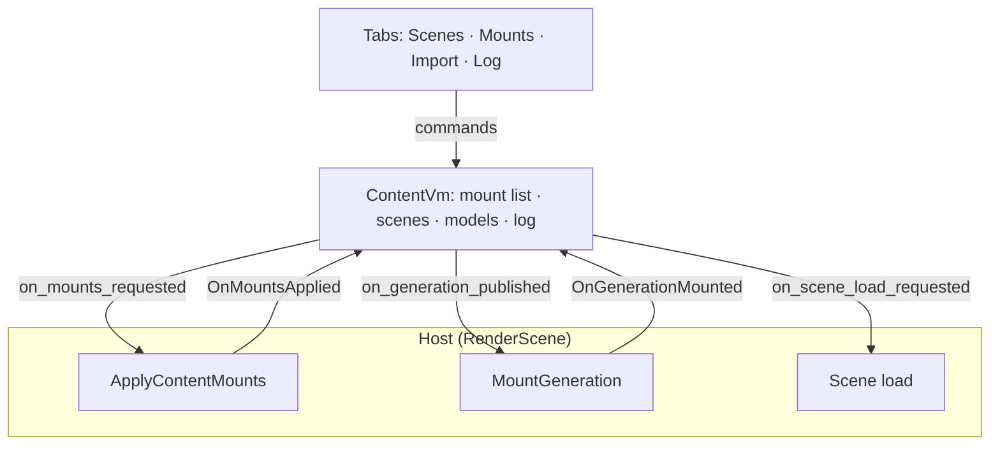

# DemoShell

DemoShell is the shell the engine examples share: the side panels, the
settings services behind them, the camera rig and the panel commands. The host
(`Oxygen.Host`) owns the window, the scene stage, the toolbar and the console;
an example turns panels on in `DemoShellPanelConfig` and binds the host hooks
in `DemoShellConfig`.

## At a glance

| Panel           | Does                                                | Used by       |
| --------------- | --------------------------------------------------- | ------------- |
| Content Loader  | Mounts cooked sources, loads scenes, imports models | RenderScene   |
| Camera Controls | Camera rig: orbit, fly and drone controllers, poses | Most examples |
| Environment     | Profiles, sun, atmosphere, sky light, fog, skybox   | Most examples |
| Post Process    | Exposure, tone mapping and post effects             | Most examples |
| Diagnostics     | Renderer diagnostics and statistics                 | Most examples |
| Ground Grid     | The ground grid                                     | On by default |

- Every panel control runs a command, so the console, the command palette and
  the UI share one path: [console commands](Console.md).
- Settings persist in one `demo_settings.json` (`SettingsService`); each
  panel's service owns its keys.
- Tests: [DemoShell tests](test/README.md).

## Content Loader

The Content Loader panel lets a developer see what is mounted, load a scene,
import a model and find out why something did not load, without an editor.
Its user steps are in the [RenderScene guide](../RenderScene/README.md#load-content).

| Tab    | Job                 | Holds                                                                             |
| ------ | ------------------- | --------------------------------------------------------------------------------- |
| Scenes | Load a scene        | Search, mount chips, Recent, the scenes by mount and folder, Load, Reload, Unload |
| Mounts | See what is mounted | Cooked sources by priority, their details and failed requirements, source folders |
| Import | Make content        | Source folder or Import file, the models and their record states, import settings |
| Log    | Find out why        | Every mount, load and import with its code, filtered by severity or text, details |

A status strip under the tabs shows the loaded scene, or the running load or
import with Cancel, and the error and warning counts, which open the Log. The
Mounts tab is marked when a source is refused, missing or unreadable; the Log
tab counts the errors not yet seen.

### How it works

`ContentVm` orchestrates the panel's models; the tabs draw them and run
commands. The host applies the mount list, mounts generations and loads
scenes, and answers the view model.

- **Mount list** (`ContentMountList`): the cooked sources in precedence order,
  each with its state (Pending, Mounted, Refused, Missing, Unreadable), its
  summary and its failed requirements. Rows come from the developer, from the
  selected generation of each mounted model import record, and the engine pak,
  always last.
- **Scenes** (`ContentSceneCatalog`): the mounted scenes grouped by the first
  segment of their virtual path, then by folder.
- **Models** (`ContentModelCatalog`): the model files of a source folder of the
  scratch project, each with its record's state: not imported, imported,
  settings changed, failed or importing.
- **Log** (`ContentLog`): every operation with its code, including the
  import's own diagnostics.
- **Source folders** (`ContentSourceFolders`): the scratch project's `Source`
  mounts. Folders the panel adds are local mounts in the scratch project's
  `.mounts.json`; the `Scratch` mount, which holds the import records, is not
  one.

| Need                        | Engine call                                                               |
| --------------------------- | ------------------------------------------------------------------------- |
| Apply the list              | `PrepareMountsAsync` then `CommitPreparedMounts`, lowest precedence first |
| Refusal reasons             | `DependencyRequirementError` failures, carried back by `OnMountsApplied`  |
| Mount one generation        | `MountLooseCookedGeneration`, `RetireLooseCookedGeneration`               |
| Provides, deletes, requires | `cooked::ReadCookedSummary`                                               |
| Assets of a source          | `cooked::CookedContent::Open(...).Assets()`                               |
| Scenes                      | `IAssetLoader::EnumerateMountedScenes`                                    |
| Model state, settings diff  | `ModelImportRecord::Read`, `MakeSettings`, `SelectedGeneration`           |
| Import                      | `ModelImportRecord::Prepare`, `AsyncImportService::SubmitModelImport`     |

An import publishes a new generation of the model's record. The host mounts it
on a later frame; a scene that loads after the import loads once the
generation is mounted, since until then no mounted source holds it.

### Settings

| Key                             | Holds                                                         |
| ------------------------------- | ------------------------------------------------------------- |
| `content.mounts.sources`        | The added cooked sources, in precedence order                 |
| `content.mounts.import_records` | The model import records whose selected generation is mounted |
| `content.scene.*`               | The loaded scene and the recent scenes                        |
| `content.import.*`              | Every import option the panel edits                           |
| `content.importer.*`            | Thread pool size and per-pipeline workers and queues          |
| `content.import_tab.*`          | Source folder, filter and formats                             |
| `demo_shell.panels.content.*`   | Which sections are open                                       |

### Files

| File                                | Role                                                              |
| ----------------------------------- | ----------------------------------------------------------------- |
| `UI/ContentLoaderPanel.*`           | The panel: tab bar, tab bodies, status strip, file dialog results |
| `UI/Content*Tab.*`                  | One file per tab                                                  |
| `UI/ContentPanelWidgets.*`          | The panel's controls: bands, chips, toggle groups, rows, callouts |
| `UI/ContentPanelCommands.*`         | The `demo.content.*` commands every control runs                  |
| `UI/ContentVm.*`                    | The view model                                                    |
| `Runtime/ContentMountApplier.*`     | `ApplyContentMounts` and `MountGeneration`, which hosts call      |
| `Services/ContentSettingsService.*` | The `content.*` settings                                          |

### Decisions

- **Four tabs by job.** Scenes, Mounts, Import and Log match what the
  developer is doing, not the code's modules.
- **One atomic path for the list.** Prepare and commit replace the mounted
  set and keep the engine pak beneath it; the engine has no per-source
  unmount for the panel.
- **Refusal is a state, not a log line.** A refused source stays in the list
  with its failed requirements and is retried at the next launch or on Retry.
- **Rows name cooked sources by mount and file**, from their summary; a loose
  root is its folder. The words library and index never appear in the panel,
  its commands or its settings keys.
- **Import file mounts the file's folder.** A record names its source through
  a source mount, so a file in none cannot be imported; the folder stays a
  source folder, so reimports work after a restart.
- **Selection before action.** Clicking selects; loading and importing are
  explicit, with the record and settings difference in view.
- **Nothing disables the whole panel.** Only actions that conflict with a
  running load or import are disabled, with a tooltip that says why.
