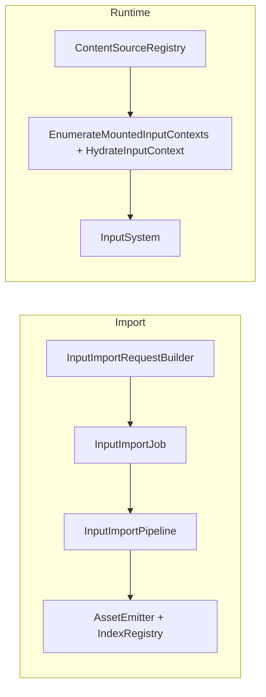

# Input Cooking Architecture Specification (Job/Pipeline Locked)

**Date:** 2026-03-02 **Status:** Design / Specification

## 0. Status Tracking

This document is the target architecture contract. Live implementation progress
and explicit missing work are tracked in
`design/content-pipeline/input-cooking-implementation-plan.md` (Section 4.1 and
Section 11).

Current implementation status snapshot:

1. Implemented: input request contracts, `InputImportJob`,
   `InputImportPipeline`, async routing, manifest `type: "input"` integration,
   and ImportTool input command wiring.
2. Implemented: runtime `EnumerateMountedInputContexts()` +
   `HydrateInputContext()` APIs, including trigger hydration, slot alias
   normalization, and mounted-context metadata extraction.
3. Implemented: scene-binding infrastructure removal in native tooling/runtime
   (`INPT` and `input_context_bindings` paths removed) and shipped input JSON
   schema (`src/Oxygen/Cooker/Import/Schemas/oxygen.input.schema.json`) with
   schema validation tests.
4. Implemented: an input source is a container. Its products are named under its
   identity (`/Content/Input/Player.input/Jump.oiact`), and a mapping names an
   action of another source by virtual path (Section 7.4.0).
5. Verification caveat: by execution policy, no local project build was run
   during the first implementation pass.

## 1. Scope

This specification defines the authoritative architecture for importing,
cooking, packaging, and runtime bootstrap of input assets in Oxygen.

In scope:

1. `InputAction` and `InputMappingContext` import/cook integration.
2. Loose-cooked descriptor emission (`.oiact`, `.oimap`).
3. PAK/runtime compatibility validation using existing tooling through native
   Cooker and PakDump.
4. Runtime bootstrap for default context activation.
5. Full removal of scene-attached input-context binding infrastructure
   (`InputContextBindingRecord`, `InputContextBindingFlags`,
   `kInputContextBinding` component type, scene `INPT` component table handling,
   and all associated code paths).

Out of scope:

1. New trigger semantics.
2. New modifier framework.
3. Any alternate import execution architecture.

## 2. Hard Constraints

1. Import implementation must use `ImportJob -> Pipeline` architecture.
2. No bypass path or ad-hoc inline runner.
3. No scope reduction without explicit approval.
4. New binary serialization/deserialization logic must use `oxygen::serio` (no
   raw byte arithmetic for new logic).
5. Runtime content code must not depend on demo/example code.
6. Input import execution must use one job class only: `InputImportJob`.
7. Input import execution must use one pipeline class only:
   `InputImportPipeline`.
8. Mapping-context imports must carry explicit dependencies to the jobs that
   produce the actions of other sources they reference.

## 3. Repository Analysis Snapshot (Pre-Implementation Baseline)

The following facts were captured before implementation started and are retained
as baseline context:

| Fact                                                                      | Evidence                                                                                                                                                        |
| ------------------------------------------------------------------------- | --------------------------------------------------------------------------------------------------------------------------------------------------------------- |
| Loose layout already supports input descriptors                           | `src/Oxygen/Cooker/Loose/LooseCookedLayout.h` (`kInputActionDescriptorExtension`, `kInputMappingContextDescriptorExtension`, input virtual path/subdir methods) |
| Runtime loaders for input assets already exist                            | `src/Oxygen/Content/Loaders/InputActionLoader.h`, `src/Oxygen/Content/Loaders/InputMappingContextLoader.h`                                                      |
| Scene loading currently parses input context binding component table      | `src/Oxygen/Content/Loaders/SceneLoader.h` (`kInputContextBinding` branch)                                                                                      |
| Scene asset dependency publication currently uses scene input bindings    | `src/Oxygen/Content/AssetLoader.cpp` (`publish_scene_input_mapping_context_dependencies`)                                                                       |
| Demo currently hydrates contexts from scene bindings                      | `Examples/DemoShell/Services/SceneLoaderService.cpp` (`AttachInputMappings`)                                                                                    |
| Import stack currently has script/script-sidecar dual path, no input path | `src/Oxygen/Cooker/Import/AsyncImportService.cpp`, `ImportManifest.cpp`, `BatchCommand.cpp`, `ImportRunner.cpp`                                                 |
| Input import job/pipeline/request-builder classes do not exist            | no matches for `InputImportJob`, `InputImportPipeline`, `InputImportKind`, `BuildInputImportRequest` under `src/Oxygen/Cooker/Import`                           |

Conclusion:

1. Input asset format and runtime loading are present.
2. Import/cooker integration is missing.
3. Scene-attached association is currently authoritative and must be removed.

## 4. Decision

Input mapping contexts are standalone assets. Scene component `INPT` is not
authoritative for runtime behavior.

A mapping-context descriptor carries one start-up value, its default priority.
Which contexts start is a property of the scene: a scene lists its starting
contexts with their priorities, and instantiating the scene adds and activates
them
([scene start state](../runtime-core/scene-instantiation-and-player.md#scene-start-state)).
Contexts carry no auto-load or auto-activate flag.

## 5. Target Architecture



Architectural split:

1. Import path owns descriptor production and indexing.
2. Runtime bootstrap owns default context activation policy.
3. Scene loading no longer owns input association policy.
4. Both input asset kinds flow through the same job/pipeline classes.

## 6. Class Design

## 6.1 New Classes

### Import/Cooker

1. `oxygen::content::import::InputImportSettings`
   - file: `src/Oxygen/Cooker/Import/InputImportSettings.h`
   - role: tooling-facing DTO for one input import job request
     (orchestration-only fields).

2. `oxygen::content::import::internal::BuildInputImportRequest(...)`
   - files:
     - `src/Oxygen/Cooker/Import/InputImportRequestBuilder.h`
     - `src/Oxygen/Cooker/Import/Internal/InputImportRequestBuilder.cpp`
   - role: validate + normalize input job settings into `ImportRequest`.

3. `oxygen::content::import::detail::InputImportJob`
   - files:
     - `src/Oxygen/Cooker/Import/Internal/Jobs/InputImportJob.h`
     - `src/Oxygen/Cooker/Import/Internal/Jobs/InputImportJob.cpp`
   - role: request/session lifecycle, source loading, pipeline orchestration,
     finalize.

4. `oxygen::content::import::InputImportPipeline`
   - files:
     - `src/Oxygen/Cooker/Import/Internal/Pipelines/InputImportPipeline.h`
     - `src/Oxygen/Cooker/Import/Internal/Pipelines/InputImportPipeline.cpp`
   - role: parse/validate/serialize/emit for `InputAction` and
     `InputMappingContext`.

### Runtime

1. `oxygen::content::HydrateInputContext(...)`
   - files:
     - `src/Oxygen/Content/InputContextHydration.h`
     - `src/Oxygen/Content/Internal/InputContextHydration.cpp`
   - role: free function — converts a binary `InputMappingContextAsset` into a
     live `InputMappingContext` by resolving action references, building trigger
     chains, and registering with `InputSystem`.

2. `IAssetLoader::EnumerateMountedInputContexts()`
   - file: `src/Oxygen/Content/IAssetLoader.h` (declaration),
     `src/Oxygen/Content/AssetLoader.cpp` (implementation)
   - role: scan mounted sources for `kInputMappingContext` assets and return
     metadata entries. Mirrors existing `EnumerateMountedScenes()`.

## 6.2 Changed Classes

1. `ImportRequest`
   - add top-level `InputPayload` marker (orchestration-only; presence signals
     input import routing).
   - `asset_virtual_path` carries the input source's identity; the pipeline
     names every product under it.
   - `InputImportKind` is NOT added to `ImportOptions` or `ImportRequest`: there
     is one input document kind.
   - file: `src/Oxygen/Cooker/Import/ImportRequest.h`.

2. `AsyncImportService`
   - route input requests to `InputImportJob`.
   - file: `src/Oxygen/Cooker/Import/AsyncImportService.cpp`.

3. `ImportManifest`
   - support `type: "input"` only.
   - files: `src/Oxygen/Cooker/Import/ImportManifest.h/.cpp`.
   - input jobs name their identity (`virtual_path`) and include explicit
     dependency edges (`id`, `depends_on`).

4. ImportTool command surface
   - add `InputCommand` and wire in `main.cpp`, `BatchCommand.cpp`,
     `ImportRunner.cpp`, README.

5. `SceneLoaderService`
   - remove `AttachInputMappings(const SceneAsset&)` entirely.
   - remove all scene-driven context activation code.

6. `SceneLoader`
   - remove scene `INPT` component table handling entirely (no compatibility
     parsing).

7. `PakFormat_input.h`
   - remove `InputContextBindingRecord` struct.
   - remove `InputContextBindingFlags` enum.

8. `SceneAsset.h`
   - remove `ComponentTraits<InputContextBindingRecord>` specialization.

9. `ComponentType.inc` / `PakFormat.inc`
   - remove `kInputContextBinding` component type.

10. `ToStringConverters.cpp`
    - remove `to_string(InputContextBindingFlags)` and `kInputContextBinding`
      case.

11. `PakFormatSerioLoaders.h`
    - remove `InputContextBindingRecord` serio loader.

12. `PakDump/SceneAssetDumper.h`
    - remove `kInputContextBinding` dump branch.

13. `AssetLoader.cpp`
    - remove `publish_scene_input_mapping_context_dependencies` and all call
      sites.

14. `IAssetLoader`
    - add `EnumerateMountedInputContexts()` returning
      `std::vector<MountedInputContextEntry>`.
    - mirrors existing `EnumerateMountedScenes()` pattern.
    - file: `src/Oxygen/Content/IAssetLoader.h`.

15. `InputMappingContextAsset`
    - add `GetDefaultPriority()` accessor.
    - file: `src/Oxygen/Data/InputMappingContextAsset.h`.

## 7. API Contracts

## 7.1 Import Request Payload

Add to `ImportRequest`:

```cpp
struct InputPayload final {
  // Orchestration-only. Presence signals input import routing.
};
```

`ImportRequest` gains:

```cpp
std::optional<InputPayload> input;
```

Routing contract:

1. `AsyncImportService` routes requests with `request.input` present to
   `InputImportJob`.
2. No `InputImportKind` enum exists. An input source has one document kind.
3. `ImportManifestJob::BuildRequest()` sets `request.input` when
   `job_type == "input"`, and `request.asset_virtual_path` to the job's
   `virtual_path`, the source's identity.

## 7.2 Input Command (CLI Only)

Command surface:

1. `input <source> --virtual-path <identity>`

`--virtual-path` is required: the source's identity, its path without the
authoring `.json` (`/Content/Input/Player.input`).

CLI-only optional flags (NOT valid in manifest job objects):

1. `--output` (cooked root override)
2. `--name` (human-readable job name)
3. `--report` (report destination path)
4. `--content-hashing` (content hashing toggle)

These flags are consumed by the `InputCommand` CLI handler to build an
`ImportRequest`. They do NOT appear in manifest `jobs[]` entries.

## 7.3 Manifest Contract (`ImportManifest`)

This section defines manifest-mode import for input assets in ImportTool batch
mode.

Schema target files:

1. `src/Oxygen/Cooker/Import/ImportManifest.h`
2. `src/Oxygen/Cooker/Import/ImportManifest.cpp`
3. `src/Oxygen/Cooker/Import/Schemas/oxygen.import-manifest.schema.json`
4. Generated at build time:
   `out/<build>/generated/Oxygen/Cooker/Import/Internal/ImportManifest_schema.h`

Schema deltas:

1. `defaults` adds:
   - `input`
2. `job_settings.type` enum adds:
   - `"input"`
3. `job_settings` adds dependency metadata:
   - `id: string` (job identity, unique in manifest)
   - `depends_on: string[]` (job ids)
4. `job_settings` for `input` includes only orchestration fields:
   - `source`
   - `virtual_path`: the source's identity, required
   - `id`
   - `depends_on`
   - `output`, `layout`, `source_key`
5. `job_item` conditional rules add:
   - if `type == "input"`: require `source`
   - jobs whose mappings reference actions of other sources must declare
     `depends_on` for the jobs that produce those actions when they cook in the
     same batch
   - asset-semantic fields are invalid in manifest jobs:
     - `type` (action type — `bool`/`axis1d`/`axis2d`; do not confuse with job
       `type: "input"`)
     - `consumes_input`
     - `priority`
     - `mappings`
     - `triggers`
     - `trigger`
     - `slot`
     - `actions`
     - `contexts`

`jobs[]` contract (single shape):

```json
{
  "id": "job.unique.id",
  "type": "input",
  "source": "Content/Input/PlayerInput.input.json",
  "virtual_path": "/Content/Input/PlayerInput.input"
}
```

Dependency example (file B maps actions declared by file A):

```json
[
  {
    "id": "core.actions",
    "type": "input",
    "source": "Content/Input/CoreActions.input.json",
    "virtual_path": "/Content/Input/CoreActions.input"
  },
  {
    "id": "vehicle.contexts",
    "type": "input",
    "depends_on": ["core.actions"],
    "source": "Content/Input/Vehicle.input.json",
    "virtual_path": "/Content/Input/Vehicle.input"
  }
]
```

Unresolved action references are caught at pipeline parse time
(`input.context.action_unresolved`).

Validation invariants:

1. `source` must be present for `type: "input"`.
2. `virtual_path` must be present (`import.manifest.virtual_path_missing`).
3. manifest jobs must not include input asset semantic fields (Section 7.3 delta
   #5 list).
4. manifest jobs must not include CLI-only keys: `name`, `verbose`,
   `content_hashing`, `report`.
5. allowed `input` job keys are exactly: `id`, `type`, `source`, `virtual_path`,
   `depends_on`, `output`, `layout`, `source_key`. Any other key is rejected
   with diagnostic `input.manifest.key_not_allowed`.
6. `id` must be unique across all jobs in the manifest.
7. every `depends_on` id must exist in the same manifest.
8. no dependency cycles are allowed.
9. `id` is required for all `input` jobs (diagnostic:
   `input.manifest.job_id_missing`).

Request mapping:

1. `type=input` -> routed to `InputImportJob`.
2. source JSON is parsed only inside `InputImportPipeline`, which emits one
   asset per declared action and per declared context.
3. no asset kind or asset properties are stored in manifest job settings.
4. output location and global toggles come from top-level/default orchestration
   config, not per-input job fields.

Cross-tool scope clarification:

1. `ImportManifest` drives ImportTool/import pipeline only.
2. Native import schemas define authoring inputs; no parallel Python packaging
   schema exists.
3. Both paths must serialize identical `InputMappingContextAssetDesc` semantics.

### 7.3.1 Dependency Scheduling Contract

Batch execution is dependency-aware:

1. ImportTool builds a DAG from `id` + `depends_on`.
2. Validation checks before dispatch:
   - unique `id` values across all jobs (diagnostic:
     `input.manifest.job_id_duplicate`).
   - every `depends_on` target exists in the manifest (diagnostic:
     `input.manifest.dep_missing_target`).
   - no cycles in the dependency graph (diagnostic: `input.manifest.dep_cycle`).
3. Jobs are dispatched only when all predecessors have succeeded.
4. If a predecessor job fails, all transitive dependents are skipped with
   deterministic diagnostics (failure propagation). Skipped jobs report
   `input.import.skipped_predecessor_failed`.
5. The execution node for each input job remains
   `InputImportJob -> InputImportPipeline`.

## 7.4 Input Source JSON Specification (Importer Input Files)

This section defines the JSON document shapes consumed by:

1. `input <source>`

These are importer source documents, not ImportManifest job documents.

### 7.4.0 Authoring Model

The input system uses two kinds of cooked assets internally
(`InputActionAssetDesc`, `InputMappingContextAssetDesc`). The authoring unit is
the **input source**, a `*.input.json` file that declares actions, mapping
contexts, or both.

An input source is a container. Its identity is its path without the authoring
`.json`, and each product is named under it:

```text
/Content/Input/Player.input.json  ->  /Content/Input/Player.input/Jump.oiact
                                      /Content/Input/Player.input/OnFoot.oimap
```

The descriptor of a product lives at the same place under the cooked root
(`Input/Player.input/Jump.oiact`); the cooked layout has no input folder. A
product's identity depends only on its source and its own name, so two sources
never produce the same identity, even in one folder. Moving or renaming a source
moves its products; renaming an action or a context changes that product's
identity.

References follow one rule:

1. Inside one source, a mapping names an action of the same source by its local
   name: `"action": "Jump"`.
2. A mapping that uses an action of another source names it by virtual path:
   `"action": "/Content/Input/Common.input/Jump.oiact"`. The cooker resolves it
   like every authored reference: canonical virtual path, expected type
   `InputAction`, mounted indexes searched from the highest precedence down,
   then a descriptor already written below the job's mount. A path that names
   another asset type is refused (`input.context.action_type_mismatch`); a path
   nothing holds is refused (`input.context.action_unresolved`).
3. The cooked record stores the action's `AssetKey`. At runtime an action or
   context is found by its key; its name is a label.

An action is declared once, by its source. A source re-cooking its own products
replaces them; a source that only declares actions is an input source like any
other, whose actions other sources map.

```text
Content/Input/
  Common.input.json    ← declares Jump, Move (actions only)
  Player.input.json    ← declares OnFoot, mapping /Content/Input/Common.input/Jump.oiact
```

Key authoring rules:

1. **Actions are declared in the top-level `actions` array.**
2. **Mappings reference actions by local name or by virtual path.**
3. **All binding/trigger/hardware configuration lives in `mappings`**, never in
   the action declaration.
4. **One source file = one import job.** A single manifest job produces all
   action assets + all context assets of the source.
5. **Dependencies between jobs** are needed when a source maps an action of
   another source cooked in the same batch.

Manifest example (typical — single self-contained file):

```json
{
  "jobs": [
    {
      "id": "input.all",
      "type": "input",
      "source": "Content/Input/PlayerInput.input.json",
      "virtual_path": "/Content/Input/PlayerInput.input"
    }
  ]
}
```

### 7.4.1 File Extension Convention

Input sources use the `*.input.json` suffix, associated with
`oxygen.input.schema.json`.

Editor workspace settings (VSCode example):

```json
{
  "json.schemas": [
    {
      "fileMatch": ["*.input.json"],
      "url": "./src/Oxygen/Cooker/Import/Schemas/oxygen.input.schema.json"
    }
  ]
}
```

This gives authors immediate autocompletion, hover documentation, and real-time
validation for every field, enum value, and slot name without any extension or
plugin.

### 7.4.2 Input Source JSON (`*.input.json`)

One schema, `oxygen.input.schema.json`, describes every input source: optional
`actions` and optional `contexts`, both defaulting to empty. Schema validation
reports its own errors (`input.schema.validation_failed`); there is no document
kind to detect.

Canonical document (`PlayerInput.input.json`):

```json
{
  "$schema": "./src/Oxygen/Cooker/Import/Schemas/oxygen.input.schema.json",

  "actions": [
    { "name": "Move", "type": "axis2d" },
    { "name": "Look", "type": "axis2d" },
    { "name": "Jump", "type": "bool", "consumes_input": true },
    { "name": "Sprint", "type": "bool" }
  ],

  "contexts": [
    {
      "name": "Gameplay",
      "priority": 100,

      "mappings": [
        { "action": "Move", "slot": "W", "trigger": "down" },
        { "action": "Move", "slot": "S", "trigger": "down", "scale": [0, -1] },
        { "action": "Move", "slot": "A", "trigger": "down", "scale": [-1, 0] },
        { "action": "Move", "slot": "D", "trigger": "down", "scale": [1, 0] },
        { "action": "Look", "slot": "MouseXY", "trigger": "down" },
        { "action": "Jump", "slot": "Space", "trigger": "pressed" },
        { "action": "Sprint", "slot": "LeftShift", "trigger": "down" }
      ]
    },
    {
      "name": "Menu",
      "priority": 50,

      "mappings": [
        {
          "action": "Move",
          "slot": "UpArrow",
          "trigger": "down",
          "scale": [0, 1]
        },
        {
          "action": "Move",
          "slot": "DownArrow",
          "trigger": "down",
          "scale": [0, -1]
        },
        {
          "action": "Move",
          "slot": "LeftArrow",
          "trigger": "down",
          "scale": [-1, 0]
        },
        {
          "action": "Move",
          "slot": "RightArrow",
          "trigger": "down",
          "scale": [1, 0]
        },
        { "action": "Jump", "slot": "Return", "trigger": "pressed" }
      ]
    }
  ]
}
```

Cooked under the identity `/Content/Input/PlayerInput.input`, this file produces
6 assets: `/Content/Input/PlayerInput.input/Move.oiact` and the other three
actions, and `/Content/Input/PlayerInput.input/Gameplay.oimap` and
`.../Menu.oimap`.

**Top-level field contract:**

1. `$schema`: optional string. Points to shipped JSON Schema for editor
   integration.
2. `actions`: optional array of action declarations (Section 7.4.2.1), default
   empty.
3. `contexts`: optional array of context declarations (Section 7.4.2.2), default
   empty.

**Top-level validation rules:**

1. unknown top-level fields are rejected.
2. all actions referenced in any context's `mappings` must resolve: a name
   declared in this source's `actions` array, or the virtual path of an action
   in mounted content (Section 7.4.0).

### 7.4.2.1 Action Declaration

Each `actions[]` item:

1. `name`: required name (the segment rule, `oxygen.name.schema.json`).
2. `type`: required enum; `"bool"` / `"axis1d"` / `"axis2d"`.
3. `consumes_input`: optional bool, default `false`.
4. `description`: optional string. Ignored by pipeline, available for editor
   hover docs via JSON Schema.

Each action is emitted as a separate `InputActionAssetDesc` binary asset at
`<source identity>/<name>.oiact`; its key derives from that virtual path.

Validation rules:

1. unknown action fields are rejected.
2. duplicate action names within the same `actions` array are rejected
   (`input.asset.action_conflict`).

Binary mapping:

| JSON field       | Binary field (`InputActionAssetDesc`) | Mapping                                |
| ---------------- | ------------------------------------- | -------------------------------------- |
| `name`           | `header.name_offset`                  | UTF-8, in the descriptor string table  |
| `type`           | `value_type`                          | `"bool"`→0, `"axis1d"`→1, `"axis2d"`→2 |
| `consumes_input` | `flags`                               | `true` → `kConsumesInput` bit set      |

### 7.4.2.2 Context Declaration

Each `contexts[]` item:

1. `name`: required name (the segment rule, `oxygen.name.schema.json`).
2. `priority`: optional int32, default `0`; the priority used when a context is
   activated without one.
3. `description`: optional string. Ignored by pipeline, for editor hover docs.
4. `mappings`: required array (Section 7.4.2.3).

Each context is emitted as a separate `InputMappingContextAssetDesc` binary
asset at `<source identity>/<name>.oimap`.

Validation rules:

1. unknown context fields are rejected.
2. `priority` must be int32.
3. duplicate context names within the same `contexts` array are rejected
   (`input.context.name_duplicate`).

Binary mapping:

| JSON field | Binary field (`InputMappingContextAssetDesc`) | Mapping                               |
| ---------- | --------------------------------------------- | ------------------------------------- |
| `name`     | `header.name_offset`                          | UTF-8, in the descriptor string table |
| `priority` | `default_priority`                            | direct int32 copy                     |

### 7.4.2.3 Mapping Record Contract

Each `mappings[]` item:

1. `action`: required string — the local name of an action of this source, or
   the virtual path of an action (Section 7.4.0).
2. `slot`: required string — input slot name. Must match a registered
   `InputSlot` name (see Section 7.4.4).
3. `trigger`: optional string — shorthand for a single trigger with default
   parameters. Mutually exclusive with `triggers`. Accepted values: any trigger
   type enum (Section 7.4.5).
4. `triggers`: optional array — full trigger specification for multiple or
   parameterized triggers. Mutually exclusive with `trigger`. Default `[]`.
5. `scale`: optional `[float, float]`, default `[1.0, 1.0]`.
6. `bias`: optional `[float, float]`, default `[0.0, 0.0]`.

Trigger resolution:

1. if `trigger` (string) is present: expand to
   `[{ "type": <value>, "behavior": "implicit", "actuation_threshold": 0.5 }]`.
2. if `triggers` (array) is present: use as-is.
3. if neither is present: mapping has zero triggers (always fires on input
   change).
4. if both are present: reject with `input.context.trigger_ambiguous`.

Validation rules:

1. `action` must be present and non-empty.
2. `slot` must be present and non-empty.
3. `scale` and `bias` must each contain exactly 2 numeric values.
4. unknown mapping fields are rejected.

Binary mapping:

| JSON field | Binary field (`InputActionMappingRecord`) | Mapping                             |
| ---------- | ----------------------------------------- | ----------------------------------- |
| `action`   | `action_asset_key`                        | resolved to the action's `AssetKey` |
| `slot`     | `slot_name_offset`                        | descriptor string table offset      |
| `scale`    | `scale[2]`                                | direct float copy                   |
| `bias`     | `bias[2]`                                 | direct float copy                   |

### 7.4.4 Input Slot Names

The `slot` field in mappings must match a registered input slot name from
`InputSlots` ([Input.h](src/Oxygen/Platform/Input.h)). The JSON Schema
enumerates all valid names for autocomplete.

Available slot categories:

**Mouse:** `MouseWheelUp`, `MouseWheelDown`, `MouseWheelLeft`,
`MouseWheelRight`, `MouseWheelX`, `MouseWheelY`, `MouseWheelXY`,
`LeftMouseButton`, `RightMouseButton`, `MiddleMouseButton`, `ThumbMouseButton1`,
`ThumbMouseButton2`, `MouseX`, `MouseY`, `MouseXY`

**Keyboard — Special:** `None`, `AnyKey`, `BackSpace`, `Delete`, `Tab`, `Clear`,
`Return`, `Pause`, `Escape`, `Space`

**Keyboard — Keypad:** `Keypad0`..`Keypad9`, `KeypadPeriod`, `KeypadDivide`,
`KeypadMultiply`, `KeypadMinus`, `KeypadPlus`, `KeypadEnter`, `KeypadEquals`

**Keyboard — Navigation:** `UpArrow`, `DownArrow`, `LeftArrow`, `RightArrow`,
`Insert`, `Home`, `End`, `PageUp`, `PageDown`

**Keyboard — Function:** `F1`..`F15`

**Keyboard — Alpha:** `Alpha0`..`Alpha9`, `A`..`Z`

**Keyboard — Symbols:** `Exclaim`, `DoubleQuote`, `Hash`, `Dollar`, `Percent`,
`Ampersand`, `Quote`, `LeftParen`, `RightParen`, `Asterisk`, `Plus`, `Comma`,
`Minus`, `Period`, `Slash`, `Colon`, `Semicolon`, `Less`, `Equals`, `Greater`,
`Question`, `At`, `LeftBracket`, `Backslash`, `RightBracket`, `Caret`,
`Underscore`, `BackQuote`

**Keyboard — Modifiers:** `NumLock`, `CapsLock`, `ScrollLock`, `RightShift`,
`LeftShift`, `RightControl`, `LeftControl`, `RightAlt`, `LeftAlt`, `LeftMeta`,
`RightMeta`, `Help`, `Print`, `SysReq`, `Menu`

Note: Gamepad slot names are not yet registered in the engine. When gamepad
support is added to `InputSlots`, the JSON Schema and this list will be extended
accordingly.

### 7.4.5 Trigger Contract

Each `triggers[]` item (or the expanded form of a `trigger` shorthand):

1. `type`: required enum (must match `InputTriggerType` from
   `ActionTriggers.inc`):
   - `pressed` (kPressed = 0)
   - `released` (kReleased = 1)
   - `down` (kDown = 2)
   - `hold` (kHold = 3)
   - `hold_and_release` (kHoldAndRelease = 4)
   - `pulse` (kPulse = 5)
   - `tap` (kTap = 6)
   - `chord` (kChord = 7)
   - `action_chain` (kActionChain = 8)
   - `combo` (kCombo = 9)
2. `behavior`: optional enum (`explicit`, `implicit`, `blocker`), default
   `implicit`.
3. `actuation_threshold`: optional float, default `0.5`.
4. `hold_time`: optional float (seconds). Used by `hold`, `hold_and_release`.
5. `interval`: optional float (seconds). Used by `pulse`.
6. `chord_action`: optional action reference (local name or virtual path). Used
   by `chord`.
7. `combo_actions`: optional array of combo step objects. Used by `combo`.
8. `aux`: optional array of aux records (Section 7.4.6), default `[]`.

Validation rules:

1. unknown trigger fields are rejected.
2. `type` must be a valid trigger type enum.
3. `aux` is required for `combo` if combo steps are authored.

Binary mapping:

| JSON field              | Binary field (`InputTriggerRecord`) | Mapping                                       |
| ----------------------- | ----------------------------------- | --------------------------------------------- |
| `type`                  | `type`                              | enum ordinal                                  |
| `behavior`              | `behavior`                          | `"explicit"`→0, `"implicit"`→1, `"blocker"`→2 |
| `actuation_threshold`   | `actuation_threshold`               | direct float                                  |
| `hold_time`, `interval` | `fparams[0..4]`                     | trigger-type-specific packing                 |
| `chord_action`          | `linked_action_asset_key`           | resolved to `AssetKey`                        |
| `combo_actions`         | `aux_start_index` + `aux_count`     | references aux record table                   |

### 7.4.6 Trigger Aux Contract

Each `aux[]` item (used for combo step definitions):

1. `action`: required action reference (local name or virtual path).
2. `completion_states`: optional uint32, default `0`.
3. `time_to_complete`: optional float (seconds), default `0`.

Validation rules:

1. unknown aux fields are rejected.
2. the referenced action must resolve (Section 7.4.0).

Binary mapping:

| JSON field          | Binary field (`InputTriggerAuxRecord`) | Mapping                          |
| ------------------- | -------------------------------------- | -------------------------------- |
| `action`            | `action_asset_key`                     | resolved to `AssetKey`           |
| `completion_states` | `completion_states`                    | direct uint32                    |
| `time_to_complete`  | `time_to_complete_ns`                  | seconds → nanoseconds conversion |

### 7.4.7 Parsing Ownership

1. `InputImportPipeline` owns source document parsing/validation.
2. `InputImportJob` does not parse schema details; it orchestrates pipeline
   lifecycle only.
3. diagnostics for source schema failures must use `input.context.*` and
   `input.asset.*` namespaces.

## 7.5 JSON Schema Distribution

The engine ships JSON Schema files that provide real-time editor support:

### 7.5.1 Shipped Schema Files

1. `src/Oxygen/Cooker/Import/Schemas/oxygen.input.schema.json` — the input
   source format (actions and contexts).

Schema features:

1. `description` on every field — visible as hover documentation in editors.
2. `enum` for all string enums — `type`, trigger `type`, `behavior`, `slot` —
   gives autocomplete in editors.
3. `default` annotations — shows default values in editor tooltips.
4. `additionalProperties: false` — rejects unknown fields and flags typos
   immediately.
5. `if/then` for trigger-type-specific fields — validates that `hold_time` is
   only used with `hold`/`hold_and_release`, etc.
6. Input slot enum is auto-generated from `InputSlots` class to stay in sync
   with the engine.

### 7.5.2 Schema Location Convention

Schema files are shipped in the engine's `schemas/` directory at the repository
root. Source files reference them via relative path:

```json
{ "$schema": "./src/Oxygen/Cooker/Import/Schemas/oxygen.input.schema.json" }
```

For projects where content is in a subdirectory, adjust the relative path
accordingly:

```json
{ "$schema": "../../src/Oxygen/Cooker/Import/Schemas/oxygen.input.schema.json" }
```

Alternatively, use workspace-level settings for automatic association (Section
7.4.1) and omit `$schema` from source files entirely.

### 7.5.3 Schema Maintenance

1. The input slot enum in the schema is generated from `InputSlots` registered
   names. When slots are added to the engine, the schema must be regenerated.
2. When trigger types are added to `ActionTriggers.inc`, the trigger type enum
   in the schema must be updated.
3. Schema version follows the engine's input system version. Breaking changes
   increment the version number.

## 8. Binary Contract Changes

## 8.1 `InputMappingContextFlags`

`InputMappingContextFlags` defines no flag: the field is reserved, cooked
contexts store `kNone`, and the loader rejects a descriptor that sets a bit. The
descriptor version is 2; version 1 descriptors carried start flags and must be
recooked.

## 8.2 `InputMappingContextAssetDesc`

Add field:

1. `int32_t default_priority`

Constraints:

1. total struct size remains 256 bytes.
2. reserved padding adjusted accordingly.

## 8.3 `InputContextBindingRecord` — Removed

This struct, its flags enum (`InputContextBindingFlags`), and the
`kInputContextBinding` component type are fully removed from the codebase as
part of this effort. No compatibility parsing is retained. All code paths that
referenced scene-attached input context bindings are deleted.

## 9. Runtime Context Lifecycle

Input context lifecycle is **app-driven**, not scene-driven and not
auto-bootstrapped.

### 9.1 Enumeration API

`IAssetLoader` gains a new method that mirrors the existing
`EnumerateMountedScenes()`:

```cpp
struct MountedInputContextEntry {
  AssetKey asset_key;
  ContentSourceKey source_key;
  std::string name;
  InputMappingContextFlags flags;
  int32_t default_priority;
};

auto EnumerateMountedInputContexts() const
    -> std::vector<MountedInputContextEntry>;
```

Implementation (inside `AssetLoader` / `SceneCatalogQueryService` layer):

1. iterate mounted sources from `ContentSourceRegistry`.
2. for each source, iterate assets by index (`GetAssetCount`,
   `GetAssetKeyByIndex`).
3. read `AssetHeader` from descriptor reader; filter
   `AssetType::kInputMappingContext`.
4. decode the mapping-context descriptor header to extract `name`, `flags`,
   `default_priority`.
5. append entry to result vector.

The caller receives a flat list of every mapping context known to the content
system. No sorting, dedup, or activation is performed — those decisions belong
to the application.

### 9.2 Hydration Free Function

A single free function converts a binary asset into a live
`InputMappingContext`:

```cpp
// src/Oxygen/Content/InputContextHydration.h
namespace oxygen::content {

auto HydrateInputContext(
    const InputMappingContextAsset& asset,
    IAssetLoader& loader,
    input::InputSystem& input_system
) -> std::shared_ptr<input::InputMappingContext>;

} // namespace oxygen::content
```

Responsibilities:

1. read action references from the asset's mapping records.
2. for each action reference, load the `InputActionAsset` via
   `IAssetLoader::GetInputActionAsset`.
3. create `Action` objects and register them with `InputSystem::AddAction` (skip
   if already registered).
4. build trigger chains from the asset's trigger records.
5. construct the `InputMappingContext` and return it.

This function replaces the ~200-line inline hydration in
`SceneLoaderService::AttachInputMappings`.

### 9.3 Application-Driven Lifecycle

The application (or a game-specific service) drives the full lifecycle using the
enumeration API, hydration function, and existing `InputSystem` methods:

```text
Enumerate  →  Hydrate  →  AddMappingContext  →  ActivateMappingContext
                                                ↕
                                         DeactivateMappingContext
                                                ↓
                                         RemoveMappingContext
```

**Scenario A — Contexts a scene starts with (e.g. gameplay bindings):**

1. The scene lists them as starting input contexts, each with a priority.
2. Scene instantiation loads each context, hydrates it with
   `HydrateInputContext(asset, loader, input_system)`, adds it with its priority
   and activates it.

**Scenario B — Mode-switching contexts (e.g. camera orbit ↔ fly):**

1. Scripts call `oxygen.input.activate_context(context)` and
   `deactivate_context(context)` with a context asset reference; a context not
   yet added is hydrated on first activation with its default priority.
2. Application code can do the same through `InputSystem`.

**Scenario C — On-demand contexts:**

1. Application loads the asset explicitly
   (`IAssetLoader::StartLoadInputMappingContextAsset`).
2. Hydrates and activates when needed; removes when done.

### 9.4 `InputMappingContextAsset` Accessor

`InputMappingContextAsset` gains a new accessor to expose the binary field:

```cpp
[[nodiscard]] auto GetDefaultPriority() const -> int32_t;
```

This reads `default_priority` from the `InputMappingContextAssetDesc` header.

### 9.5 Failure Behavior

1. If a mapping-context descriptor cannot be decoded,
   `input.context.hydration_failed` is emitted and that context is skipped.
2. If an action reference cannot be resolved during hydration,
   `input.context.action_unresolved` is emitted and that mapping entry is
   skipped.
3. Enumeration and hydration failures do not halt processing of remaining
   contexts.

## 10. Import Pipeline Behavior

## 10.1 `InputImportJob`

Responsibilities:

1. validate manifest/orchestration request shape (`type=input`, source present).
2. load source bytes.
3. start `InputImportPipeline` workers in job nursery.
4. submit one work item and collect one result.
5. finalize import session and return `ImportReport`.

## 10.2 `InputImportPipeline`

Responsibilities:

1. place the source at its identity (`request.asset_virtual_path`, an `.input`
   path inside the job's mount; refusals are the placement's
   `import.asset_virtual_path_*` and `vpath.*` codes).
2. parse and validate the source document against `oxygen.input.schema.json`.
3. validate domain constraints.
4. extract action declarations from `actions`, emit each as a separate
   `InputActionAssetDesc` named under the source.
5. iterate `contexts`, emit each as a separate `InputMappingContextAssetDesc`
   named under the source; expand `trigger` shorthand strings to full trigger
   records.
6. resolve every action reference (Section 7.4.0): a local name against the
   declared actions, a virtual path through the mounted cooked sources.
7. build descriptor bytes with `oxygen::serio::Writer`.
8. emit descriptor(s) through `AssetEmitter` and register loose index entries
   for all emitted assets.

Validation:

1. `actions[]` declarations validated (name, type, no duplicates).
2. context names unique within the file.
3. each context's mapping/trigger/aux/slot ranges valid.
4. every action reference resolves to an input action.
5. `trigger` shorthand and `triggers` array are mutually exclusive per mapping.

## 11. Diagnostics Contract

Stable diagnostic prefixes:

1. `input.request.*`
2. `input.import.*`
3. `input.asset.*`
4. `input.context.*`
5. `input.manifest.*`

Required diagnostics:

1. `input.request.invalid_job_type`
2. `input.context.action_unresolved` (a local name this source does not declare,
   or a virtual path no mounted content holds)
3. `input.context.action_type_mismatch` (a virtual path naming an asset that is
   not an input action)
4. `input.context.name_duplicate` (duplicate context names within one file)
5. `input.context.trigger_ambiguous` (both `trigger` and `triggers` present on
   same mapping)
6. `input.context.slot_unknown` (slot name not in registered InputSlots)
7. `input.context.hydration_failed` (descriptor decode or construction error
   during hydration)
8. `input.asset.action_conflict` (an action name declared twice in one source)
9. `input.schema.validation_failed` (the source does not match
   `oxygen.input.schema.json`)
10. `input.import.index_load_failed` (a mounted cooked index could not be read
    while resolving an action path)
11. `input.import.index_registration_failed`
12. `input.import.skipped_predecessor_failed`
13. `input.manifest.job_id_missing`
14. `input.manifest.job_id_duplicate`
15. `input.manifest.dep_missing_target`
16. `input.manifest.dep_cycle`
17. `input.manifest.dep_wrong_type` (reserved — not emitted; kept for code
    stability)
18. `input.manifest.key_not_allowed`

## 12. Current-format contract

Native Cooker, runtime loaders and inspection tools use the current versions
from `Oxygen.Data`. There are no compatibility readers. Rebuild tools and recook
content after a format change. A scene's starting input contexts, scripts and
gameplay code activate contexts; a context only carries its default priority.
Scene input binding records are not authored or emitted.

## 14. Test Strategy

1. Data:
   - descriptor layout/size tests for mapping-context changes.
2. Import:
   - input request builder tests.
   - job/pipeline end-to-end tests for action/context.
   - products named under their source: two sources in one folder declaring the
     same action cook two keys.
   - a mapping referencing another source's action by virtual path; an
     unresolved reference is refused.
   - `trigger` shorthand expansion (string → full trigger record).
   - slot name validation against registered `InputSlots`.
3. Manifest:
   - key whitelist enforcement (reject `name`, `verbose`, `content_hashing`,
     asset fields) and the required `virtual_path`.
   - dependency DAG ordering, cycles, missing targets.
   - failure propagation (predecessor fail -> skip dependents).
4. Runtime:
   - `EnumerateMountedInputContexts` returns correct entries for mounted
     sources.
   - `HydrateInputContext` resolves actions, builds triggers, returns live
     context.
   - a scene's starting contexts are added and activated by instantiation.
5. Compatibility checks:
   - verify generated descriptors are consumable by existing runtime and
     existing tooling.
6. Schema:
   - JSON Schema validates canonical examples without errors.
   - JSON Schema rejects unknown fields, invalid enum values.
7. Demo:
   - RenderScene functional test without scene input bindings.

## 15. Acceptance Criteria

1. Input import path is exclusively `InputImportJob -> InputImportPipeline`.
2. All scene-bound context association infrastructure is fully removed (no
   struct, no enum, no component type, no parsing, no packing).
3. `EnumerateMountedInputContexts` + `HydrateInputContext` provide a complete,
   app-driven context lifecycle (no implicit bootstrap service).
4. Loose-cooked outputs are consistent with new ownership model and remain
   PAK-compatible.
5. Runtime and tooling diagnostics are explicit and deterministic.
6. Tests listed in Section 14 pass.
