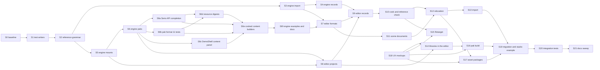

# Portable references: implementation plan

Status: proposal

Last updated: 2026-11-04

This plan implements the [proposal](README.md) as specified by the
[design](design.md). It orders the work into slices, says what each slice
deletes, which tests it writes and what "done" means, and ends with the debt
ledger: every old form found in the code, with the slice that removes it.

## Contents

- [Status](#status)
- [Rules for every slice](#rules-for-every-slice)
- [Order](#order)
- [Slices](#slices)
- [What R16 leaves for the editor](#what-r16-leaves-for-the-editor)
- [What R11 leaves for the editor](#what-r11-leaves-for-the-editor)
- [Debt ledger](#debt-ledger)
- [Test impact](#test-impact)
- [Commits](#commits)

## Status

| Slice | Status                                                         |
| ----- | -------------------------------------------------------------- |
| S0    | Done                                                           |
| S1    | Done, committed                                                |
| S2    | Done, committed                                                |
| S3    | Done, committed                                                |
| S4    | Done, committed                                                |
| S5    | Done, committed                                                |
| S6    | Done, committed, with the Serio step 6 and cooked sources work |
| S6a   | Done                                                           |
| S6b   | Done                                                           |
| S6c   | Done                                                           |
| S6d   | Done                                                           |
| S6e   | Done                                                           |
| S6f   | Done                                                           |
| S7    | Done, committed                                                |
| S8    | Done, committed                                                |
| S9    | Done, committed                                                |
| S10   | Done, committed                                                |
| S11   | Not started                                                    |
| S12   | Not started                                                    |
| S13   | Not started                                                    |
| S14   | Not started (waits on S18)                                     |
| S15   | Not started (waits on S18)                                     |
| S16   | Not started (waits on S18)                                     |
| S17   | Not started (waits on S18)                                     |
| S18   | Not started                                                    |
| S19   | Not started                                                    |
| S20   | Not started                                                    |
| S21   | Not started                                                    |

## Rules for every slice

- **Delete, do not adapt.** A slice that replaces a form deletes the old one in
  the same slice: no reader, flag, fallback or converter of an old form
  survives it. Its ledger rows are closed when the slice ends.
- **Tests by level.** A slice writes unit and functional tests, as the design
  defines them, from the contract and with codes. It writes no integration
  test, unless its row names one with the reason no lower level reaches the
  behaviour.
- **One writer per format.** Tests write authored files through the format's
  test writer (S1), never as inline JSON.
- **Integration tests wait for S20.** Integration tests that a slice's contract
  change breaks are listed in its row, are not edited in that slice, and are
  fixed together in S20 through the same writers. If a slice breaks an
  integration test it does not list, it stops and reports why.
- **Docs move with code.** A slice updates the docs its rows name.
- **Engine first.** The editor embeds the engine's schemas and conformance
  tables from the installed SDK, so an engine slice that changes them is built
  and installed before the editor slice that consumes them.

## Order

S18 (mockups) has no code dependency and starts with S1, so the owner's UX
decisions are in before S14.

S6a to S6e finish the engine side of S6 and of the
[Serio](../../../src/Oxygen/Serio/README.md) and [cooked sources](../cooked-sources/README.md)
work. They change no editor code; editor work they require is a task of the
editor slice named in their rows. The engine slice S2 of review set R6,
[loose root publication](../cooked-sources/root-publication.md), lands and is
installed before S7: its loose index version 9 is the one the editor slices
consume. Review set R16, the tool command lines and SDK contracts, lands and is
installed before S7 too: it changed the reports the editor reads and left the
work in [what R16 leaves for the editor](#what-r16-leaves-for-the-editor). S6f
takes the engine share of S19 to S21, so from S7 on every slice is editor or
interop work and touches the engine only incidentally.

## Slices

### S0. Baseline

Run, filtered to the suites this plan touches, the engine `Oxygen.Content`,
`Oxygen.Data`, `Oxygen.Cooker` and PakTool tests, and the editor's Core,
Assets, Projects, Models, Textures, ContentPipeline Unit, World, Scenes,
ContentExplorer and Problems unit lanes. Record the failures. Each failure
gets its own fix before S1, as an ordinary fix with its own commit. Done when
every lane above passes.

### S1. Test writers

No behaviour change. Adds the single writers of the design's
[testing](design.md#testing) table, each writing today's contract, and moves
the **unit and functional** tests to them. A writer is added when a test uses
it, so none is unused:

- Engine: `Cooker/test/Support/AuthoredFiles.h`, one builder per authored
  format with its own identity; `SpellReference` is the only place a reference
  is spelled. The scripting sidecar keeps `ScriptImportTestSupport.h` as its
  writer. The engine record builder lands in S20, the first slice whose tests
  write records, and `TestPaths` cooked mounts in S20, with the integration
  tests that use them (S5's mount tests run over an in-memory file system).
- Editor: `Oxygen.Managed.Assets.Testing` `AuthoredFiles`; new
  `Oxygen.Editor.Models.Testing` `ModelRecords`; `TestProject.ManifestJson`
  and `TestProject.BindMounts`, the one test writer of `Project.oxy` and of
  `.mounts.json`, replacing the local copies in the Projects tests.
- Unit and functional tests moved: the engine schema tests and the material,
  geometry, buffer and scene source tests; `MaterialSourceTests`,
  `TextureSourceTests`, `InputSourceTests`, `ModelImportRecordsTests`,
  `ModelContentTests`, `TextureImportTests`, `ProjectAssetFilesTests`,
  `ProjectValidationAndContextTests`, `AssetRelocationTests`,
  `SharedMountTests`, `UnsavedCookInputsTests`. Tests whose subject is a
  spelling (a malformed document, a source position) keep that text.
- Mislabelled tests: the 34 classes of ContentPipeline `tests/Unit` that use
  the disk or processes, directly or through the cook output lease, move to
  `tests/Integration`; five merge into the Integration class of the same name.
  The README's tier text states the three levels.

Done when the moved tests pass with no inline authored JSON left in unit or
functional tests other than spelling cases.

### S2. Reference grammar

| Engine                                                                                                          | Editor                                                                  |
| --------------------------------------------------------------------------------------------------------------- | ----------------------------------------------------------------------- |
| `content::ResolveReference`, `RelativeReference`, two errors                                                    | `AssetPath.TryResolveReference`, `ToReference`, two errors, codes       |
| `VirtualPathCases.json` `references` table (anchors, `..`, `.`, spaces, Unicode, refusals, spelling round trip) | `VirtualPathCasesTests` runs it; `RefusalSections` includes it          |
| `virtual_paths.md` References section                                                                           | `Oxygen.Managed.Core/README.md` References; `AssetUris` section removed |

Nothing consumes the functions yet, so nothing breaks. Unit tests only. Done
when both languages pass the shared table.

### S3. Engine import

Deletes: the five resolvers, the `canonical_*_path` reference definitions, the
three identity checks, the texture descriptor identity source, the per-job
invalid/unmounted reference codes. Adds: `ResolveJobReference`,
`LookupReference`, `oxygen.reference.schema.json`,
the `.oiact` input rule, relative buffer products, written and resolved forms
in source analysis, the relative built-in geometry material.

Unit tests: the schema tests with relative, absolute, self-absolute and
outside-mount samples; `BufferSource_test`, `ScriptImportRequestBuilder_test`
and `InputImportRequestBuilder_test`, which are unit tests and are fixed here;
resolver tests over an in-memory
`ImportRequest`; input rule tests; `ImportSourceAnalysis` dependency
comparison as a pure function. Docs: `async_import_pipeline_v2.md`,
ImportTool README job rules, `physics.md` reference layers.

Integration tests broken and left for S20: the descriptor, manifest, sidecar,
geometry, buffer, input and source-analysis `*_functional_test` files and the
ImportTool CLI tests in the [test impact](#test-impact) table.

### S4. Engine records

Deletes: `kRecordsFolder`, `RecordRelativePath`, `PathFor`, `ContentRootOf`,
`RootOfRecord`, the `Imports/` scan, the record `virtual_path`, the manifest
`record` field, the content root inputs, `import.reference_outside_mount`.
Adds: `RecordPathOf`, `IdentityOf`, `ScanRecords(MountTable)`,
`kModelGenerationsFolder`, the record `LocateReference` path,
`MountTable::LocateReference` over `ResolveReference`,
`ModelImportRecordCases.json`.

Unit tests: the shared record cases (path to identity, `source` forms) over an
in-memory mount table. Docs: ImportTool README records section,
`loose_cooked_content.md`, `async_import_pipeline_v2.md`, model record schema
description.

Integration tests left for S20: `ModelImportRecord_functional_test`,
`SceneImportRequestBuilder_functional_test`, the model scenario tests, the
ImportTool record CLI tests, DemoShell `ContentVm_test`, and the texture
descriptor file references of `TextureDescriptorImportRequestBuilder_functional_test`. DemoShell's scratch
mount (design) lands here so the examples build.

### S5. Engine mounts

Deletes: `MountKind::kPak`, the silent unknown-kind default, the folder-only
`Cooked` rule, the 64-character mount-name cap. Adds: `kInvalid`, findings,
roles, `ReadLibraryFacts`, the library checks a version 3 pak and a loose root
can answer (format, roots, external scripts), cooked folder overlap,
`mount.kind_unknown`, library fixture recipes in `MountTableCases.json`, typed
pak and index open failures, the table's `Cooked` mounts in every job's cooked
roots.

Unit tests: library facts over in-memory loose index and pak bytes (built by
`LooseCookedTestWriter` and `PakTestWriter` into buffers); mount table cases
over an in-memory file system port. `SourceMounts_test` moves to that port; it
is functional today on temp folders and becomes unit. Docs: source-mounts
proposal mount sections, ImportTool README mounts.

### S6. Engine paks

Deletes: exact-identity dependencies, `PakCatalog::ValidateDependencies`, the
flat `dependency_types` map, `--embed-browse-index` and the optional browse
index. Adds: catalog version 4, dependency records with requirements, the
registry requirement check, `DependencyRequirementError`, the Player launch
error, PakDump output, a pak's root and requirements in its library facts and
`mount.cooked_dependency_missing` with pak recipes in `MountTableCases.json`
(a version 3 catalog names neither). Rebuilds `engine.pak` and the examples pak.

Unit tests: `PakCatalog_test` (encode, decode, structure), the catalog schema
and sidecar IO tests, requirement checks over fake `IContentSource` layers
with patches and tombstones, `RequestPreparation` over its fake file system,
`CliBuilder`. One integration test is added and named here:
`PakBuilderDependencyTest` builds a library pak and a dependent pak and mounts
both through `AssetLoader`, because only a real build proves the planner writes
the requirements the registry checks. Docs: PakTool README, `paktool_design.md`,
`binary_packing_discipline.md`, `patch_resolution_contract.md`,
`scene-instantiation-and-player.md`.

Integration tests left for S20, to move to the
[cooked content builders](../cooked-content-builders/README.md): the Pak and
PakTool functional tests whose fixtures build a pak with no content or patch
bases of another library than their content (24 Pak, 10 PakTool, all failing
on the one-library rule). The `AssetLoader_generation_test` dependency cases
and the `PakBuilder_functional_test` dependency fixture moved to requirements
in this slice.

### S6a. Serio API completion

Closes the gaps consumers worked around, in Serio itself, and moves every
duplicate of a Serio facility onto it, so the API is complete and consistent
and Serio is the one IO stack. The design is the
[Serio documentation](../../../src/Oxygen/Serio/README.md).

Deletes:

- Content: `Internal/BlockingReads.h`, `Internal/RegionReader.h`, the
  no-driver branches of `LooseCookedSource` and `PakFile`, the verified pak
  mount's blocking CRC pass on a thread pool worker, and the path-keyed index
  mutex (`LockFileShared`, `LockFileExclusive`).
- Data: the hand-written span copies into a `ByteBuffer` (`TextureResource`,
  `BufferResource`, the test kit's `StagePayload`), the `reinterpret_cast`
  views of one as `uint8_t`, the span constructors of `TextureResource` and
  `BufferResource`, the `memcpy` header parsing of `TextureResource`, and the
  `std::vector<uint8_t>` payloads of `ScriptResource` and `PhysicsResource`.
- Cooker: `RealCookerStorage::Move`'s rename and its check-then-act
  pre-checks; `IAsyncFileWriter`, `WindowsFileReader`, `WindowsFileWriter`,
  `FileError`, `FileErrorInfo` and their tests; the emitters' callbacks,
  pending counts and polling flush; `PakSourceDevices::Read`'s vector; the
  PakDump helpers `ReadDescriptorBytes`, `TryReadAssetHeader`,
  `ReadStructAt`, `ReadRecordAt` and the scene dumper's buffer copies.
- Engine and others: `ScriptCompilationService`'s stream records,
  `PublishCacheFile` and its `MoveFileExW`; `ScriptSourceBlob`'s vector;
  `ExternalFileResolver`'s `ifstream` read; `ControlServer`'s hand-written
  temporary and rename; `Console::Registry`'s in-place archive and history
  writes; `AtomicFileCommit` and the `#if` in `AtomicFile.cpp`.

Adds, in Serio:

- `IoDriver::CreateInline()`, the inline backend, and every async suite run
  once per backend. Only a driver makes a file awaitable; `MappedFile` is
  never awaitable.
- `ByteBuffer::CopyOf`, `Unsigned()`, `AsUnsigned`; `ReadAll` and
  `AsyncReadAll`.
- `RegionReader<D>` and `RegionWriter<D>`, each an `AnyReader` or
  `AnyWriter`, viewing or owning their device; `RegionReadStream` caps its
  buffer at its region.
- `MoveFileOver` and `FileReplacement` in `Platform/<os>/`; `kIsDirectory`;
  durability on `WriteFileAtomically`; `AsyncWriteFileAtomically`;
  `FileLock::Acquire`.
- `AsyncHash`, `AsyncComputeCrc32`, `AsyncComputeSha256`.
- `MappedFile::Open(path, sharing)`, so a file another handle writes maps;
  `NativeFile::Open` of a folder is `kIsDirectory` on every platform.

Moves onto it: the loader and its sources (one driver, never null);
`CookerStorage` (`Move` is `MoveFileOver`, `LockExclusive` serializes the
loose index's writers, `Open` maps sharing writes) and its import role
`ImportStorage` (`PublishAsync`, `OpenData`), which only the real and the
in-memory storages implement; the import (one driver on its loop,
`FileSourceReader` behind `IAsyncFileReader`, emitters writing through
`CookerStorage` in the session nursery, `std::error_code` errors); the
verified pak mount (async CRC on the loop); `ScriptQueryService`; the
texture, buffer, script and physics resources and their producers;
`PakPlanBuilder`; PakDump; the bytecode cache; `ExternalFileResolver`;
`ControlServer`; `Console::Registry`; the loose index (a blocking file lock
on `container.index.lock`, which the R6 S2 writer lease,
`container.writer.lock`, replaces).

Unit tests: each new API's own tests in Serio (conformance where it is a
device or backend), and the moved consumers' tests migrated with them,
including the emitter, import session and job tests onto the in-memory
storage. Docs: the Serio README and `Serio/Docs`, the Content
and Cooker import READMEs.

### S6b. Pak format 11 tests

`PakWriter`'s own tests lay out plans by hand with 256-byte payload offsets,
which the planner no longer produces. Moves them to format 11 layouts: every
payload on a 4 KiB boundary and every region padded to one, as
`pak.plan.*_payload_alignment_mismatch` checks. Deletes the 256-byte layouts
of `PakWriterTestSupport.h`. Unit tests: the writer tests, which keep proving
the writer lays out a given plan. Docs: `binary_packing_discipline.md` if it
states the old offsets.

### S6c. DemoShell content panel

Rebuilds the DemoShell content panel, now documented in the
[DemoShell README](../../../Examples/DemoShell/README.md#content-loader): the
Scenes, Mounts, Import and Log tabs and the shared status strip, on a mount
list of cooked sources applied through `PrepareMountsAsync` and
`CommitPreparedMounts`, with summaries, refusals and model record states in
the view model. Source folders of the scratch project are added and removed
in its `.mounts.json`; Import file imports a model from anywhere by adding
its folder.

Deletes identifying a loose source by `<root>/container.index.bin`
(DemoShell and RenderScene's `kLooseCookedIndexFileName`), "library" in the
panel, view model, services, commands and settings keys (`BrowseForLibrary`,
`BrowseTarget::kLibraryFile`, `MakeLibraryBrowserConfig`, `content.library.*`),
the four old tabs, the whole-panel disable and the diagnostic markers. The
saved `content.library.*` values are dropped: nothing reads them, and the
developer adds their sources once. Every import option and the importer
configuration the panel edits are persisted. RenderScene's mount hooks report
refusals to the view model instead of logging and pruning them.

Unit tests: `ContentVm_test`, `SettingsService_test` and a new
`ContentLoaderPanel_test`, with cooked sources from the cooked content
builders. Functional tests: UiRunner cases for loading from search, a refused
pak's details and log detail navigation. Docs: the DemoShell README and the
RenderScene guide's Load content section; the panel's proposal is deleted.

### S6d. Resource digests

Every texture, buffer and physics resource carries a full SHA-256 in its table
entry, computed by its producer from the bytes it holds, so no import reads a
data file again. Deletes: the 8-byte truncated `content_hash` of texture and
buffer descriptors (and of the `.otex` sidecar), the whole-file digest of
`*.data` files and `LooseCookedWriter::Finish`'s hash pass over them,
`content_hashing` everywhere (`ImportOptions::with_content_hashing`, the
manifest key, the schemas, descriptor overrides, the ImportTool flags, the
asset header hash switches) and every non-SHA fingerprint fallback used when
a hash was zero. Adds: the widened table entries, with a format version bump;
full verification of loose data files per resource from their table entries
(`CheckContent`, `ValidateContent`, `CookedContent::VerifyStorage`, verified
mounts); the producers' digests (texture and buffer emitters and pipelines,
mesh build, script pipeline, `BufferSource` JSON input, the table aggregators'
dedup signatures). The inventory, about 70 production and 40 test files, is
`resource-digest-inventory.md` of the loose index session. Editor: the
managed loose index reader, `.otex` reader and inventory fixture follow the
format in S7.

Unit and functional tests: the encoder and readers of the widened entries,
per-resource verification and its refusals, each producer's digest; the
Vortex fixtures that key textures by `content_hash`. Docs: the Data format
docs, ImportTool README, the import manifest schema docs.

### S6e. Cooked content builders

By the owner's decision, the last engine code slice. Implements steps 5 and 6 of
the [cooked content builders](../cooked-content-builders/README.md): the
descriptor builders (`SceneBuilder`, `PhysicsSidecarBuilder` with bindings,
`DescriptorDefects`) and `ModelRecord`, each with its hardening tests; moves
every test the proposal's "What it replaces" table lists onto them and
deletes the hand-written builders (the scene builders of the AssetLoader,
Pak, Import, Inspector and ModelImport tests, the sidecar of
`AssetLoader_physics_test` and `PhysicsLoaderTestFixtures.h`, the forged
`.otex` files of the material and scene descriptor import job tests, the
hand-written model records); reviews the test bodies migrated in steps 1 to
4; moves the engine integration tests (`AssetLoader` mounting, the Player,
the examples) onto the builders and `Materialize`. Done when no engine test
lays out a cooked artifact or a descriptor by hand outside a format's own
reader tests.

### S6f. Engine examples and docs

The engine share of S19 to S21, so the editor slices start from an engine with
no old form left. The engine integration tests of the
[test impact](#test-impact) table are already fixed: the full engine suite
passes after S6d and S6e.

- **Showcase mount `Showcase`.** The mount is renamed from `Content`, its
  identities become `/Showcase/...`, and every hard-coded `Content` mount name
  and `.cooked/Content` path in the examples follows, as the design's
  "Examples and tools" lists them: `Project.oxy`'s mount entry, the 21
  manifests and 11 records, the scene and descriptor sources,
  `Examples.json`, the `Tools/Generators` scripts, `fetch.ps1` and the tool
  schemas, `RenderScene/Tools/{cook,play,pak}.ps1`,
  `internal/ExamplesTools.ps1`, `internal/prepare_showcase.py`,
  `RuntimePaths`, `Showcase.cmake`, `DemoMain`, `VortexBasic`, the Scripting
  and Cooker test CMake lists and sources that consume Showcase, and
  `tools/cmake/tests/test_showcase.py`. Turning `Project.oxy` into a library
  project (project schema version 3) stays in S19, with the editor's schema.
- **One check.** `cook.ps1 -Check` loses `Test-ExamplesProject`, its
  PowerShell copy of the identity and reference rules, and runs ImportTool's
  source analysis over the manifests instead; only the manifest-per-example
  and scene-file checks, which no engine rule covers, stay.
- **The last hand-laid descriptors.** The cooked script, collision shape,
  physics material and input descriptors that S6e left built by hand in some
  tests move onto the kit, with a builder for each format that needs one.
  First inventory them: tests that construct asset objects in memory are not
  layouts and stay.
- **Engine docs.** The engine documents of the docs ledger and every engine
  document that still states an old form: `source-mounts/README.md`
  (`.cooked/Content` output, `Imports/` records), `examples-project/README.md`,
  `scene-composition.md` NGN14, `pak-builder-api-specification.md`
  (`embed_browse_index`), the Showcase and RenderScene READMEs, `SDK_README.md`,
  `loose_cooked_content.md`, the PakTool README and `paktool_design.md`, the
  ImportTool README. The proposal's accepted engine parts move into the engine
  documents its "Accepted designs this touches" table lists.
- **Engine sweep.** The S21 sweep, run over `projects/Oxygen.Engine`:
  `Imports/`, the `"Pak"` mount kind, `identity_conflict`, `canonical_*_path`
  in reference positions, `asset:///` in authored files,
  `--embed-browse-index`, `container.index.bin` naming a source. What remains
  must be a test of a refusal or a reader of the URI spelling.

Done when Showcase, every example scene and the engine content cook under the
`Showcase` mount, the full engine suite passes, `cook.ps1 -Check` has no rule
of its own, and the sweep finds no old form in the engine tree. Tests: the
`test_showcase.py` and preset tooling tests, the moved descriptor tests, the
builders' hardening tests.

### What R16 leaves for the editor

R16 keeps the editor's readers, schemas and fixtures in step with each engine
contract it changes, but engine slices do not wait for editor tests, so none of
those edits has been built or run. Each item below belongs to the slice named.

| Item                  | What the engine now does                                                                                                                                                                            | What the editor still does                                                                                                                                                                                                                                                                                                                         | Slice |
| --------------------- | --------------------------------------------------------------------------------------------------------------------------------------------------------------------------------------------------- | -------------------------------------------------------------------------------------------------------------------------------------------------------------------------------------------------------------------------------------------------------------------------------------------------------------------------------------------------- | ----- |
| First build           | Import report 6, dependency report 4, geometry and script reports 2, inventory report 2; `oxygen.import-report.schema.json` installed; editor overlays moved to `Oxygen.Editor.Schemas/src/Schemas` | Build `ContentPipeline` and `Schemas` against the R16 SDK and pass their lanes: the embedded import report schema, the overlay `Content` items, `EditorSchemaOverlayTests` reading the output's `Schemas` folder, and the updated readers and fixtures                                                                                             | S7    |
| Version keys          | R16 S4 gives every versioned format one required integer `schema_version`, and refuses the old key with a typed code                                                                                | R16 S4 migrates the editor's writers, readers and fixtures with the engine, unbuilt. S7 builds them with the rest; S19's tool writes the new key                                                                                                                                                                                                   | S7    |
| Fixture versions      | Engine tests state a format's version through its owner constant or schema, never a literal                                                                                                         | Editor test fixtures still state versions as literals, such as `"schema_version":2` in raw JSON, and `ModelImportSession` keeps its own manifest constant beside `ContentImportManifest.CurrentSchemaVersion`. Read each version from the owner: `ContentImportManifest.CurrentSchemaVersion`, `ProjectMounts.SchemaVersion`, or the engine schema | S7    |
| Inventory reasons     | A writer's file no commit lists is the issue `uncommitted`, and bytes past a data file's committed length are `uncommitted_tail`. A mount accepts both; a root to publish holds neither             | `NativeInventoryFixture` can report both. `CookRootRepair` and `CookProvenance` count them as shared damage that no repair covers, so a crash's leftovers would block the root. Delete them as the next writer does, and refuse them only when publishing                                                                                          | S10   |
| Job status            | A job is `succeeded`, `failed`, `skipped`, `cancelled` or `not_submitted`; the process exits 0 ok, 1 refused, 2 failed, 3 stopped, 4 tool defect                                                    | `NativeImportReportReader` folds every status but `succeeded` into failure, and `NativeImportResult` has only `Succeeded`, so a stopped run reads as a failed one with no error. Carry the outcome, and show a tool defect (4) as a defect, not a content problem                                                                                  | S10   |
| Failed report rows    | `geometries` and `scripts` write a row with a `diagnostic` for an asset they cannot read, keep the other rows, and exit 2                                                                           | `RunInspectorAsync` drops the report on any non-zero exit, and `CookedGeometryReport` and `CookedScriptReport` refuse a report with `complete` false, so one bad asset fails the whole query with the tool's stderr. Read the rows, and report the failure against the asset it names                                                              | S10   |
| Inspector refusals    | A cooked root that does not exist exits 1; one that exists and does not read exits 2. The dependency report has no per-asset failure: a corrupt root fails the command                              | `CookedLibraryReadSet` lost `asset_cook.library_inspection_failed` with the row fields. Check that a library that is missing and one that is corrupt each reach the consumer as a located diagnostic, not an escaping `InvalidDataException`                                                                                                       | S10   |
| Old dependency caches | The report is version 4, so the cache folder is `cooked-dependencies-v4`                                                                                                                            | `.build/cache/cooked-dependencies-v3` stays orphaned in existing projects. S19's tool deletes it                                                                                                                                                                                                                                                   | S19   |

The editor's own cancel stays a hard kill (`TerminateJobObject`): it writes no
report, and the root stays at its last commit, so the items above are about runs
that end by themselves or by a signal from outside.

### What R11 leaves for the editor

Review set R11, the model adapters and node identity, changed what the importer
reports and refuses. Each item below belongs to the slice named.

| Item                | What the engine now does                                                                                                                                              | What the editor still does                                                                                                                                                                                                                                                                                                                      | Slice |
| ------------------- | --------------------------------------------------------------------------------------------------------------------------------------------------------------------- | ----------------------------------------------------------------------------------------------------------------------------------------------------------------------------------------------------------------------------------------------------------------------------------------------------------------------------------------------- | ----- |
| Omitted light range | `gltf_omitted_light_range_m` is `omitted_light_range_m`, for both formats; the old key is refused                                                                     | The settings catalog, its test and the panel's view model follow the new key, unbuilt. S7's first build compiles them and passes their lanes                                                                                                                                                                                                    | S7    |
| Continuity circles  | Entries that continue each other in a circle are an error that blocks the model. A node renamed back has its first anchor's ID, so it needs no entry                  | `ModelImportSettings.WithContinuity` adds the reverse of an entry, reachable from the Continue command and `ReassignKeptChange`: with `B` continuing `A`, `A` continuing `B` blocks the model. An entry that would close a circle replaces the one it closes: walk from `continues`, and remove the entry on that chain that continues `anchor` | S9    |
| Continued nodes     | `new_nodes` holds nodes whose ID the previous publication did not emit, so after the next import a renamed node that continues its anchor is neither new nor vanished | `NodeContinuityGroup` says each new anchor names the one it continues. That holds only between adding the entry and reimporting: check the panel's wording, and that `Entries` alone shows a continued node afterwards                                                                                                                          | S9    |
| Surface provenance  | Provenance schema 3: `declaration_key` is a string, the source material's name, and `source_layout_witness` is gone; version 2 is refused                             | `ModelImportSettings.EmptyProvenance` and the `ModelEditorSettingsTests` and `ProducedSourceMetadataTests` fixtures follow, unbuilt. S7's first build compiles them and passes their lanes                                                                                                                                                      | S7    |

### S7. Editor formats

Requires the S3 and R16 SDK installs, and does the first three rows of
[what R16 leaves for the editor](#what-r16-leaves-for-the-editor) and the
omitted light range and surface provenance rows of
[what R11 leaves for the editor](#what-r11-leaves-for-the-editor). Deletes: `IdentityField`, `TextureSource.VirtualPath`,
`TextureSourceCodes.VirtualPathInvalid`, `Path.IsPathRooted` image resolution,
`InputActionReference.IsPath`. Adds: identity parameters on every reader and
writer, `IFileReferenceLocator`, the record suffix in `AssetFileTypes`
(`ToIdentity`, `SourcesOf`, `CompanionsOf`), the schema conformance test of
`AssetReferenceField`. Follows the S6d and R6 S2 formats: the managed
`LooseCookedIndex` reads version 9 (commit, retired and requirement records)
and accepts only a zero digest for resource data files; it, `CookedIndexSnapshot`,
`CookedInventoryReport` and `CookRootImage` treat `container.writer.lock` and
`.leases` as reserved, and retired files as listed;
`TextureDescriptorFile` reads version 3 with the 63-byte row, and
`NativeInventoryFixture` lists data files without a digest and reports the
`resource_*` and `uncommitted*` reasons.

The 10 production reader call sites and `AuthoredReferenceFormat`'s identity
field use are changed in this slice so it compiles; their behaviour change is
S10 and S12. Because a saved material now spells its references relatively,
`AuthoredReferenceFormat` resolves engine-format references against the file's
identity and respells them when the file moves or is copied; without that a
rename would miss its referrers until S12. `ProjectContext.LocateReference` lands
here too, as the one implementation of `IFileReferenceLocator` that S7's callers
need. S8 extends it to pak and generation mounts, and S12 keeps the rest of
relocation. Editing a texture binding, the occlusion mode and the grid in the
Material Editor is texture-slots S4; this slice gives them their format, model,
writer and overlay annotations. The managed pak reader, which no slice named,
moves to format 12 here, and `CookedFormatConformanceTests` compares every managed
cooked reader with the installed version table.

Integration tests left by this slice, of 565 in ContentPipeline: 65 fail because
a model record still writes `virtual_path` (S9); 36 because
`SceneDescriptorGenerator` and hand-written samples spell absolute references
into their own mount (S10); 6 because they expect a cooked file at its old name,
not its content name (S20); 18 assert on a failed cook without printing why, and
S20 diagnoses them as failures its table does not predict.

Unit tests: the moved format tests with relative cases; `AssetFileTypesTests`
record rows. Docs: `Oxygen.Managed.Assets/README.md`, `texture-editor.md`,
`asset-primitives.md`.

### S8. Editor projects

Requires the S5 and S6 SDK installs. Deletes: `MountKind.Pak`,
`CookedContentSourceKind.Pak`, the `Pak` branches in `CookedLibraryReadSet`,
`ProjectAssetFiles`, `AssetCatalog` and Content Explorer, the typed library
name, `SourceMountPathOf` and `LocateSourceMountPath`. Adds: `Invalid`,
findings, roles, library facts (a loose root's requirements from its index
records), the `.cooked` resolution, `ProjectContext.LocateReference`,
project schema version 3, the library template, the publication reader types
in Managed.Assets.

Unit and functional tests: `MountTableCasesTests` with library recipes,
`.cooked` binding tests over `MockFileSystem` with publication fixtures,
`CookedContentOrderingTests`, `ProjectValidationAndContextTests` pak rows,
`ProjectAssetFilesTests`, template creation with a library template. Docs:
`Oxygen.Editor.Projects/README.md` and testing README,
`project-layout-and-templates.md` mounts, `project-services.md`.

Beyond this text: the engine's table treated a requirement of `/Engine/...` as
unprovided, which would mark any library using an engine material `Invalid`; both
tables now take the engine's content as below every mount, with a shared case.
`SourceFileOf` and the `CookPaths` mount path stay until S9 and S10 replace a
record's `source` and the cook path with references; `ToFileReference` is S9's to
call. `ResolvedMount.Location` is what is read and `BoundTo` what the mount names.
With one root per library, a library can no longer hold a copy of a project's
asset: the two tests of that case are deleted, and the code is S14's (see the
ledger).

Integration tests this slice breaks, for S20: eight bind a cooked mount whose
index holds another root, or expect a stale library in `Unreadable` rather than
`Invalid`: `StaleLibraryIsLeftOutWhileTheRestMounts`,
`DamagedMaskedLibraryFailsBeforeMountAndReleasesReaders`,
`RecookedLibraryFailsAdmissionNamingTheChangedRoot`,
`RecookedLibraryFailsCatalogOpeningNamingBothIdentities`,
`LocalInspectionUsesTheDeclaredRootWithoutInventingSourceOwnership`,
`MaterialCookUsesDeclaredCookedLibraryTexture`,
`LibraryGeometryUsesProjectPriorityForTheSameNativeMaterialKey` and
`ALibraryScriptReportsItsCookedDeclarations`. They move to library fixtures whose
root is the mount's name. ContentPipeline integration stands at 132 of 566: 65
record (S9), 36 refused references (S10), 7 cooked names and these 8 (S20), and 16
that assert on a failed cook without printing why (S20 diagnoses them).

### S9. Editor records

Deletes: `RecordsFolder`, `PathFor`, `RelativePathFor`, `ProjectRootOf`,
`ModelImportSettings.VirtualPath`, `TryFindBySource`, `ModelRecordLookup`'s
source lookups, the "record lives under Imports" checks. Adds: `Parse(bytes,
identity)`, records indexed by identity from the mount enumeration,
`RecordsNaming(source)`.

Also does the continuity circles and continued nodes rows of
[what R11 leaves for the editor](#what-r11-leaves-for-the-editor), with a
`ModelImportSettingsTests` case for a renamed-back node and for a longer chain.

All 28 production call sites move here, because removing the members breaks
them at compile: Assets, ContentExplorer, ContentPipeline, ModelEditor, Scenes.
Each call site's behaviour test is its module's existing functional test,
moved to the Models kit in S1. Docs: `Oxygen.Editor.Models/README.md`,
`model-editor.md`, `scene-instances.md` NGN14, `asset-family-modules.md`.

Beyond this text, because the record now lives in the mount:

- `ModelImportRecords.TryRead` reads a record at its identity without listing,
  so a row or a lookup does not walk the mounts.
- `CookInputResolver` takes a model's source from its record, and a scan cooks
  a model once: from its file, or from its record where no file is at its
  identity. The record itself as the cook input stays S10's.
- `ModelRecordLookup.RelativePath` is deleted: a record's cook path is its mount
  path, through `CookPaths.Of`. The prefix rule of `CookDependencyDiscovery` and
  `PruneEmptyRecordFolders` go here, since `RecordsFolder` does.
- A record beside the model it names moves and renames with it; any other stays
  and respells its source. Delete counts the record as the model's file. S12
  keeps companions, copies and shared mounts.
- `ProjectDocumentFiles` opens a model on the source its record names, at the
  model's identity. A row of a model whose source is elsewhere still renames that
  source, not the record: S12 owns that, with the other moves of members.
- A replacement reads the reviewed folder again after saving the record's
  settings, since the record now lies in it.
- A second model of one source is allowed: the import refuses only a record at
  the identity that names another source.

Integration tests this slice leaves, for S20: the import integration tests and
`ProducedSourceMetadataTests` in the test impact table. Record sites only changed
to compile. ContentPipeline integration stands at 130 of 566: 52 fail native
source analysis because the installed manifest schema refuses a model job's
`record`, which S10 removes, so end-to-end model imports wait for S10; 9 are
`ProducedSourceMetadataTests`, whose fixture provenance the schema refuses and
whose paths are project-relative (S20); the other 69 are the refused references,
cooked names, library fixtures and unexplained failures of the S8 count.

### S10. Cook and reference check

Deletes: the `Imports/` cook path branch, `ContentImportJob.Record`, absolute
spelling in `SceneDescriptorGenerator`, the "non-source mount resolves"
shortcut in `ReferenceCheck`. Adds: model
cook input from the record, manifests with `Cooked` mounts, analysis
diagnostics with written, resolved and looked-up forms, library-aware
reference check, `reference.into_project_mount`, written forms in
`references.json`, at its next version.
Also does the inventory reasons, job status, failed report rows and Inspector
refusals rows of [what R16 leaves for the editor](#what-r16-leaves-for-the-editor).

Unit and functional tests: the import report reader for each status and exit
code, the inventory report and repair decision for a root with uncommitted
files, the geometry and script report readers for a failed row, a missing and a
corrupt library through `CookedLibraryReadSet`, `CookPathsTests`,
`ContentCookAssetKindsTests`,
`ReferenceCheck` over a fake library catalog, `CookSourceAnalyzer` texture
diagnostics with a fake project, `SceneDescriptorGenerator` spelling as a pure
function over a scene model, `CookIncrementalPlanner` reuse of an unchanged
output whose content-named descriptor path the index records. Docs: `content-pipeline.md` 7.2, 7.4, 7.5, 8.6.

Beyond this text, because the cook could not run without them:

- The managed index reader accepts an auxiliary file with a virtual path, as the
  engine's format does. It refused every buffer sidecar, so no model cook could
  publish.
- The script sidecar and kept-change diagnostics read their location as the JSON
  pointer the cooker reports. They still read the older `bindings[0]` form, so
  those diagnostics had lost their slot, their node and Go To Property.
- `MaterialTextureCheck` is the texture check, moved out of `CookSourceAnalyzer`
  so it runs over a fake project; `CookRootRepair.Create` takes a lookup of the
  published root instead of a lease, for the same reason.
- Generator expectations in the integration descriptor and script tests moved to
  the relative spelling, as the scene-model tests of that spelling.

Integration tests left for S20: the cooking, import, inspection and publication
integration tests in the test impact table. ContentPipeline integration stands at
60 of 577, down from 130. By first message: 15 are library fixtures that declare a
library under another name than its root; 10 write a reference the grammar refuses
or assert an older diagnostic; 9 are `ProducedSourceMetadataTests`; 6 expect a
cooked file at its old name; 2 are descriptor expectations past the first one
fixed; 18 report only that the cook did not publish, and their fixtures need the
same review.

### S11. Scene documents

Deletes: the four scene (de)serialization paths outside `SceneFiles`, `asset:///`
in scene files. Adds: `SceneFiles` as the one reader and writer with the scene
identity, resolution and spelling of `SceneReferenceFields.All` and script
parameters. Unit tests: World and Scenes serialization tests with relative,
cross-mount and refused references. Docs: `Oxygen.Editor.World/README.md` and
`Serialization/README.md`, `scene-authoring-model.md`.

### S12. Relocation

Deletes: identity-field rewriting, the model copy
and member-move blockers, the folder-wide model delete. Adds: companions,
respelling by new identity, the R3 closure and refusal, roles in writable
mounts, shared-mount review text, copy with new `source_identity`, delete that
spares shared sources. Functional tests: `AssetRelocationTests` and
`SharedMountTests` rows for every R8 row and E1 to E8, on `MockFileSystem`.
Docs: `content-explorer-asset-identity.md` 9.5, `content-pipeline.md` 8.4.

### S13. Import

Deletes: identity from the source's own path, destinations in shared mounts,
the always-copy texture import. Adds: own-mount destinations, referencing a
source in a mount, raw source rows with Import, texture import by reference.
Functional tests: `ImportWorkflow` planning over a fake project, `TextureImportTests`
by reference and by copy, `AssetFeed` rows for records, companions and raw
sources. Docs: `content-pipeline.md` 17, ContentPipeline README.

### S14. Libraries in the editor

Requires S18 decisions. Deletes: the typed-name library add, library rename,
re-rooting under the mount name, the binary unavailable-state adapter, library
copies of a project's asset (`OverriddenCookedSources`, `ProjectSourceWins`), which
one root per library leaves unreachable. Adds:
Add library, `Invalid` presentation, `.cooked` follow in Live Preview and Play,
generation swap with `replaces`; a loose generation with unmet requirements
mounts and its mount reports `mount.cooked_dependency_missing`. Functional tests: `ContentMountsViewModelTests`,
`CookedLibraryFoldersTests`, `PreviewSession` swap over a fake engine port,
`PlaySession` launch roots. Docs: `content-folders-ui.md`, `live-preview.md`.

### S15. Retarget

Adds the Problems command. Unit tests: `ProblemsViewModelTests` with a fake
picker and relocation port; the edit and its Undo as a functional test over
`MockFileSystem`.

### S16. Pak build

Adds `PakBuildService`, the mount pre-check and the menu command. Functional
tests: the pre-check over resolved tables; the PakTool command line built from
a project, with a fake process port. Docs: `content-pipeline.md` publication
and packing.

### S17. Asset packages

Adds export, import and replace with the schema. Functional tests on
`MockFileSystem`: the package root and destinations, copied and respelled
sources, digests, refusal on any existing file, the three Replace lists, Undo,
a second run after a later release. Docs: `content-explorer-asset-identity.md`.

### S18. UX mockups

SVG mockups in the editor's style for Add library, Export package, Import
package, Replace with library, Retarget and Build pak, with the UX questions
each raises, for the owner's decision. Added to `design.md`.

### S19. Migration and studio example

Writes `tooling/migrations/portable_references/` with unit tests over in-memory
project trees for every rule of the design's migration table, plus R16's: the
`schema_version` key in every authored file it rewrites, and the orphaned
`.build/cache/cooked-dependencies-v3` folder deleted. Runs it on
every project in `Oxygen Projects`, libraries first; reviews each report;
fixes F1's two `.cooked` references by hand. Makes Showcase, whose mount S6f
renamed, a library project with project schema version 3. Adds
`Examples/Studio`. Done when every
migrated project opens with no unexpected problem, and Showcase, F1 Validation,
Instancing and Racer cook.

### S20. Integration tests

Fixes every editor integration test listed in the [test impact](#test-impact)
table, through the S1 writers, moving the remaining inline JSON to them; the
engine column was fixed by S6a to S6e. The count of
failing tests before the fix is compared with the table; a failure the table
does not predict is diagnosed before it is fixed. Adds the integration tests
the studio example can run without a window (L4, L9, L10, S9). Done when every
lane of every touched module passes, WinUI lanes included.

### S21. Docs sweep

Updates every remaining editor doc of the ledger, moves the proposal's accepted
editor parts into the documents it lists under "Accepted designs this touches"
(S6f moved the engine ones), and checks the repository outside
`projects/Oxygen.Engine`, which S6f swept, for any remaining old form (`Imports/`, `"Pak"`,
`identity_conflict`, `IdentityField`, `canonical_*_path` in reference
positions, `asset:///` in authored files, `--embed-browse-index`).

## Debt ledger

Every old form the inventory found, with the slice that deletes it. A slice is
done only when its rows are gone from the code.

### Engine

| Old form                                                                           | Where                                                                                                                                                                 | Slice |
| ---------------------------------------------------------------------------------- | --------------------------------------------------------------------------------------------------------------------------------------------------------------------- | ----- |
| Five reference resolvers                                                           | `MountedCookedSources`, `TextureReferenceResolver`, `GeometryDescriptorImportJob` (3), `VirtualPathResolver::ResolveAssetKey` callers, `InputImportPipeline::Resolve` | S3    |
| Per-family invalid/unmounted reference codes                                       | Scene, geometry, buffer, physics, script, texture jobs                                                                                                                | S3    |
| `canonical_*_path` in reference positions (20 definitions, 34 uses)                | Scene, geometry, physics sidecar, collision shape, buffer container schemas                                                                                           | S3    |
| Inline `^/` pattern for `auto_exposure_metering_mask`                              | Scene descriptor schema                                                                                                                                               | S3    |
| `action_reference` local-or-absolute rule                                          | Input schema, `InputImportPipeline`, `ImportSourceAnalysis.cpp:402`                                                                                                   | S3    |
| Texture descriptor `virtual_path`, `identity_conflict`, descriptor identity source | Schema, `TextureDescriptorImportRequestBuilder.cpp:138,256`                                                                                                           | S3    |
| Physics material and collision shape identity `virtual_path` and checks            | Schemas, both jobs, both request builders' normalized JSON                                                                                                            | S3    |
| Absolute buffer product names; product mount from its own text                     | Buffer container and geometry schemas, `BufferSource`, `BufferImportSubmitter`                                                                                        | S3    |
| Textual local-buffer comparison                                                    | `ImportSourceAnalysis.cpp:546`                                                                                                                                        | S3    |
| Absolute same-mount built-in material                                              | `EngineContent.cpp:121`                                                                                                                                               | S3    |
| `material_remap` absolute-only                                                     | `ModelSettings.h`, manifest schema                                                                                                                                    | S3    |
| `Imports/` records folder and its API                                              | `ModelImportRecord.{h,cpp}`: `kRecordsFolder`, `RecordRelativePath`, `RootOfRecord`, `RecordPaths`, `ScanRecords`, `PathFor`, `ContentRootOf`                         | S4    |
| Record `virtual_path`, content-root inputs                                         | `ModelImportRecordContent`, `Query`, `Save`; model import schema                                                                                                      | S4    |
| `LocateRecordSource` bypassing `LocateReference`                                   | `ModelImportRecord.cpp:624`                                                                                                                                           | S4    |
| Manifest model job `record`                                                        | `ImportManifest.cpp`, manifest schema, Showcase manifests                                                                                                             | S4    |
| `--root` record scan                                                               | `ImportRunner.cpp`, `FbxCommand`, `GltfCommand`, README                                                                                                               | S4    |
| `import.reference_outside_mount` (second code for one rule)                        | `SourceMounts.h`, `LocateReference`                                                                                                                                   | S4    |
| `MountKind::kPak`, `"Pak"` kind, folder-only `Cooked`                              | `SourceMounts`, `ImportManifest.cpp:304`, both schemas, `MountTableCases.json`                                                                                        | S5    |
| Unknown mount kind silently `Source`                                               | `ImportManifest.cpp:304`                                                                                                                                              | S5    |
| Two mount-name rules                                                               | `IsValidMountName`, `oxygen.mounts.schema.json`, `VirtualPath`                                                                                                        | S5    |
| Cooked folders outside the overlap check                                           | `SourceMounts.cpp:734`                                                                                                                                                | S5    |
| Untyped pak and index open failures                                                | `PakFile.cpp:202`, `PakCatalog.cpp:243`, `LooseCookedIndexImpl.cpp`                                                                                                   | S5    |
| `Cooked` mounts unconnected to reference lookup                                    | `MountedCookedSources`, `cooked_context_roots`                                                                                                                        | S5    |
| Exact-identity dependencies                                                        | `PakCatalog`, `PatchManifest`, `PakManifestWriter`, `PakCatalogIo`, catalog schema, `PakPlanBuilder`, `PakFileDumper`                                                 | S6    |
| Loose layers unable to satisfy a dependency                                        | `ContentSourceRegistry.cpp:90`                                                                                                                                        | S6    |
| Optional browse index                                                              | `--embed-browse-index`, `EngineContent/CMakeLists.txt`, `pak.ps1`                                                                                                     | S6    |
| Uncaught dependency refusal at launch                                              | `PlayerModule.cpp:316`                                                                                                                                                | S6    |
| DemoShell scratch records in `Imports/`, borrowed `kRecordsFolder`                 | `ContentVm.cpp`, `FileBrowserService`                                                                                                                                 | S4    |
| Content adapters standing in for Serio APIs                                        | `BlockingReads.h`, `RegionReader.h`, span copies into `ByteBuffer`, `reinterpret_cast` byte views                                                                     | S6a   |
| Test-only span constructors                                                        | `TextureResource`, `BufferResource`                                                                                                                                   | S6a   |
| A second replacing rename, with check-then-act pre-checks                          | `RealCookerStorage::Move`                                                                                                                                             | S6a   |
| A blocking CRC pass on a pool worker                                               | Verified pak mount (`PrepareMountSetAsync`)                                                                                                                           | S6a   |
| A loose source named by its index file; "library" in the content UI                | DemoShell `ContentVm`, `ContentLoaderPanel`, `ContentSettingsService`, `FileBrowserService`, `DemoShell.cpp`, `ContentVm_test`, RenderScene `MainModule.cpp`          | S6c   |
| Mount refusals logged by the host, never shown; unsaved import settings            | RenderScene `MainModule.cpp`, `ContentSettingsService`, `ContentVm`                                                                                                   | S6c   |

### Editor

| Old form                                                                                                      | Where                                                                                                                                                              | Slice        |
| ------------------------------------------------------------------------------------------------------------- | ------------------------------------------------------------------------------------------------------------------------------------------------------------------ | ------------ |
| Absolute-only references, no anchor                                                                           | Material, texture, input readers and writers; 10 reader call sites                                                                                                 | S7           |
| Material descriptors without per-binding `sampler`, `uv_set` above 1 accepted                                 | `oxygen.material-descriptor.editor.schema.json`, `MaterialSourceWriter`, `MaterialSource.cs`                                                                       | S7           |
| Material descriptors without `ambient_occlusion_mode`, `procedural_grid`; omitted `alpha_mode` read as opaque | `oxygen.material-descriptor.editor.schema.json`, `MaterialSourceWriter`, `MaterialSource.cs:149`                                                                   | S7           |
| `AssetFileType.IdentityField`                                                                                 | `AssetFileTypes.cs:144`, `AuthoredReferenceFormat`                                                                                                                 | S7           |
| Loose index version 7, whole-file data digests, `.otex` version 1                                             | `Oxygen.Managed.Assets` `LooseCookedIndex`, `TextureDescriptorFile`; `NativeInventoryFixture`                                                                      | S7           |
| `TextureSource.VirtualPath`, `VirtualPathInvalid`                                                             | Texture model, reader, writer, `TextureImport.cs:105`                                                                                                              | S7, S13      |
| Rooted-disk image resolution                                                                                  | `TextureSource.ResolveImages`                                                                                                                                      | S7           |
| `InputActionReference.IsPath`                                                                                 | Input reader, `InputSourceReader.cs:125`                                                                                                                           | S7           |
| `.import.json` as an identity-less file                                                                       | `AssetFileTypes.ToIdentity`, `SourcesOf`                                                                                                                           | S7           |
| `MountKind.Pak`, `CookedContentSourceKind.Pak` (~12 consumers)                                                | Projects, Assets, ContentExplorer, ContentPipeline                                                                                                                 | S8           |
| Cooked mount assumed to be a folder                                                                           | `ProjectAssetFiles.Mounts()`                                                                                                                                       | S8           |
| `SourceMountPathOf`, `LocateSourceMountPath` (absolute, Source-only)                                          | `ProjectAssetFiles`; 6 callers                                                                                                                                     | S8           |
| `.mounts.json` writers outside `MountBindings`                                                                | `ContentImportMountsFile`, `ProjectLibraries` test support                                                                                                         | S8, S20      |
| `Content` as the required template mount                                                                      | `ProjectCreationService.cs:305`                                                                                                                                    | S8           |
| `RecordsFolder`, `PathFor`, `RelativePathFor`, `ProjectRootOf`, `VirtualPath`                                 | `ModelImportSettings`; 17 call sites                                                                                                                               | S9           |
| One record per source (`TryFindBySource`, 28 sites)                                                           | Models, Assets, ContentExplorer, ContentPipeline, ModelEditor, Scenes                                                                                              | S9           |
| Two owners of the new-model identity rule                                                                     | `ImportWorkflow.cs:132`, `ModelImportDialogViewModel.cs:320`                                                                                                       | S13          |
| Two owners of the record `source` spelling                                                                    | `SourceMountPathOf`, `CookPaths.TryOf`                                                                                                                             | S8, S10      |
| `Imports/` cook path, record exclusion by prefix                                                              | `CookPaths`, `CookDependencyDiscovery.cs:234`                                                                                                                      | S10          |
| `ContentImportJob.Record`                                                                                     | Manifest builder, validator                                                                                                                                        | S10          |
| Model identity requires a file at the identity                                                                | `CookInputResolver`, `HasProjectSource`, `CookRootRepair`, `CookPaths.ExistsExactly`, `ImportedOutputs`, `AssetFeed`, `AssetsViewModel.Describe`, `ReferenceCheck` | S9, S10, S13 |
| Absolute same-mount references in generated descriptors                                                       | `SceneDescriptorGenerator`                                                                                                                                         | S10          |
| Library references never unresolved                                                                           | `ReferenceCheck.cs:156`                                                                                                                                            | S10          |
| `references.json` without written forms                                                                       | `ReferenceCheck.ReferencesFile`                                                                                                                                    | S10          |
| Library texture references skipped by analysis                                                                | `CookSourceAnalyzer.cs:285`                                                                                                                                        | S10          |
| Five scene (de)serialization paths, `asset:///` in scene files                                                | `SceneSerializer`, `SceneFiles`, `SceneDocumentKind`, `SceneContent`, `ModelPreviewFiles`                                                                          | S11          |
| Identity-field rewrite, absolute-only rewrite                                                                 | `AuthoredReferenceFormat`                                                                                                                                          | S12          |
| `PruneEmptyRecordFolders`, records moved under `Imports/`                                                     | `AssetRelocationTransaction`, `AssetRelocationPlanner.cs:330`, `CookPublicationTransaction.Sources.cs:99`                                                          | S9           |
| Models not copyable, members not movable, folder-wide delete                                                  | `AssetRelocationService`, `AssetRelocationPlanner`, `AssetsViewModel.AssetActions`                                                                                 | S12          |
| Writable mounts without roles; no R3 closure                                                                  | `RelocationPaths`, planner                                                                                                                                         | S12          |
| Import destination follows the source's mount                                                                 | `ImportWorkflow.PlannedIdentity`, `ImportSourceRetention`                                                                                                          | S13          |
| Typed and renamable library names, re-rooting under them                                                      | `ContentMountsViewModel`, `ContentMountRow`, `CookedLibraryFolders`, pak tree                                                                                      | S14          |
| `LocalLibrary`/`PakLibrary` split, binary unavailable state                                                   | `ContentMountKind`, `UnavailableMountTreeItemAdapter`, `PakMountTreeItemAdapter`                                                                                   | S14          |
| Library roots named by the declared mount, unchecked                                                          | `CookedLibraryReadSet.cs:440`                                                                                                                                      | S8           |
| Project schema version 2                                                                                      | `ProjectInfo`                                                                                                                                                      | S8, S19      |
| Every job status but `succeeded` read as failure; exit codes unread                                           | `NativeImportReportReader`, `NativeImportResult`, `ImportToolContentPipelineApi`                                                                                   | S10          |
| A writer's leftovers treated as damage no repair covers                                                       | `CookRootRepair`, `CookProvenance`, `CookedInventoryReport.IsValid`                                                                                                | S10          |
| A report with one failed row dropped whole                                                                    | `RunInspectorAsync`, `CookedGeometryReport`, `CookedScriptReport`                                                                                                  | S10          |
| Orphaned dependency cache folder                                                                              | `.build/cache/cooked-dependencies-v3` in existing projects                                                                                                         | S19          |
| ~20 "Unit" test classes on temp disk or processes                                                             | ContentPipeline `tests/Unit`                                                                                                                                       | S1           |
| Three model record test writers, 16 hand-rolled record sites                                                  | ContentPipeline, Assets, ContentExplorer, ModelEditor, Scenes tests                                                                                                | S1, S20      |

### Docs

| Doc                                                                                                                                                                                  | Slice      |
| ------------------------------------------------------------------------------------------------------------------------------------------------------------------------------------ | ---------- |
| `Content/Docs/virtual_paths.md`, `loose_cooked_content.md`, `patch_resolution_contract.md`                                                                                           | S2, S4, S6 |
| `Cooker/Docs/Import/async_import_pipeline_v2.md`, ImportTool README                                                                                                                  | S3, S4     |
| `Data/Docs/physics.md`, `binary_packing_discipline.md`                                                                                                                               | S3, S6     |
| PakTool README, `paktool_design.md`                                                                                                                                                  | S6         |
| `design/runtime-core/scene-instantiation-and-player.md`                                                                                                                              | S6         |
| `asset-identity.md`, `project-layout-and-templates.md`, `content-pipeline.md`, `content-explorer-asset-identity.md`                                                                  | S7 to S17  |
| `project-services.md`, `scene-instances.md`, `model-editor.md`, `asset-family-modules.md`, `texture-editor.md`, `asset-primitives.md`, `scene-authoring-model.md`, `live-preview.md` | S7 to S14  |
| Module READMEs: Managed.Core, Managed.Assets (and Pak, LooseCooked), Projects (and testing), Models, ContentPipeline, World                                                          | S2 to S13  |
| `content-folders-ui.md`                                                                                                                                                              | S14        |
| Plans that state old forms (`asset-identity-debt-elimination.md`, `ED-M08*`, `ED-M09.14`, `ED-M10-input-authoring.md`)                                                               | S21        |

## Test impact

The integration tests each slice breaks and leaves for S20, from the inventory.
Counts are test cases.

| Slice    | Engine                                                                                                                                                                                                                                                                                                                        | Editor                                                                                                                                                                                                                                                  |
| -------- | ----------------------------------------------------------------------------------------------------------------------------------------------------------------------------------------------------------------------------------------------------------------------------------------------------------------------------- | ------------------------------------------------------------------------------------------------------------------------------------------------------------------------------------------------------------------------------------------------------- |
| S3       | Material (7), scene (23), geometry (20), buffer (17), collision shape (6 + 4 builder), physics material (5 + 4 builder), physics sidecar (26), scripting sidecar (43), input (11), texture builder (8), source analysis (21), `EngineContent` (3), descriptor manifest tests (31); ImportTool `source_analysis_cli_test` (15) | none (the editor consumes S3 in S7)                                                                                                                                                                                                                     |
| S4       | `ModelImportRecord` (40), `SceneImportRequestBuilder` (11), glTF scenario (30), `ModelValues` (8), `ImporterRevision` (14); ImportTool record CLI (3); DemoShell `ContentVm_test`; `test_showcase.py` (4)                                                                                                                     | none                                                                                                                                                                                                                                                    |
| S5       | none (mount tests are unit after S5)                                                                                                                                                                                                                                                                                          | none                                                                                                                                                                                                                                                    |
| S6       | `AssetLoader_generation_test` (2), `PakBuilder_functional_test` dependency fixture (2)                                                                                                                                                                                                                                        | `CookedContentMountTests` (9)                                                                                                                                                                                                                           |
| S6a-S6e  | none left broken: each slice fixes the engine tests it changes, and S6e moves the engine integration tests                                                                                                                                                                                                                    | none                                                                                                                                                                                                                                                    |
| S8       | none                                                                                                                                                                                                                                                                                                                          | `CookedLibraryResolutionTests` (3), `TransitiveLibraryTests` (2), `CrossMountImportTests` (2), `MaterialKeyPriorityTests` (1); ContentExplorer UI pak and cooked rows                                                                                   |
| S9       | none                                                                                                                                                                                                                                                                                                                          | Import integration tests (49), `ProducedSourceMetadataTests` (6); ContentExplorer UI model rows                                                                                                                                                         |
| S10      | none                                                                                                                                                                                                                                                                                                                          | Cooking integration tests (`MaterialCookTests`, `TextureCookTests`, `CookRepairTests`, incremental, input, script, preview, analysis reuse: 54), `SourceDependencyDiscoveryTests` (11), inspection (3), the ~20 classes moved out of `tests/Unit` in S1 |
| S11      | none                                                                                                                                                                                                                                                                                                                          | none (World and Scenes tests are unit and functional)                                                                                                                                                                                                   |
| S12, S13 | none                                                                                                                                                                                                                                                                                                                          | ContentExplorer UI asset and import tests                                                                                                                                                                                                               |
| S14      | none                                                                                                                                                                                                                                                                                                                          | LivePreview `PublicationPreviewEngineTests` (3), ContentExplorer UI mount rows                                                                                                                                                                          |

## Commits

Each slice is committed on the feature branch when its unit and functional
lanes pass. A slice that leaves integration lanes broken names them in its
commit body, as the [test impact](#test-impact) table lists them; no other lane
may fail. The branch is merged only after S20, when every lane of every touched
module passes.

S14 to S17 wait for the owner's decisions on the S18 mockups.
