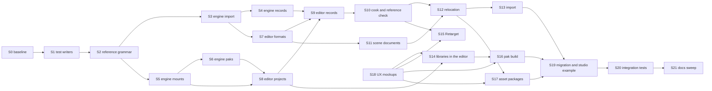

# Portable references: implementation plan

Status: proposal

Last updated: 2026-10-30

This plan implements the [proposal](README.md) as specified by the
[design](design.md). It orders the work into slices, says what each slice
deletes, which tests it writes and what "done" means, and ends with the debt
ledger: every old form found in the code, with the slice that removes it.

## Contents

- [Rules for every slice](#rules-for-every-slice)
- [Order](#order)
- [Slices](#slices)
- [Debt ledger](#debt-ledger)
- [Test impact](#test-impact)
- [Commits](#commits)

## Rules for every slice

- **Delete, do not adapt.** A slice that replaces a form deletes the old one in
  the same slice: no reader, flag, fallback or converter of an old form
  survives it. Its ledger rows are closed when the slice ends.
- **Tests by level.** A slice writes unit and functional tests, as the design
  defines them, from the contract and with codes. It writes no integration
  test, unless its row names one with the reason no lower level reaches the
  behaviour.
- **One writer per format.** Tests write authored files through the format's
  test writer (S1), never as inline JSON.
- **Integration tests wait for S20.** Integration tests that a slice's contract
  change breaks are listed in its row, are not edited in that slice, and are
  fixed together in S20 through the same writers. If a slice breaks an
  integration test it does not list, it stops and reports why.
- **Docs move with code.** A slice updates the docs its rows name.
- **Engine first.** The editor embeds the engine's schemas and conformance
  tables from the installed SDK, so an engine slice that changes them is built
  and installed before the editor slice that consumes them.

## Order

S18 (mockups) has no code dependency and starts with S1, so the owner's UX
decisions are in before S14.

## Slices

### S0. Baseline

Run, filtered to the suites this plan touches, the engine `Oxygen.Content`,
`Oxygen.Data`, `Oxygen.Cooker` and PakTool tests, and the editor's Core,
Assets, Projects, Models, Textures, ContentPipeline Unit, World, Scenes,
ContentExplorer and Problems unit lanes. Record the failures. Each failure
gets its own fix before S1, as an ordinary fix with its own commit. Done when
every lane above passes.

### S1. Test writers

No behaviour change. Adds the single writers of the design's
[testing](design.md#testing) table, each writing today's contract, and moves
the **unit and functional** tests to them. A writer is added when a test uses
it, so none is unused:

- Engine: `Cooker/test/Support/AuthoredFiles.h`, one builder per authored
  format with its own identity; `SpellReference` is the only place a reference
  is spelled. The scripting sidecar keeps `ScriptImportTestSupport.h` as its
  writer. The engine record builder lands in S20, the first slice whose tests
  write records, and `TestPaths` cooked mounts in S5.
- Editor: `Oxygen.Managed.Assets.Testing` `AuthoredFiles`; new
  `Oxygen.Editor.Models.Testing` `ModelRecords`; `TestProject.ManifestJson`
  and `TestProject.BindMounts`, the one test writer of `Project.oxy` and of
  `.mounts.json`, replacing the local copies in the Projects tests.
- Unit and functional tests moved: the engine schema tests and the material,
  geometry, buffer and scene source tests; `MaterialSourceTests`,
  `TextureSourceTests`, `InputSourceTests`, `ModelImportRecordsTests`,
  `ModelContentTests`, `TextureImportTests`, `ProjectAssetFilesTests`,
  `ProjectValidationAndContextTests`, `AssetRelocationTests`,
  `SharedMountTests`, `UnsavedCookInputsTests`. Tests whose subject is a
  spelling (a malformed document, a source position) keep that text.
- Mislabelled tests: the 34 classes of ContentPipeline `tests/Unit` that use
  the disk or processes, directly or through the cook output lease, move to
  `tests/Integration`; five merge into the Integration class of the same name.
  The README's tier text states the three levels.

Done when the moved tests pass with no inline authored JSON left in unit or
functional tests other than spelling cases.

### S2. Reference grammar

| Engine                                                                                                          | Editor                                                                  |
| --------------------------------------------------------------------------------------------------------------- | ----------------------------------------------------------------------- |
| `content::ResolveReference`, `RelativeReference`, two errors                                                    | `AssetPath.TryResolveReference`, `ToReference`, two errors, codes       |
| `VirtualPathCases.json` `references` table (anchors, `..`, `.`, spaces, Unicode, refusals, spelling round trip) | `VirtualPathCasesTests` runs it; `RefusalSections` includes it          |
| `virtual_paths.md` References section                                                                           | `Oxygen.Managed.Core/README.md` References; `AssetUris` section removed |

Nothing consumes the functions yet, so nothing breaks. Unit tests only. Done
when both languages pass the shared table.

### S3. Engine import

Deletes: the five resolvers, the `canonical_*_path` reference definitions, the
three identity checks, the texture descriptor identity source, the per-job
invalid/unmounted reference codes. Adds: `ResolveJobReference`,
`LookupReference`, `oxygen.reference.schema.json`,
the `.oiact` input rule, relative buffer products, written and resolved forms
in source analysis, the relative built-in geometry material.

Unit tests: the schema tests with relative, absolute, self-absolute and
outside-mount samples; `BufferSource_test`, `ScriptImportRequestBuilder_test`
and `InputImportRequestBuilder_test`, which are unit tests and are fixed here;
resolver tests over an in-memory
`ImportRequest`; input rule tests; `ImportSourceAnalysis` dependency
comparison as a pure function. Docs: `async_import_pipeline_v2.md`,
ImportTool README job rules, `physics.md` reference layers.

Integration tests broken and left for S20: the descriptor, manifest, sidecar,
geometry, buffer, input and source-analysis `*_functional_test` files and the
ImportTool CLI tests in the [test impact](#test-impact) table.

### S4. Engine records

Deletes: `kRecordsFolder`, `RecordRelativePath`, `PathFor`, `ContentRootOf`,
`RootOfRecord`, the `Imports/` scan, the record `virtual_path`, the manifest
`record` field, the content root inputs. Adds: `RecordPathOf`, `IdentityOf`,
`ScanRecords(MountTable)`, `kModelGenerationsFolder`, the record
`LocateReference` path, `ModelImportRecordCases.json`.

Unit tests: the shared record cases (path to identity, `source` forms) over an
in-memory mount table. Docs: ImportTool README records section,
`loose_cooked_content.md`, `async_import_pipeline_v2.md`, model record schema
description.

Integration tests left for S20: `ModelImportRecord_functional_test`,
`SceneImportRequestBuilder_functional_test`, the model scenario tests, the
ImportTool record CLI tests, DemoShell `ContentVm_test`. DemoShell's scratch
mount (design) lands here so the examples build.

### S5. Engine mounts

Deletes: `MountKind::kPak`, the silent unknown-kind default, the folder-only
`Cooked` rule, the 64-character mount-name cap. Adds: `kInvalid`, findings,
roles, `ReadLibraryFacts`, the library checks, cooked folder overlap,
`mount.kind_unknown`, library fixture recipes in `MountTableCases.json`, typed
pak and index open failures.

Unit tests: library facts over in-memory loose index and pak bytes (built by
`LooseCookedTestWriter` and `PakTestWriter` into buffers); mount table cases
over an in-memory file system port. `SourceMounts_test` moves to that port; it
is functional today on temp folders and becomes unit. Docs: source-mounts
proposal mount sections, ImportTool README mounts.

### S6. Engine paks

Deletes: exact-identity dependencies, `PakCatalog::ValidateDependencies`, the
flat `dependency_types` map, `--embed-browse-index` and the optional browse
index. Adds: catalog version 4, dependency records with requirements, the
registry requirement check, `DependencyRequirementError`, the Player launch
error, PakDump output. Rebuilds `engine.pak` and the examples pak.

Unit tests: `PakCatalog_test` (encode, decode, structure), the catalog schema
and sidecar IO tests, requirement checks over fake `IContentSource` layers
with patches and tombstones, `RequestPreparation` over its fake file system,
`CliBuilder`. One integration test is added and named here:
`PakBuilderDependencyTest` builds a library pak and a dependent pak and mounts
both through `AssetLoader`, because only a real build proves the planner writes
the requirements the registry checks. Docs: PakTool README, `paktool_design.md`,
`binary_packing_discipline.md`, `patch_resolution_contract.md`,
`scene-instantiation-and-player.md`.

Integration tests left for S20: `AssetLoader_generation_test` dependency
cases, `PakBuilder_functional_test` dependency fixture.

### S7. Editor formats

Requires the S3 SDK install. Deletes: `IdentityField`, `TextureSource.VirtualPath`,
`TextureSourceCodes.VirtualPathInvalid`, `Path.IsPathRooted` image resolution,
`InputActionReference.IsPath`. Adds: identity parameters on every reader and
writer, `IFileReferenceLocator`, the record suffix in `AssetFileTypes`
(`ToIdentity`, `SourcesOf`, `CompanionsOf`), the schema conformance test of
`AssetReferenceField`.

The 10 production reader call sites and `AuthoredReferenceFormat`'s identity
field use are changed in this slice so it compiles; their behaviour change is
S10 and S12.

Unit tests: the moved format tests with relative cases; `AssetFileTypesTests`
record rows. Docs: `Oxygen.Managed.Assets/README.md`, `texture-editor.md`,
`asset-primitives.md`.

### S8. Editor projects

Requires the S5 and S6 SDK installs. Deletes: `MountKind.Pak`,
`CookedContentSourceKind.Pak`, the `Pak` branches in `CookedLibraryReadSet`,
`ProjectAssetFiles`, `AssetCatalog` and Content Explorer, the typed library
name, `SourceMountPathOf` and `LocateSourceMountPath`. Adds: `Invalid`,
findings, roles, library facts, the `.cooked` resolution, `ProjectContext.LocateReference`,
project schema version 3, the library template, the publication reader types
in Managed.Assets.

Unit and functional tests: `MountTableCasesTests` with library recipes,
`.cooked` binding tests over `MockFileSystem` with publication fixtures,
`CookedContentOrderingTests`, `ProjectValidationAndContextTests` pak rows,
`ProjectAssetFilesTests`, template creation with a library template. Docs:
`Oxygen.Editor.Projects/README.md` and testing README,
`project-layout-and-templates.md` mounts, `project-services.md`.

### S9. Editor records

Deletes: `RecordsFolder`, `PathFor`, `RelativePathFor`, `ProjectRootOf`,
`ModelImportSettings.VirtualPath`, `TryFindBySource`, `ModelRecordLookup`'s
source lookups, the "record lives under Imports" checks. Adds: `Parse(bytes,
identity)`, records indexed by identity from the mount enumeration,
`RecordsNaming(source)`.

All 28 production call sites move here, because removing the members breaks
them at compile: Assets, ContentExplorer, ContentPipeline, ModelEditor, Scenes.
Each call site's behaviour test is its module's existing functional test,
moved to the Models kit in S1. Docs: `Oxygen.Editor.Models/README.md`,
`model-editor.md`, `scene-instances.md` NGN14, `asset-family-modules.md`.

### S10. Cook and reference check

Deletes: the `Imports/` cook path branch, `ContentImportJob.Record`, absolute
spelling in `SceneDescriptorGenerator`, the "non-source mount resolves"
shortcut in `ReferenceCheck`, `.build/references.json` version 1. Adds: model
cook input from the record, manifests with `Cooked` mounts, analysis
diagnostics with written, resolved and looked-up forms, library-aware
reference check, `reference.into_project_mount`, `references.json` version 2.

Unit and functional tests: `CookPathsTests`, `ContentCookAssetKindsTests`,
`ReferenceCheck` over a fake library catalog, `CookSourceAnalyzer` texture
diagnostics with a fake project, `SceneDescriptorGenerator` spelling as a pure
function over a scene model. Docs: `content-pipeline.md` 7.2, 7.4, 7.5, 8.6.

Integration tests left for S20: the cooking, import, inspection and publication
integration tests in the test impact table.

### S11. Scene documents

Deletes: the four scene (de)serialization paths outside `SceneFiles`, `asset:///`
in scene files. Adds: `SceneFiles` as the one reader and writer with the scene
identity, resolution and spelling of `SceneReferenceFields.All` and script
parameters. Unit tests: World and Scenes serialization tests with relative,
cross-mount and refused references. Docs: `Oxygen.Editor.World/README.md` and
`Serialization/README.md`, `scene-authoring-model.md`.

### S12. Relocation

Deletes: identity-field rewriting, `PruneEmptyRecordFolders`, the model copy
and member-move blockers, the folder-wide model delete. Adds: companions,
respelling by new identity, the R3 closure and refusal, roles in writable
mounts, shared-mount review text, copy with new `source_identity`, delete that
spares shared sources. Functional tests: `AssetRelocationTests` and
`SharedMountTests` rows for every R8 row and E1 to E8, on `MockFileSystem`.
Docs: `content-explorer-asset-identity.md` 9.5, `content-pipeline.md` 8.4.

### S13. Import

Deletes: identity from the source's own path, destinations in shared mounts,
the always-copy texture import. Adds: own-mount destinations, referencing a
source in a mount, raw source rows with Import, texture import by reference.
Functional tests: `ImportWorkflow` planning over a fake project, `TextureImportTests`
by reference and by copy, `AssetFeed` rows for records, companions and raw
sources. Docs: `content-pipeline.md` 17, ContentPipeline README.

### S14. Libraries in the editor

Requires S18 decisions. Deletes: the typed-name library add, library rename,
re-rooting under the mount name, the binary unavailable-state adapter. Adds:
Add library, `Invalid` presentation, `.cooked` follow in Live Preview and Play,
generation swap with `replaces`. Functional tests: `ContentMountsViewModelTests`,
`CookedLibraryFoldersTests`, `PreviewSession` swap over a fake engine port,
`PlaySession` launch roots. Docs: `content-folders-ui.md`, `live-preview.md`.

### S15. Retarget

Adds the Problems command. Unit tests: `ProblemsViewModelTests` with a fake
picker and relocation port; the edit and its Undo as a functional test over
`MockFileSystem`.

### S16. Pak build

Adds `PakBuildService`, the mount pre-check and the menu command. Functional
tests: the pre-check over resolved tables; the PakTool command line built from
a project, with a fake process port. Docs: `content-pipeline.md` publication
and packing.

### S17. Asset packages

Adds export, import and replace with the schema. Functional tests on
`MockFileSystem`: the package root and destinations, copied and respelled
sources, digests, refusal on any existing file, the three Replace lists, Undo,
a second run after a later release. Docs: `content-explorer-asset-identity.md`.

### S18. UX mockups

SVG mockups in the editor's style for Add library, Export package, Import
package, Replace with library, Retarget and Build pak, with the UX questions
each raises, for the owner's decision. Added to `design.md`.

### S19. Migration and studio example

Writes `tooling/migrations/portable_references/` with unit tests over in-memory
project trees for every rule of the design's migration table. Runs it on
Showcase and on every project in `Oxygen Projects`, libraries first; reviews
each report; fixes F1's two `.cooked` references by hand. Renames the Showcase
mount through the examples tooling. Adds `Examples/Studio`. Done when every
migrated project opens with no unexpected problem, and Showcase, F1 Validation,
Instancing and Racer cook.

### S20. Integration tests

Fixes every integration test listed in the [test impact](#test-impact) table,
through the S1 writers, moving the remaining inline JSON to them. The count of
failing tests before the fix is compared with the table; a failure the table
does not predict is diagnosed before it is fixed. Adds the integration tests
the studio example can run without a window (L4, L9, L10, S9). Done when every
lane of every touched module passes, WinUI lanes included.

### S21. Docs sweep

Updates every remaining doc of the ledger, moves the proposal's accepted parts
into the documents it lists under "Accepted designs this touches", and checks
the repository for any remaining old form (`Imports/`, `"Pak"`,
`identity_conflict`, `IdentityField`, `canonical_*_path` in reference
positions, `asset:///` in authored files, `--embed-browse-index`).

## Debt ledger

Every old form the inventory found, with the slice that deletes it. A slice is
done only when its rows are gone from the code.

### Engine

| Old form                                                                           | Where                                                                                                                                                                 | Slice   |
| ---------------------------------------------------------------------------------- | --------------------------------------------------------------------------------------------------------------------------------------------------------------------- | ------- |
| Five reference resolvers                                                           | `MountedCookedSources`, `TextureReferenceResolver`, `GeometryDescriptorImportJob` (3), `VirtualPathResolver::ResolveAssetKey` callers, `InputImportPipeline::Resolve` | S3      |
| Per-family invalid/unmounted reference codes                                       | Scene, geometry, buffer, physics, script, texture jobs                                                                                                                | S3      |
| `canonical_*_path` in reference positions (20 definitions, 34 uses)                | Scene, geometry, physics sidecar, collision shape, buffer container schemas                                                                                           | S3      |
| Inline `^/` pattern for `auto_exposure_metering_mask`                              | Scene descriptor schema                                                                                                                                               | S3      |
| `action_reference` local-or-absolute rule                                          | Input schema, `InputImportPipeline`, `ImportSourceAnalysis.cpp:402`                                                                                                   | S3      |
| Texture descriptor `virtual_path`, `identity_conflict`, descriptor identity source | Schema, `TextureDescriptorImportRequestBuilder.cpp:138,256`                                                                                                           | S3      |
| Physics material and collision shape identity `virtual_path` and checks            | Schemas, both jobs, both request builders' normalized JSON                                                                                                            | S3      |
| Absolute buffer product names; product mount from its own text                     | Buffer container and geometry schemas, `BufferSource`, `BufferImportSubmitter`                                                                                        | S3      |
| Textual local-buffer comparison                                                    | `ImportSourceAnalysis.cpp:546`                                                                                                                                        | S3      |
| Absolute same-mount built-in material                                              | `EngineContent.cpp:121`                                                                                                                                               | S3      |
| `material_remap` absolute-only                                                     | `ModelSettings.h`, manifest schema                                                                                                                                    | S3      |
| `Imports/` records folder and its API                                              | `ModelImportRecord.{h,cpp}`: `kRecordsFolder`, `RecordRelativePath`, `RootOfRecord`, `RecordPaths`, `ScanRecords`, `PathFor`, `ContentRootOf`                         | S4      |
| Record `virtual_path`, content-root inputs                                         | `ModelImportRecordContent`, `Query`, `Save`; model import schema                                                                                                      | S4      |
| `LocateRecordSource` bypassing `LocateReference`                                   | `ModelImportRecord.cpp:624`                                                                                                                                           | S4      |
| Manifest model job `record`                                                        | `ImportManifest.cpp`, manifest schema, Showcase manifests                                                                                                             | S4, S19 |
| `--root` record scan                                                               | `ImportRunner.cpp`, `FbxCommand`, `GltfCommand`, README                                                                                                               | S4      |
| `import.reference_outside_mount` (second code for one rule)                        | `SourceMounts.h`, `LocateReference`                                                                                                                                   | S2      |
| `MountKind::kPak`, `"Pak"` kind, folder-only `Cooked`                              | `SourceMounts`, `ImportManifest.cpp:304`, both schemas, `MountTableCases.json`                                                                                        | S5      |
| Unknown mount kind silently `Source`                                               | `ImportManifest.cpp:304`                                                                                                                                              | S5      |
| Two mount-name rules                                                               | `IsValidMountName`, `oxygen.mounts.schema.json`, `VirtualPath`                                                                                                        | S5      |
| Cooked folders outside the overlap check                                           | `SourceMounts.cpp:734`                                                                                                                                                | S5      |
| Untyped pak and index open failures                                                | `PakFile.cpp:202`, `PakCatalog.cpp:243`, `LooseCookedIndexImpl.cpp`                                                                                                   | S5      |
| `Cooked` mounts unconnected to reference lookup                                    | `MountedCookedSources`, `cooked_context_roots`                                                                                                                        | S5      |
| Exact-identity dependencies                                                        | `PakCatalog`, `PatchManifest`, `PakManifestWriter`, `PakCatalogIo`, catalog schema, `PakPlanBuilder`, `PakFileDumper`                                                 | S6      |
| Loose layers unable to satisfy a dependency                                        | `ContentSourceRegistry.cpp:90`                                                                                                                                        | S6      |
| Optional browse index                                                              | `--embed-browse-index`, `EngineContent/CMakeLists.txt`, `pak.ps1`                                                                                                     | S6      |
| Uncaught dependency refusal at launch                                              | `PlayerModule.cpp:316`                                                                                                                                                | S6      |
| `.cooked/Content` and `/Content` hard-coded in the examples                        | DemoMain, VortexBasic, DemoShell, RenderScene tools, `RuntimePaths.cpp`, `Showcase.cmake`, `generate_city.py`, test CMake lists, `test_showcase.py`                   | S19     |
| `cook.ps1 -Check` second implementation of R2 and R4                               | `Examples/RenderScene/Tools/cook.ps1`                                                                                                                                 | S19     |
| DemoShell scratch records in `Imports/`, borrowed `kRecordsFolder`                 | `ContentVm.cpp`, `FileBrowserService`                                                                                                                                 | S4      |

### Editor

| Old form                                                                      | Where                                                                                                                                                              | Slice        |
| ----------------------------------------------------------------------------- | ------------------------------------------------------------------------------------------------------------------------------------------------------------------ | ------------ |
| Absolute-only references, no anchor                                           | Material, texture, input readers and writers; 10 reader call sites                                                                                                 | S7           |
| `AssetFileType.IdentityField`                                                 | `AssetFileTypes.cs:144`, `AuthoredReferenceFormat`                                                                                                                 | S7           |
| `TextureSource.VirtualPath`, `VirtualPathInvalid`                             | Texture model, reader, writer, `TextureImport.cs:105`                                                                                                              | S7, S13      |
| Rooted-disk image resolution                                                  | `TextureSource.ResolveImages`                                                                                                                                      | S7           |
| `InputActionReference.IsPath`                                                 | Input reader, `InputSourceReader.cs:125`                                                                                                                           | S7           |
| `.import.json` as an identity-less file                                       | `AssetFileTypes.ToIdentity`, `SourcesOf`                                                                                                                           | S7           |
| `MountKind.Pak`, `CookedContentSourceKind.Pak` (~12 consumers)                | Projects, Assets, ContentExplorer, ContentPipeline                                                                                                                 | S8           |
| Cooked mount assumed to be a folder                                           | `ProjectAssetFiles.Mounts()`                                                                                                                                       | S8           |
| `SourceMountPathOf`, `LocateSourceMountPath` (absolute, Source-only)          | `ProjectAssetFiles`; 6 callers                                                                                                                                     | S8           |
| `.mounts.json` writers outside `MountBindings`                                | `ContentImportMountsFile`, `ProjectLibraries` test support                                                                                                         | S8, S20      |
| `Content` as the required template mount                                      | `ProjectCreationService.cs:305`                                                                                                                                    | S8           |
| `RecordsFolder`, `PathFor`, `RelativePathFor`, `ProjectRootOf`, `VirtualPath` | `ModelImportSettings`; 17 call sites                                                                                                                               | S9           |
| One record per source (`TryFindBySource`, 28 sites)                           | Models, Assets, ContentExplorer, ContentPipeline, ModelEditor, Scenes                                                                                              | S9           |
| Two owners of the new-model identity rule                                     | `ImportWorkflow.cs:132`, `ModelImportDialogViewModel.cs:320`                                                                                                       | S13          |
| Two owners of the record `source` spelling                                    | `SourceMountPathOf`, `CookPaths.TryOf`                                                                                                                             | S8, S10      |
| `Imports/` cook path, record exclusion by prefix                              | `CookPaths`, `CookDependencyDiscovery.cs:234`                                                                                                                      | S10          |
| `ContentImportJob.Record`                                                     | Manifest builder, validator                                                                                                                                        | S10          |
| Model identity requires a file at the identity                                | `CookInputResolver`, `HasProjectSource`, `CookRootRepair`, `CookPaths.ExistsExactly`, `ImportedOutputs`, `AssetFeed`, `AssetsViewModel.Describe`, `ReferenceCheck` | S9, S10, S13 |
| Absolute same-mount references in generated descriptors                       | `SceneDescriptorGenerator`                                                                                                                                         | S10          |
| Library references never unresolved                                           | `ReferenceCheck.cs:156`                                                                                                                                            | S10          |
| `references.json` without written forms                                       | `ReferenceCheck.ReferencesFile`                                                                                                                                    | S10          |
| Library texture references skipped by analysis                                | `CookSourceAnalyzer.cs:285`                                                                                                                                        | S10          |
| Five scene (de)serialization paths, `asset:///` in scene files                | `SceneSerializer`, `SceneFiles`, `SceneDocumentKind`, `SceneContent`, `ModelPreviewFiles`                                                                          | S11          |
| Identity-field rewrite, absolute-only rewrite                                 | `AuthoredReferenceFormat`                                                                                                                                          | S12          |
| `PruneEmptyRecordFolders`, records moved under `Imports/`                     | `AssetRelocationTransaction`, `AssetRelocationPlanner.cs:330`, `CookPublicationTransaction.Sources.cs:99`                                                          | S12          |
| Models not copyable, members not movable, folder-wide delete                  | `AssetRelocationService`, `AssetRelocationPlanner`, `AssetsViewModel.AssetActions`                                                                                 | S12          |
| Writable mounts without roles; no R3 closure                                  | `RelocationPaths`, planner                                                                                                                                         | S12          |
| Import destination follows the source's mount                                 | `ImportWorkflow.PlannedIdentity`, `ImportSourceRetention`                                                                                                          | S13          |
| Typed and renamable library names, re-rooting under them                      | `ContentMountsViewModel`, `ContentMountRow`, `CookedLibraryFolders`, pak tree                                                                                      | S14          |
| `LocalLibrary`/`PakLibrary` split, binary unavailable state                   | `ContentMountKind`, `UnavailableMountTreeItemAdapter`, `PakMountTreeItemAdapter`                                                                                   | S14          |
| Library roots named by the declared mount, unchecked                          | `CookedLibraryReadSet.cs:440`                                                                                                                                      | S8           |
| Project schema version 2                                                      | `ProjectInfo`                                                                                                                                                      | S8, S19      |
| ~20 "Unit" test classes on temp disk or processes                             | ContentPipeline `tests/Unit`                                                                                                                                       | S1           |
| Three model record test writers, 16 hand-rolled record sites                  | ContentPipeline, Assets, ContentExplorer, ModelEditor, Scenes tests                                                                                                | S1, S20      |

### Docs

| Doc                                                                                                                                                                                  | Slice      |
| ------------------------------------------------------------------------------------------------------------------------------------------------------------------------------------ | ---------- |
| `Content/Docs/virtual_paths.md`, `loose_cooked_content.md`, `patch_resolution_contract.md`                                                                                           | S2, S4, S6 |
| `Cooker/Docs/Import/async_import_pipeline_v2.md`, ImportTool README                                                                                                                  | S3, S4     |
| `Data/Docs/physics.md`, `binary_packing_discipline.md`                                                                                                                               | S3, S6     |
| PakTool README, `paktool_design.md`                                                                                                                                                  | S6         |
| `design/runtime-core/scene-instantiation-and-player.md`                                                                                                                              | S6         |
| `design/proposals/source-mounts/README.md`, `examples-project/README.md`                                                                                                             | S5, S21    |
| `Examples/Showcase/README.md`, `Examples/RenderScene/README.md`                                                                                                                      | S19        |
| `asset-identity.md`, `project-layout-and-templates.md`, `content-pipeline.md`, `content-explorer-asset-identity.md`                                                                  | S7 to S17  |
| `project-services.md`, `scene-instances.md`, `model-editor.md`, `asset-family-modules.md`, `texture-editor.md`, `asset-primitives.md`, `scene-authoring-model.md`, `live-preview.md` | S7 to S14  |
| Module READMEs: Managed.Core, Managed.Assets (and Pak, LooseCooked), Projects (and testing), Models, ContentPipeline, World                                                          | S2 to S13  |
| `content-folders-ui.md`                                                                                                                                                              | S14        |
| Plans that state old forms (`asset-identity-debt-elimination.md`, `ED-M08*`, `ED-M09.14`, `ED-M10-input-authoring.md`)                                                               | S21        |

## Test impact

The integration tests each slice breaks and leaves for S20, from the inventory.
Counts are test cases.

| Slice    | Engine                                                                                                                                                                                                                                                                                                                        | Editor                                                                                                                                                                                                                                                  |
| -------- | ----------------------------------------------------------------------------------------------------------------------------------------------------------------------------------------------------------------------------------------------------------------------------------------------------------------------------- | ------------------------------------------------------------------------------------------------------------------------------------------------------------------------------------------------------------------------------------------------------- |
| S3       | Material (7), scene (23), geometry (20), buffer (17), collision shape (6 + 4 builder), physics material (5 + 4 builder), physics sidecar (26), scripting sidecar (43), input (11), texture builder (8), source analysis (21), `EngineContent` (3), descriptor manifest tests (31); ImportTool `source_analysis_cli_test` (15) | none (the editor consumes S3 in S7)                                                                                                                                                                                                                     |
| S4       | `ModelImportRecord` (40), `SceneImportRequestBuilder` (11), glTF scenario (30), `ModelValues` (8), `ImporterRevision` (14); ImportTool record CLI (3); DemoShell `ContentVm_test`; `test_showcase.py` (4)                                                                                                                     | none                                                                                                                                                                                                                                                    |
| S5       | none (mount tests are unit after S5)                                                                                                                                                                                                                                                                                          | none                                                                                                                                                                                                                                                    |
| S6       | `AssetLoader_generation_test` (2), `PakBuilder_functional_test` dependency fixture (2)                                                                                                                                                                                                                                        | `CookedContentMountTests` (9)                                                                                                                                                                                                                           |
| S8       | none                                                                                                                                                                                                                                                                                                                          | `CookedLibraryResolutionTests` (3), `TransitiveLibraryTests` (2), `CrossMountImportTests` (2), `MaterialKeyPriorityTests` (1); ContentExplorer UI pak and cooked rows                                                                                   |
| S9       | none                                                                                                                                                                                                                                                                                                                          | Import integration tests (49), `ProducedSourceMetadataTests` (6); ContentExplorer UI model rows                                                                                                                                                         |
| S10      | none                                                                                                                                                                                                                                                                                                                          | Cooking integration tests (`MaterialCookTests`, `TextureCookTests`, `CookRepairTests`, incremental, input, script, preview, analysis reuse: 54), `SourceDependencyDiscoveryTests` (11), inspection (3), the ~20 classes moved out of `tests/Unit` in S1 |
| S11      | none                                                                                                                                                                                                                                                                                                                          | none (World and Scenes tests are unit and functional)                                                                                                                                                                                                   |
| S12, S13 | none                                                                                                                                                                                                                                                                                                                          | ContentExplorer UI asset and import tests                                                                                                                                                                                                               |
| S14      | none                                                                                                                                                                                                                                                                                                                          | LivePreview `PublicationPreviewEngineTests` (3), ContentExplorer UI mount rows                                                                                                                                                                          |

## Commits

Each slice is committed on the feature branch when its unit and functional
lanes pass. A slice that leaves integration lanes broken names them in its
commit body, as the [test impact](#test-impact) table lists them; no other lane
may fail. The branch is merged only after S20, when every lane of every touched
module passes.

S14 to S17 wait for the owner's decisions on the S18 mockups.
