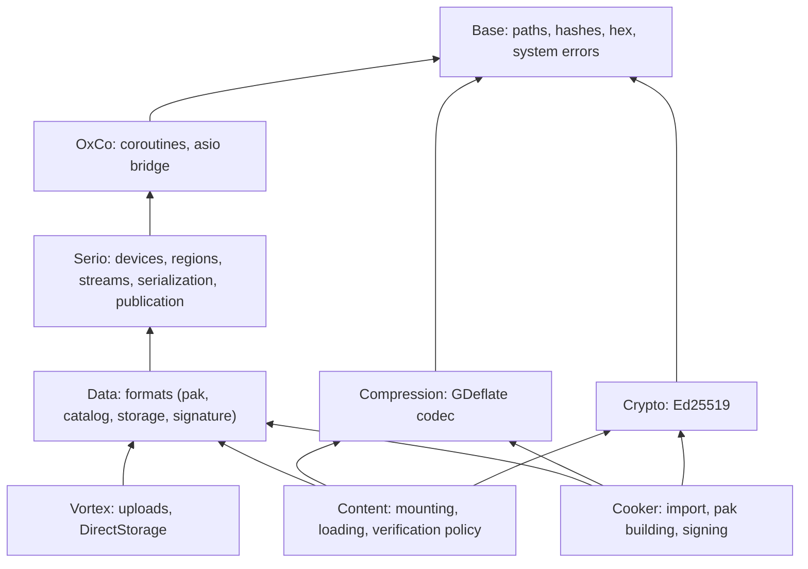
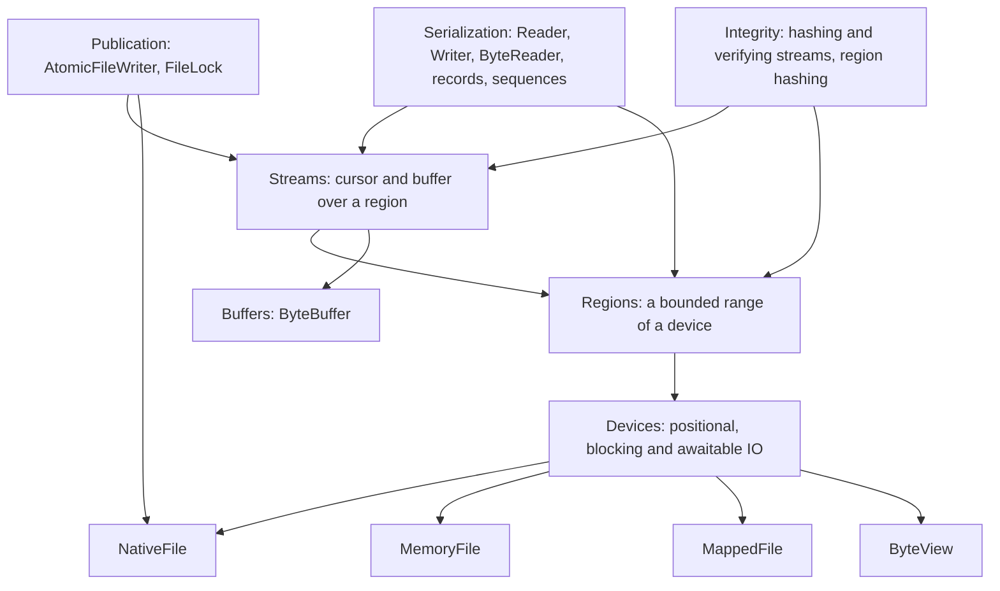

# Serio IO and serialization

Status: proposal

Last updated: 2026-11-02

Serio is the engine's IO and binary serialization library. This proposal takes
it to what the content pipeline and the asset manager need: one set of
primitives that reads and writes files and memory alike, without copies,
reopens or whole-artifact buffers the workload does not need. It states the
scenarios, what the code does today, the design, the debt it removes and the
order of the work. It builds on Base, which provides the
[path rules](../../../src/Oxygen/Base/Docs/Filesystem.md) and the
[hashes, hex codec and system error conversion](../../../src/Oxygen/Base/Docs/Hashing.md)
Serio uses.

Serio moves and parses bytes. It knows no file format, no codec, no key and no
asset: those belong to the modules [scope and layering](#scope-and-layering)
names, which Serio serves.

## Contents

- [Scenarios](#scenarios)
- [Today](#today)
- [Requirements](#requirements)
- [Scope and layering](#scope-and-layering)
- [Design](#design)
  - [Layers](#layers)
  - [Devices](#devices)
  - [Regions](#regions)
  - [Streams](#streams)
  - [Buffers](#buffers)
  - [Serialization](#serialization)
  - [Integrity](#integrity)
  - [Publication](#publication)
  - [Errors](#errors)
  - [Conformance](#conformance)
  - [Benchmarks](#benchmarks)
- [Consumers](#consumers)
- [Debt removed](#debt-removed)
- [Beyond Serio](#beyond-serio)
- [Order](#order)
- [Decisions](#decisions)

## Scenarios

| Id  | Who                         | Scenario                                                                                                                 |
| --- | --------------------------- | ------------------------------------------------------------------------------------------------------------------------ |
| R1  | Asset manager               | Many pool threads load assets and resources from one mounted pak at once, each reading a descriptor and one payload      |
| R2  | Asset manager               | A texture or buffer payload goes from disk to its consumer with the fewest copies, and none it does not need             |
| R3  | Asset manager               | Mounting a pak or a loose root reads its metadata quickly; a verified mount checks integrity without reading twice       |
| R4  | Asset manager, tests, tools | A pak or loose root held in memory (a test, embedded content) mounts and reads through the same code as one on disk      |
| P1  | Import service              | Import jobs append payloads to a multi-GB data file concurrently, each at the offset it reserved                         |
| P2  | Pak builder                 | The pak writer copies payload slices from source files into a multi-GB pak, computes its CRC and its digest as it writes |
| P3  | Loose writer, records       | An index or record is published atomically while readers may hold the old one, without buffering the whole artifact      |
| P4  | Tests                       | Builders produce cooked content in memory with product serde, and readers consume it without a file                      |

## Today

The audits behind this proposal read Serio, the cooker and Content. Their
findings, by layer:

**Streams.** Serio's stream concepts (`InputStream`, `OutputStream`), the
type-erased `AnyInputStream`/`AnyOutputStream` and the memory streams are
sound. The file stream is not:

- `FileStream` wraps `std::fstream` with its default buffer, no sharing mode,
  no access hints and no positional IO.
- `FileStream::Size()` does four stream operations and mutates the stream;
  `Seek()` calls `Size()` first, so each seek costs about six
  ([FileStream.h:414](../../../src/Oxygen/Serio/FileStream.h)).
- The constructor throws `no_such_file_or_directory` for any open failure, and
  the default mode cannot create a file.
- The two implementations disagree: a seek past the end is `invalid_argument`
  on a file and `invalid_seek` in memory; a short read is `no_buffer_space` on
  a file and `io_error` in memory; `Forward` past the end succeeds on a file
  and fails in memory.

**Serialization.** `Reader`/`Writer` are templates, but every `Load`/`Store`
takes `AnyReader&`/`AnyWriter&`, so each primitive costs two or three virtual
calls, a `Position()` (a `tellg` on files) for alignment even under
`ScopedAlignment(1)`, a `Result` and a try/catch frame. Vectors are encoded
element by element. Packed descriptors such as `TextureResourceDesc` are read
field by field (about 24 virtual calls for one fixed-size record), while other
loaders read the same kind of record with one blob read and a `memcpy`.
`ReadBlob(n)` and `Load(vector)` allocate from lengths read off the file
before checking them against what remains.

**Runtime reads.**

- `PakFile` opens five `FileStream`s on one pak and uses one; a mutex guards
  even its in-memory lookups.
- `PakFileSource` and `LooseCookedSource` open a new `ContentFileReader` (a
  new `std::fstream`) for every reader they hand out. One resource load opens
  a table reader and up to four data readers to read one region; one asset
  decode opens a descriptor reader and four data readers.
- A texture payload is zero-filled into a `std::vector`, copied from the
  stream buffer into it, then copied row by row into upload staging.
- A verified pak mount reads the whole pak once for its CRC, then reads it
  again to load. The hash itself is no longer the cost (`base::Crc32` folds
  at 20 to 80 GiB/s); the second read is.
- Nothing can read a pak or a loose root from memory: `PakFile`,
  `ContentFileReader` and their helpers are typed to `FileStream`.

**Producer writes.**

- The import service writes payloads with `WindowsFileWriter`: overlapped IOCP
  writes at explicit offsets, each opening and closing its own handle on the
  shared data file.
- `PakWriter` writes one sequential `FileStream` and computes the CRC as it
  writes, but copies each payload slice by opening the source file, reading
  the whole slice into a vector and copying it again
  ([PakMeasureStore.cpp](../../../src/Oxygen/Cooker/Pak/PakMeasureStore.cpp)
  `StorePayloadSourceSlice`).
- The planner reads every payload slice into memory to digest it; the writer
  then reads it again; the manifest writer then re-reads the whole pak for its
  SHA-256. `LooseCookedWriter::Finish` re-hashes every data file, multi-GB
  ones included.
- Atomic publication (`WriteFileAtomically`) takes only a complete buffer, so
  the loose index is serialized whole into memory first.
- At least eight whole-file read helpers, four file-system ports
  (`ILibraryFiles`, `IMountFileSystem`, `IRequestPreparationFileSystem`,
  `IArtifactFileSystem`) and several error models (exceptions, `Result`,
  optional, diagnostics) coexist.

## Requirements

1. **Positional, stateless access.** A file opened once serves any number of
   concurrent readers or writers, each naming its offset (R1, P1).
2. **Memory and file behind one interface,** with the same semantics and the
   same errors (R4, P4).
3. **Zero-copy where the bytes are already in memory:** a parser over memory
   or a mapped file reads views, not copies (R3, R4).
4. **Caller-owned destinations:** a read fills the caller's buffer, never one
   the library allocates and the caller copies from (R2).
5. **Bulk paths:** fixed-layout records and arrays of trivially copyable
   elements move as one copy (R1, R3).
6. **Single-pass integrity:** CRCs and digests are computed while the bytes
   pass, never by a second read (R3, P2).
7. **Streaming publication:** an atomic replace accepts a stream, so no
   artifact is buffered whole to be published (P3).
8. **Bounded, validated reads:** no allocation from an unchecked length;
   reading past a bound fails with one code (R1, R4).
9. **No per-field virtual dispatch** in hot decode paths; type erasure only at
   coarse boundaries (once per file, region or asset).
10. **IO that does not hold a thread:** a coroutine awaits a read or write;
    no thread blocks on the disk, and cancelling the coroutine cancels the
    operation (R1, P1, P2). Code that need not be asynchronous reads and
    writes directly.

## Scope and layering

**Serio's place among the modules.** Serio depends on Base and on OxCo (for
awaitable IO through its asio bridge); every module that reads or writes a
file depends on Serio. Two new modules hold the third-party codecs the pak
features need, outside Base (which stays free of third-party libraries beyond
`fmt`) and outside Serio:



**Who owns what.** A feature lives where its knowledge lives; Serio holds what
any reader or writer of bytes needs, whatever the bytes are.

| Feature                                                                                          | Owner                                                                       | Serio's part                                                         |
| ------------------------------------------------------------------------------------------------ | --------------------------------------------------------------------------- | -------------------------------------------------------------------- |
| Files and memory, positional and awaitable IO                                                    | Serio                                                                       | All of it                                                            |
| Regions, streams, buffers, serialization primitives                                              | Serio                                                                       | All of it                                                            |
| Atomic publication, locks                                                                        | Serio                                                                       | All of it                                                            |
| Hashing bytes as they pass, verifying them                                                       | Serio, with Base's hashes                                                   | All of it; the hash functions are Base's                             |
| Bounding memory in flight                                                                        | Each consumer: Content's payload budget, Vortex's staging provider          | None: Serio's operations take memory their caller owns               |
| Cooked formats (pak, catalog, loose index, storage records, signature section) and their loaders | Data                                                                        | Records, sequences and `ByteReader` that formats are read with       |
| Pak layout rules (4 KiB payload alignment, sections)                                             | Data and the pak builder (Cooker)                                           | Unbuffered reads of aligned regions                                  |
| Opening a pak for metadata and payloads                                                          | Content (`PakFile`)                                                         | `MappedFile` and `AsyncFile`                                         |
| GDeflate compression and decompression                                                           | Compression module; scheduled by Cooker (compress) and Content (decompress) | Reading and writing the stored bytes                                 |
| Ed25519 signing and verification                                                                 | Crypto module; used by Cooker (sign) and Content (verify)                   | Verifying each region's digest as it is read                         |
| Signature trust list and policy                                                                  | Content, Player                                                             | None                                                                 |
| Reads into upload staging, DirectStorage                                                         | Vortex                                                                      | A region's native file and offset; reads into a caller's destination |

## Design

### Layers



A **device** is random-access bytes: a file, a mapping or memory. A
**region** is a bounded range of one. A **stream** is a cursor with a buffer
over a region, for sequential producers and consumers. **Serialization**
reads and writes streams, or parses a region's bytes in place when they are
contiguous. **Integrity** hashes or verifies bytes as streams and regions pass
them; **publication** replaces a file atomically from a stream.

The C++ shape of these layers (headers, the concepts each kind of type
satisfies, the erased wrappers and the extension points) is the
[Serio C++ API design](api.md); the sections below state what each layer does.

### Devices

A device names its offsets; it has no cursor, so one device serves concurrent
callers without a lock. Offsets and sizes are distinct types (`ByteOffset`,
`ByteCount`), so they cannot be swapped. A device is any type that satisfies
the device concepts ([devices](api.md#devices)); `AnyDevice` erases one at a
coarse boundary ([type erasure](api.md#type-erasure)).

| Device       | Backing                                                                                              | Contiguous | Writes |
| ------------ | ---------------------------------------------------------------------------------------------------- | ---------- | ------ |
| `NativeFile` | A Win32 handle (`ReadFile`/`WriteFile` with an `OVERLAPPED` offset) or a POSIX fd (`pread`/`pwrite`) | No         | Yes    |
| `AsyncFile`  | A `NativeFile` bound to an `IoDriver`, with awaitable operations                                     | No         | Yes    |
| `MemoryFile` | A growable buffer it owns; a test's or a builder's file                                              | Yes        | Yes    |
| `MappedFile` | A read-only view of a whole file (`CreateFileMapping`/`MapViewOfFile`, `mmap`)                       | Yes        | No     |
| `ByteView`   | Bytes the caller owns: an embedded pak, a decoded section                                            | Yes        | No     |

- `NativeFile::Open(path, OpenSpec)` names access, creation, sharing (share
  delete by default, so atomic replacement succeeds under readers) and an
  access hint (sequential or random), and whether reads bypass the OS cache
  (`FILE_FLAG_NO_BUFFERING`, `O_DIRECT`) for large streaming reads of
  sector-aligned regions. It takes a logical path and converts it
  with `base::ToNativePath` only at the OS call, so long and UNC paths work
  whatever the machine's long-path policy; the device keeps the logical path
  for diagnostics. It returns the OS error (`base::LastSystemError`) and never
  throws. The platform implementation is chosen by CMake
  ([platform code](api.md#platform-code)).
- `Reserve` preallocates (`FileAllocationInfo`, `fallocate`), so a producer
  that knows its size fails early on a full disk and writes unfragmented.
- `Durability` is `kBuffered` (to the OS) or `kStable` (`FlushFileBuffers`,
  `fsync`).
- `ReadAt` returns the bytes read; a read that crosses the end returns fewer,
  and `ReadExactlyAt` fails with `kEndOfData`. Every device behaves the same.

#### Awaitable IO

Every device has the blocking `ReadAt` and `WriteAt` above, for tools and
code that need not be asynchronous. Devices that can complete without
blocking also have awaitable forms, for coroutines:

```cpp
auto file = driver.Open(path, {.access = Access::kRead});  // Result<AsyncFile>
auto bytes = co_await file->AsyncReadAt(offset, buffer);  // Result<ByteCount>
co_await file->AsyncWriteAt(offset, payload);             // Result<void>
```

- **On an `AsyncFile`** the operation is asynchronous IO completed by the
  awaiting loop's `asio::io_context`
  ([OxCo async IO](../../../src/Oxygen/OxCo/Docs/AsyncIO.md)): IOCP on
  Windows, io_uring on Linux (`ASIO_HAS_IO_URING`, with liburing). The coroutine suspends; no thread
  blocks; the completion resumes it on the loop thread.
- **One IO driver per loop; backends live behind it.** `IoDriver::Open`
  returns an `AsyncFile`, and its awaitable operations are submitted to the
  driver, never to the OS directly. A `NativeFile` opened without a driver has
  no awaitable form, and `MappedFile` has none either: a consumer that awaits
  payload reads of a mapped file opens it as an `AsyncFile` too. The driver holds
  everything a backend can differ in:
  - **handles:** registered when a file opens, released when it closes;
  - **submission:** a backend that can submit several operations in one OS
    call submits those started in one loop turn together, so batching needs
    no caller change;
  - **completion:** drained on the loop thread, resuming each awaiter;
  - **cancellation:** the backend's own (`CancelIoEx`, an io_uring cancel);
  - **buffers:** `driver.AllocateBuffer(size)` returns a `ByteBuffer`, from
    the backend's registered pool when it has one, a plain allocation
    otherwise.

  The IOCP backend submits overlapped requests to the port of the loop's
  `io_context` (`asio::windows::overlapped_ptr`), and the io_uring backend
  uses asio's `random_access_file` on the loop's ring. Each platform has one
  backend: a Windows I/O ring backend was built and measured against IOCP
  and deleted (see [Decisions](#decisions)). No public type or signature
  names a backend, so adding, dropping or choosing one never changes a
  caller ([IO driver and backends](api.md#io-driver-and-backends)).

- **On a `MemoryFile` or `ByteView`** the awaitable is ready at once
  (`co::Just`): nothing suspends, so tests and embedded content pay nothing
  for the asynchronous form.
- **The awaitables are plain awaitables,** not `co::Co` coroutines, so an
  operation allocates no coroutine frame.
- **Cancellation is structural.** A coroutine cancelled by its nursery, an
  `AnyOf` or a timeout cancels its in-flight operation (`CancelIoEx`), and
  resumes only after the OS is done with the buffer. There is no cancel API.
- **Concurrency is OxCo's:** `co::AllOf` over several reads of one file, a
  `Nursery` for open-ended loads. The `IoDriver` only submits and completes
  operations; it has no scheduling policy of its own.
- **Memory is the caller's.** An operation reads into or writes from memory
  its caller owns; Serio allocates nothing per operation and imposes no budget.
  A consumer that starts many reads bounds their buffers itself.
- **Copies overlap.** `co_await CopyRegion(from, to)` is a double-buffered
  loop that reads chunk N + 1 while it writes chunk N; the pak writer's
  payload copies and the import service's writes use it.

Decoding stays synchronous: IO fills buffers asynchronously, then parsing runs
over the bytes in memory (`ByteReader`, whole records), on a `ThreadPool`
worker when it is heavy.

#### Mapped files

A `MappedFile` serves bytes that are parsed in place or read at random:
pak metadata (directory, catalog, browse index), the loose index, and tools
such as PakDump and the Inspector. Payloads are not read through it: a hard
page fault blocks the thread that touches the page, the OS alone decides
residency, and an upload copies from mapped pages anyway, so payloads stay on
overlapped IO.

- **Opened like a `NativeFile`,** from a logical path with share delete, so a
  published file is replaced (never modified) while it is mapped, and the
  mapping keeps showing the complete version it opened.
- **`Bytes()` is the view** (`Contiguous()` on an `AnyDevice`); `ByteReader`
  parses it without allocating or copying.
- **`ReadAt` copies from the view** inside a guarded copy (structured
  exception handling on Windows, a `SIGBUS` guard elsewhere) that turns a
  failed page-in into `kIo`, so every copied read stays a `Result`.
- **A view cannot be guarded.** A device failure while code parses a view
  directly is fatal; the header says so. Views are used for metadata parsed
  once per mount.
- **No awaitable form.** Only the view and the blocking `ReadAt` touch mapped
  pages, so nothing awaited ever faults on the loop thread.
- **`Prefetch(region)`** hints that a region will be parsed soon
  (`PrefetchVirtualMemory`, `madvise(MADV_WILLNEED)`), without waiting.
- A mapping of a multi-GB file only reserves address space on a 64-bit
  process, so a consumer may map a large file to parse a small part of it.

### Regions

A `Region` is a device, a `ByteOffset` and a `ByteCount`, cheap to copy. A pak section, a
resource payload and a descriptor are regions of the pak's one device; a
loose root's data file is a region covering its device. `ReadAt` on a region
is bounds-checked against the region, not the file. `Bytes()` on a
region of a contiguous device is a subspan.

### Streams

Serio's `InputStream`/`OutputStream` concepts are redefined as the
[API design](api.md#streams) states (`ReadSome`, `Position()` and `Size()`
that cannot fail, a positional `PatchAt` instead of seeking an output), and
every encoder and decoder moves to them. The streams are reimplemented over
regions:

| Stream                 | Over                    | Behaviour                                                                                                  |
| ---------------------- | ----------------------- | ---------------------------------------------------------------------------------------------------------- |
| `RegionReadStream`     | A region                | A cursor and a buffer (default 64 KiB, none for a contiguous device, where reads are copies from the view) |
| `RegionWriteStream`    | A writable device       | A cursor and a buffer (default 1 MiB), flushed with `WriteAt`; `Seek` within written bytes for patches     |
| `MemoryStream`         | Its own growable buffer | As today, with `Reserve`, `Take()` to move the buffer out, and the shared error codes                      |
| `ReadOnlyMemoryStream` | A span                  | As today, with the shared error codes                                                                      |

`FileStream` and its `std::fstream` backing (`ByteFileStream`,
`BackingStream`) are deleted: a file stream is a region stream over a
`NativeFile`. `Size()` and `Seek()` are O(1) on every stream. A read stream's
`ReadInto(span)` above the buffer size reads straight into the caller's span
with `ReadAt`, without passing through the buffer.

### Buffers

A read fills memory its caller owns. When the caller needs memory to own,
`ByteBuffer` is it:

- An owned, **uninitialized** allocation (`make_unique_for_overwrite`): a
  buffer about to be filled by a read is never zero-filled first.
- **Aligned to 4 KiB** by default, so the same buffer serves an unbuffered
  read of a sector-aligned region.
- Move-only, with `Bytes()` as a span and `Take()`/adoption so a `MemoryStream`
  or a `MemoryFile` can hand its storage on without a copy.

A buffer to fill is one allocation and one read: allocate a `ByteBuffer` of
the size to read, from the file's `IoDriver` when it will be read
asynchronously, and `AsyncReadAt` fills it.

### Serialization

- **Bulk records.** A struct declared a record moves as one copy through the
  same `Read<T>()` and `Write(value)` as any value, with a compile-time check
  that its bytes are its encoding: trivially copyable, no padding (packed to
  one byte, or a unique object representation) and a little-endian target.
  Every packed pak and loose format struct whose bytes are read as they are
  is a record, and its per-field `Load` in `PakFormatSerioLoaders.h` is
  deleted; a struct whose values are checked after reading keeps its own
  `Load`, which copies it whole and then checks.
- **Bulk sequences.** A `vector`, `array` or `span` of trivially copyable
  elements is written and read as its count and one copy. `bool`, `array` and
  `optional` get the overloads they lack, symmetric on both sides.
- **Alignment** costs nothing when the effective alignment is 1, and is
  relative to the stream's start.
- **Bounded lengths.** A length prefix is checked against the bytes that
  remain before anything is allocated; `ReadBlob` takes a cap and the
  default is the remaining size.
- **`ByteReader`** parses bytes already in memory: a bounds-checked cursor
  over a span with `Read<T>` (a copy of a record or a value), `ReadBytes(n)`
  (a view, no copy) and `ReadStringView(n)`, all inline and without virtual
  calls. Catalogs, browse
  indexes, the loose index and directories parse through it when their region
  is contiguous, and through a stream otherwise.
- **Type erasure at the boundary.** `AnyReader`/`AnyWriter` stay as the
  boundary a loader is handed once per asset; within a loader, records and
  sequences go through the bulk paths, so a descriptor read is one virtual
  call, not twenty.
- **Measure, then write.** A `CountingSink` with the writer interface measures
  a record exactly, so small records are written once into an exact buffer;
  large artifacts stream to their device instead of growing a buffer.

### Integrity

- The hashes are Base's incremental `base::Crc32` (the pak footer's IEEE
  CRC32, folded with PCLMULQDQ or AVX-512 VPCLMULQDQ) and `base::Sha256`
  (with SHA-NI); Serio feeds them, and owns no hash of its own. Both run
  faster than any storage, so what an integrity check costs is the bytes it
  reads, which is why each byte is read once.
- **Hashing a region:** `ComputeSha256(Region)` and `ComputeCrc32(Region)`
  read a region once with a 1 MiB buffer, and `ComputeFileSha256(path)` hashes
  a file. They replace `base::ComputeFileSha256`, which leaves Base with its
  nine callers moving here.
- **Hashing as bytes pass:** `HashingWriteStream` and `HashingReadStream`
  decorate a stream; every byte that passes updates the hashes, except the
  skip ranges the caller names (a field that holds the checksum itself).
- **Verifying as bytes pass:** `VerifiedRead(region, expected, destination)`
  reads a region into the caller's destination and compares its SHA-256 with
  the expected digest as the bytes pass, failing with `kDigestMismatch`. A
  reader that holds trusted digests (a signed region table) checks exactly the
  bytes it reads, in the same pass.

### Publication

`AtomicFile` gains a writer:

```cpp
auto writer = AtomicFileWriter::Create(path);   // temp sibling
Writer(writer->Stream()).Write(...);            // stream the artifact
auto commit = std::move(*writer).Commit();      // flush, replace, sync parent
```

`Commit()` flushes the temp file to stable storage, replaces the destination
while readers hold it (the rename `WriteFileAtomically` performs), and
reports a parent-directory sync failure as today's `durability_error`. A
writer destroyed without `Commit()` removes its temp file.
`WriteFileAtomically(path, bytes)` becomes a call to it. `OpenPublishedFile`
returns a `NativeFile` opened with share delete, so a caller reads what it
needs instead of the whole file; `ReadPublishedFile` reads all of it through
one.

### Errors

Serio's results stay `base::Result<T>`, carrying a `std::error_code`. A
`std::error_code` holds one code, so two kinds of code flow through it:

- **OS errors as they are.** A `NativeFile` returns the OS error from
  `base::LastSystemError()` in `std::system_category()`, so the real cause is
  never replaced.
- **Serio's own conditions**, in the `serio::Error` category: `kEndOfData`,
  `kOutOfBounds`, `kTooLarge`, `kDigestMismatch`. Memory devices, regions, streams and the
  serializer return these.

`serio::Error` is also an error condition: `kNotFound`, `kAccessDenied`,
`kSharingViolation` and `kNoSpace` match the OS codes that mean them, so a
caller writes `error == serio::Error::kNotFound` once and it holds for every
device. The conformance suite checks that every device returns codes that
compare equal to the same conditions for the same case.

### Conformance

One typed test suite runs every device (`NativeFile`, `MemoryFile`,
`MappedFile`, `ByteView`) and every stream through the same cases: reads across
the end, zero-length reads and writes, concurrent positional reads, writes past
the end, `Reserve`, flush, and the error each case returns. `MappedFile` adds
two cases: replacing the file atomically while it is mapped leaves the view on
the complete old version and the next open on the new one, and a failed
page-in under `ReadAt` returns `kIo` (driven through the guarded copy's fault
path). A fault-injecting
device (short reads, failed writes, full disk) runs the stream, region and
serializer suites through every error path. Hostile length prefixes, bulk
records and big-endian guards get their own cases.

### Benchmarks

`Oxygen.Serio.Benchmarks` (Google Benchmark, like Base's hashing benchmarks,
measured in Release only) keeps the efficiency claims honest: `ReadAt` and
region stream throughput per device, against the same reads through
`std::fstream`; descriptor decode per record, field by field against
`ReadRecord`; a hashing stream's overhead over a plain stream; and small-read
operations per second in wall-clock time, reads scattered over one file and
awaited by 1 to 1024 concurrent readers against the same reads made blocking:
descriptor-sized reads from the OS cache, which measure the per-operation
cost, and unbuffered 4 KiB reads, which wait on the device and measure how
reads in flight overlap.

## Consumers

| Consumer                                                                 | Change                                                                                                                                                                                                                                                                                                                                                                                                                                                                                                                                                            |
| ------------------------------------------------------------------------ | ----------------------------------------------------------------------------------------------------------------------------------------------------------------------------------------------------------------------------------------------------------------------------------------------------------------------------------------------------------------------------------------------------------------------------------------------------------------------------------------------------------------------------------------------------------------- |
| `PakFile`                                                                | A `MappedFile` for its metadata, parsed in place, and an `AsyncFile` for payloads (or one memory device for both); its parsers take regions; the five streams, the per-lookup mutex and the copies of its directory go                                                                                                                                                                                                                                                                                                                                            |
| `PakFileSource`, `LooseCookedSource`, `ContentFileReader`                | One device per pak or data file, opened at mount; readers are region streams over it; a load opens nothing                                                                                                                                                                                                                                                                                                                                                                                                                                                        |
| Loaders (`LoaderContext`)                                                | Descriptors read as records; a payload is read with one awaitable read into the loader's destination. Content's payload budget, internal to its loaders and built on `co::Event` waiters, bounds payload buffers in flight: arrival order, no barging, a payload larger than the budget served alone when it is free, a cancelled waiter leaving the queue. A load starts the loads of its independent dependencies together, a nursery over each dependency list, instead of awaiting them one after another, so their reads are in flight on the device at once |
| `data::TextureResource`, `data::BufferResource`, their loaders           | Own a `ByteBuffer` instead of a `std::vector<uint8_t>`; the loaders read the payload straight into it, bounded by Content's payload budget. The zero-fill and the stream-buffer copy go; the one copy into upload staging remains                                                                                                                                                                                                                                                                                                                                 |
| Loose index (`LooseCookedIndexImpl`)                                     | Maps `container.index.bin` and parses it through `ByteReader`, aliasing its string table and reference tail instead of reading the file whole and copying them; bytes from memory are copied once, or taken whole                                                                                                                                                                                                                                                                                                                                                 |
| PakDump, Inspector                                                       | Read paks through `PakFile` (header, footer and size from its device) and loose roots through `CookedContent`                                                                                                                                                                                                                                                                                                                                                                                                                                                     |
| `LooseCookedWriter`                                                      | Streams the index through `data::loose_cooked::EncodeLooseCookedIndex`, the one encoder of the format, into a publication of the `CookerStorage` port; never re-hashes the files it lists                                                                                                                                                                                                                                                                                                                                                                         |
| `IAsyncFileReader`, `IAsyncFileWriter` and their Windows implementations | `IAsyncFileWriter` and both Windows implementations are deleted: emitters await their writes through `cooked::ImportStorage` (atomic publications, and a data file the table aggregator opens once), in the import session's nursery, with their bytes in the awaiting frame instead of a `shared_ptr`. `IAsyncFileReader` stays the source-read seam the snapshot decorates; its one implementation reads through the import loop's driver into a `ByteBuffer`                                                                                                   |
| `PakPlanBuilder`, `PakWriter`, `PakManifestWriter`                       | Payload slices copied region to stream in 1 MiB chunks over source devices opened once; the pak CRC (skipping its own footer field) and the pak's SHA-256 come out of the write pass through the hashing stream, which replaces `PakStreamingCrc32`; no re-read for the manifest                                                                                                                                                                                                                                                                                  |
| Content verified mounts                                                  | Check the pak CRC through the hashing stream on the regions a mount reads; a full check is one sequential pass                                                                                                                                                                                                                                                                                                                                                                                                                                                    |
| Import service, `LooseCookedWriter`                                      | Each texture, buffer, script and physics resource carries the full SHA-256 of its bytes in its table entry, computed by its producer as it writes them; a loose data file has no whole-file digest, and a full check verifies each resource against its entry. Descriptors, auxiliary files and tables take their producers' digests                                                                                                                                                                                                                              |
| Pak format (`PakPlanBuilder`, `PakFormatVersions.inc`)                   | Every payload starts on a 4 KiB boundary and its region is padded to one, so a payload can be read unbuffered or handed to DirectStorage as is; the pak format version goes up                                                                                                                                                                                                                                                                                                                                                                                    |
| Cooker file helpers and ports                                            | The whole-file read and write helpers become one Serio pair over devices; `ILibraryFiles` and `IMountFileSystem` open devices                                                                                                                                                                                                                                                                                                                                                                                                                                     |
| `base::ComputeFileSha256` callers (nine)                                 | Hash a region through `serio::ComputeSha256(Region)`                                                                                                                                                                                                                                                                                                                                                                                                                                                                                                              |

Each consumer change is its own step after Serio lands. Two rows change a
cooked format: the pak format's 4 KiB alignment, made for the unbuffered
reads Serio offers, and the full resource digests of the table entries, made
so that no producer re-reads a data file to hash it.

## Debt removed

| Debt                                                                                              | Where                                                                                                               |
| ------------------------------------------------------------------------------------------------- | ------------------------------------------------------------------------------------------------------------------- |
| `std::fstream` file stream, `ByteFileStream`, `BackingStream`                                     | `Serio/FileStream.h`                                                                                                |
| O(n-op) `Size()`/`Seek()`, a mutating `const Size()`, a throwing constructor that hides the error | `Serio/FileStream.h`                                                                                                |
| Divergent error codes between memory and file streams                                             | `Serio/FileStream.h`, `Serio/MemoryStream.cpp`                                                                      |
| Per-field `Load` of packed records; per-element vector encoding                                   | `Data/PakFormatSerioLoaders.h`, `Serio/Reader.h`, `Serio/Writer.h`                                                  |
| Unchecked length prefixes and uncapped `ReadBlob`                                                 | `Serio/Reader.h`, `Content/PakFile.cpp`                                                                             |
| Five streams per pak; a mutex around in-memory lookups                                            | `Content/PakFile.h`                                                                                                 |
| A file open per reader per load                                                                   | `Content/Internal/PakFileSource.h`, `LooseCookedSource.h`, `ContentFileReader.h`                                    |
| Whole-buffer-only atomic publication                                                              | `Serio/AtomicFile.h`                                                                                                |
| A second async IO stack, a handle per write and `shared_ptr` payloads                             | `Cooker/Import/IAsyncFileReader.h`, `IAsyncFileWriter.h`, `Internal/WindowsFileReader.cpp`, `WindowsFileWriter.cpp` |
| Second reads for CRC and digests                                                                  | `Content/PakFile.cpp`, `Cooker/Pak/PakManifestWriter.cpp`, `LooseCookedWriter.cpp`                                  |
| Whole-slice payload copies                                                                        | `Cooker/Pak/PakMeasureStore.cpp`, `PakPlanBuilder.cpp`                                                              |
| Eight whole-file read helpers                                                                     | Cooker import, pak and tool sources                                                                                 |
| A private memory reader that copies its input twice                                               | `Content/Internal/ResourceLoadPipeline.cpp` `MemoryAnyReader`                                                       |
| Payloads zero-filled into a `std::vector`, then copied from the stream buffer                     | `Data/TextureResource.h`, `Data/BufferResource.h`, `Content/Loaders/TextureLoader.h`, `BufferLoader.h`              |
| Interchangeable `uint64_t` offsets and sizes in IO signatures                                     | `Serio`, `Cooker/Pak/PakWriter.cpp`, `PakMeasureStore.h`                                                            |
| File IO inside Base: `base::ComputeFileSha256` reads files with `std::ifstream`                   | `Base/Sha256.cpp`                                                                                                   |

## Beyond Serio

Three features use Serio and live elsewhere:

- **Reads straight into upload staging, and DirectStorage:** the
  [Vortex upload proposal](../vortex-direct-upload/README.md). Serio provides
  reads into a caller's destination, a region's native file and offset, and
  unbuffered reads; the pak format provides 4 KiB-aligned payloads.
- **Compression:** the [pak compression proposal](../pak-compression/README.md).
  The GDeflate codec is the Compression module; Data owns the storage records;
  the pak builder compresses and Content schedules decompression on its
  workers. Serio reads and writes the stored bytes, and knows nothing of the
  codec.
- **Signing:** the [pak signing proposal](../pak-signing/README.md). Ed25519 is
  the Crypto module; Data owns the signature section; the pak builder signs and
  Content verifies under its policy. Serio's part is `VerifiedRead`, which
  checks each region against its signed digest as it is read.

## Order

1. Devices, regions, the new streams, the shared error category and the
   conformance suite. `FileStream` is deleted and its users move to region
   streams over `NativeFile`.
2. `IoDriver` with the IOCP backend, awaitable IO and `CopyRegion`, after
   [OxCo's](../../../src/Oxygen/OxCo/Docs/AsyncIO.md) asio file IO tests;
   Serio gains its OxCo and asio dependency, and `ARCHITECTURE.md`'s module
   table states it.
3. The small-read benchmark, and an I/O ring backend measured against IOCP
   before any consumer moves: it lost and was deleted, and the driver keeps
   one backend per platform.
4. Bulk records and sequences, bounded lengths, `ByteReader`, `CountingSink`;
   the packed-record loaders move to `ReadRecord`.
5. Integrity streams (deleting `PakStreamingCrc32`), region hashing
   (deleting `base::ComputeFileSha256`) and `AtomicFileWriter`.
6. The consumers, one per step, in the order of the table above.

## Decisions

- **IO is awaited, not queued.** The engine is coroutine-based: an operation
  is an awaitable, handed to the OS when it is awaited. Which operations run,
  how many are in flight and when they are cancelled is OxCo's structured
  concurrency; Serio keeps no request queue and no scheduling policy. The
  `IoDriver` only binds files to the loop's completion mechanism, and a
  backend that submits in batches packs the operations already started.
- **Both blocking and awaitable forms.** Not every read needs to be
  asynchronous; tools and synchronous code read directly.
- **Positional devices are the base primitive.** A cursor shared between
  callers is the reason the asset manager opens a file per reader; a device
  that names its offsets needs neither the reopen nor a lock.
- **Memory is a device, not a special case.** Tests, builders and embedded
  content read through the same code as files, and the conformance suite
  keeps the two from drifting.
- **Paks lay payloads out for unbuffered reads.** Every payload of a pak
  starts on a 4 KiB boundary (`data::pak::core::kPakPayloadAlignment`, equal to
  `serio::kIoAlignment`) and every region holding payloads is padded to one,
  so a payload is read unbuffered or handed to DirectStorage as it lies; the
  planner lays it out, plan validation refuses anything else, and the pak
  format version is 11.
- **Uninitialized, aligned buffers.** Memory about to be filled by a read is
  never cleared first, and is aligned for unbuffered reads.
- **Mapping for metadata, overlapped IO for payloads.** Mapped bytes are
  parsed in place; payloads are read without page faults on the loop thread.
- **Copies from a mapping are guarded; views are not.** A failed page-in under
  `ReadAt` is `kIo`; under a view it is fatal, and views serve only metadata
  parsed once per mount.
- **Views when the bytes are contiguous, copies otherwise.** `Contiguous()`
  lets a parser alias memory and mapped files without the parser knowing which
  device it reads.
- **Base owns the primitives, Serio owns the IO.** Paths, hashes, hex and
  error conversion are Base's and Serio calls them; every file a program
  parses or publishes for another reader goes through Serio, and every
  whole-file read names a limit. Text written for people, console scripts,
  the logger, tests and benchmarks keep their streams
  ([IO outside Serio](api.md#io-outside-serio)).
- **Serio knows no format, codec or key.** Formats are Data's, the codec is the
  Compression module's, keys are the Crypto module's and their policy is
  Content's; Serio moves, hashes and verifies bytes for all of them.
- **Serio imposes no memory policy.** Operations use their caller's memory;
  bounding memory in flight is the consumer's.
- **Offsets and sizes are distinct types.** In a library that is mostly
  offsets and sizes, swapping the two is the easiest bug to write; the type
  system refuses it.
- **Records move whole.** A packed format struct is one copy, checked at
  compile time; field-by-field decode stays only for variable-length data.
- **Type erasure once per boundary.** A loader receives one erased reader per
  asset; nothing erased sits between fields.
- **Integrity is computed in passing.** No producer or reader reads bytes
  twice to hash them.
- **Loose data files are verified per resource.** Resource data files are
  appended to by every import, out of order, so no producer can know the
  digest of a whole file without reading it again. Each resource's table
  entry holds the full SHA-256 of its bytes, which its producer computes
  while it holds them; a full check hashes each resource region against it.
- **Backends sit behind the driver, decided before clients.** The public API
  names no backend. A Windows I/O ring backend was built right after the IOCP
  backend, ran every async suite, and was deleted: it beat IOCP only with
  16 or more small reads in flight and lost with one to four, while
  Content's loads read one dependency at a time and the cooker's reads are
  large. Its completion event reaches the loop through a thread-pool wait,
  a cost every completion pays.
- **Loads overlap their reads.** An awaited read that waits on the device
  is no faster than a blocking one by itself; the device serves reads in
  flight in parallel, so unbuffered reads complete several times faster with
  16 in flight than one at a time. A read from the OS cache always goes
  through the completion port, so it costs more awaited than blocking. Today
  a load awaits each dependency before starting the next and reads it inside
  a thread-pool job, which overlaps nothing; the loaders' migration starts a
  load's independent dependencies together and awaits their reads, bounded
  by the payload budget.
- **One IO driver for Content, on the engine loop.** The asset loader owns
  one `IoDriver` on the `io_context` its loop polls (`AssetLoaderConfig::
io_context`) and shares it with every mounted source, which holds it
  before its files so it outlives them. A loader with no `io_context` (a
  unit test's loop, a tool) reads payloads with awaited reads that complete
  at once by blocking: the same code, never the engine's path.
- **Sources open everything at mount.** A pak source maps its pak for the
  metadata and opens it through the driver for its payloads; a loose source
  maps its resource tables and opens its data files. A resource descriptor is
  a view of its table row, read as a record; a payload is a region of the
  payload device, which a descriptor's `data_offset` names. Loose asset
  descriptors stay one file each, as the loose layout keeps them, and are
  opened when read; an index-only loose source opens nothing but the index.
- **The pipeline reads payloads; loaders decode bytes.** A resource load
  reads its descriptor row on the loop thread, leases the payload's size from
  the payload budget, allocates a `ByteBuffer` and awaits one read into it,
  then runs its loader on the thread pool with the buffer, which the loader
  moves into the resource. Loaders stay synchronous decoders of bytes in
  memory; the lease returns when the loader has taken the buffer.
- **The payload budget is FIFO.** Content's budget (256 MiB by default,
  `AssetLoaderConfig::payload_budget_bytes`) serves waiters in arrival order
  without barging, serves a payload larger than the budget when nothing else
  is in flight, and drops a cancelled waiter from the queue.
- **A verified pak mount is one pass.** A verified mount checks the footer's
  CRC32 over the whole pak before it parses anything past the header and
  footer, so a corrupt pak fails as a CRC mismatch and the parse reads pages
  the pass brought in; nothing is read a second time to verify. Loose roots
  verify their payloads per resource, from the digests their tables hold.
