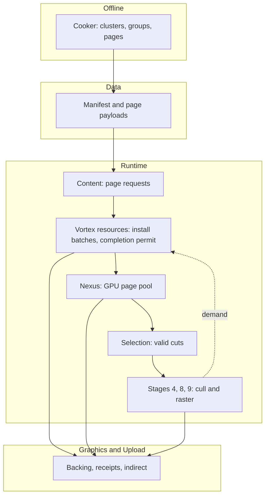

# Virtual geometry and GPU paging

Status: proposal. Nothing here is implemented, scheduled or accepted. It is
written against the engine as it is today and changes no accepted document.

Last updated: 2026-10-24

Read: [at a glance](#at-a-glance), [scenario](#scenario),
[engine today](#the-engine-today), [architecture](#architecture),
[decisions](#decisions), [shared rules](#shared-rules),
[accepted designs this touches](#accepted-designs-this-touches).

## At a glance

| Question          | Answer                                                                                                                                      |
| ----------------- | ------------------------------------------------------------------------------------------------------------------------------------------- |
| What is it?       | Meshes and terrain of any size rendered as paged, adaptive triangle clusters, selected on the GPU, with a GPU-authoritative page pool.      |
| Why?              | Source assets (rock, cliff, 1 km terrain) exceed what classic LOD meshes and per-draw CPU work can carry; detail must stream without holes. |
| Proof workload    | A compiled heightfield terrain plus a cliff mesh through one runtime path, in a runnable example.                                           |
| Modules           | Nexus, Graphics, Data, Cooker, Content, Vortex (reserved Stage 4), one example. No editor work.                                             |
| Reuses            | Nexus retirement, Graphics managed resources and receipts, Upload, GPU feedback, occlusion culling and indirect lists.                      |
| Not in the design | Full terrain system, editing, collision, virtual textures, mesh shaders, software rasterization, GPU-driven VSM.                            |

## Scenario

An author imports a cliff scan with several million triangles and a one
kilometre heightfield. The scene contains both. A player camera flies over the
terrain, stops, teleports, and a second view (an editor viewport or a mirror)
looks elsewhere. A spot light casts shadows from a cliff the camera cannot
see.

What the author and the player must observe:

- The scene never shows a hole, a popping parent/child overlap or a stalled
  frame while detail loads. Missing detail means a coarser, complete surface.
- Detail follows the view: near surfaces refine to the authored surface, far
  surfaces stay coarse, each view choosing independently.
- Memory is bounded. A pool smaller than the full detail set keeps working,
  evicting what no view needs.
- Shadows match what the lit surface looks like, including from off-screen
  casters, on the first frame detail changes.
- Replacing an asset (a recook) never mixes old and new surface.

The same machinery serves ordinary meshes: a classic mesh is the degenerate
case with one resident level, so one cluster format, one cluster culling path
and one draw path cover both.

## The engine today

Facts the design is written against, verified on `master`:

| Area       | Fact                                                                                                                                                                                                                              |
| ---------- | --------------------------------------------------------------------------------------------------------------------------------------------------------------------------------------------------------------------------------- |
| Vortex     | 23 fixed stages. Stage 4 is a comment (`SceneRenderer.cpp`) and `Vortex/GeometryVirtualization/` is an empty directory. No cluster, meshlet or virtual-geometry code exists anywhere.                                             |
| Culling    | GPU two-phase occlusion over mesh views (about 4096 triangles, Morton-ordered) already feeds depth, base, translucency and shadow passes through `ExecuteIndirect` lists. Cluster culling is a documented next step.              |
| Depth      | `DepthPrePassCompleteness` (`kDisabled`, `kIncomplete`, `kComplete`) gates scene depth, shadow receivers and the screen HZB.                                                                                                      |
| Scene data | Since the data-contract rework: one immutable inputs record per pass, no in-place rewrites, descriptors and buffers retired by submission receipts.                                                                               |
| Shadows    | Conventional shadows reuse maps keyed by caster dependencies. Virtual shadow maps are designed but not implemented; their shader tree is a retired-renderer remnant.                                                              |
| Nexus      | `IndexReuse` with move-only retirement tickets, `RetirementState` owner/use/pin accounting (two production adopters). No paging.                                                                                                  |
| Graphics   | Managed registrations, `RecordingUseBatch`, `CompletionReceipt`, allocation budgets, `ExecuteIndirect` (draw, dispatch, optional GPU count). No capability query, reserved resources, enhanced barriers or runnable mesh shaders. |
| Upload     | `UploadCoordinator::Submit`, immutable 2D texture upload, bounded `GpuFeedbackPool`. Ticket `Cancel` is logical and does not stop a submitted copy.                                                                               |
| Data       | `GeometryAsset` → one `Mesh` per LOD → `SubMesh` → `MeshView`. Versions come from `PakFormatVersions.inc`; readers accept only current versions.                                                                                  |
| Cooker     | Geometry import pipeline with `MeshBuildPipeline` (spatial mesh-view split), cancellation by stop token, JSON-schema validated settings. No clustering library dependency.                                                        |
| Content    | Callback loader (`IAssetLoader`) with `LoadRequest`/`LoadIntent::kStreaming`, residency policy and pins; coroutines on the concrete `AssetLoader`. Content never touches the GPU.                                                 |
| Terrain    | No terrain asset, importer or sample.                                                                                                                                                                                             |

## Architecture

| Document                                            | Owner module   | Contract                                                                                   |
| --------------------------------------------------- | -------------- | ------------------------------------------------------------------------------------------ |
| [Page residency](page-residency.md)                 | Nexus          | GPU-authoritative page pool: identity, demand, resolve, production, protection, epochs.    |
| [Paged resource backing](paged-resource-backing.md) | Graphics       | Backing resources, capabilities, ordering and indirect execution for the pool.             |
| [Geometry format](geometry-format.md)               | Data           | Virtual representation: clusters, replacement groups, pages, quantization, validation.     |
| [Geometry compilation](geometry-compilation.md)     | Cooker         | How heightfields and meshes become that format deterministically.                          |
| [Geometry streaming](geometry-streaming.md)         | Content        | Typed page requests over the existing loader; no GPU knowledge.                            |
| [Geometry resources](geometry-resources.md)         | Vortex         | Region admission, immutable install batches, the completion permit, protection, revisions. |
| [Geometry selection](geometry-selection.md)         | Vortex         | Valid cuts, bounded progress, cluster culling and visibility history.                      |
| [Geometry rendering](geometry-rendering.md)         | Vortex         | Stage placement, draw and shading contract, shadow and temporal identity.                  |
| [Terrain](terrain.md)                               | Vortex example | The proof workload and the boundaries of the later terrain system.                         |
| [References](references.md)                         | -              | Engine sources, UE 5.7 and external research behind the decisions.                         |

Responsibility split:

- Nexus owns generic page identity, residency transitions, protection and
  publication. It does not interpret geometry, terrain, material or shadows.
- Graphics owns physical resources, budgets, submission outcomes and native
  lifetime. It does not parse page keys or geometry.
- Data owns the wire format. Cooker produces it. Content moves bytes.
- Vortex owns geometry semantics: dependency closure, valid surface selection,
  installation scheduling and drawing.

## Decisions

Each decision is binding for this proposal and states its rationale.

1. **The GPU is the page authority.** Physical placement, eviction and
   publication are decided on the GPU in bounded passes. There is no
   production CPU planner and no blocking readback in rendering, allocation or
   reuse. Rationale: a CPU planner fed by readback decides a frame late or
   stalls; the accepted [VSM design](../../vortex/lld/virtual-shadow-maps.md)
   rejects the same pattern.
2. **Bounded software pools.** Pools are fixed-size, budgeted device-local
   buffers or texture arrays with software page lookup. Hardware sparse
   backing and explicit driver residency are separate later optimizations.
3. **Surfaces are valid cuts of a replacement-group DAG.** A cut replaces a
   complete set of coarse clusters with the complete finer set a group
   certifies. Pages may arrive independently; selection changes only when a
   complete compatible representation is usable. Rationale: independent
   cluster LOD choices cannot guarantee crack-free boundaries.
4. **One cluster unit with occlusion.** The cluster of this format is the
   cluster of
   [cluster culling through vertex pulling](../../vortex/lld/occlusion.md#101-cluster-culling-through-vertex-pulling-vx-occ-05),
   about 128 triangles with bounds and a normal cone. A classic mesh compiles
   to the same cluster records with every level resident, so occlusion's
   cluster culling and this proposal share one asset format, one culling level
   and one draw path.
5. **Vertex-pulling hardware raster first.** Visible clusters become counted
   indirect draws through existing `ExecuteIndirect`. Mesh shaders need
   Graphics support that does not exist today and are a separate decision;
   software micropolygon rasterization and a visibility buffer are separate
   renderer decisions.
6. **Content stays GPU-independent.** Content returns validated immutable
   bytes by manifest-local page identity. Vortex owns GPU installation.
7. **One non-preemptive completion permit per geometry pool.** The geometry
   resource owner schedules loading completion for one unit at a time and the
   GPU reserves abstract capacity and protects its dependencies before any
   eviction. This bounds partial-group deadlock. Installation parallelism is
   limited, drawing of resident geometry is not.
8. **Owned immutable install batches.** Page bytes reach the GPU through
   device-local buffers filled by `UploadCoordinator` and retained by Graphics
   through one-shot install recordings. Ring staging is never the source of a
   delayed install.
9. **Conservative conventional-shadow reuse.** Conventional local shadow
   products that virtual casters can contribute to bypass cache reuse and
   refresh fully. Products disjoint from virtual casters keep reuse. No GPU
   readback decides CPU reuse.
10. **Terrain is compiled geometry.** Heightfield, layers, holes and baked
    displacement are authoring inputs compiled to the same clusters as any
    mesh. A runtime-displaced grid is only a synthetic producer for pool tests.
11. **Page kernels are shared with VSM.** The generic free-list, epoch-LRU and
    compaction kernels live in the Nexus paging shader family. The VSM design
    keeps its own pool resource, page table and metadata and consumes those
    kernels when it is implemented. Rationale: both need the same
    prefix-scan and age-bucket machinery; neither exists as code today.
12. **Cluster and page sizes are profile parameters.** They are chosen by
    measurement when the format is frozen, are independent of hardware wave
    size and of each other, and are never encoded as architecture.
13. **A clustering library is adopted by audit.** meshoptimizer's clusterlod
    is the candidate; no clustering dependency exists today, so adoption adds
    a pinned Conan requirement after boundary and error fixtures pass. Oxygen
    owns the coverage proof, error semantics and format regardless.

## Shared rules

These bind every module document and are subordinate to the
[Oxygen engineering rules](../../../../../design/oxygen/RULES.md). Before adding
a helper, name the existing capability inspected, why it falls short and the
smallest change in its owner. No forwarding utilities, parallel registries,
generic schedulers, serializers or handle frameworks.

### Existing capabilities to use

| Concern                 | Reuse                                                                                                                                                                                      |
| ----------------------- | ------------------------------------------------------------------------------------------------------------------------------------------------------------------------------------------ |
| Outcomes and rollback   | Base `Result`, `ScopeGuard` (nonthrowing cleanup), RAII, existing module error families.                                                                                                   |
| Ownership               | `observer_ptr` for borrows, standard unique/shared ownership by lifetime, Base `Macros.h` for special members.                                                                             |
| Strong scalars          | Base `NamedType`; Core `SizeBytes`, `OffsetBytes`, `Alignment`, `Epoch`, frame and view types, bindless types.                                                                             |
| Identity                | Core `AssetKey`, Data `SourceKey` and `SurfaceId`, Content `ResourceKey` (opaque, never serialized). No page-specific UUID or key replacement.                                             |
| CPU identity retirement | Nexus `IndexReuse`, `RetirementTicket` and `RetirementState`, and `FrameDrivenIndexReuse` where release must not allocate. GPU physical-slot state is the new execution-domain capability. |
| Hashing and binary I/O  | Base `Hash`, SHA-256, Serio reader/writer and the Data packing rules. `HashCombine` is for in-memory keys, not portable content digests.                                                   |
| Async loading           | Content request lifetimes and OxCo; Cooker import jobs and JSON-schema validation. No second I/O worker, decoder registry or cancellation protocol.                                        |
| Upload and feedback     | `UploadCoordinator`, `TransientStructuredBuffer`, `GpuFeedbackPool`/`GpuFeedbackReservation`.                                                                                              |
| Native GPU execution    | Managed registrations, `RecordingUseBatch`, `CompletionReceipt`, `AllocationBudget`, `CommandRecorder`, profiling.                                                                         |
| Culling and draw lists  | The occlusion module's `DrawCullRecord`, visibility history, `IndirectListBuilder` and two-phase structure.                                                                                |

Reuse must keep semantics. `StaticVector` range construction can truncate, so
validate external counts first. Base `ResourceHandle` has a 12-bit generation;
do not force it onto the 32-bit GPU page generation. Typed scalars still need
checked range and narrowing validation. Nexus paging cannot include Vortex
headers; a generic shader primitive lives in its existing common owner and
geometry math stays in Vortex.

### Strong types

Use strong CPU types where equal numbers mean different things:

| Owner            | Types                                                                                                                                            |
| ---------------- | ------------------------------------------------------------------------------------------------------------------------------------------------ |
| Nexus paging     | `VirtualPageIndex`, `NamespaceIndex`, permit and ticket identity at the module boundary. Physical slot indices stay private.                     |
| Data             | Manifest-local `PageId`, `ClusterId`, `GroupId`, `TraversalNodeId`, `BoundaryCohortId`, declared once and shared through Data headers.           |
| Vortex internals | Install batch identity/generation, request attempt and selection-product identity only where domains differ; reuse `ViewId` and frame types.     |
| Quantities       | Reuse `SizeBytes`, `OffsetBytes`, `Alignment`, `Epoch`. World geometric error and projected pixel error are distinct types at conversion points. |

Declare each type once in its owning header. Translating Data `PageId` to
Nexus `VirtualPageIndex` is one explicit validated adapter: manifest and
runtime namespace indices are different domains. Strong types are CPU
surface; cooked and GPU records are separate wire layouts packed with checked
narrowing, never by reinterpreting `NamedType` storage.

### Public API budget

"Public" means installed headers and exported symbols another module can use.
Rows are allowlists of responsibilities, not a list of free functions to
export.

| Owner    | Public surface                                                                                                                 | Private                                                                                                 |
| -------- | ------------------------------------------------------------------------------------------------------------------------------ | ------------------------------------------------------------------------------------------------------- |
| Nexus    | Pool creation and configuration, owned namespace/epoch/permit tokens, recording and publication operations, typed keys, errors | Slot maps, token ledgers, free lists, kernel selection, wire packers, metadata, test oracles            |
| Graphics | Only demonstrated gaps in existing resource, capability and execution APIs                                                     | D3D12MA, native heaps, fences, command signatures, descriptor internals; no paging execution facade     |
| Data     | Virtual representation accessors, immutable validated manifest views, owning scalar IDs                                        | Builder workspace, codec internals, mutable packed backing                                              |
| Content  | Typed manifest and page requests on the existing loader, immutable payloads, opaque request and source ownership               | File offsets, handles, cache scheduling, GPU destinations, install permits                              |
| Cooker   | Representation and profile fields on existing import settings and schema                                                       | Cluster builder, simplifier, quantizer, packer, job graph                                               |
| Vortex   | Existing renderer admission; a new capability only for a named outside caller                                                  | Geometry resource and selection services, completion scheduler, install batches, cuts, per-pass records |
| Example  | None                                                                                                                           | Diagnostics, script controls and test producers                                                         |

Check CMake installation and transitive includes: an `Internal` directory does
not make a header private. Export individual methods with the owning
`OXGN_*_NDAPI` macros, prefer opaque state to header templates, and keep
engine-only C++23 behind any C++20-facing facade because editor and interop
consumers require C++20. Do not change unrelated APIs.

## Accepted designs this touches

Adopting this proposal means reconciling these accepted documents. This
proposal changes none of them.

| Accepted document                                                                                 | Interaction                                                                                                                                |
| ------------------------------------------------------------------------------------------------- | ------------------------------------------------------------------------------------------------------------------------------------------ |
| [Occlusion §10.1-10.2](../../vortex/lld/occlusion.md)                                             | Cluster culling and its asset format are this proposal's cluster unit (decision 4); the mesh-shader path waits on Graphics `DispatchMesh`. |
| [Virtual shadow maps](../../vortex/lld/virtual-shadow-maps.md)                                    | Its page allocation (epoch-age free list, LRU, prefix-scan bucket sort) would consume the shared Nexus kernels (decision 11).              |
| [Vortex architecture §6.2](../../vortex/ARCHITECTURE.md)                                          | Fills the reserved Stage 4 and the reserved `GeometryVirtualizationService` family.                                                        |
| [Upload](../../vortex/lld/upload.md), [GPU feedback](../../vortex/lld/gpu-feedback.md)            | Consumed unchanged.                                                                                                                        |
| [Shadow service](../../vortex/lld/shadow-service.md)                                              | Extends caster dependencies with virtual casters (see [rendering](geometry-rendering.md#shadow-and-temporal-identity)).                    |
| [Capabilities](../../vortex/milestones/capabilities.md), [open items](../../vortex/OPEN_ITEMS.md) | Geometry virtualization is a reserved family there; scheduling it updates both.                                                            |

## Out of scope

The complete terrain system, editing and collision revision coordination,
deep world streaming, deformation, virtual textures and composed surface
caches, mesh shaders, hardware sparse backing, and the VSM implementation
itself. [Terrain](terrain.md) states the boundaries and the extension points
each of these needs.

References and the reading order for the research behind the decisions are in
[references](references.md).
