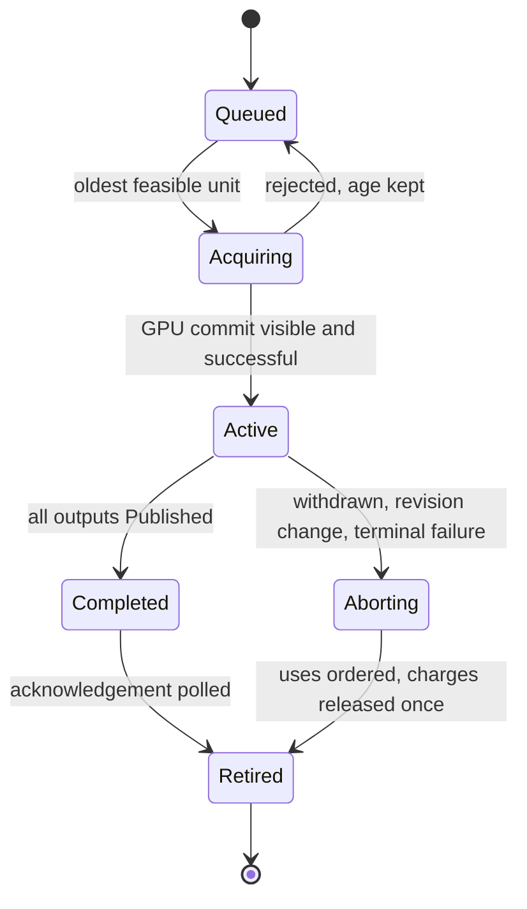

# Virtual geometry resource ownership

Status: proposal. Part of [virtual geometry](README.md). Owner module: Vortex
(Resources).

Last updated: 2026-10-24

Read: [ownership](#ownership-and-admission), [data products](#data-products),
[installation](#installation-and-publication),
[protection and revisions](#protection-and-revisions),
[verification](#verification).

## Ownership and admission

Add explicit virtual-geometry resource ownership inside Vortex Resources; the
classic `GeometryUploader` (residency keyed by asset and LOD, Nexus-versioned
handles) stays supported. Virtual geometry is never represented as thousands
of `GeometryRef`s, assets or scene nodes. ScenePrep publishes instances,
transforms, material references and manifest identities as it already does for
classic draws; GPU work selects clusters. There is no per-cluster CPU draw
list and no authoritative CPU page mirror.

Inputs: [Content page loading](geometry-streaming.md), the
[Data format](geometry-format.md), [Nexus paging](page-residency.md) and the
existing [Upload](../../vortex/lld/upload.md) service. Nexus does not inspect
group graphs; this owner supplies dependency and protection data and
coordinates installation.

### Public API and reuse

The resource service and its completion and install machinery are
Vortex-private. Cross-product records used only by Resources, selection,
stages and Shadows are not installed public API. External callers continue
through existing renderer, scene and asset admission; a new public capability
needs a named outside-module caller and header and symbol approval. Reuse Data
IDs, Core view, frame, byte and epoch types, Content requests and
Graphics/Upload ownership. Internal `NamedType`s identify batches, attempts and
selection products where their domains differ; wire scalars are packed
explicitly. Mutable directories, cut buffers and scheduler state are not
exported. See the [shared rules](README.md#shared-rules).

An admitted active region includes a manifest, bounded routing metadata,
guaranteed coarse geometry and its dependency closure. All of it is budgeted
before admission. The world hierarchy need not be resident all at once, and
fine pages never hold the only metadata needed to discover themselves or find
a valid fallback.

Admission is asynchronous: Pending is distinct from Ready. Rendering never
advertises coarse coverage for an unadmitted region. Once admitted, fine-page
misses cannot withdraw base coverage. Mandatory bytes or outputs that do not
fit are explicit region-admission failures, not silent holes.

## Data products

| Product                   | Owner and lifetime                                                         | Consumers                                        |
| ------------------------- | -------------------------------------------------------------------------- | ------------------------------------------------ |
| GeometryResourceHandle    | CPU namespace identity and generation; immutable manifest, source snapshot | ScenePrep, loading, region lifecycle             |
| GeometryPoolBindings      | Registered payload and maps plus the Nexus pool incarnation                | Install, selection, draw shaders                 |
| GroupReadiness            | GPU per-group state stamped by manifest and residency epoch                | Selection                                        |
| GeometryResidencySnapshot | Admitted namespace metadata and ordered mapping epoch                      | Every view using that epoch                      |
| SurfaceRevision           | Authored surface identity (`SurfaceId`) and content revision               | Shadows, edits, temporal logic                   |
| RepresentationIdentity    | Manifest and group approximation identity independent of addresses         | Selection, shadow content identity, history      |
| PhysicalPageHandle        | Slot and generation used for safe access                                   | GPU work only; not a surface-change notification |

Every product has one producer and explicit recording dependencies. Following
the immutable-inputs model of the existing renderer, GPU work reads one
immutable inputs record per pass; nothing reachable by recorded work is
rewritten in place. A CPU handle for submitted production is a promise to
order GPU work, not proof that a GPU validation result succeeded. Consumers
gate on published GPU readiness. Permanent content failure is exposed through
bounded status transport without waiting in the render loop.

The resource API admits and releases a `GeometryResourceHandle`, records
pending installs, exposes the `GeometryResidencySnapshot` to selection and
accepts logical demand and status from declared consumers. It exposes no PAK
ranges and no mutable CPU page table. The retained source, staging and epoch
owner for each input span is specified with the recording that uses it:
borrowed CPU arrays never outlive their caller merely because an upload or
recording was queued.

## Installation and publication

1. Merge camera, shadow and other consumer demand by logical `PageKey`,
   keeping consumer priority information without merging their selected
   surfaces.
2. Coalesce asynchronous Content requests. Old source and manifest identity
   stay until requests and borrowed bytes drain.
3. Select one logical completion unit and submit its full installation
   closure to Nexus for capacity and protection acquisition. GPU validation
   of the result precedes any victim selection or production for that unit.
4. Populate immutable install-batch buffers through Upload. After successful
   transfer, expose one-shot `InstallRecord`s, ordered dependency-first, to the
   admitted permit. GPU resolution alone chooses physical destinations.
5. Install compute reads protected dependencies and immutable source ranges.
   Invalid, stale or failed records never publish. A newly installed
   prerequisite gets permit protection as part of publication, before any
   later eviction.
6. When all required outputs and runtime references are `Published`, validate
   group readiness and transfer protection to its ready-representation owner
   without a gap. Release decode-only holds after their final ordered use.
   Publish a consistent residency epoch for selection and all declared pass
   consumers.

### Completion admission policy

This owner is the sole completion scheduler. Selection supplies logical
demand and consumes readiness, Content supplies bytes, and Nexus validates
residency and capacity and owns physical allocation. A geometry pool permits
one Active completion unit at a time. That bounds ownership and prevents
partial groups from mutually consuming all remaining slots. It limits
installation parallelism, not drawing of already resident geometry.

Completion demand is coalesced by manifest incarnation and group or unit
identity across instances and views; selection stays per instance and view.
Completion guarantees usable content, not that every view can afford or
wants that refinement in its current output and material-bin budget. Selection
independently admits the actual cut substitution.

A unit expands to the sorted unique full set of `PageKey`s `C`: required output
pages, transitive runtime references and transitive decode prerequisites,
shared keys counted once. This conservative full closure is kept through
completion; optimal peak-live scheduling is not attempted. Let `E` be the
matching `Published` members of `C`, `M = C \ E`, and `U` the slots
unavailable through other protections, production or unordered readers. GPU
admission requires `|U ∪ slots(E)| + |M| ≤ pool slots` plus available token,
descriptor and scratch bounds; an already-protected member of `E` counts once.

The permit protections for `E` and `|M|` abstract capacity credits are acquired
all-or-none before victims are chosen. Credits reserve capacity, not addresses
or payload slots. A destination is assigned only when its payload and decode
prerequisites are ready, and new protections or admissions cannot consume
reserved credits. This logical reservation can span I/O while physical
installation stays late. If unit A needs `{a,b}`, unit B needs `{c,d}` and two
slots are free, only one unit is Active: after `a` arrives its remaining
credit belongs to `b`, so `c` cannot split-pin the pool.

Optional coalesced units queue by first-seen sequence; ties use descending
consumer priority, then stable unit identity. Duplicate demand keeps its
original position. The oldest currently feasible unit is serviced; a
temporarily blocked one is deferred without resetting its age. An invalid or
oversized closure is a distinct terminal profile outcome. There is no
priority-only preemption of an Active unit; withdrawn interest, revision
invalidation or a terminal producer or I/O failure may abort it. Mandatory
region admission is accounted separately and cannot invalidate an active
capacity guarantee.

The CPU proposes logical units in that order; only the GPU admission result
establishes feasibility. A rejected proposal advances the bounded service
cursor without losing its age and is reconsidered later. No CPU inference from
a statistics sample approves a reservation. Candidate count and the feedback
and service periods are finite bounds, so a feasible older candidate cannot be
skipped indefinitely by repeated younger proposals.

Permit state is versioned, retained GPU state, observed by repeated
asynchronous polls over `GpuFeedbackPool`; a dropped one-shot sample cannot
strand a permit. This control is required for loading progress and is
distinct from optional lossy statistics. Rendering never waits for an
acknowledgement and continues its current valid cut.

Staging and scratch service for at least one legal dependency-ready batch of
the Active unit is reserved, so unrelated ready arrivals cannot fill the
allowance. After a terminal failure new jobs stop, existing uses are ordered
or discarded, this permit's tokens and credits are released once, and
unreferenced partial contents stay ordinarily evictable. Shared Content
interest and other owners' protections survive cancellation. Unknown
execution quarantines charges rather than reporting ordinary retirement.

Progress guarantee: under fixed finite valid demand, a feasible full closure,
bounded successful I/O and retries, bounded GPU and feedback service and
eventually resolved recordings, an admitted unit completes within its
closure's bounded dependency batches. Configuration declares the maximum
payload attempts and maximum waiting service ticks; exhausting either ends the
unit rather than holding a permit forever. A service tick is an owner update
opportunity, not a busy loop. Where one dependency-ready page is delivered per
service opportunity, a conservative bound is
`T_acquire + |M| · (T_delivery + T_upload + T_service + T_install) + T_publish`,
including retry and poll delays in those maxima. Fair admission eventually
services persistently feasible queued units. The design does not promise
that all individually feasible groups stay ready when their protected union
cannot fit. Optional ready representations can be retired by withdrawing
readiness for new epochs, ordering existing readers and releasing their
owner's runtime tokens; new cuts then fall back to admitted coarse coverage.

### Immutable install batches

The resource owner allocates a fixed-budget set of independently owned
device-local install-batch buffers and immutable directory buffers through
managed Graphics registration, charged to the allocation budget.
`UploadCoordinator::Submit`/`SubmitMany` fills their ranges using
`UploadBufferDesc`. Ring staging is needed only until that transfer completes
and is never the backing for delayed GPU installation.

`UploadTicket::TryGetResult` is polled without blocking, and a batch is
exposed to installation only after a successful result is observed. This
permits an extra frame of latency and an extra copy, and avoids a new
pin-aware Upload range allocator. `UploadTicket::Cancel` is never used to
prove that a submitted destination can be reused: it marks the ticket
logically terminal before the GPU copy completes. Logical interest is
withdrawn, but the submitted upload ticket stays uncancelled and destination
ownership and budget are retained until real completion is observed.

Each directory entry identifies the batch and directory generation, entry
index, logical source, manifest and `PageId`, request attempt, checked byte
offset and length, codec and decoded-size bound. The bound directory supplies
the batch identity. Its wire layout is frozen with Nexus's `InstallRecord`
`staged_range_index`. Source directory identity and destination production
ticket are both validated before reading or writing.

Entries are one-shot candidates for one installation recording. A rejected or
deferred entry leaves no GPU retry referencing its source; persistent demand
can restage later. The install recording retains registrations and a batch
ownership token through `RetainRegistration`/`RetainOpaqueUse` and
`SubmitWithReceipt`. A batch recycles only after upload completion, closed
future-use admission and release of every recorded and submitted install use.
Discard is distinct from completion and execution uncertainty quarantines the
batch through `InvalidateManagedRegistrations`. Admission acknowledgements are
not required for recycling, so dropped status cannot hold rejected batches
forever. Cross-queue install uses a recorded `RecordDependency(receipt)` or a
ticket-gated publish, and descriptors are published once per batch and
retired by receipt, never updated in place.

Account for the allocated capacity of uploading, ready, recorded, submitted and
quarantined batches and directories: dropping demand does not remove those
charges. Before upload, private bytes can be released immediately; after
install submission, cancellation cannot mutate the frozen directory or
payload. Source retention and batch reuse exclusion protect byte contents, not
merely `Buffer` object lifetime.

The packing profile keeps each cluster inside a page and lets a group cross
pages; Data owns the encoding. Draw shaders can decode compact attributes
directly, or an explicit codec installs a GPU-readable representation. Scratch
and expanded resident size are budgeted separately from transfer size.

## Protection and revisions

Protection reasons are explicit and separately releasable:

- mandatory coarse coverage and routing for an admitted region;
- decode-only dependencies, released when decoding no longer references them;
- runtime dependencies, kept while dependent representations stay usable;
- selected-epoch references, ordered before pool reuse;
- retained content or snapshot requests, under a separate bounded allowance.

Not every ancestor of every resident page is protected. Selection chooses a
valid fallback, and dependency records specify the data that must be retained.
Geometry translates these requirements into Nexus tokens and protection
buffers. Unknown execution quarantines the affected resource generations via
Graphics.

Runtime closure tokens belong to an explicitly retireable
ready-representation owner, never to mutually immortal per-page reference
cycles. Readiness retires before its tokens release, and other owners' shared
holds are preserved. Decode-only inputs are installation preconditions: a
successful independent resident output stays selectable after its inputs are
evicted. If draw-time decoding still reads an input, it is a runtime
reference instead.

Edits create a new immutable manifest and cohort. Old pages, mapping and
selection stay usable until the new coherent revision is ready and published.
Overlap of old and new geometry, routing metadata, staging, decode scratch and
pinned captures is budgeted; if it cannot be admitted, the old revision is
preserved and pressure reported. Old pages are never partially relabelled as
the new manifest.

Surface-revision and representation changes carry affected bounds for
consumer invalidation. Physical page relocation carries only mapping-generation
changes. Storage offsets and descriptors never feed semantic shadow or
temporal identity, and nothing guarantees that a `ClusterId` survives a recook.

## Verification

- Region admission accounts for root metadata and geometry and rejects
  insufficient capacity explicitly.
- Multiple instances and views share page contents while keeping independent
  transforms and selection.
- Stale source, upload and install completions cannot publish into a new
  namespace or revision.
- Two free slots with `A = {a,b}`, `B = {c,d}` and arrivals `a,c,b,d` complete
  the admitted unit; priority churn does not preempt it; shared closure
  credits and pins are conserved across abort and retry.
- A newly needed dependency is acquired before it can become a victim; a
  failed acquisition suppresses production; consumed decode-only inputs
  evict without losing output selectability; runtime and shared-owner
  references are retained correctly.
- Relocation preserves the decoded surface and semantic identity.
- Old/new revision overlap and captured readers stay within budget; a failed
  replacement leaves old content usable.
- Install delayed beyond ordinary ring reuse reads the exact batch bytes;
  rejecting every candidate and dropping acknowledgements still frees batch
  capacity; cancellation never treats an in-flight copy as finished.
