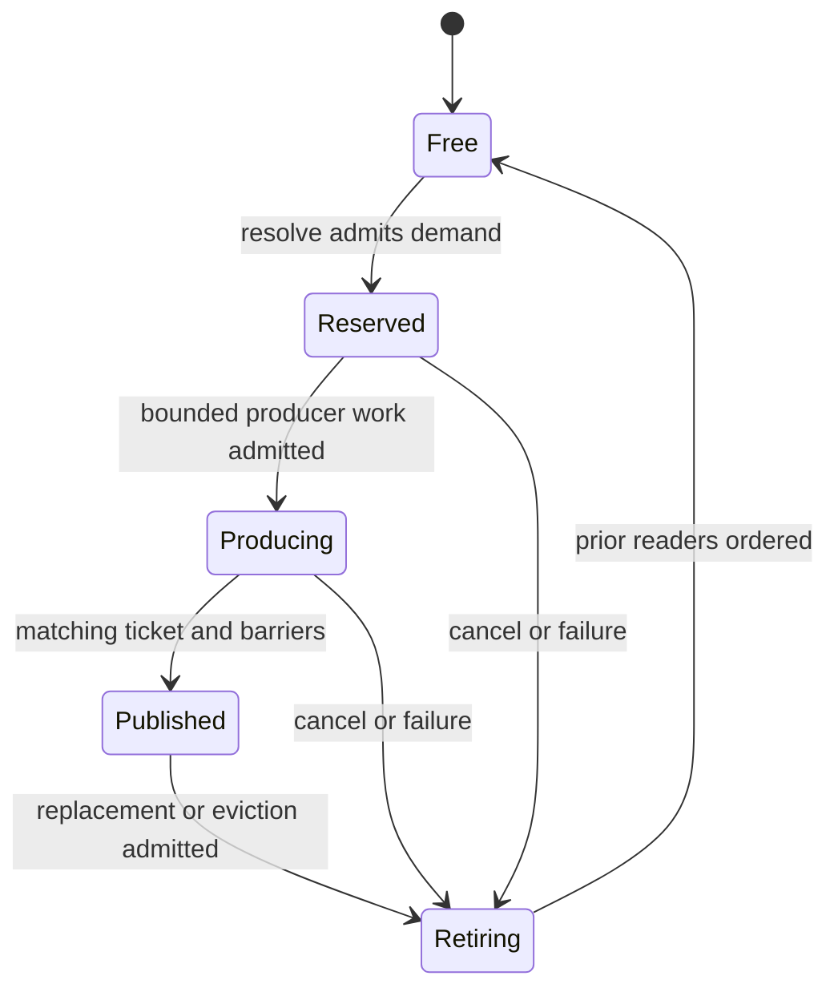

# GPU page residency

Status: proposal. Part of [virtual geometry](README.md). Owner module: Nexus.

Last updated: 2026-10-24

Read: [ownership](#ownership), [identity and wire](#identity-and-wire-contract),
[page state](#page-state), [resolve and production](#gpu-resolve-and-production),
[epochs and protection](#epochs-protection-and-completion),
[failure](#failure-and-capacity), [verification](#verification).

## Ownership

Add a paging capability to Nexus beside `IndexReuse`. Nexus owns generic page
identity, residency transitions, protection and publication. Graphics owns
resources and completion. Vortex schedules passes and supplies producers. The
geometry consumer owns dependency closure and valid surface selection. This
does not turn descriptor slot reuse into a GPU allocator.

Placement: CPU code in `Nexus/Paging/`, shaders in a `Nexus/Paging` family
under `Graphics/Direct3D12/Shaders/`, registered through the existing shader
catalog like the Vortex family. Shared wire records are owned here and
consumed by shaders without a Graphics C++ dependency on Nexus. No new
renderer graph framework.

Inputs are the pool description, admitted namespaces, GPU demand, protection
and install buffers, and an admitted mutation epoch. Outputs are GPU mappings,
a production batch, bounded result and status buffers and a publication
token. CPU objects keep pool generations and recordings; they never mirror the
authoritative physical-page maps.

### What is reused

| Need                                 | Existing capability                                                                                                                        |
| ------------------------------------ | ------------------------------------------------------------------------------------------------------------------------------------------ |
| CPU pool and namespace identity      | `IndexReuse`, `RetirementTicket`; owner, use and pin accounting in `RetirementState`; `FrameDrivenIndexReuse` for allocation-free release. |
| Recording lifetime and ordering      | Graphics `RecordingUseBatch`, `RetainRegistration`, `RetainOpaqueUse`, `RecordDependency`, `CompletionReceipt`.                            |
| Reliable status and permit transport | `GpuFeedbackPool`/`GpuFeedbackReservation` (fixed capacity, `kBusy` when full, transport only).                                            |
| Quarantine of uncertain execution    | Graphics `InvalidateManagedRegistrations` and `PollManagedRetirements`.                                                                    |
| Physical slot identity               | New and shader-owned: slot generations and a free list live on the GPU and are never read back to call `IndexReuse` per page.              |

`DomainKey` in Nexus is a `DomainToken` wrapper today; paging introduces its
own namespace key rather than reusing bindless domains.

### Public API and reuse

The new cross-module surface is: pool configuration, typed keys and errors,
opaque namespace, epoch and permit ownership, recording, publication and read
attachment, and minimal producer GPU bindings. Physical maps, ledgers, kernels
and wire packers stay private; no mutable-map or free-list getter is exported.
CPU `NamespaceIndex`, `VirtualPageIndex` and permit/ticket domains are Base
`NamedType`s; use Core `SizeBytes`, `OffsetBytes`, `Alignment` and `Epoch`
instead of new byte or epoch wrappers. The public headers list their language
requirement: engine internals may use C++23, but any facade reachable by editor
or interop consumers is C++20 and does not leak the expected-based retirement
implementation.

### Recording operations

A small explicit recording sequence, not a callback scheduler. Signatures use
Base `Result` and the existing Graphics types.

| Operation                   | CPU result and guarantee                                                                                                                     |
| --------------------------- | -------------------------------------------------------------------------------------------------------------------------------------------- |
| CreatePool / AdmitNamespace | Validated backing and namespace ownership, or a typed admission failure; no partially exposed allocation.                                    |
| BeginMutation               | Exclusive mutation recording token, or Busy/Closed; carries earlier accepted publication dependencies.                                       |
| RecordAcquirePermit         | Preflight and commit a deduplicated page set, protections and capacity credits; the GPU Active result gates resolve and production.          |
| RecordResolve               | GPU production bindings and bounded result buffers; returns no physical allocation list and no GPU-derived count.                            |
| RecordPublish               | Validation and publication after the caller's producer work, attached to the same pool and ticket identity.                                  |
| ResolveSubmission           | Consumes the actual `SubmissionResult`: accept ordered publication, roll back unissued work, or quarantine uncertainty.                      |
| AttachRead                  | Retains pool and registration state and records dependencies for a permitted publication epoch.                                              |
| RecordProtectionUpdates     | Records admitted versioned token changes; GPU outcome is distinct from recording success.                                                    |
| RecordRetirePermit          | Stop new work, transfer or release protections and credits after ordered uses; a retained versioned terminal state is repeatedly observable. |
| Close                       | Seals admission and releases ordinary ownership; outstanding uses retire through Graphics without destructor waits.                          |

The caller places its producer between `RecordResolve` and `RecordPublish`
using the production bindings. No function collection is stored in the pool.
Nexus records generic compute through Graphics interfaces and its own declared
bindings; it never includes Vortex `RenderPass` or `RenderContext`. CPU
submission resolution uses stable internal state, never callbacks that capture
a dead facade.

## Identity and wire contract

The pool description declares virtual-entry capacity, physical slots, fixed
payload layout, demand, install and result capacities, maximum production
jobs, protection-token capacity and the Graphics budget owner. Every byte
product is checked in 64-bit CPU arithmetic before resource creation. GPU
indices are bounded `uint32`. Zero generation or revision is invalid;
exhaustion rejects admission or requires a new pool incarnation after safe
retirement. No wrap and no ABA acceptance.

A `PageKey` is scoped to one pool incarnation and independent of physical
storage. Namespaces represent source or asset incarnations assigned by the
resource owner. CPU `AssetKey`/`SourceKey` and immutable manifest revisions
map to namespaces; asset hashes are not copied into every GPU record. A
page's content revision is separate from its physical-slot generation, and
equal bytes relocated to another slot keep their content identity.

Proposed v1 structured-buffer records use 4-byte fields and explicit padding:

| Record        | Fields in order                                                                                                                       | Bytes |
| ------------- | ------------------------------------------------------------------------------------------------------------------------------------- | ----: |
| PageKey       | namespace_index, namespace_generation, page_index, content_revision                                                                   |    16 |
| PageDemand    | PageKey, priority, flags, producer_record_index, reserved_zero                                                                        |    32 |
| PageMapping   | physical_slot, slot_generation, content_revision, state                                                                               |    16 |
| ProductionJob | PageKey, physical_slot, slot_generation, ticket_index, ticket_generation                                                              |    32 |
| InstallRecord | PageKey, staged_range_index, payload_bytes, codec_id, result_index                                                                    |    32 |
| PhysicalMeta  | owner PageKey, slot_generation, state, last_use_epoch, protection_count, ticket_index, ticket_generation, retire_epoch, reserved_zero |    48 |

The namespace directory carries generation, mapping offset and count, and
active revision admission. `PageMapping` is indexed through that directory,
not by a global asset hash. The pool incarnation travels in the binding and
epoch token and is validated when recording, so an old recording never
attaches to a replacement pool. Layout probes (`sizeof`, `offsetof`, shader
reflection) gate use. Metadata is versioned; domain-specific fields live in
parallel buffers. Conversion between typed CPU values and these records is
explicit and width-checked.

Priority is a bounded unsigned rank, larger more urgent. Equal ranks use
`PageKey` order for reproducible admission. Consumer policy computes rank;
Nexus never interprets screen error, distance, light type or terrain level.
Demand flags cannot create a permanent pin: protection uses a separately
admitted token and delta protocol. Producer record indices address bounded
input tables, never pointers.

## Page state

Request and protection state are orthogonal. A mapping is usable only if
namespace, content revision, slot generation and `Published` state agree.
Reserved storage and a completed upload alone do not prove a usable payload.

| Transition                    | Authority and precondition                                            | Effect                                                              |
| ----------------------------- | --------------------------------------------------------------------- | ------------------------------------------------------------------- |
| Free → Reserved               | GPU resolve; admitted demand or install and exclusive slot claim      | New slot generation, owner and production ticket; no usable mapping |
| Reserved → Producing          | Bounded producer work admitted                                        | Payload may be written; lookup stays unavailable                    |
| Producing → Published         | Producer success; matching key, ticket, generation; required barriers | Publish the usable mapping; report success                          |
| Published → Retiring          | Replacement or eviction admitted by epoch and protection rules        | Remove the current mapping before reassignment                      |
| Retiring → Free               | Prior readers ordered before reuse; no retained-content protection    | Return the slot once                                                |
| Reserved/Producing → Retiring | Cancel, failure or stale ticket                                       | Never publish partial data; reclaim when safe                       |

An invalidated revision is unavailable to new consumers of it. Old published
content can stay reachable through an explicitly retained version and is never
relabelled as new content. Replacement can need another slot. If capacity is
unavailable the pool reports pressure and the domain keeps a permitted
fallback.

## GPU resolve and production

The first implementation uses a bounded dense mapping table per namespace.
It supports arbitrary bounded page IDs, not a terrain coordinate layout. A
general concurrent hash table waits for a demonstrated consumer.

1. Aggregate demand from every participating view and consumer before any
   mutation. Deduplicate by full `PageKey`; merge the maximum priority;
   validate namespace and range.
2. Resolve `Published` hits. Before victim selection validate source
   dependency mappings and generations and acquire required protections and
   capacity permit. Preflight token, descriptor and counter limits before
   committing any acquisition. A failed or stale acquisition changes no
   protection balance and produces no work. Compute misses only under
   successful admission; optional work cannot take reserved capacity.
3. Scan slots into empty, reusable-retained and unavailable classes. Keep
   unrequested cache contents until they are selected as victims. Prefer
   empty slots, then unprotected victims by last-use age. Current-epoch
   readers and explicit pins exclude victims. Final choices break ties
   stably where practical.
4. Pair admitted misses with available slots using bounded scans and
   compaction. One owner writes each mapping or slot transition. Clear an
   evicted owner's mapping before reassignment; publish the new generation
   and `ProductionJob`.
5. The producer records compute or raster work using the GPU list and
   indirect arguments, gated on successful GPU acquisition, not merely an
   ordered pin request. Generated payload and staged installation share the
   job and ticket completion contract. Payload codecs and geometric meaning
   are outside Nexus.
6. A separate publication pass accepts success only for matching tickets and
   protections. Newly installed prerequisites inherit the active permit hold
   before a later mutation can evict them. Required barriers precede lookup,
   dependency reads and indirect consumption. Runtime holds transfer without
   a gap; decode-only holds release after their final ordered use.
7. Maps, metadata, retained contents and protection state persist on the GPU.
   Statistics readback is optional and never reconstructs next-frame
   allocator state.

Demand aggregation is per mutation epoch, not necessarily per presented
frame. Streamed geometry can append camera and late shadow misses throughout
an immutable read epoch and resolve them in the next update; coarse coverage
stays usable. The pool is not mutated between a view's depth and GBuffer
work, or before declared shadow readers. A generated consumer that needs
same-epoch results collects its demand before its resolve pass; the domain
schedule declares this boundary.

Kernels are bounded scans, radix or priority-bin passes with defined
worst-case storage. No spinning across thread groups and no reliance on
dispatch scheduling. Prefix sums work for every supported wave width and
partial group. Capacity overflow sets a defined output flag and never indexes
past its range. Counters feeding indirect execution are clamped and
validated; overflow is not hidden by the native maximum command count. The
empty-slot compaction, epoch-age bucket ordering and prefix-sum primitives
are written once here as shared shader includes, so the VSM page allocation
can consume them (see [decisions](README.md#decisions)).

Install admission is late: CPU I/O completion makes bytes eligible but does
not reserve a GPU slot. The CPU uploads payload plus a logical `InstallRecord`
into bounded immutable install batches, and GPU resolution supplies physical
destinations. A separate completion permit can reserve abstract capacity
across I/O without choosing addresses. One-shot rejected or deferred entries
leave no producer ticket and no hidden retry reading their source after the
recording retires; persistent demand restages bytes in a new batch. The
[geometry resource owner](geometry-resources.md#immutable-install-batches)
owns source-directory generation, successful-upload gating and batch recycling.

### Capacity and protection permits

Nexus receives bounded opaque `PageKey` sets and versioned permit IDs, never
geometry graphs. The geometry consumer uses one active permit per pool. Inside
an exclusive mutation the whole set is preflighted: identities, existing
`Published` slots and generations, token capacity and missing-page credits.
All holds and credits commit in a separate ordered phase, then Active is
exposed. No eviction or producer dispatch runs before the commit result is
visible and successful. Separate GPU phases and barriers provide the order;
there is no cross-workgroup spin lock.

Credits preserve capacity for missing keys. Consuming one for a destination
transfers its charge to that reserved physical slot, and a duplicate install
cannot consume twice. Cache eviction, new protection and ordinary admission
must preserve outstanding credits. Cancelling a permit stops new jobs and
releases only its charges after accepted work is ordered; shared holds
survive. Unknown execution quarantines the permit with its pool. A versioned
terminal result is retained until the control owner acknowledges retirement,
so a dropped feedback sample cannot leak a permit. No physical address is ever
returned to the CPU completion scheduler.

## Epochs, protection and completion

`PageUseEpoch` has CPU lifecycle states Open, Recording, Submitted,
Closed/Discarded and Quarantined. GPU execution is ordered; Submitted is not
CPU proof that content finished. Each ordinary pool mutation has one owner and
a declared reader set. The owner seals reader admission before admitting a
conflicting mutation. A reader that is neither submitted nor discarded makes
the next conflicting admission Busy, with no CPU wait and no speculative
reuse.

For submitted readers the next writer is ordered after their Graphics
receipts. Same-queue ordering avoids a host wait; cross-queue consumers carry
explicit `RecordDependency` receipts that become native queue-to-queue waits.
Resource barriers remain required: a fence is not a state transition. Reuse
can be recorded after ordered readers without waiting for their CPU
completion polling. Graphics pins keep the backing alive until actual
completion; they do not authorize overwriting content.

Published tables and selected-work references stay consistent within an epoch.
Mutations are serialized at whole-pool granularity at first, with immutable
per-recording constants. The payload pool is never double- or triple-copied
just because several frames are in flight; per-frame scratch rotates
independently.

Protection categories are mandatory-resident, dependency and retained-content.
GPU protection updates use versioned tokens with exactly-once acquire and
release; duplicate or stale deltas are rejected. A consumer checks the GPU
acquisition result as well as ordering its access. A failed acquisition gates
off production and publication and leaves no partial hold. CPU
acknowledgement, when control progress needs it, is asynchronous and reads
retained state; it is not optional lossy telemetry. No caller gets a
synchronous promise about a GPU-selected page. Protected-set capacity is
admitted, not unlimited; underflow and overflow are errors.

Geometry decides which dependencies need tokens and when they release; Nexus
never infers that every ancestor stays pinned. Long-lived diagnostic reads use
budgeted immutable snapshots or explicit retained-content admission and cannot
silently stop the live pool from progressing.

Pool and namespace closure rejects new recordings and cancels logical demand.
Existing recordings keep internal pins, not facade-owning leases. Completion
and discard releases are nonthrowing and allocate nothing, which is what
`FrameDrivenIndexReuse` already guarantees for CPU identities. Unknown
execution quarantines the pool through Graphics; its pages are not returned
as if execution had been discarded.

## Failure and capacity

Outcomes stay distinct: InvalidInput, Closed, Unsupported, BudgetExceeded,
BusyRecording, RequestOverflow, NoEvictableSlot, ProductionDeferred,
ProducerFailed, StaleResult, RecordingFailed, SubmissionRejected (the
exception path of the throwing submit overloads), ExecutionUncertain and
DeviceLost. CPU admission errors and GPU page outcomes are different typed
surfaces and are never flattened into false or empty success.

Pool allocations are fixed during steady operation. Creation and explicit
resize use Graphics budgets, including metadata, scratch, charged
descriptors, retiring generations and capture storage. A failed resize
preserves the previous admitted pool. There is no automatic growth from
virtual address-space size. Production count is a hard bound; content bytes
and staging have independent caps.

Permanent protection plus admitted completion credits and workspace must fit
capacity. The [geometry completion policy](geometry-resources.md#completion-admission-policy)
owns its single permit, queue fairness, delivery assumptions and
partial-group retirement; Nexus conserves generic credits and tokens. If
every slot is protected the pool reports pressure without eviction, host
waiting or a kernel retry loop. Optional telemetry loss affects neither
allocation nor rendering; reliable asynchronous permit control is required
for loading progress.

## Verification

- Identity, exhaustion, checked byte arithmetic and namespace reuse.
- Empty, full and overfull demand; duplicate multi-view requests; partial
  groups.
- Unique ownership and forward/reverse mapping agreement after random traces.
- Stale ticket after reuse, cancelled production, failed producer, revision
  replacement.
- All-protected pressure, atomic failed or stale protection acquisition,
  newly needed oldest-victim dependencies, duplicate deltas, and credit
  conservation through complete, abort and retry.
- Delayed reader, unsubmitted recorder, cross-queue producer, discard and
  uncertain execution, using the Graphics submission fault-injection access.
- Identical allocator contract with generated buffer and texture payloads.
- No runtime allocation readback, bounded work and memory, steady-state
  reuse after warmup.

An independent CPU model is test-only; tests compare semantic invariants and
payload identity, not physical-slot order unless guaranteed. Native tests read
back and check canaries, mappings and payloads: headless bookkeeping does not
prove shader memory ordering. Exhaustive diagnostic kernels stay out of
production.
