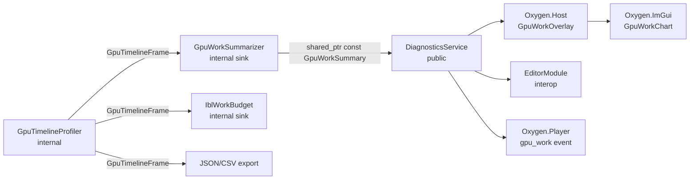

# GPU work summary LLD

**Status:** implemented 2026-10-13

Vortex turns its built-in GPU timeline into a small, human-readable summary of
where the renderer spends GPU time: per view, grouped into a fixed set of work
buckets, averaged over a short window. The summary is plain public data. ImGui
panels, the editor and the game player's event stream consume it; none of them
see timeline internals.

- [§1](#1-purpose-and-non-goals) purpose and non-goals
- [§2](#2-boundaries-and-consumers) module boundaries and consumers
- [§3](#3-implementation) where each part lives
- [§4](#4-public-contract) public types, catalog and service API
- [§5](#5-attribution) how scopes become buckets, items and views
- [§6](#6-windowing-and-publication) averaging window and snapshot publication
- [§7](#7-scope-granularity-policy) which scopes the built-in timeline records
- [§8](#8-profiler-and-diagnosticsservice-changes) profiler and service changes
- [§9](#9-failure-modes) failure modes
- [§10](#10-exit-gates) exit gates

The ImGui half of the work, Vortex no longer linking ImGui, is specified by its
owners: the Vortex side in
[multi-view composition §12.4](multi-view-composition.md#124-surface-layer-sources)
and the ImGui module, widget and host wiring in
[runtime host §5.3](../../runtime-core/runtime-host.md#53-oxygenimgui-widgets).

## 1. Purpose and non-goals

The summary answers one question at a glance while the engine runs: _what is
the GPU doing this frame, and which part of the renderer costs the most?_

It is for a developer or technical artist watching a running scene, in the
DemoShell, the game player or the editor. It must stay readable while the
scene changes: stable labels, a fixed bucket order, averaged numbers.

Non-goals:

- It is not a trace viewer. No per-scope Gantt chart, no raw scope tree, no
  query slots. Dense attribution belongs to Tracy, PIX and RenderDoc
  ([built-in GPU timing](../../profiling/built-in-gpu-timing-architecture.md#3-non-goals)).
- It does not replace the timeline export. The JSON/CSV export and recording
  keep consuming the raw `GpuTimelineFrame`.
- It does not measure CPU time, presentation time or cross-queue overlap. Only
  graphics-queue recorders carry the timeline collector today.

## 2. Boundaries and consumers



| Module          | Owns                                                                                       | Sees                      |
| --------------- | ------------------------------------------------------------------------------------------ | ------------------------- |
| Vortex          | Profiler, summarizer, bucket catalog, stage table, `GpuWorkSummary` publication            | everything below its API  |
| `Oxygen.ImGui`  | `GpuWorkChart`: draws neutral rows; knows nothing about Vortex                             | its own row type          |
| `Oxygen.Host`   | `host::GpuWorkOverlay`: maps `GpuWorkSummary` to chart rows; toggled by `host.ui.gpu_work` | `GpuWorkSummary`, catalog |
| `Oxygen.Player` | `gpu_work` event and `stats` request on the event stream                                   | `GpuWorkSummary`, catalog |
| Editor interop  | Managed copy of the snapshot next to `EditorFrameStatistics`; WinUI panel                  | `GpuWorkSummary`, catalog |
| DemoShell       | Nothing of its own; it gets the overlay from Host                                          | —                         |

Until `Oxygen.Host` exists, `GpuWorkOverlay` lives in DemoShell and moves to
Host in the [runtime host migration](../../runtime-core/runtime-host.md#8-migration),
as `StatsOverlay` does.

The editor reaches the summary two ways:

- **In-process viewports.** `EditorModule` already publishes
  `EditorFrameStatistics` once per frame
  (`Oxygen.Editor.Interop/src/EditorModule/EditorModule.cpp`). It publishes the
  latest `GpuWorkSummary` pointer beside it; interop marshals it to a managed
  record and a WinUI panel draws it. The editor never uses ImGui for this.
- **Out-of-process player.** The editor subscribes to `gpu_work` on the
  player's control server and reads the events it pushes
  ([control and events](../../runtime-core/scene-instantiation-and-player.md#control-and-events)).
  The player serializes the summary; Vortex does not know the event format.

The editor-side work is tracked as a GitHub issue opened when implementation
reaches it; it is outside the scope of this LLD.

## 3. Implementation

| Part                                        | Source                                                              |
| ------------------------------------------- | ------------------------------------------------------------------- |
| Public types and bucket catalog             | `src/Oxygen/Vortex/Diagnostics/GpuWorkSummary.h`                    |
| Stage table and label constants             | `src/Oxygen/Vortex/Diagnostics/Internal/GpuWorkStageTable.h`        |
| Summarizer (timeline sink, window, publish) | `src/Oxygen/Vortex/Diagnostics/Internal/GpuWorkSummarizer.h`        |
| Viewer leases and `GetLatestGpuWorkSummary` | `src/Oxygen/Vortex/Diagnostics/DiagnosticsService.h`                |
| IBL timing access (production lease, sinks) | `src/Oxygen/Vortex/Internal/GpuTimelineAccess.h`                    |
| `Vortex.View` scope per view                | `SceneRenderer::RenderViewFamily`, `SceneRenderer::OnRender`        |
| Chart widget                                | `src/Oxygen/ImGui/Widgets/GpuWorkChart.h`                           |
| Host overlay and `host.ui.gpu_work`         | `src/Oxygen/Host/GpuWorkOverlay.h`                                  |
| DemoShell Diagnostics panel IBL line        | `Examples/DemoShell/UI/DiagnosticsPanel.cpp`, from `background.ibl` |

## 4. Public contract

### 4.1 Types

`src/Oxygen/Vortex/Diagnostics/GpuWorkSummary.h`. The header is consumed by the
editor's C++/CLI interop, so it uses C++20 only and no Vortex internal type.

```cpp
namespace oxygen::vortex {

enum class GpuWorkBucket : std::uint8_t {
  kVisibility,     // view init, occlusion, HZB
  kDepthPrepass,
  kShadows,
  kBasePass,
  kLighting,       // light data, deferred and indirect lighting
  kEnvironment,    // sky, atmosphere, fog
  kTranslucency,
  kPostProcess,    // scene-colour resolve, exposure, tonemap
  kOverlays,       // grid, selection, view overlays, debug views
  kComposition,    // surface composition and surface layers
  kBackground,     // frame work outside views: IBL, LUT bakes
  kOther,          // unknown scopes, list work no stage covers
};

struct GpuWorkStat {
  float avg_ms { 0.0F };
  float max_ms { 0.0F };
};

struct GpuWorkItem {
  std::string id;          // stable, e.g. "lighting.deferred"
  std::string name;        // display text, e.g. "Point lights"
  GpuWorkStat time;
};

struct GpuWorkGroup {
  GpuWorkBucket bucket { GpuWorkBucket::kOther };
  GpuWorkStat time;
  std::vector<GpuWorkItem> items;   // at most kMaxItemsPerGroup, by avg_ms desc
};

struct GpuWorkView {
  std::uint64_t view_id { 0U };
  std::string name;
  GpuWorkStat time;                 // sum of the groups
  std::vector<GpuWorkGroup> groups; // catalog order; empty buckets omitted
};

struct GpuWorkSummary {
  static constexpr std::uint32_t kSchemaVersion { 1U };
  static constexpr std::size_t kMaxItemsPerGroup { 4U };

  std::uint64_t revision { 0U };            // increments per publication
  frame::SequenceNumber last_frame { 0U };  // newest frame in the window
  float window_ms { 0.0F };
  std::uint32_t valid_frames { 0U };
  std::uint32_t invalid_frames { 0U };      // overflow, incomplete, failed
  GpuWorkStat frame_gpu;                    // whole-frame GPU span
  GpuWorkStat idle;                         // span with no command list
  std::vector<GpuWorkView> views;
  std::vector<GpuWorkGroup> frame_work;     // work outside any view
  GpuWorkStat frame_work_time;              // their per-frame total
  std::vector<float> frame_gpu_history_ms;  // newest last, for sparklines
};

} // namespace oxygen::vortex
```

All values are milliseconds. `idle` is the part of `frame_gpu` when no graphics
command list runs: the GPU waits for the CPU or for presentation. Work inside a
command list that no stage scope covers is not idle: it is a `kOther` item
named after the list ([§5.2](#52-rules)), so missing scopes are visible by
name.

### 4.2 Bucket catalog

Labels and colours are shared by every consumer so the player, DemoShell and
the editor look the same.

```cpp
struct GpuWorkBucketInfo {
  GpuWorkBucket bucket;
  std::string_view id;            // "base_pass"
  std::string_view display_name;  // "Base pass"
  profiling::ProfileColor color;  // presentation hint
};

[[nodiscard]] OXGN_VRTX_NDAPI auto EnumerateGpuWorkBuckets() noexcept
  -> std::span<const GpuWorkBucketInfo>;
[[nodiscard]] OXGN_VRTX_NDAPI auto GetGpuWorkBucketInfo(GpuWorkBucket bucket)
  noexcept -> const GpuWorkBucketInfo&;
[[nodiscard]] OXGN_VRTX_NDAPI auto to_string(GpuWorkBucket bucket) noexcept
  -> std::string_view;
```

The catalog order is the display order. Bucket ids are stable strings for the
event stream and the managed record; enum values are not serialized.

### 4.3 Service API

`DiagnosticsService` gains a reader and a collection lease:

```cpp
[[nodiscard]] OXGN_VRTX_NDAPI auto GetLatestGpuWorkSummary() const
  -> std::shared_ptr<const GpuWorkSummary>;

//! Keeps GPU timeline collection on while held. Move-only RAII handle;
//! releasing the last lease turns collection off unless the user setting
//! (`SetGpuTimelineEnabled`) is on.
[[nodiscard]] OXGN_VRTX_NDAPI auto AcquireGpuTimeline() -> GpuTimelineLease;
```

`GetLatestGpuWorkSummary` returns null while collection is off or before the
first window completes. Readers on any thread keep the snapshot alive as long
as they hold the pointer; the summarizer never mutates a published snapshot.

Viewers hold a lease while they show the summary: the Host overlay while
visible, the player while the launcher's `stats` request is on, the editor
while its panel is open. Several viewers can watch at once and none overrides
another. `SetGpuTimelineEnabled` stays the persistent user switch (DemoShell
Diagnostics panel, `rndr.gpu_timestamps`); collection runs while it is on or
any lease is held. Viewer leases need `kDiagnosticsAndProfiling`; without it
the lease is inert and the summary stays null. IBL budgeting is production
scheduling, not diagnostics, so its lease ([§8.2](#82-diagnosticsservice))
is never capability-gated. A lease that outlives the service is inert:
the engine shuts the renderer down before the host modules that hold
viewer leases, and their release must not reach the destroyed service.

`GetLatestIblGpuTiming()` and `IblGpuTiming` are removed; IBL time appears as
the `kBackground` group's `ibl` item. Export and recording are unchanged.

## 5. Attribution

### 5.1 Stage table

One Vortex-internal table, `Diagnostics/Internal/GpuWorkStageTable.h`, lists
every scope that may carry summary time:

| Field          | Example                             |
| -------------- | ----------------------------------- |
| `label`        | `"Vortex.Stage12.DeferredLighting"` |
| `bucket`       | `GpuWorkBucket::kLighting`          |
| `item_id`      | `"lighting.deferred"`               |
| `display_name` | `"Deferred lights"`                 |

The table also defines the label constants. Scope sites use those constants
instead of string literals, so a label is spelled once and a renamed pass
cannot silently fall out of its bucket. The summarizer looks entries up by the
scope's name hash, which the profiler already computes.

The mapping, by bucket:

| Bucket       | Stage scopes                                                                         |
| ------------ | ------------------------------------------------------------------------------------ |
| Visibility   | `Stage3.Occlusion.Phase1/2`, `Occlusion.PyramidBuild`, `Stage5.ScreenHzbBuild`       |
| Depth        | `Stage3.DepthPrepass`                                                                |
| Shadows      | `Stage8.ShadowDepths`, `Stage8.ShadowReceiverFit`, `Stage8.ContactShadowCasterDepth` |
| Base pass    | `Stage9.BasePass`                                                                    |
| Lighting     | `Stage6.SpatialLightGrid`, `Stage12.DeferredLighting`, `Stage13.IndirectLighting`    |
| Environment  | `Stage14.*` fog, `Stage15.*` sky, atmosphere and fog, `Environment.Atmosphere*Lut`   |
| Translucency | `Stage18.Translucency`                                                               |
| Post-process | `ResolveSceneColor`, `PostProcess.Exposure.*`, `PostProcess.Tonemap`, cleanup        |
| Overlays     | `Stage20.*`, `Stage12.DebugVisualization`, `ViewPick`, GPU debug primitives          |
| Composition  | `Vortex.CompositingTask`, `Vortex.SurfaceOverlay`, `Vortex.SurfaceLayer`, aux views  |
| Background   | `Vortex.Environment.IBL.*`, the IBL capture LUTs, `Diagnostics.IBL.Metadata`         |

Occlusion culling records inside `Stage3.DepthPrepass`, so its time is part of
the depth prepass item; `Visibility` shows the HZB builds.

The table is complete when [§10](#10-exit-gates) passes, not when every label in
the source appears in it: only telemetry scopes need entries
([§7](#7-scope-granularity-policy)).

### 5.2 Rules

For each valid frame:

1. **Counted scopes.** A scope's parent is the innermost scope open on the
   same command recorder, else the frame span: only those contain it on the
   GPU. Only a scope directly under the frame span or a `Vortex.View` span
   counts. Nested scopes add nothing, so a stage's sub-pass never
   double-counts with its parent.
2. **View.** A counted scope belongs to the `Vortex.View` scope open, on any
   recorder, when it began ([§8.1](#81-profiler)): passes a view records on
   their own command lists are its work. Other counted scopes are frame work.
   `kBackground` items are frame work wherever they were recorded: IBL work
   records on its own command list while a view records.
3. **Item.** A counted scope's item is its table entry. An item's time is the
   sum of its counted scopes in that view. A group's time is the sum of its
   items. A view's time is the sum of its groups.
4. **Unknown scopes.** A counted scope with no table entry becomes an item of
   `kOther` named by its label, so a missing table entry shows up in the panel
   instead of vanishing into `idle`.
5. **Command lists.** `Graphics` times every graphics-queue command list as a
   `Graphics.CommandList` scope named by the list
   (`Graphics::SetCommandListTimingCollector`, set by the profiler while it
   collects). A list span is transparent to rule 1. Its time that no counted
   scope covers becomes the `kOther` item `list:<name>`, in the view the list
   holds or was recorded for, else in frame work. `idle` is the frame span
   minus every list and every counted scope outside a list.
6. **Items shown.** A group with more than `kMaxItemsPerGroup` items keeps its
   largest by window average and folds the rest into one `"other"` item, so
   it shows at most `kMaxItemsPerGroup`. The folded maximum is the largest
   per-frame sum of the folded items.

Views are keyed by `view_id`. A view appears while it has samples in the window
and disappears with the first window that has none.

## 6. Windowing and publication

The summarizer is an internal `GpuTimelineSink` that the renderer registers
while the GPU timeline is enabled.

- **Window.** 500 ms of steady-clock time, measured when frames are consumed.
  A window publishes when it closes, so consumers see at most two updates per
  second. This is the update rate a person can read; it also bounds the
  `gpu_work` event rate.
- **Statistics.** `avg_ms` is the mean over valid frames in the window;
  `max_ms` is the largest single valid frame. An item absent from a frame
  counts as zero for that frame, so averages of intermittent work stay
  truthful.
- **Invalid frames.** Overflowed, incomplete or failed-resolve frames are
  counted in `invalid_frames` and excluded from the statistics. A window with
  no valid frame publishes a summary with empty views and the counts, so a
  consumer can say why there is nothing to show.
- **History.** `frame_gpu_history_ms` keeps the last 120 valid whole-frame
  spans for a sparkline.
- **Publication.** The summarizer builds a new `GpuWorkSummary`, increments
  `revision` and swaps a `std::shared_ptr<const GpuWorkSummary>` under a short
  lock. `DiagnosticsService::GetLatestGpuWorkSummary` returns that pointer.
  Disabling the timeline drops the pointer.

The legacy presentation smoother (per-scope exponential blending, dead bands,
sibling stitching) is not ported. Window averages give stable numbers with no
display-only state in the consumer.

## 7. Scope granularity policy

The built-in timeline records `kTelemetry` scopes only
(`GpuTimelineProfiler::BeginScope`). After this change:

| Scope                                                     | Granularity   |
| --------------------------------------------------------- | ------------- |
| `Vortex.Frame` (frame span)                               | `kTelemetry`  |
| `Vortex.View` per-view root                               | `kTelemetry`  |
| Stage-table entries                                       | `kTelemetry`  |
| IBL phase scopes while the IBL budget is active           | `kTelemetry`  |
| Exposure sub-scopes, which exposure benchmarks record     | `kTelemetry`  |
| Everything else: sub-steps, constant uploads, list builds | `kDiagnostic` |

`kDiagnostic` scopes still reach Tracy and native GPU markers; they leave the
built-in timeline and its export. This keeps the query budget far below the
4096-scope default and keeps exports pass-level, as the
[profiling guide](../../profiling/profiling-developer-guide.md) already asks.

`IblWorkBudget` keeps consuming raw frames through its own sink and keeps its
own phase labels; its scopes nest under `Vortex.Environment.IBL.Process`, which
maps to `kBackground`.

## 8. Profiler and DiagnosticsService changes

### 8.1 Profiler

- `GpuTimelineScope` parents follow the scope's recorder ([§5.2](#52-rules))
  and gain `view_scope_id`, the `Vortex.View` scope open when it began.
- `GpuTimelineScope` gains `instance_id` and `instance_name`, copied from the
  scope's `view` and `name` variables when present. This is the per-view
  convention the profiling guide already documents; other variables are still
  dropped.
- `SceneRenderer` opens one `Vortex.View` telemetry scope around each view's
  GPU work, with `view` set to the view id and `name` to the composition view
  name.
- The profiler stays in `vortex::internal`. No public header exposes
  `GpuTimelineFrame`.

### 8.2 DiagnosticsService

- Add `GetLatestGpuWorkSummary` ([§4.3](#43-service-api)). Remove
  `GetLatestIblGpuTiming`, `IblGpuTiming` and the public
  `SetGpuTimelineRetainLatestFrame`; tests that need a raw frame reach the
  profiler through the existing `RendererPublicationProbe` fixture.
- Move IBL timing plumbing out of the public service. An internal
  `GpuTimelineAccess`, built over the service and its only timeline friend,
  provides what the friends used: attach the collector to a recorder,
  register a sink, invalidate the current frame and hold a
  `GpuTimelineLease` while IBL budgeting needs collection. This replaces
  `AcquireIblTiming`/`ReleaseIblTiming` and their owner count with the same
  lease type, acquired without the capability gate that applies to viewer
  leases: the renderer creates the profiler regardless of capabilities, and
  IBL scheduling must work in a renderer without
  `kDiagnosticsAndProfiling`. The five IBL `friend` declarations go away.
- Remove `DiagnosticsPassRecord::gpu_duration_ms`. GPU time has one source,
  the summary; the capture manifest drops the field.

## 9. Failure modes

| Condition                                    | Behaviour                                                                                    |
| -------------------------------------------- | -------------------------------------------------------------------------------------------- |
| Collection off or capability unsupported     | `GetLatestGpuWorkSummary` returns null; consumers say why.                                   |
| No timestamp provider or graphics queue      | Existing profiler diagnostic and `DiagnosticsIssue`; windows publish with zero valid frames. |
| Query overflow                               | Frame counted invalid; existing `timeline.query-overflow` issue.                             |
| Telemetry scope missing from the stage table | Appears under `kOther` by label ([§5.2](#52-rules)).                                         |
| View created or destroyed mid-window         | View listed while it has samples; averages count only frames it rendered in.                 |

## 10. Exit gates

- Unit tests for the summarizer on synthetic `GpuTimelineFrame`s: nesting
  roll-up, per-view split, frame work, unknown scope to `kOther`, top-N fold,
  invalid-frame exclusion, window close and `revision` increments, history
  length.
- A test that every `kTelemetry` scope recorded by a representative Vortex
  frame has a stage-table ancestor (no `kOther` items).
- `DiagnosticsService` tests: null while collection is off, non-null after
  the first window, snapshot unchanged while held across a later publication;
  collection stays on while any lease or the user setting is on and stops
  when the last one goes; viewer leases are inert without
  `kDiagnosticsAndProfiling`, while the IBL lease still collects without it.
- IBL budgeting tests still pass with the internal `GpuTimelineAccess`.
- `GpuWorkSummary.h` compiles in an installed-SDK consumer built as C++20.
