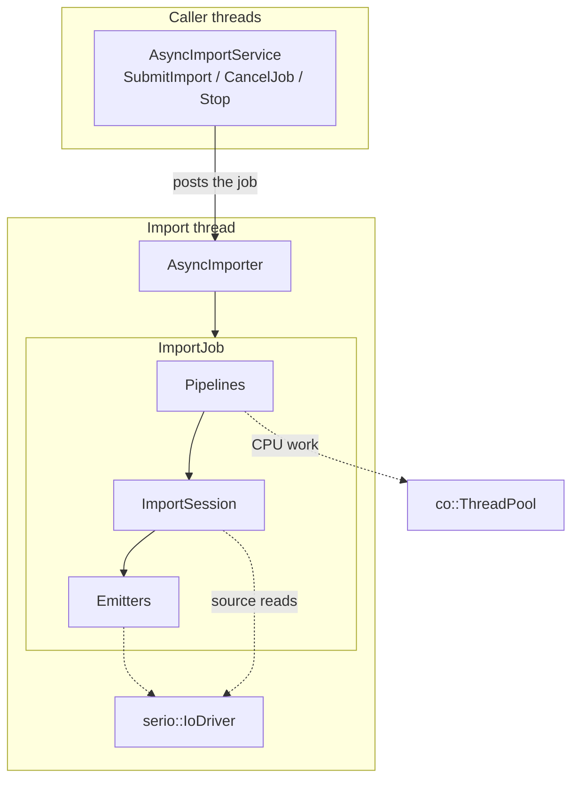

# Async Import Pipeline

The Cooker imports content on a dedicated import thread. It runs its own event
loop and a `co::ThreadPool` for CPU-bound work, and is decoupled from the
application's threads. `AsyncImportService` is the public, thread-safe entry
point. Each submission becomes one job: it reads its sources, cooks them in
compute-only pipelines, writes the cooked files through emitters, and publishes
them in a loose cooked root.

Related documents:

- [async_file_io.md](async_file_io.md): source reads and cooked writes.
- [async_import_planner.md](async_import_planner.md): dependency plan of a model
  import.
- [Model import publication](#model-import-publication) and
  [source analysis](#source-analysis-and-input-observations) below.

## At a glance

| Part                                                | Scope           | Role                                                      |
| --------------------------------------------------- | --------------- | --------------------------------------------------------- |
| `AsyncImportService`                                | One per owner   | Thread-safe API; owns the import thread and its objects   |
| `ImportEventLoop`                                   | Import thread   | ASIO `io_context` and the one `serio::IoDriver`           |
| `AsyncImporter`                                     | Import thread   | Bounded job channel; runs up to `max_in_flight_jobs` jobs |
| `ImportJob`                                         | Per job         | Job nursery, cancellation, observed reads, final report   |
| `ImportSession`                                     | Per job         | Emitters, diagnostics, index and table participation      |
| Pipelines                                           | Per job         | Compute-only cooking on the ThreadPool                    |
| Emitters                                            | Per session     | Reserve rows and ranges, write cooked files               |
| `LooseCookedIndexRegistry`, `ResourceTableRegistry` | Per cooked root | Cohort of the jobs writing one root                       |



## Rules

- All import coroutines run on the import thread. A coroutine that awaits
  `ThreadPool::Run` resumes on the import thread, so emitter and session state
  is mutated from one thread. The table aggregator of a cooked root is shared by
  its jobs and takes its own mutex.
- The ThreadPool does CPU-bound work only (decoding, mips, BC7, mesh
  processing, hashing). File reads and cooked writes go through the loop's
  `serio::IoDriver`.
- Pipelines do not write cooked files. They return in-memory results that the
  job hands to an emitter.
- Cancellation is cooperative: the job nursery is cancelled, and work items
  carry a `std::stop_token`.
- Callbacks run directly on the import thread. A callback that blocks holds up
  every job; callers marshal to their own threads.

## AsyncImportService

### Configuration

| Field                     | Default                  | Meaning                                                                                                    |
| ------------------------- | ------------------------ | ---------------------------------------------------------------------------------------------------------- |
| `thread_pool_size`        | `hardware_concurrency()` | Worker threads of the import `ThreadPool`                                                                  |
| `max_in_flight_jobs`      | `hardware_concurrency()` | Jobs running at once                                                                                       |
| `job_admission_capacity`  | 64                       | Jobs admitted and not yet finished; also the capacity of the job channel                                   |
| `concurrency`             | `ImportConcurrency{}`    | Per-pipeline workers and queue capacities                                                                  |
| `max_source_bytes`        | `kDefaultMaxSourceBytes` | Most bytes read from one source file or range (`import.source_too_large`)                                  |
| `script_compile_callback` | empty                    | Compiler for compile-enabled script imports; without it they fail with `script.asset.compiler_unavailable` |
| `cooked_storage`          | `RealCookerStorage()`    | Where every job reads and writes the indexes, tables and descriptors of cooked roots                       |

`kDefaultMaxSourceBytes` is 2,147,483,647. `ImportConcurrency` has one
`{workers, queue_capacity}` entry per plan item kind. Defaults are texture 2/64,
buffer 2/64, material 2/64, mesh build 2/32, geometry 1/16, scene 1/8. A
submission may carry its own `ImportConcurrency`; a manifest does too
(`ImportManifest::concurrency`). Every capacity must be at least 1; otherwise
the job is refused with `import.concurrency_invalid`.

### API

All public methods are thread-safe. `ImportJobId` is a `NamedType<uint64_t>`
(`Import/ImportJobId.h`); `kInvalidJobId` is 0.

| Method                                                                      | Effect                                                                                               |
| --------------------------------------------------------------------------- | ---------------------------------------------------------------------------------------------------- |
| `SubmitImport(request, on_complete, on_progress, concurrency)`              | Detects the importer from the request, creates the job, returns its id; `std::nullopt` when rejected |
| `SubmitImport(request, on_complete, on_progress, job_factory, concurrency)` | The same with a caller-supplied job factory (custom and test jobs)                                   |
| `SubmitModelImport(record, on_complete, on_progress)`                       | Cooks and publishes one prepared `ModelImportRecord` attempt                                         |
| `SubmitManifest(manifest, on_item_complete, on_progress)`                   | Submits every item of an `ImportManifest`; returns the ids of the accepted ones                      |
| `CancelJob(id)`                                                             | Requests cancellation; `false` when the job already finished or the id is unknown                    |
| `CancelAll()`                                                               | Requests cancellation of every admitted job                                                          |
| `RequestShutdown()`                                                         | Stops accepting jobs, cancels every job, returns without waiting                                     |
| `Stop()`                                                                    | `RequestShutdown()`, then joins the import thread; safe to call repeatedly                           |
| `IsStopped()`, `IsAcceptingJobs()`, `IsJobActive(id)`                       | State queries                                                                                        |
| `ActiveJobCount()`, `RunningJobCount()`, `PendingJobCount()`                | Queued plus running, running, and queued jobs; 0 once the import thread's objects are closed         |

`SubmitImport` returns `std::nullopt`, without calling any callback, when the
service is shutting down, the import thread is not running, the format is
unknown, `job_admission_capacity` jobs are already admitted, or the factory
returns no job. A caller that is refused for capacity retries after a job
finishes.

The `ImportCompletionCallback` signature is
`void(ImportJobId, const ImportReport&)`; `ProgressEventCallback` is
`void(const ProgressEvent&)`. Progress events carry an `ImportPhase`
(`kPending`, `kLoading`, `kPlanning`, `kWorking`, `kFinalizing`, `kComplete`,
`kCancelled`, `kFailed`) and the job-started, job-finished, item-started,
item-finished and item-collected kinds.

### Job kinds

`ImporterOf(request)` selects the job by importer. Audio is not an import kind.

| Importer                                         | Job                                                                                                           |
| ------------------------------------------------ | ------------------------------------------------------------------------------------------------------------- |
| glTF / GLB, FBX                                  | `GlbImportJob`, `FbxImportJob` over `ModelImportJob` in `Import/Internal/Jobs/ModelImportJob.h` (plan-driven) |
| Texture                                          | `TextureImportJob`                                                                                            |
| Buffer container                                 | `BufferContainerImportJob`                                                                                    |
| Material, physics material descriptors           | `MaterialDescriptorImportJob`, `PhysicsMaterialDescriptorImportJob`                                           |
| Collision shape, geometry, scene descriptors     | `CollisionShapeDescriptorImportJob`, `GeometryDescriptorImportJob`, `SceneDescriptorImportJob`                |
| Script asset, scripting sidecar, physics sidecar | `ScriptAssetImportJob`, `ScriptingSidecarImportJob`, `PhysicsSidecarImportJob`                                |
| Input                                            | `InputImportJob`                                                                                              |

Every job derives from `ImportJob` and implements `ExecuteAsync()`. Model jobs
build an `ImportPlanner` plan and run it in a `WorkDispatcher`; the other jobs
create one pipeline with `CreatePipeline<...>` and feed it directly.

### Outcome

`ImportReport::success` is true only when the job finished and its output is
published. `ImportReport::cancelled` is true when a stop request ended the job;
`success` is then false and nothing of the job is published.

Every job, whether it ran or not, ends with exactly one final progress event
(`kJobFinished`, phase `kComplete`, `kFailed` or `kCancelled`) and then one
completion callback:

- A job that was dropped from the queue at shutdown completes as cancelled.
- A job refused with `import.queue_full` (the channel has no room) or
  `import.concurrency_invalid` completes as failed with that code.
- A cancelled job completes with `cancelled`, the diagnostics it had gathered
  and the diagnostic `import.canceled`.
- An exception becomes `import.exception`. A callback that throws is logged; it
  affects neither the service nor the job's outcome.

### Cancellation

`CancelJob` and `CancelAll` trigger each job's `co::Event` on the import thread,
which cancels the job nursery and requests stop on the job's stop token.
Cancellation must always run on the import thread; the service posts it there.
`RequestShutdown` does the same for every job and then stops the importer: its
channel closes, queued jobs complete as cancelled and the nursery is cancelled,
while each running job reports its own completion.

A cancellation that arrives once a job's commit has started loses: completion
wins (see [Publication](#publication)).

### Lifetime

`Stop()` must complete (`IsStopped()` is true) before the destructor runs; the
destructor `CHECK`s it and aborts otherwise.

The public methods that reach the import thread's objects hold a shared lock
over them. When the import loop ends, the import thread takes the lock
exclusively and marks the objects closed, so no caller reaches them from then
on. It runs what callers had already posted, so a job that got in still
completes. It then finalizes the resource tables and, again under the exclusive
lock, destroys the thread pool, importer, registries, file reader and event loop
in that order.

## Jobs

### AsyncImporter

`AsyncImporter` is a `co::LiveObject` in the import thread's nursery. Its
channel holds up to `job_admission_capacity` jobs and a semaphore admits
`max_in_flight_jobs` at a time. For each job it activates the job's nursery,
calls `Run()` and waits for the job to complete or for its cancel event.

### ImportJob

`ImportJob` is a `co::LiveObject` that owns the job nursery. It owns the
session and any standalone pipelines; they are joined and destroyed before the
job completes. It provides `StartTask`, `StartPipeline`, `CreatePipeline`,
`StopToken`, progress reporting and the readers and registries a job needs.

Every job reads sources through an `ImportSourceSnapshot`, which decorates the
service's `IAsyncFileReader` and records what the job read (see
[Source reads](#source-reads)). If the request has no `cooked_root`,
`ImportRequest::ResolveCookedRoot()` derives one from the source path and the
mount of the job's identity (`OutputMountRoot`), ending in the mount's name; a
cooked root holds one mount, and the writer refuses another with
`import.output_mount_mixed`.

### ImportSession

The session is the job's access point to infrastructure and output: the
reader, the `IoDriver`, the `cooked::ImportStorage`, the nursery the emitters
write in, the ThreadPool, diagnostics, and the job's participation in the
cohort of its cooked root. Emitters are created lazily: texture, buffer,
physics resource, asset and resource-descriptor emitters.

Diagnostics may be added from any thread. The session's emitters start their
writes in the job's nursery, so cancelling the job cancels them.

## Pipelines

Pipelines are concrete classes that satisfy the `ImportPipeline` concept
(`Import/Internal/ImportPipeline.h`); there is no common base class, because
their inputs and outputs differ. Each has a `WorkItem`, a `WorkResult`, a
static `kItemKind`, and:

- `Start(co::Nursery&)`, called once;
- `Submit(WorkItem)` (bounded; suspends when the input queue is full),
  `TrySubmit`, `Close()`;
- `Collect()`, which suspends until a result exists; a closed, drained output
  yields an empty result with `success = false`;
- `HasPending()`, `PendingCount()`, `GetProgress()` and the output queue size
  and capacity.

A `WorkItem` carries a `std::stop_token`; a cancelled item yields a result with
`success = false`. Results carry diagnostics and telemetry.

`PlanItemKind` lists the kinds the planner schedules: `Texture`, `Buffer`,
`Material`, `MeshBuild`, `Geometry` and `Scene`. The standalone jobs also run
descriptor, script, physics and input pipelines.

### Back-pressure and memory

`queue_capacity` bounds the in-flight work of a pipeline: the items it has
decoded and cooked and not yet handed on. The `WorkDispatcher` submits a ready
item only while its kind has capacity, and fails the import with
`import.plan.capacity_blocked` if ready work exists but nothing can take it. A
model's plan holds the model's source data for the whole plan, bounded by
`max_source_bytes`. Every capacity must be at least 1.

## Model import plan

A glTF or FBX adapter parses the source once and translates the parser's
structures (cgltf, ufbx) into the pipelines' `WorkItem` storage, owned by the
job's `WorkPayloadStore`. The job registers plan items and dependencies in an
`ImportPlanner`, calls `MakePlan()` and runs the plan in a `WorkDispatcher`:

- The dispatcher owns the pipelines of the run, submits ready items round-robin
  across kinds that have capacity, collects results, emits them through the
  session and marks the consumers' readiness trackers.
- A scene becomes ready after its geometry, geometry after its mesh build and
  materials, materials after their textures.
- Mesh build records, for every submesh, the offset of its material key.
  Geometry finalization receives the resolved keys and patches
  `SubMeshDesc::material_asset_key` at that offset.
- An import with no pending work that is not complete fails with
  `import.plan.deadlock`.

[async_import_planner.md](async_import_planner.md) describes the planner.

## Emitters and cooked writes

An emitter's `Emit()` returns a stable index at once and starts the write; it
does not wait for I/O. Rows come from the per-root `ResourceTableAggregator`:

- `Acquire(row, alignment)` reuses a row whose fields (SHA-256 included, every
  field but the offset) match and whose offset satisfies the alignment.
  Otherwise it reserves the next aligned range of the data file, appends the
  row and returns the range. A new row's padding and payload are written with
  `AsyncWriteAt` at explicit offsets; ranges never overlap, and writes may
  complete in any order.
- Each emitter has a `WriteGroup`: writes are tasks of the session's nursery,
  the first error is kept (`WriteFailure` names the file), and `Finalize()`
  joins them.
- The texture table reserves index 0 for the fallback texture.
- Asset descriptors record their `content_hash` through
  `data::StampDescriptorHash` when `AssetEmitter` emits them; resource payloads
  are `HashedBytes`, whose SHA-256 is computed on the ThreadPool when they are
  built, and the row records it.

[async_file_io.md](async_file_io.md) describes `ImportStorage`.

## Publication

### Index and tables

A cooked root holds `container.index.bin`, the resource tables and data files,
and the asset descriptors:

```text
container.index.bin
Resources/textures.table  textures.data
Resources/buffers.table   buffers.data
Materials/*.omat   Geometry/*.ogeo   Scenes/*.oscene
```

The index is written last because its file records carry final sizes and
digests. Row indices only grow: a re-cook of a source appends new rows and the
index points at the fresh ones, and a complete re-cook retires the outputs its
source no longer produces. The pak step packs only the resources its assets
reach and remaps their indices.

### Finalize

`ImportSession::Finalize()` ends a job in this order:

1. Finalize every emitter, joining its writes. A failed resource data write
   (texture, buffer, physics) is remembered.
2. Verify the job's observed source reads (`import.source_changed` if one
   changed). A cancellation here unwinds with nothing published.
3. End the participation in the resource tables: a failed resource write aborts
   it instead.
4. Prepare the report: check every output exists and read what the report needs.
   Anything that can still fail the job happens here, before its first
   registration, so a job that fails here leaves the cohort and stops no one.
5. Register what the job produced in the cooked root's index writer. The writer
   takes nothing back, so a refusal here (`import.identity_collision`,
   `import.output_mount_mixed`) stops the cohort.
6. End the index participation. The cohort's index is written once; every
   participant learns the published source identity.

Once the commit starts, completion wins over cancellation, and nothing after it
can make the job a failure: a successful report means the output is published. A
job that emits nothing is not a failure.

### Cohort

Jobs on one cooked root form a cohort and publish one index commit.

- A failed participant (errors reported through its session) leaves without
  contributing, and registers no asset; the other participants still publish.
- A participant that is interrupted, or a resource data write that fails, aborts
  the whole cohort: the rows it reserved may have no bytes. The other
  participants fail with `import.cooked_root_interrupted`, publish nothing and
  can run again.
- A failed or cancelled job publishes nothing: it registers no asset in the
  index. Rows it added may remain in the table, unreferenced; a retry reuses
  them.
- A model record job (see below) has its own registries for its generation.

### Order of rows

Output is valid at any concurrency. Row order follows completion order, so two
fresh cooks of the same sources are not byte-identical, and nothing may depend
on a row order. A rebuild over an existing root reuses rows.

## Source reads

`ImportSourceSnapshot` implements `IAsyncFileReader` over the service's reader.
It records every byte range a job reads, and presence, absence and metadata
probes. A missing file is a fact; denied access and I/O failures stay errors.
Contradictory observations invalidate the attempt.

`ParserRead` scopes the synchronous reads of glTF and FBX parsers through the
same observer. Cooked asset references use a separate cooked reader and mount
resolution.

`Verify()` seals collection and rechecks the consumed bytes right before the
commit: it reuses full-read hashes, qualifies range-only reads with bounded
chunks and fails with `ImportSourceChanged` if a source changed or can no longer
be checked. `Observations()` exports owned facts only after a successful
verification.

`ImportRequest::captured_inputs` optionally supplies an immutable
`CapturedInputSet`. Its logical authored paths map to private captured files
with expected size, SHA-256 and original metadata, or to presence and absence
probes. Resource naming keeps the authored paths; reads use the captured files,
and verification never substitutes the live originals. A path the capture does
not list is treated as absent, like any missing file: reads return not found and
probes report it missing. A model's texture that is absent binds the error
texture with a warning, because a missing file is never fatal for a model. A
descriptor or a parser read of such a path fails as a missing file does. A
captured file that is unreadable invalidates the attempt.

`ImportSourceDocument` reads a document for request preparation and batch
dependency preflight: it keeps logical paths, validates the captured size and
digest and returns the bytes with a pending observation. Builders attach those
to `ImportRequest::preparation_inputs`; the job's snapshot inherits them, and
`Verify()` rechecks them.

## Source analysis and input observations

Native preparation owns descriptor validation, logical references and
recipe-dependent output naming. Batch analysis calls the same preparation
without cooking or writing files; import jobs consume the same interpretation.
`SceneImportSettings::Prepare` and `TextureImportSettings::Prepare` apply native
recipe rules without file I/O or a cooked destination.

`ImportManifest::AnalyzeSources` analyzes material, texture, geometry and scene
descriptors, standalone textures and glTF/FBX sources. ImportTool exposes it:

```text
Oxygen.Cooker.ImportTool.exe analyze-sources --manifest imports.json --report analysis.json
Oxygen.Cooker.ImportTool.exe batch --manifest imports.json --captured-inputs captures.json
```

`--root` selects the authoring root for relative paths, and `--captured-inputs`
supplies a capture map for either command. The
[report schema](../../Import/Schemas/oxygen.source-analysis.schema.json)
separates declared outputs, logical references, file dependencies and verified
observations; the
[capture schema](../../Import/Schemas/oxygen.captured-inputs.schema.json)
requires absolute logical and captured paths, SHA-256, size and original
metadata for files, and no bytes for presence-only and absence entries.
Duplicate identities, inconsistent facts and unknown fields are rejected before
preparation. The report does not predict byte offsets or replace validation of
the cooked output. `accessed_paths` lets a caller protect declared and accessed
inputs from report-path aliases; `observations` carries verified facts.

A texture job's identity is the job's `virtual_path`; a texture descriptor never
states one. A job with no identity is refused with
`import.asset_virtual_path_missing`. A reference in an authored file is an
absolute virtual path in another mount, or text relative to the folder of the
referring file, resolved against the job identity (for a sidecar, the identity
of its target scene).

## Model import publication

A glTF or FBX model imported from its model import record holds its source,
settings and identity there, and what its imports established: surface
provenance, node continuity, published nodes and the source fingerprint. The
record is `<model identity>.import.json` in the model's mount
(`/Content/Models/Ship.glb` has `Models/Ship.glb.import.json` in the `Content`
mount's folder; schema `oxygen.model-import.schema.json`). Original external
files are read inputs; importing never writes metadata beside them.

`ModelImportRecord` reads and writes the record. `Prepare` reserves one unique
attempt, which is submitted once with `AsyncImportService::SubmitModelImport`.
The identity is the record's location (`RecordPathOf`, `IdentityOf`); its
`source` is a file reference from the record. The selected generation is
publication state, kept in the caller's
`<generations_root>/<source_identity>/head.json`, never in the record. See the
editor's
[scene instances](../../../../../../../design/editor/lld/scene-instances.md).

Each attempt cooks into a new private directory
`<generations_root>/<source_identity>/<generation-id>`. The generations root
belongs to the caller and is never derived from the project. An attempt neither
modifies a published generation nor copies an earlier root. Staging imports
reject writes into marked generation roots.

A model record job verifies its sources right before its record publishes:
after the candidate is validated and before `Publish`. Publication writes the
record's new provenance, published nodes and fingerprint, then selects the
generation in `head.json`. A competing change to the record fails the
expected-revision check and leaves the previous generation selected. A failed or
interrupted attempt stays unselected and leaves the record unchanged. The
generation's registries belong to the job.

A batch's `model` jobs run the same records but never write them: each report
returns the fields the import established (`model_import`), and the host commits
them with its own publication.

Content mounts immutable generation paths, and replaced generations stay
available to assets and reads that reference them. `ReclaimUnusedGenerations`
runs before a model job's work: under the record lock it removes only UUID-named
private generations of that source whose exclusive marker lock can be acquired;
selected, mounted and in-flight generations remain.

DemoShell and ImportTool consume this same API and schema. DemoShell's ad-hoc
imports are records in its scratch project's own `Scratch` mount, never in the
read-only examples mount, and their generations live in that project's
`.cooked/ModelGenerations`. It persists the records it mounts in
`content.mounts.import_records` and resolves each one's selected generation when
it restores them, so an external reimport does not strand it on an old directory.

Physical I/O uses [Base filesystem paths](../../../Base/Docs/Filesystem.md),
including parser callbacks and generated output; authored paths and identities
keep their logical spelling.

## Errors

- Results of I/O are `Result<T>` with `std::error_code`; cooked-write failures
  name the file (`WriteFailure`). Exceptions inside a coroutine are caught at
  the job boundary and become `import.exception` (or a specific code such as
  `import.source_changed` and `import.cooked_root_busy`).
- A ThreadPool exception is rethrown in the awaiting coroutine.
- Each diagnostic code has one constant. Most are in `ImportCodes.h`
  (`import_codes`), next to the owners of a family such as `mount_codes` and
  `model_record_codes`. Missing optional inputs warn and recover; a missing file is never fatal for a
  model.

## Example

```cpp
AsyncImportService service;
const auto id = service.SubmitImport(
  ImportRequest {
    .source_path = "models/sponza.fbx",
    .cooked_root = "H:/cooked/sponza",
  },
  [](ImportJobId job, const ImportReport& report) {
    // Runs on the import thread.
    LOG_F(INFO, "job {}: success={} cancelled={}", job, report.success,
      report.cancelled);
  });
// ...
service.Stop();   // required before the destructor
```

## See also

- [async_file_io.md](async_file_io.md)
- [async_import_planner.md](async_import_planner.md)
- [OxCo ThreadPool](../../../OxCo/Docs/ThreadPool.md)
