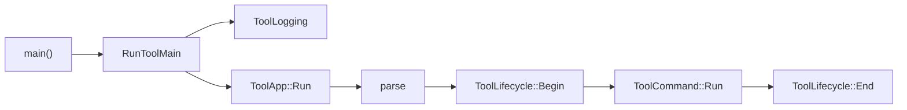

# Oxygen.Cooker.ToolKit

The command line scaffolding the content tools share: ImportTool, Inspector,
PakDump and PakTool. A tool is a list of commands behind one parser; the toolkit
owns everything around them, so a tool's own code is its commands.

`oxygen-cooker-toolkit` is an internal static library. It depends on Base, Clap
and the Cooker's versions report, and it is not installed.

## A tool run

A tool's `main` builds its commands, describes the tool with a `ToolInfo` and
calls `RunToolMain`, which runs it on the process streams inside a
`ToolLogging` scope. `RunTool` does the same on given streams, for tests.

## What the toolkit provides

| Concern        | Behavior                                                                                                                          |
| -------------- | --------------------------------------------------------------------------------------------------------------------------------- |
| Commands       | Adds `help`, `version` and `versions` to the tool's commands, and selects the one the command line names.                         |
| `versions`     | Prints the cooked format and asset versions; with `ToolInfo::cooks_content`, the importer revisions too. `--json` for one object. |
| Output         | Everything goes to the streams given to `ToolApp::Run`, including the parser's help and errors.                                   |
| Failures       | Each is reported once, as `ERROR: <message>`, and yields its exit code. An escaping exception is a failure.                       |
| Logging        | `ToolLogging` initializes loguru with the log silenced. A tool raises it from its own options in its lifecycle.                   |
| Shared setup   | `ToolInfo::lifecycle` brackets the selected command, for services all commands use.                                               |
| Global options | `ToolInfo::global_options` are accepted before the command name, and stored like command options.                                 |

## Exit codes

| Code | Meaning                                                  |
| ---- | -------------------------------------------------------- |
| 0    | Success                                                  |
| 1    | Invalid command line, or an input the command line names |
| 2    | The command ran and failed, or threw                     |

A tool with a richer contract returns its own codes with
`ToolError::WithCode`. PakTool does: 3 for a failed build and 4 for a runtime
failure.

## Writing a command

1. Derive from `toolkit::ToolCommand`. Keep its option values in members.
2. `Name()` is the command's path, or `clap::Command::DEFAULT` for the default
   command. `BuildCommand()` must register the command under that same name;
   the app checks it when it is built.
3. Register the options in `BuildCommand()` and read the members in `Run`.
4. Write through `context.Out()` and `context.Err()`, never the process
   streams.
5. Return `std::unexpected(toolkit::ToolError::Usage("..."))` for bad input
   and `Failed("...")` for a failed run; an error with no message means the
   command already reported it. Throwing is a failure too.
6. Add the command to the tool's `main`.

The Inspector's `ReportCommand` and `CookedRootCommand` bind a report or a dump
function to a command, for commands that need no class of their own.

## Lifecycle

- `Begin` runs after parsing and before the selected command. A returned error
  ends the run with its code; the command does not run and `End` is not
  called.
- `End` runs after the command, whatever its outcome, once `Begin` succeeded.
- Neither runs for `help` or `version`. They do run for `versions`, which needs
  no setup, so a lifecycle sets up only what the selected command needs, as
  ImportTool's `ImportSession` creates the import service only for commands
  that import.

## Lifetimes

`ToolApp` keeps pointers to the commands and to `ToolInfo::lifecycle`, so both
must outlive it. It reads `ToolInfo::global_options` only while it is built.

## Testing

`ToolApp` and `RunTool` take the streams as arguments and touch no process-wide
state, so a test builds one, runs a command line, then reads the captured
streams and the exit code. `ToolApp::Cli()` exposes the parser for tests that
only check parsing. `ExitCodeOf` runs a body the way the app runs a command,
for a test of a function that returns a `ToolResult`.
