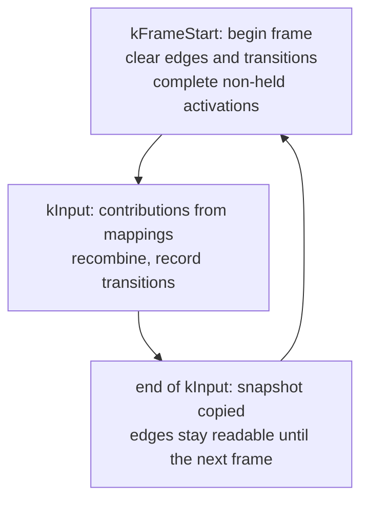

# Actions

An `Action` is a named logical input (Jump, Fire, Move) with a typed value,
a level state that persists across frames, and edges that exist for one frame.
Gameplay reads actions; only the input system writes them.

## Value and state

- **Value type**: `kBool`, `kAxis1D` or `kAxis2D`, fixed at construction.
- **Level state** (persists): `IsOngoing()`, `IsTriggered()`, `IsIdle()`,
  `GetValue()`.
- **Edges** (current frame only): `WasStartedThisFrame()` (Idle → Ongoing),
  `WasTriggeredThisFrame()`, `WasCompletedThisFrame()`,
  `WasCanceledThisFrame()`, `WasReleasedThisFrame()` (Ongoing → Idle),
  `WasValueUpdatedThisFrame()`, and the full `GetFrameTransitions()` list.
- **Configuration**: `SetConsumesInput()` (see
  [Mappings.md](Mappings.md#consumption)) and `SetAccumulation()`.

The state mutators are private. `InputSystem` and `InputActionMapping` write
actions; unit tests use the `testing::ActionTestAccess` peer
(`Test/ActionTestAccess.h`). Gameplay cannot desynchronize an action from its
bindings.

## Several bindings, one action

Each `InputActionMapping` that drives an action records its own latest
evaluation (a _contribution_: state, value and the frame it was written in).
After every contribution the action recombines all of them:

| Field     | Rule                                                                                                                                                                  |
| --------- | --------------------------------------------------------------------------------------------------------------------------------------------------------------------- |
| Ongoing   | Any contribution is ongoing.                                                                                                                                          |
| Triggered | Any contribution triggered **in the current frame**. Older contributions keep their ongoing bit but not their edges.                                                  |
| Canceled  | Some contribution canceled in the current frame **and** the combined action is not active. A cancel from one binding does not cancel an action another binding holds. |
| Value     | Combined per component by the accumulation mode. `kBool`: any true.                                                                                                   |

Accumulation modes (`ActionAccumulation`):

- `kHighestAbsolute` (default) — per component, keep the value with the
  largest magnitude. W and Up Arrow both bound to forward give 1, not 2; W + D
  give (1, 1).
- `kCumulative` — sum per component. W + S give 0 (opposing keys cancel);
  W and Up Arrow give 2, which is the documented trade-off.

This matches Unreal Enhanced Input's per-mapping aggregation and its
highest-absolute default (`EInputActionAccumulationBehavior`).

When a binding goes away (its context is deactivated or removed), its
contribution is removed and the action recombines.

## Relative values

Mouse motion and wheel bindings are relative: their value is the sum of every
event received in the current frame, and returns to zero in the next frame
without motion. `GetValue()` of a look action is therefore the whole-frame
delta, independent of how many events the device sent or the frame rate.
Do not sum `GetFrameTransitions()` values to recover a delta; transitions
record state changes, not samples.

## Activation outcome: Completed or Canceled

An _activation_ starts when the action becomes active (triggered or ongoing)
and ends when it becomes inactive. It ends with exactly one closing edge:

- **Completed** if it triggered at least once and was not canceled.
- **Canceled** if it never triggered, or if it was interrupted.

Activations that trigger without holding (Pressed, Released, Tap, and a
one-frame Pulse) complete at the start of the following frame, so gameplay
sees Triggered in frame N and Completed in frame N+1.

| Scenario                                              | Edges                                |
| ----------------------------------------------------- | ------------------------------------ |
| Hold E 0.5 s to open a door, release after it opened  | Triggered ... Completed              |
| Release E at 0.2 s of a 0.5 s hold                    | Canceled                             |
| Auto-fire Pulse, release between pulses after 3 shots | Triggered ×3, Completed              |
| Jump (Pressed)                                        | Triggered, then Completed next frame |
| Sprint held while its context is deactivated          | Canceled                             |

Unreal derives Completed from the trigger state at the moment of release, so
it reports Canceled for a Pulse released between pulses even after it fired.
Oxygen decides by outcome: the auto-fire succeeded, so it completes. Unreal's
invariant — every triggered activation completes — is kept.

## Fixed-step consumption

Frame edges are the wrong tool for a fixed-step simulation: a frame may run no
substep (the edge is lost) or several (the edge is seen twice). Every rising
Triggered edge is also latched in a counter that survives frame boundaries:

```cpp
// In the fixed-step phase, once per substep:
if (jump->ConsumeFixedStepTrigger()) {
  body.ApplyJumpImpulse();
}
```

One press yields exactly one `true`. Two presses inside one rendered frame
yield two. Actions that trigger every frame while held (Down, Pulse) latch one
edge per frame in which they trigger.

## Frame lifecycle



Edges and transitions are readable on the action from the end of `kInput`
until the next `kFrameStart`. Readers outside that window (parallel tasks,
frames in flight) use the `InputSnapshot`.

## Usage

```cpp
if (fire->WasTriggeredThisFrame()) { weapon.Fire(); }
if (aim->IsOngoing()) { camera.Aim(); }
if (open_door->WasCompletedThisFrame()) { anim.EndInteraction(); }
if (open_door->WasCanceledThisFrame()) { anim.AbortInteraction(); }
const auto look = look_action->GetValue().GetAs<oxygen::Axis2D>();
camera.AddYawPitch(look.x, look.y);
```
