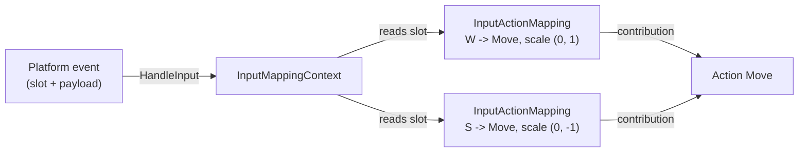

# Mappings & Mapping Contexts

How platform events reach actions: an `InputMappingContext` routes each event to
the `InputActionMapping`s that read its slot; each mapping turns the event into
a value, evaluates its triggers and contributes the result to its action.

## InputActionMapping

A mapping binds one `InputSlot` to one action. It owns:

- **Triggers** (`AddTrigger`) — decide when the binding triggers.
- **Scale and bias** (`SetScale`, `SetBias`, both `Axis2D`; defaults (1, 1) and
  (0, 0)) — the value transform.

### Value translation

Every event becomes a 2D sample, which is transformed per component and then
converted to the action's value type:

| Source                   | Sample                            |
| ------------------------ | --------------------------------- |
| Key, mouse button        | (s, s), s = 1 pressed, 0 released |
| `MouseX` / `MouseY`      | (dx, dx) / (dy, dy)               |
| `MouseXY`                | (dx, dy)                          |
| `MouseWheelX/Left/Right` | (dx, dx)                          |
| `MouseWheelY/Up/Down`    | (dy, dy)                          |
| `MouseWheelXY`           | (dx, dy)                          |

- Transform: `value = sample * scale + bias`, per component. Bias is not applied
  to relative sources (mouse motion and wheel): a delta has no rest offset.
- Conversion: `kAxis2D` takes (x, y); `kAxis1D` takes x; `kBool` is true when
  either component is non-zero.

A scalar source feeds both components so that scale alone places it on an axis:
W with scale (0, 1) gives (0, 1); D with scale (1, 0) gives (1, 0). An unscaled
key bound to a 2D action gives (1, 1).

Relative sources (`IsRelative()`: mouse axes and every wheel slot) accumulate
the samples of the current frame that the triggers accept; see
[Actions.md](Actions.md#relative-values).

### Trigger aggregation

On each update the mapping evaluates its triggers and contributes one result to
its action:

- If any explicit trigger exists, at least one must trigger in this update.
- Every implicit trigger must be satisfied: time and value implicits (Hold,
  Tap...) must trigger in this update; a Chain is satisfied while armed
  (triggered or ongoing).
- Any triggered blocker suppresses the result.
- The binding is ongoing while an explicit trigger is ongoing and the implicits
  are satisfied.
- A trigger that reports Canceled cancels the binding's activation.
- The contributed value is the binding's value while it is triggered or ongoing,
  and zero otherwise; a relative binding contributes the motion accepted in the
  current frame
  ([only accepted input counts](Actions.md#only-accepted-input-counts)).

Implicit and blocker triggers are evaluated on every update, without fresh
input, so they react to time and to other actions. Chain triggers are also
evaluated while the binding has no input at all, so their delay window runs from
the moment the prerequisite triggers.

### Updates and time

The input system updates every active context once per frame with the frame's
physical delta (the time pass), then once per event with zero delta. Platform
event timestamps are not used.

### Cancel and deactivate

- `CancelInput()` restores the value before the staged event, resets the
  triggers and cancels the binding's activation if it had one.
- `Deactivate()` resets the binding (triggers, staged input, value), cancels its
  activation if it had one, and withdraws its contribution from the action. An
  idle binding is reset silently — no Canceled edge for an action that was never
  active.

## InputMappingContext

A context is an ordered list of mappings, identified by its key like an action
(see [Actions](Actions.md#identity)); its name is a label. The input system
holds contexts with a priority and an active flag.

### Routing

`HandleInput(slot, event)` delivers the event to every mapping that reads it:

- Mouse motion (`MouseXY` events): `MouseXY` mappings always; `MouseX` if dx ≠
  0; `MouseY` if dy ≠ 0.
- Wheel (`MouseWheelXY` events): `MouseWheelXY` always; `MouseWheelX` if dx ≠ 0,
  `Left` if dx < 0, `Right` if dx > 0; `MouseWheelY` if dy ≠ 0, `Up` if dy > 0,
  `Down` if dy < 0.
- `AnyKey` mappings read every key and mouse button event.
- Otherwise the slots must be equal.

### Consumption

When an action with `SetConsumesInput(true)` triggers on a fresh event, its
mapping claims the physical sources it reads, and the claim holds for the rest
of that evaluation pass — later mappings in the same context and every
lower-priority context. A mapping that reads a claimed source is skipped:

- if it holds an active activation, the activation is canceled;
- otherwise its staged input is dropped, with no edge.

| Consuming slot                 | Claimed sources                |
| ------------------------------ | ------------------------------ |
| Key or button                  | that key or button             |
| `MouseXY`                      | Mouse X, Mouse Y               |
| `MouseX`, `MouseY`             | that axis                      |
| `MouseWheelXY`                 | wheel X, wheel Y               |
| `MouseWheelY`, `Up`, `Down`    | wheel Y                        |
| `MouseWheelX`, `Left`, `Right` | wheel X                        |
| `AnyKey`                       | the key or button of the event |

Mappings on other sources are not affected. Examples, all covered by
`Test/Scenarios/Consumption_scenario_test.cpp`:

- Interact on E (consuming) while walking on W: walking continues; an idle Jump
  gets no Canceled edge.
- Vehicle Jump on Space (consuming, high priority) and Move on W pressed in the
  same frame: both trigger; an on-foot Vault on Space does not.
- A UI drag on `MouseXY` (consuming) blocks camera yaw on `MouseX`, not W.
- Weapon cycle on `MouseWheelUp` (consuming) blocks zoom on `MouseWheelY`, not
  tilt on `MouseWheelX`.
- A "press any key" prompt on `AnyKey` (consuming) claims Q when Q is pressed;
  walking on W continues.

Within one context, order matters: a consumer only blocks mappings evaluated
after it. Place exclusive bindings earlier, or in a higher-priority context.

### Activation

- `ActivateMappingContext` starts routing to the context.
- `DeactivateMappingContext` stops routing immediately; at the start of the next
  `kInput` every binding of the context is deactivated, so actions they held end
  with a Canceled edge that gameplay can observe. Reactivating in the same frame
  withdraws the pending deactivation.
- `RemoveMappingContext` deactivates the bindings immediately.

Example — hold Shift to sprint, open the pause menu, release Shift in the menu,
close it: Sprint is canceled when the menu opens and stays idle afterwards
(`Contexts_scenario_test.cpp`).

## Authored data

Contexts and actions are cooked from JSON (`oxygen.input.schema.json`,
`oxygen.input-action.schema.json`) and hydrated by
`Content/Internal/InputContextHydration.cpp`. Authored per-mapping `scale` and
`bias`, and per-action `consumes_input` and `accumulation` (`"highest_absolute"`
or `"cumulative"`), map to the runtime settings above.
