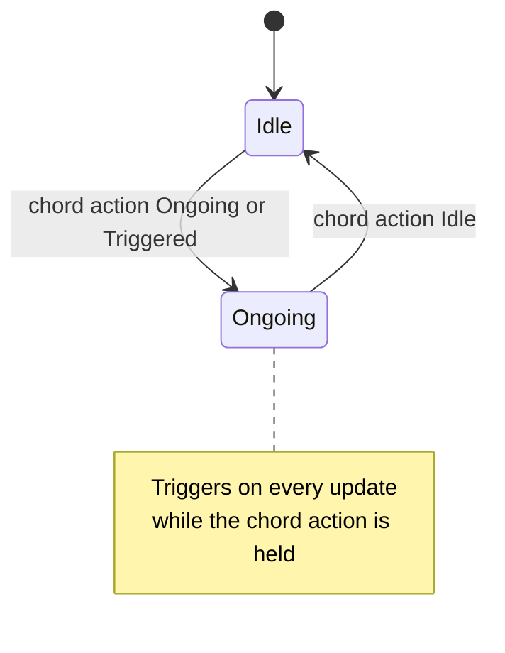

# Chord Trigger

The Chord trigger is a modifier: it is active while another Action, its chord
action, is held. As an implicit trigger it gates its mapping on the chord
action, and the mapping's other triggers decide when the mapping fires.

## Behavior summary

- Chord action: Chord watches one linked Action.
- Active: Chord triggers on every update in which the chord action is Ongoing
  (held) or Triggered (for example a press), and is Ongoing while it does.
- Inactive: Chord is Idle, and does not trigger, while the chord action is Idle
  or no chord action is linked.
- Own input: Chord ignores its own input value; pair it with a Down, Pressed or
  other trigger that reads the mapping's input.

Use it implicitly with an explicit Down to fire a mapping while two inputs are
held (right mouse button walks while the left one is held). Unlike
[Chain](Chain.md), it needs no order between the two inputs and stops at once
when the chord action is released.

## Lifecycle and states



## Authoring

```json
{
  "action": "MouseForward",
  "slot": "RightMouseButton",
  "triggers": [
    { "type": "down", "behavior": "explicit" },
    { "type": "chord", "behavior": "implicit", "chord_action": "MouseLook" }
  ]
}
```

`chord_action` names an action of the same input source or another source's
action by virtual path; it is cooked as the trigger's linked action.
