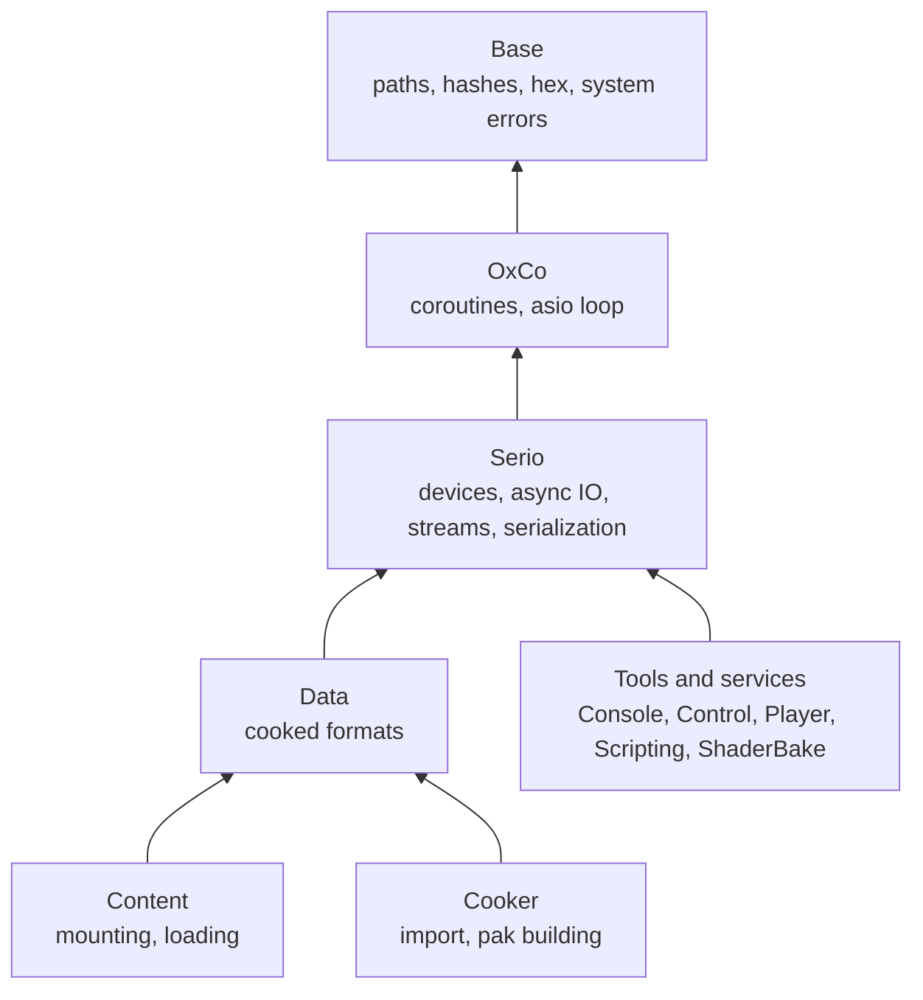

# Serio architecture

How Serio is put together, what it owns among the engine's modules, and the
principles every type in it follows.

## Place among the modules

A feature lives where its knowledge lives. Serio holds what any reader or
writer of bytes needs, whatever the bytes mean:

| Concern                                             | Owner                 | Serio's part                                                  |
| --------------------------------------------------- | --------------------- | ------------------------------------------------------------- |
| Files and memory, blocking and awaited IO           | Serio                 | All of it                                                     |
| Regions, streams, buffers, serialization primitives | Serio                 | All of it                                                     |
| Atomic publication, file locks                      | Serio                 | All of it                                                     |
| Hashing and verifying bytes as they pass            | Serio                 | All of it; the hash functions are Base's                      |
| Paths, hash functions, hex, OS error conversion     | Base                  | Calls them                                                    |
| Cooked formats (pak, catalog, loose index, tables)  | Data                  | Records, sequences and `ByteReader` the formats are read with |
| Pak layout (4 KiB payload alignment, sections)      | Data, the pak builder | Unbuffered reads of aligned regions                           |
| Mounting, loading, verification policy              | Content               | Mapped metadata, awaited payload reads, region hashing        |
| Memory in flight (payload budget, staging)          | Each consumer         | None: operations use their caller's memory                    |
| Codecs, signature schemes, trust                    | Outside Serio         | Reading and writing the stored bytes, verifying digests       |

## Layers

| Layer         | Headers (under `Oxygen/Serio/`)                                                                          |
| ------------- | -------------------------------------------------------------------------------------------------------- |
| Vocabulary    | `Types.h`, `Error.h`                                                                                     |
| Buffers       | `ByteBuffer.h`                                                                                           |
| Devices       | `Device.h`, `NativeFile.h`, `MappedFile.h`, `MemoryFile.h`, `ByteView.h`, `AnyDevice.h`                  |
| Regions       | `Region.h`                                                                                               |
| Async IO      | `IoDriver.h`, `AsyncFile.h`, `AsyncDevice.h`, `Operation.h`                                              |
| Streams       | `Stream.h`, `RegionStream.h`, `MemoryStream.h`, `AnyStream.h`, `CopyRegion.h`                            |
| Integrity     | `Integrity.h`                                                                                            |
| Serialization | `Reader.h`, `Writer.h`, `Record.h`, `ByteReader.h`, `CountingSink.h`, `RegionReader.h`, `RegionWriter.h` |
| Publication   | `AtomicFile.h`, `FileLock.h`                                                                             |
| Test kit      | `Testing/FaultInjectingDevice.h`, `Testing/TestBytes.h`, `Testing/AtomicFiles.h`                         |

A layer includes only the layers below it. `Detail/` holds the erasure
tables, the backend variant and other internals, and no header outside Serio
includes it. The test kit is a separate library that only tests link.

## Principles

- **Concepts define the contracts.** A device, a stream, a backend and a hash
  are concepts with `noexcept` operations and exact result types. A type that
  satisfies one is one, with no base class to derive from.
- **Capabilities are types.** A device that cannot write does not satisfy
  `WritableDevice`; one that cannot be awaited does not satisfy
  `AsyncReadableDevice`. Asking for what a type cannot do fails to compile.
  The one run-time capability check is on `AnyDevice`, where the type has been
  erased.
- **Erasure once per boundary.** Devices and streams are open sets (tests,
  tools and other modules add their own), so each concept has one
  value-semantic erased wrapper, used once per file, region or asset, never
  per field. Its dispatch is a static table of function pointers, one indirect
  call per operation.
- **Closed sets are variants.** IO backends are known per platform, so the
  driver holds them in a `std::variant`, out of the public API.
- **Serialization has one virtual boundary.** `AnyReader` and `AnyWriter` are
  abstract bases, because every type's hooks take them by reference and a
  loader receives one per asset. Inside a loader, records and sequences take
  the bulk paths.
- **Owners and views are distinct.** Devices, buffers, drivers and streams own
  their resources and are move-only. Regions and `ByteReader` are views with
  `std::span`'s rule: the owner outlives them. Shared ownership is the
  consumer's choice, never Serio's.
- **Offsets and sizes are distinct types.** `ByteOffset` and `ByteCount` do
  not mix except as offset plus count and offset minus offset, so swapping
  them fails to compile.
- **No exceptions, no global state.** Every fallible operation returns
  `Result<T>`. There is no default driver, registry or device: an operation
  receives what it needs.

## Errors

Serio returns Base's `Result<T>` with a `std::error_code`, and adds no result
type. Two kinds of code flow through it:

- **OS errors as they are,** in `std::system_category()`, so the real cause is
  never replaced by a generic one.
- **Serio's own codes,** for what only Serio detects: an exact read past the
  end, a range outside its region, a length past its limit, a digest that does
  not match, a failed page-in under a mapped copy.

`serio::Error` is also an error condition. Every OS code that means "not
found", "access denied", "sharing violation", "no space", "is a directory",
"path too long" or "IO failure" compares equal to it, so a caller tests
`error == serio::Error::kNotFound` once and the test holds for files and
memory on every platform. An error code carries no path: the caller that
reports a failure names the file.

## Platform code

Public headers carry no platform `#if` and include no OS header; a native
handle is an opaque value type. `Platform/Windows/` and `Platform/Posix/`
hold the native files, mappings, the replacing move and each platform's IO
backend, and CMake selects the directory. The inline backend is the same on
every platform.

| Platform | Files                       | Mapping         | Awaited IO                   |
| -------- | --------------------------- | --------------- | ---------------------------- |
| Windows  | Win32 handles, `OVERLAPPED` | `MapViewOfFile` | IOCP, on the loop's port     |
| POSIX    | File descriptors, `pread`   | `mmap`          | io_uring, on the loop's ring |

Paths are logical everywhere and converted with `base::ToNativePath` only at
the OS call, so long and UNC paths work whatever the machine's long-path
policy. See Base's [path rules](../../Base/Docs/Filesystem.md).

## Decisions

- **Positional devices are the base primitive.** A cursor shared between
  callers forces a reopen or a lock per reader; a device that names its
  offsets needs neither.
- **Memory is a device, not a special case.** Tests, builders and embedded
  content read through the same code as files, and the conformance suites
  keep the two from drifting.
- **Both blocking and awaited forms.** Tools and synchronous code read
  directly; coroutines await.
- **Base owns the primitives, Serio owns the IO.** Hashes, hex and error
  conversion are Base's; reading and writing files is Serio's.
- **Serio knows no format, codec or key.** Formats are Data's, and codecs and
  signature schemes live in their own modules; Serio moves, hashes and
  verifies bytes for all of them.
- **Serio imposes no memory policy.** Bounding memory in flight belongs to
  the consumer that knows its workload.
