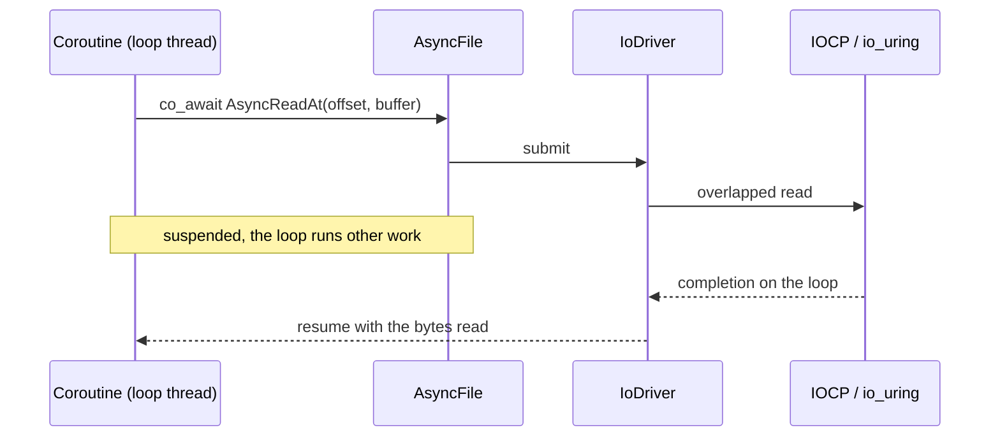
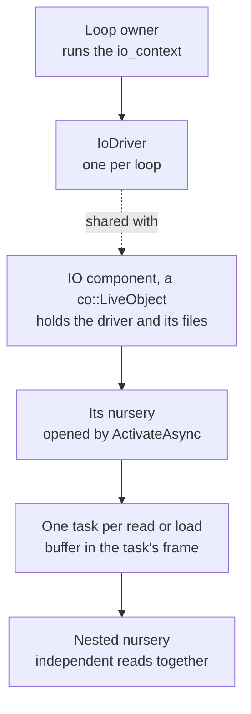

# Async IO

Coroutines await reads and writes through an `IoDriver`. With a loop driver,
the event loop that awaits an operation completes it, and no thread blocks on
the disk. With the inline driver, for code that has no loop, the same awaited
operations complete on the awaiting thread, which blocks for each of them.

## Contents

- [Drivers](#drivers)
- [Backends](#backends)
- [Operations](#operations)
- [Awaiting or blocking](#awaiting-or-blocking)
- [Example: reading payloads together](#example-reading-payloads-together)
- [Drivers, live objects and nurseries](#drivers-live-objects-and-nurseries)
- [Copies](#copies)

## Drivers



- **One driver per loop.** A driver binds files to one `asio::io_context`'s
  completion mechanism: IOCP on Windows, io_uring on Linux. A file opened
  through it is an `AsyncFile`, with the blocking operations of a
  `NativeFile` and the awaited ones.
- **The inline driver** has no loop: each awaited operation completes on the
  awaiting thread, which blocks for it, and the coroutine never suspends.
  Tools and unit tests that have no loop hold one, and run the same code as
  the engine.
- **Only a driver makes a file awaitable.** A consumer that awaits reads
  always holds a driver and opens every file it awaits through it. It never
  asks whether a driver exists and never wraps a blocking device to look
  awaitable. The code that owns the loop, or knows it has none, decides the
  kind of driver once.
- **Memory is awaitable by itself.** A `MemoryFile` or `ByteView` operation is
  ready at once, so tests and embedded content pay nothing for the awaited
  form.
- **A `MappedFile` is never awaitable.** See
  [mapped files](devices.md#mapped-files).

The driver outlives the files it opens, and the loop outlives the driver.
Where it lives is in
[drivers, live objects and nurseries](#drivers-live-objects-and-nurseries).

## Backends

A backend is what the platform's asynchronous IO differs in: registering a
handle, submitting a request, completing it on the loop thread, cancelling
it, and allocating the buffers it reads into best. Backends sit behind the
driver, and no public type names one, so choosing, adding or dropping a
backend never changes a caller. Each platform has one loop backend; the
inline backend is shared by all.

## Operations

- **Plain awaiters.** An operation is an object holding its arguments and its
  target. It allocates no coroutine frame, and the OS receives it when it is
  awaited. Serio keeps no request queue and no scheduling policy.
- **Cancellation is structural.** A coroutine cancelled by its nursery, an
  `AnyOf` or a timeout cancels its operation in flight, and resumes only
  after the OS has released the buffer. There is no cancel call.
- **Concurrency is OxCo's.** `co::AllOf` over several reads of one file, or a
  nursery for open-ended work, puts reads in flight together; see
  [drivers, live objects and nurseries](#drivers-live-objects-and-nurseries).
- **Memory is the caller's.** An operation reads into or writes from memory
  its caller owns. A consumer that starts many reads bounds their buffers
  itself, as Content's payload budget does.
- **Decoding stays synchronous.** IO fills buffers; parsing runs over the
  bytes in memory, on a thread-pool worker when it is heavy.

## Awaiting or blocking

An awaited read frees the thread while the device works, and the device
serves reads in flight in parallel, so awaiting pays when reads overlap. A
single read from the OS cache costs more awaited than blocking, since its
completion goes through the loop. Await reads that can be in flight together;
read directly when a synchronous caller needs one value now.

## Example: reading payloads together

A load that needs several payloads of one file starts all their reads at
once, each into its own buffer from the driver, and decodes once they have
all arrived:

```cpp
auto ReadPayloads(IoDriver& driver, const AsyncFile& file,
  std::span<const ByteRange> payloads)
  -> co::Co<Result<std::vector<ByteBuffer>>>
{
  auto buffers = std::vector<ByteBuffer> {};
  buffers.reserve(payloads.size());
  auto reads = std::vector<co::Co<Result<void>>> {};
  for (const auto& payload : payloads) {
    auto buffer = driver.AllocateBuffer(payload.count);
    if (!buffer) {
      co_return Err(buffer.error());
    }
    buffers.push_back(std::move(*buffer));
    reads.push_back(
      AsyncReadExactlyAt(file, payload.offset, buffers.back().Bytes()));
  }
  // The reads start together; cancelling this coroutine cancels all of them.
  for (const auto& read : co_await co::AllOf(std::move(reads))) {
    if (!read) {
      co_return Err(read.error());
    }
  }
  co_return buffers;
}
```

The caller bounds how many bytes it asks for at once. With an inline driver
the same code reads one payload after another.

## Drivers, live objects and nurseries

Serio decides how a read reaches the OS; OxCo's structured concurrency
decides which reads run, for how long, and who waits for them. Clean async IO
code puts each piece where its lifetime belongs.

- [Rules](#rules)
- [Example: independent loads together](#example-independent-loads-together)
- [Example: a live object that serves reads](#example-a-live-object-that-serves-reads)



### Rules

- **The driver belongs with the loop.** Create one driver per event loop, in the
  component that owns or is activated on that loop, and pass it down by
  reference or shared pointer. Never create a driver per operation, and never
  make one global. Destruction order matters: the loop outlives the driver, and
  the driver outlives every file opened through it. Declare the `io_context`
  before the driver, and the driver before the files. The cooker's
  `ImportEventLoop` owns its context and then its driver. Content's
  `AssetLoader` creates its driver from the loop it is configured with, or an
  inline one when it has none, and shares it with every mounted source, which
  holds it before its files.
- **IO work lives in a live object's nursery.** A component that serves reads or
  writes over time is a `co::LiveObject` (`OxCo/LiveObject.h`). Its
  `ActivateAsync` opens a nursery, and its methods start IO tasks in that
  nursery and return at once. `AssetLoader` and the cooker's `ImportJob` work
  this way. The nursery gives every read a parent. Stopping the object, or
  cancelling the nursery it was activated in, cancels every operation in flight.
  The nursery closes only after the OS has released each buffer, so no read
  writes into freed memory. See OxCo's
  [live objects](../../OxCo/Docs/Live_Objects.md) and
  [async IO](../../OxCo/Docs/AsyncIO.md).
- **A task owns its buffer.** Allocate the buffer inside the task that awaits
  the read, or move it into the task. The coroutine frame keeps it alive exactly
  as long as the read needs it, without a `shared_ptr`. Data to write is moved
  into the writing task the same way.
- **Signatures say how far IO reaches.** A `co::Co<...>` function joins every
  read it starts before it returns: open a nursery with `OXCO_WITH_NURSERY` for
  a variable number of reads, or use `co::AllOf` for a known set. A function
  that takes a `co::Nursery&` starts IO that outlives the call. The cooker's
  emitters receive the job's nursery, start each cooked write in it, keep the
  first error, and join their writes when the job finishes.
- **The owner bounds memory in flight.** A nursery puts no limit on the reads it
  runs. A component that may start many takes a slot before allocating its
  buffer: a `co::Semaphore` for a count of reads, or an admission rule over
  `co::Event` for bytes, as Content's payload budget does.

### Example: independent loads together

Content starts the independent loads a load depends on together, in a nested
nursery, so their payload reads are in flight on the device at once:

```cpp
OXCO_WITH_NURSERY(nursery)
{
  for (const auto key : keys) {
    nursery.Start([this, key, &bindings, request]() -> co::Co<> {
      co_await BindResourceAsync<T>(key, bindings, request);
    });
  }
  co_return co::kJoin;
};
```

### Example: a live object that serves reads

A component that reads chunks of one file for code on the loop holds the
file, starts each read in its own nursery, and keeps at most eight reads in
flight:

```cpp
class ChunkReader final : public co::LiveObject {
public:
  ChunkReader(IoDriver& driver, AsyncFile file)
    : driver_(&driver)
    , file_(std::move(file))
  {
  }

  auto ActivateAsync(co::TaskStarted<> started) -> co::Co<> override
  {
    return co::OpenNursery(nursery_, std::move(started));
  }

  void Stop() override
  {
    if (nursery_ != nullptr) {
      nursery_->Cancel();
    }
  }

  [[nodiscard]] auto IsRunning() const -> bool override
  {
    return nursery_ != nullptr;
  }

  //! Starts reading `range` and returns at once; `consume` receives the
  //! bytes on the loop thread. Stopping the reader cancels the read.
  void StartRead(const ByteRange range,
    std::function<void(Result<ByteBuffer>)> consume)
  {
    nursery_->Start([this, range, consume = std::move(consume)]() -> co::Co<> {
      const auto slot = co_await in_flight_.Lock();
      auto buffer = driver_->AllocateBuffer(range.count);
      if (buffer) {
        const auto read
          = co_await AsyncReadExactlyAt(file_, range.offset, buffer->Bytes());
        if (!read) {
          buffer = Err(read.error());
        }
      }
      consume(std::move(buffer));
    });
  }

private:
  IoDriver* driver_;
  AsyncFile file_;
  co::Semaphore in_flight_ { 8 };
  co::Nursery* nursery_ { nullptr };
};
```

Its owner activates it in a nursery that its users run inside, or with
`co::With` so the reader stays alive until the code that uses it has
finished, cancellation included. The driver outlives the reader, and the
reader outlives every task its nursery runs.

## Copies

`CopyRegion` copies a region of one awaitable device to another through two
buffers, reading the next chunk while it writes the current one. `AsyncHash`
reads the same way while it hashes; see [integrity](integrity.md).
