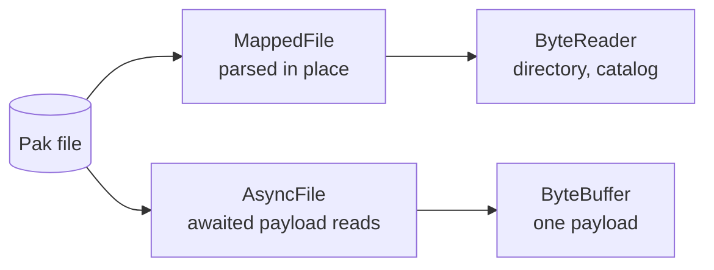

# Devices and buffers

A device is random-access bytes: a file, a mapping or memory. It names the
offset of every operation and keeps no cursor, so one device serves any
number of concurrent callers without a lock.

## Kinds of device

| Device       | Backing                               | Writes | Contiguous | Awaitable                     |
| ------------ | ------------------------------------- | ------ | ---------- | ----------------------------- |
| `NativeFile` | An OS file handle                     | Yes    | No         | No: open it through a driver  |
| `AsyncFile`  | A `NativeFile` bound to an `IoDriver` | Yes    | No         | Yes, through its driver       |
| `MappedFile` | A read-only view of a whole file      | No     | Yes        | Never                         |
| `MemoryFile` | A growable buffer it owns             | Yes    | Yes        | Yes, by itself: ready at once |
| `ByteView`   | Bytes the caller owns                 | No     | Yes        | Yes, by itself: ready at once |
| `Region<D>`  | A bounded range of `D`                | No     | As `D`     | As `D`                        |
| `AnyDevice`  | Any readable device, erased           | Asked  | Asked      | No: `AnyAsyncDevice` is       |

A contiguous device is one span of memory, so a parser reads views of it
instead of copies. On `AnyDevice` and `Region<AnyDevice>`, `Contiguous()`
answers at run time; code that parses a region takes the view when there is
one and reads through the device otherwise, without knowing which device it
has.

## The contract

Every device keeps the same contract, and the device conformance suite checks
it for each one:

- `const` operations are safe from any number of threads at once.
- A read that crosses the end returns the bytes that exist; an exact read
  fails with `kEndOfData`.
- A zero-length operation succeeds and does nothing.
- A write writes all of its bytes or fails.
- The same failure compares equal to the same `serio::Error` condition on
  every device, file or memory.

Opening is a factory that returns a `Result`; a constructor never fails. A
file is opened from a logical path, with **shared deletion by default**, so a
file published atomically is replaced under its readers instead of blocking
the replacement. A folder where a file is expected fails with `kIsDirectory`
on every platform.

A producer that knows its final size reserves it first: the write fails early
on a full disk, and the file is written unfragmented. An unbuffered open
bypasses the OS cache for large streaming reads; every offset, size and
buffer must then be aligned to the volume's sector size, which `kIoAlignment`
(4 KiB) satisfies.

## Mapped files

A `MappedFile` serves bytes that are parsed in place or read at random: a
pak's directory and catalog, the loose cooked index, and the tools that dump
them. Payloads are not read through mappings: a page fault blocks the thread
that touches the page, the OS alone decides residency, and an upload copies
from the mapped pages anyway.

- **The view keeps its version.** A mapping opened with shared deletion keeps
  showing the complete file it opened after an atomic replacement; the next
  open sees the new one.
- **Copies are guarded, views are not.** A blocking `ReadAt` from a mapping
  copies under a fault guard and turns a failed page-in into `kIo`. Code that
  parses the view directly cannot be guarded, so a device failure under it is
  fatal. Views serve metadata parsed once per mount.
- **Never awaitable.** Only the view and the blocking read touch mapped
  pages, so nothing awaited faults on the loop thread. A consumer that parses
  a mapping and awaits payloads from the same file opens it twice: mapped,
  and through its driver.
- **Mapping a file another writer appends to** needs the sharing mode that
  admits writers; the default refuses one.
- **Prefetching** hints that a range will be parsed soon, without waiting.
- On a 64-bit process a mapping only reserves address space, so mapping a
  multi-GB file to parse a small part of it is cheap.

## Regions

A region is a device, an offset and a count, cheap to copy. A pak section, a
resource payload and a descriptor are regions of one device. Every read is
bounded by the region, not the file, and offsets are relative to the region.
A region is itself a readable device, so a region of a region, a stream over
a region and a hash of a region are the same code as over a device.

There is no writable region: a writable device grows as it is written, so a
fixed bound would mean nothing. A write stream takes a device and a start
offset instead.

## Buffers

`ByteBuffer` is the one owner of bytes read from or for a device:

- **Uninitialized.** Memory about to be filled by a read is never cleared
  first.
- **Aligned to `kIoAlignment`,** so the same buffer serves an unbuffered read.
- **Move-only,** and handed on without a copy: a resource keeps the buffer its
  loader read into, and a `MemoryFile` or `MemoryStream` gives up its storage
  as one.
- **One copy, one cast.** `CopyOf` is how bytes held elsewhere enter a buffer,
  and `Unsigned()` (or `AsUnsigned` for any span) is the one view as
  `uint8_t`.

A read into a new buffer is one allocation and one read. `ReadAll` and its
awaited form read a whole device or region into a buffer of its size, and
refuse a device larger than the caller's limit with `kTooLarge` before
allocating anything. A buffer for awaited reads comes from the file's driver,
which serves memory its backend reads into best.
