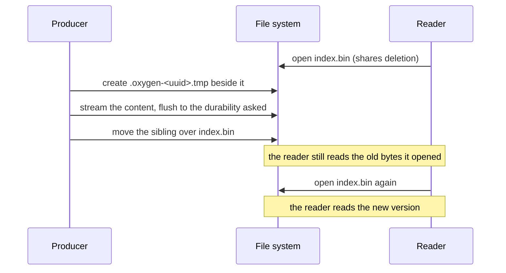

# Publication and locks

How a file is replaced while other threads and processes read it, and how
writers that share a file exclude each other.

## Atomic replacement

A published file is never modified in place. Its producer writes a unique
sibling, flushes it, and moves it over the destination in one step. A reader
sees the old file or the new one, never a torn one.



- **Streamed, not buffered.** `AtomicFileWriter` hands out a buffered,
  patchable stream, so an artifact of any size is published without holding
  it whole in memory. `WriteFileAtomically` and its awaited form publish
  bytes already in memory.
- **Failure leaves the destination as it was.** A writer destroyed without
  committing removes its sibling. A process killed before the commit leaves
  the sibling behind, and nothing removes it later.
- **The caller owns the rest.** The parent folder must exist; locking and
  revision checks are the caller's. The destination's access permissions are
  kept, and no backup is made.
- **One replacing move.** `MoveFileOver` is the move every publication
  commits with: POSIX semantics on Windows, a replacing move on a file system
  without them, `rename(2)` elsewhere. Both paths are on one volume. Its
  errors come from the move itself, not from checks before it.

## Durability

| Durability  | The commit waits for                  | For                                                          |
| ----------- | ------------------------------------- | ------------------------------------------------------------ |
| `kStable`   | The disk, before and after the move   | Files nothing else validates, such as the loose cooked index |
| `kBuffered` | Nothing: the OS cache writes it later | Files a stable record validates: cooked descriptors, tables  |

A stable move flushes every folder it changes. A commit has three outcomes:

| Outcome                         | Destination holds | Survives a power loss |
| ------------------------------- | ----------------- | --------------------- |
| Error                           | The old file      | Yes, the old file     |
| Success                         | The new file      | Yes                   |
| Success with a durability error | The new file      | Not guaranteed        |

The third outcome means the name moved, but flushing the move failed
afterward. Readers already see the new file, so the caller cannot undo it; it
decides whether to report it. A cache can ignore it. A file that other files
rely on reports it, so the user knows the last save may not survive a crash.

### Example: publishing and checking the commit

```cpp
//! Publishes `index` at `path`. The cooked files beside it are validated by
//! the index, so it waits for the disk.
auto PublishIndex(const std::filesystem::path& path, const Index& index)
  -> Result<void>
{
  auto file = AtomicFileWriter::Create(path); // kStable by default
  if (!file) {
    return Err(file.error());
  }
  CHECK_RESULT(Writer { file->Stream() }.Write(index));

  const auto replaced = std::move(*file).Commit();
  if (!replaced) {
    return Err(replaced.error()); // the old index is still in place
  }
  if (replaced->durability_error) {
    LOG_F(WARNING, "{} is replaced but may not survive a crash: {}",
      path.string(), replaced->durability_error.message());
  }
  return {};
}
```

## Reading published files

A reader opens a published file sharing deletion, so a publication proceeds
while the reader holds it and the reader keeps the bytes it opened.
`OpenPublishedFile` opens one for positional reads; `ReadPublishedFile` reads
all of it, refusing a file larger than the caller's limit before allocating.
A mapping opened with the default sharing behaves the same way.

## File locks

`FileLock` owns an operating-system lock on a marker file until it is
destroyed. Shared locks coexist; an exclusive lock excludes shared and
exclusive owners. Acquiring can fail at once on contention or wait for the
lock.

- **Cooperative.** Every reader and writer that must be excluded takes the
  lock; nothing stops code that does not.
- **Threads and processes alike.** Each acquisition opens its own handle, so
  two threads of one process exclude each other as two processes do.
- **The marker is not the content.** A lock file is separate from the files
  it guards. Replacing or recreating it while it has owners breaks the lock.
- **Three ways to open the marker:** it must exist (a lease on something
  that already exists), it is created and kept, or it exists only while it is
  locked (a mutex that leaves no file behind).

Content's [published generations](../../Content/Docs/loose_cooked_content.md#published-generations)
take shared and exclusive leases on markers. A loose root's writer holds a
temporary exclusive lock, `container.writer.lock`, for its whole session, and
its readers hold temporary shared leases of the commit they read; a writer
probes them exclusively before it deletes what an older commit listed.

### Example: writers that merge into one file

Two writers that each read, merge and republish the same file would lose each
other's changes. Each takes the exclusive lock for the whole sequence, and
waits when another writer holds it:

```cpp
//! Adds `entries` to the index at `path`, excluding every other writer, in
//! this process or another, until the new index is published.
auto AddToIndex(const std::filesystem::path& path,
  const std::span<const IndexEntry> entries) -> Result<void>
{
  auto marker = path;
  marker += ".lock";
  const auto lock = FileLock::Acquire(
    marker, FileLockMode::kExclusive, FileLockOpenMode::kOpenOrCreate);
  if (!lock) {
    return Err(lock.error());
  }
  auto index = ReadIndex(path); // the version every other writer published
  if (!index) {
    return Err(index.error());
  }
  index->Add(entries);
  return PublishIndex(path, *index);
} // the lock is released after the new index is in place
```

A writer that must not wait uses `TryAcquire`, which fails with
`device_or_resource_busy` while another writer holds the lock.

## Decisions

- **Publish by replacement, never in place.** A cancelled or failed producer
  never leaves a torn file.
- **Shared deletion by default.** Readers never block a publication, and a
  publication never changes bytes a reader holds.
- **Buffered durability under a stable record.** Files whose digests a stable
  index holds are flushed by the OS; the index itself waits for the disk.
- **Locks are files.** They exclude other processes as well as other threads.
