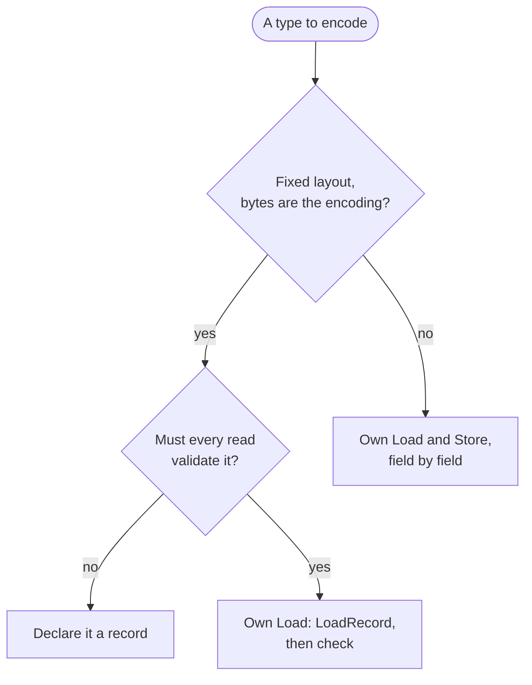

# Streams and serialization

Streams give sequential producers and consumers a cursor and a buffer over a
device. Serialization turns values into bytes through streams, or parses
bytes already in memory in place.

## Streams

| Stream                 | Over                     | Buffer                                           |
| ---------------------- | ------------------------ | ------------------------------------------------ |
| `RegionReadStream`     | A region                 | 64 KiB by default, never more than the region    |
| `RegionWriteStream`    | A device, from an offset | 1 MiB by default, flushed with positional writes |
| `MemoryStream`         | Its own growable buffer  | None                                             |
| `ReadOnlyMemoryStream` | A span                   | None                                             |

- **Position and size cannot fail.** A stream knows both, and seeking is
  constant time on every stream.
- **A read stream's buffer never exceeds its region,** so reading a 200-byte
  descriptor allocates 200 bytes.
- **A contiguous region is read through its device,** without a buffer: a
  mapped file copies under its fault guard, and a memory file that grew or
  shrank since the stream was made is read as it is now. A read larger than
  the buffer goes straight into the caller's span.
- **Patching is positional.** An output stream has no seek. A writer that
  completes a header once its content is known overwrites bytes it already
  wrote with `PatchAt`, in the buffer or on the device; the cursor never
  moves, and a patch past the position fails with `kOutOfBounds`. Code that
  patches is constrained on `PatchableOutputStream`.
- **Decorators are streams over streams,** templates over their inner stream,
  so they compose without erasure. A hashing stream over a region stream is
  one pass for every hash it carries.

## Encodings

`Reader` and `Writer` are templates over a stream; `AnyReader` and
`AnyWriter` are the erased boundary a loader or an encoder receives once.
Every kind of value is read with `Read<T>()` or `ReadInto(value)` and written
with `Write(value)`:

| Kind                                     | Encoding                                                   |
| ---------------------------------------- | ---------------------------------------------------------- |
| Integers, floating point                 | Little-endian, swapped on a big-endian target              |
| Enumerations                             | Their underlying type                                      |
| `bool`                                   | One byte, 0 or 1                                           |
| `std::string`                            | A 32-bit length, then its UTF-8 bytes                      |
| `std::optional<T>`                       | A `bool`, then the value when present                      |
| `std::vector`, `std::array`, `std::span` | A 32-bit count, then the elements                          |
| A record                                 | Its bytes, as one copy                                     |
| Any other type                           | Its own `Load` and `Store` hooks, found by argument lookup |

A sequence of records or arithmetic values moves as its count, one alignment
and one copy; other elements are read one by one. Values are aligned to their
natural alignment relative to the stream's start, unless a
`ScopedAlignment` sets another; an alignment of 1 costs nothing.

## Records

A record is a struct whose bytes are its encoding. It moves as one copy, so a
fixed-layout descriptor is one read, not one per field.

- **Opt-in.** A trivially copyable type can still hold a pointer, or padding
  whose bytes must never reach a file, so only a type declared with
  `kIsRecord` is copied as bytes.
- **Checked layout.** Copying a record checks at compile time that it is
  trivially copyable, has no padding (packed, or with a unique object
  representation, which a struct with floating-point members never has) and
  that the target is little-endian. The check does not reach nested members:
  a nested struct is packed or has a unique representation itself.
- **Unchecked values.** A record holds whatever bytes the file held. The code
  that uses a field decides whether to check it. A type that must be checked
  on every read is not declared a record: its own hook copies it with
  `LoadRecord`, then checks.



A variable-length format pairs records with its own hooks:

```cpp
struct SaveHeader {
  uint32_t magic;
  uint16_t version;
  uint16_t flags;
};
template <> inline constexpr bool serio::kIsRecord<SaveHeader> = true;

struct SaveFile {
  SaveHeader header;
  std::vector<SaveEntry> entries; // SaveEntry is a record too: one copy
  std::string name;
};

auto Load(serio::AnyReader& reader, SaveFile& file) -> Result<void>
{
  CHECK_RESULT(reader.ReadInto(file.header));
  if (file.header.magic != kSaveMagic) {
    return Err(std::make_error_code(std::errc::illegal_byte_sequence));
  }
  CHECK_RESULT(reader.ReadInto(file.entries));
  return reader.ReadInto(file.name);
}
```

The hooks live beside the type, in its own source file, and are compiled
once.

## Bounded reads

No length read from a file allocates before it is checked. A reader knows the
bytes it may still read; a length prefix that asks for more fails with
`kTooLarge` before anything is allocated, and so does a blob read past what
remains. Sequences of non-bulk elements grow as they are read, so a hostile
count allocates no more than the stream holds.

## Parsing in place

`ByteReader` parses bytes already in memory, a mapping or a buffer, without
virtual calls or allocations: a bounds-checked cursor that copies out records
and values and hands out views of bytes and characters. It never aliases an
object from raw bytes. Formats parse through it when their region is
contiguous, and through a stream otherwise.

## Measuring and region readers

- **Measure, then write.** A `CountingSink` is a patchable output stream that
  only counts, so writing a value to it through a `Writer` measures it
  exactly. A small artifact is then written once into a buffer of its size;
  a large one streams to its device instead of growing a buffer.
- **Region readers and writers** are the `AnyReader` and `AnyWriter` a
  consumer hands on, with the stream they need inside. They are neither
  copyable nor movable, since the reader refers to the stream beside it, so
  an owning one comes in a `unique_ptr`. The stream is destroyed, and
  flushed, before the device it writes.
