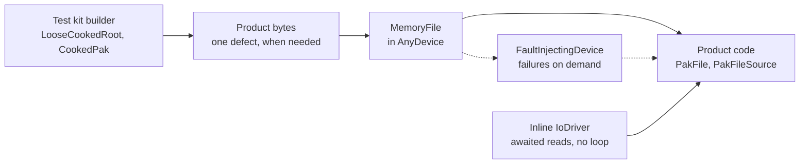

# Testing with Serio

Serio exists to make the tests of everything that reads and writes bytes short,
fast and deterministic. A loader, a parser, a cooker step or a publication is
tested on bytes in memory, through the same code that runs on files, and its
error paths are reached on demand.

## What a test reaches for

| A test needs to                             | With Serio                                                            |
| ------------------------------------------- | --------------------------------------------------------------------- |
| Feed bytes to a parser, a loader or a mount | `MemoryFile::FromBytes(bytes)` or a `ByteView`, erased in `AnyDevice` |
| Run awaited IO without an event loop        | `IoDriver::CreateInline()`: each read completes on the test thread    |
| Produce realistic content                   | The product's encoders, through a module's test kit builders          |
| Make one thing wrong                        | Product bytes, then one defect applied on top                         |
| Fail a read, a write or a flush             | `FaultInjectingDevice::FailOn`                                        |
| Return short reads, or fill the disk        | `FaultInjectingDevice::LimitReads`, `LimitCapacity`                   |
| Check how code batches its IO               | `FaultInjectingDevice::CallCount`                                     |
| Catch a read from the wrong offset          | `PatternBytes`: no offset of a block repeats another's value          |
| Compare megabytes of output                 | `BytesEqual`: reports the sizes and the first differing offset        |
| Give a resource bytes to own                | `OwnedBytes`                                                          |
| Check a publication left no temporary file  | The atomic file checks of `Serio/Testing/AtomicFiles.h`               |
| Check which failure happened                | Compare with a `serio::Error` condition, never a message              |

## Rules

- **Memory unless the file is the subject.** A test opens files only to test
  what files add: paths, sharing, mapping, publication, locks. Everything
  else runs on memory devices, needs no temp folder and runs as a unit test.
  The [test guide](../test/README.md) sets the tiers.
- **The same code path, no IO mocks.** A memory device is a device: product
  code receives it as it receives a file, with no test-only branch and no
  mock of a file system. The conformance suites hold memory and files to one
  contract, so a test on memory covers the consumer's own logic for both.
- **Files and loops where they differ.** Memory tests do not cover what only
  the OS does: sharing and replacement under open readers, mapped page
  faults, durability, locks across processes, and the real interleaving of
  awaited completions on a loop. A consumer that relies on those keeps a few
  functional tests with real files and a loop driver.
- **Product bytes, then one defect.** Content is encoded by the product's own
  writers, through builders such as the Cooker kit's `LooseCookedRoot` and
  `CookedPak`. A test of a refusal breaks one thing in valid bytes, so it
  fails for the reason it names and stays valid when the format grows.
- **Error paths on demand.** A fault-injecting device fails exactly the call a
  test schedules, so every error branch of a stream, a parser or a writer is
  reachable without a broken disk.
- **Async code without threads.** An inline driver completes every awaited
  read on the awaiting thread, so a test of a coroutine that reads payloads
  runs its real code in order, with no loop to pump.
- **Whole storage in memory.** A module whose code reads and publishes many
  files tests it over an in-memory implementation of its storage port, such
  as the Cooker kit's `MemoryFileSystem`.



## Example: refusing a broken pak

A pak test opens bytes from memory. The valid pak comes from the product's
encoder, and each refusal test breaks one field of it:

```cpp
//! The pak `bytes` hold, opened from memory: no file, no temp folder.
auto Open(const std::vector<std::byte>& bytes) -> PakFile
{
  return { serio::AnyDevice(serio::MemoryFile::FromBytes(bytes).value()),
    "test.pak" };
}

NOLINT_TEST(PakFileTest, RefusesAnotherHeaderMagic)
{
  auto bytes = ValidPak(); // encoded by the product's pak writer
  CookedBytes::BreakPakMagic(bytes);

  EXPECT_EQ(OpenFailure(bytes), CookedOpenFailure::kWrongFormat);
}
```

## Example: a full disk

A writer's error path is one scheduled fault away. The stream buffers its
writes, so the full disk is reported when it flushes:

```cpp
NOLINT_TEST(IndexWriterTest, ReportsAFullDisk)
{
  auto device = serio::testing::FaultInjectingDevice { serio::MemoryFile {} };
  device.LimitCapacity(serio::ByteCount { 100 });
  auto writer = serio::RegionWriter { device };

  ASSERT_TRUE(writer.Write(LargeIndex()));
  const auto flushed = writer.Stream().Flush();

  ASSERT_FALSE(flushed);
  EXPECT_EQ(flushed.error(), serio::Error::kNoSpace);
}
```

## Test kit

`oxygen::serio::testing` is linked by tests only. It holds the
fault-injecting device, the test bytes and matcher, and the atomic file
checks. Module test kits build on it: the Cooker kit builds cooked content
and storage in memory, and the Content tests mount it through inline
drivers.
