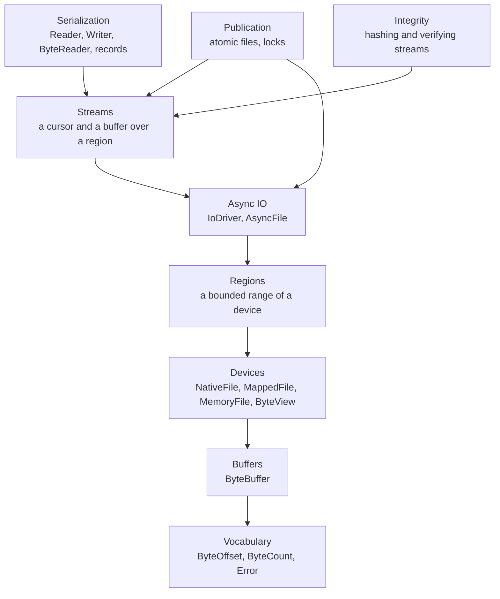

# Serio

Serio is Oxygen's IO and binary serialization library. Files the engine and its
tools parse, and files they publish for another reader, go through it, and so
does memory that must read like a file; a few kinds of IO
[stay outside](Docs/io_boundary.md#what-stays-outside). It moves, parses,
hashes and publishes bytes; it knows no file format, codec, key or asset.

Code built on Serio is tested on bytes in memory, through the same code that
runs on files, with its error paths reachable on demand. See
[Testing with Serio](Docs/testing.md).

## At a glance

| Need                                       | Use                                                |
| ------------------------------------------ | -------------------------------------------------- |
| Read or write a file, blocking             | `NativeFile`                                       |
| Parse a file in place                      | `MappedFile` and a `ByteReader` over its bytes     |
| Await reads and writes of a file           | An `AsyncFile` opened through an `IoDriver`        |
| Await without an event loop (tools, tests) | `IoDriver::CreateInline()`                         |
| Bytes in memory that read like a file      | `MemoryFile` (owns), `ByteView` (borrows)          |
| A bounded part of a device                 | `Region`                                           |
| Bytes to own (payloads, whole files)       | `ByteBuffer`, filled by `ReadAll` or a read        |
| Sequential reads and writes over a device  | `RegionReadStream`, `RegionWriteStream`            |
| Values and records to and from bytes       | `Reader`, `Writer`, `RegionReader`, `RegionWriter` |
| Hash or verify bytes as they pass          | `Integrity.h`                                      |
| Replace a file atomically                  | `AtomicFileWriter`, `WriteFileAtomically`          |
| Read a file another process replaces       | `OpenPublishedFile`, `ReadPublishedFile`           |
| Exclude other threads and processes        | `FileLock`                                         |

## First use

Read a small binary file whole, with a size limit, and parse its header. The
example is complete; it compiles against `oxygen::serio`:

```cpp
#include <cstdint>
#include <filesystem>
#include <optional>

#include <Oxygen/Base/Result.h>
#include <Oxygen/Serio/AtomicFile.h>
#include <Oxygen/Serio/ByteReader.h>
#include <Oxygen/Serio/Error.h>
#include <Oxygen/Serio/Record.h>

struct CacheHeader {
  uint32_t magic;
  uint32_t entry_count;
};
// The header's bytes are its encoding: it is read as one copy.
template <> inline constexpr bool oxygen::serio::kIsRecord<CacheHeader> = true;

namespace serio = oxygen::serio;

//! The header of the cache file at `path`; none when there is no cache yet.
auto ReadCacheHeader(const std::filesystem::path& path)
  -> oxygen::Result<std::optional<CacheHeader>>
{
  // A cache is never larger than 16 MiB; a larger file is refused unread.
  constexpr auto kMaxCacheBytes = serio::ByteCount { uint64_t { 16 } << 20U };
  const auto bytes = serio::ReadPublishedFile(path, kMaxCacheBytes);
  if (!bytes) {
    if (bytes.error() == serio::Error::kNotFound) {
      return oxygen::Ok(std::optional<CacheHeader> {});
    }
    return oxygen::Err(bytes.error());
  }
  auto reader = serio::ByteReader { bytes->Bytes() };
  const auto header = reader.Read<CacheHeader>();
  if (!header) {
    return oxygen::Err(header.error()); // kEndOfData: the file is too short
  }
  return oxygen::Ok(std::optional { *header });
}
```

From here:

- awaited reads, and where the driver lives: [async IO](Docs/async_io.md);
- writing a file others read: [publication and locks](Docs/publication.md);
- variable-length formats: [streams and serialization](Docs/serialization.md);
- tests: [testing with Serio](Docs/testing.md).

Other examples in these docs are fragments: they omit includes and assume the
`oxygen::serio` namespace.

## How it is built



Each layer includes only the layers below it. A **device** is random-access
bytes with no cursor, so one device serves any number of concurrent callers.
A **region** bounds a device. A **stream** adds a cursor and a buffer for
sequential producers and consumers. **Serialization**, **integrity** and
**publication** build on streams and regions.

Serio depends on Base (paths, hashes, hex, system errors) and on OxCo
(coroutines and the asio loop that completes awaited IO).

## Rules every consumer follows

- **Read and write files through Serio, and cap every whole-file read.**

  > If your code parses a file (a manifest, an index, a cooked descriptor), or
  > writes one that another program or thread will read, it uses Serio rather
  > than `std::ifstream` or `fopen`.
  >
  > When you read a whole file into memory, pass the largest size you accept for
  > that kind of file. A corrupt or hostile file that claims to be huge is then
  > refused with `kTooLarge`, and nothing is allocated for it.
  >
  > [IO boundary](Docs/io_boundary.md) lists the existing limits and the few
  > places that keep using streams.

- **To `co_await` a file read, open the file through an `IoDriver`.**

  > An `IoDriver` connects files to an event loop, so a coroutine can wait for a
  > read without blocking a thread. Open the file with `driver.Open(...)`: it
  > returns an `AsyncFile`, whose reads you can `co_await`.
  >
  > A file opened with `NativeFile::Open` can only be read blocking; never wrap
  > it to look awaitable.
  >
  > If your code has no event loop (a command-line tool, a unit test), create
  > the driver with `IoDriver::CreateInline()`. Your code stays the same, and
  > each awaited read completes at once on the calling thread.
  >
  > Who owns the driver, and how nurseries run IO:
  > [async IO](Docs/async_io.md#drivers-live-objects-and-nurseries).

- **Map the small data you parse, read the large data you keep.**

  > Memory-map (`MappedFile`) the parts of a file you parse in place: headers,
  > tables, indexes. You then read them straight from memory, with no copy.
  >
  > Read the large blobs a program keeps (texture or mesh data, called payloads)
  > with awaited reads into a `ByteBuffer`. Reading mapped memory can stall the
  > thread on the disk, which an event loop must never do, and the bytes would
  > be copied again anyway. Details:
  > [mapped files](Docs/devices.md#mapped-files).

- **You own the memory Serio reads into.**

  > A read fills a buffer you pass in. Whole-file reads (`ReadAll`,
  > `ReadPublishedFile`) are the exception: they allocate one buffer of the
  > file's size, capped by the limit you pass. Serio allocates nothing else per
  > operation and sets no memory limit.
  >
  > If you start many reads at once, you decide how many bytes may be in flight.

- **Errors are returned, never thrown.**

  > Every operation that can fail returns a `Result` holding either the value or
  > a `std::error_code`.
  >
  > To test for a kind of failure, compare the error with a `serio::Error`
  > value, for example `error == serio::Error::kNotFound`. The test holds
  > whether the error came from Windows, Linux or a memory device. Details:
  > [errors](Docs/architecture.md#errors).

## Documentation

| Document                                           | Covers                                                               |
| -------------------------------------------------- | -------------------------------------------------------------------- |
| [Architecture](Docs/architecture.md)               | Principles, layering, ownership among modules, errors, platforms     |
| [Devices and buffers](Docs/devices.md)             | The device model, mapped files, regions, `ByteBuffer`                |
| [Async IO](Docs/async_io.md)                       | Drivers, live objects and nurseries, cancellation, overlapping reads |
| [Streams and serialization](Docs/serialization.md) | Streams, patching, records, sequences, bounded reads, hooks          |
| [Integrity](Docs/integrity.md)                     | Single-pass hashing, skip ranges, verified reads                     |
| [Publication and locks](Docs/publication.md)       | Atomic replacement, durability, published reads, file locks          |
| [IO boundary](Docs/io_boundary.md)                 | What goes through Serio, size limits, what stays outside             |
| [Testing with Serio](Docs/testing.md)              | Memory devices, inline drivers, fault injection, test kit            |
| [Extending Serio](Docs/extending.md)               | Adding devices, backends, hashes and formats; conformance suites     |

The [test guide](test/README.md) covers test tiers, executables and where a
new test goes.
