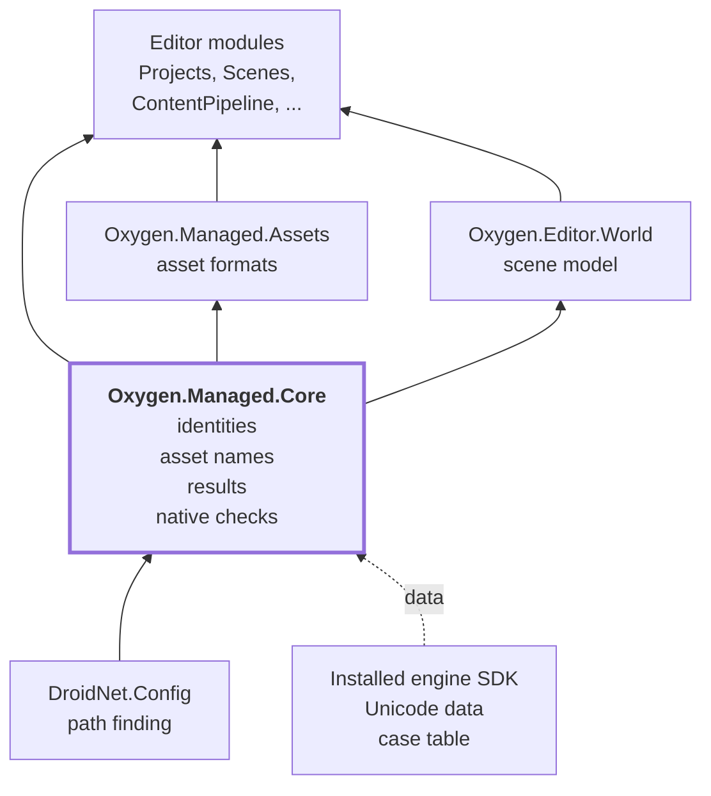
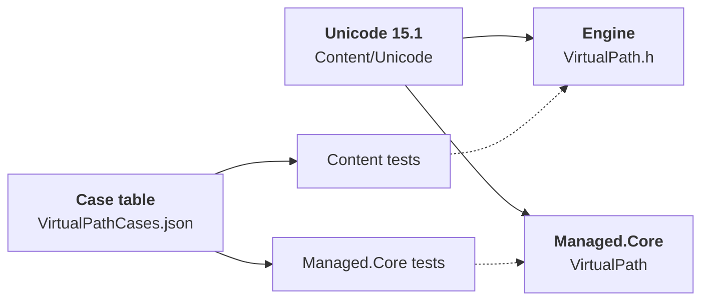
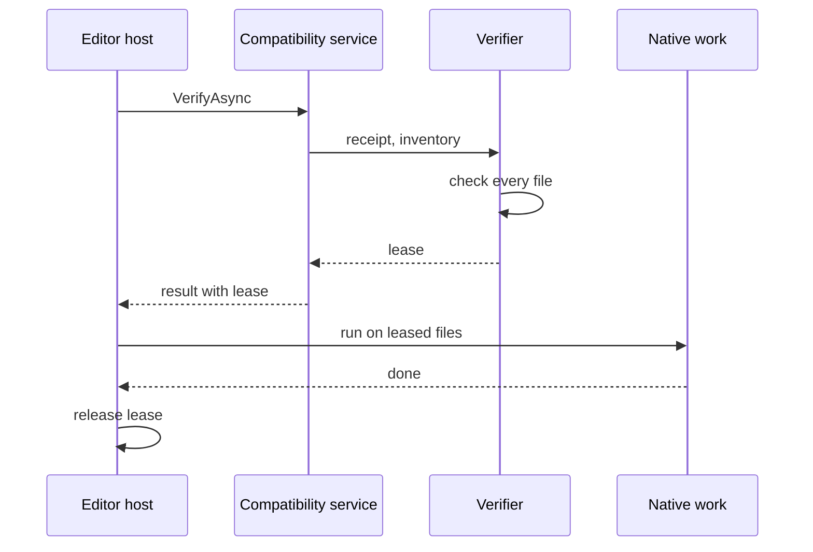

# Oxygen.Managed.Core

The vocabulary every other Oxygen managed module shares: the typed identities of
scenes, nodes and components, the asset URI and the virtual path rules that name
assets, the operation results and diagnostic codes that report what happened,
and the checks that the native engine files the editor runs are the ones it was
built against.

It holds contracts and rules, not features. It has no UI, no engine and no
project: a module can name an asset, check a name a user typed or report a
failure without depending on the module that owns it.

**At a glance**

- **Typed identities.** `SceneId`, `NodeId` and `ComponentId` cannot be confused
  with each other or with a bare `Guid`.
- **Asset names.** `AssetUris` spells an asset's identity as a URI;
  `VirtualPath` implements the engine's virtual path rules with the same refusal
  codes, so the editor accepts exactly what the cooker accepts.
- **Operation results.** `OperationResult` and `DiagnosticRecord`, with the
  stable codes of every domain, are how modules report outcomes to the user.
- **Native compatibility.** The editor verifies the installed engine SDK and its
  own Interop build before it runs native code, and holds the verified files
  until the native work is done.

## Where it sits

Managed.Core is at the bottom of the managed stack. Every editor module and
`Oxygen.Managed.Assets` reference it; it references only `DroidNet.Config`.



The installed engine SDK is read for data only: the Unicode database the rules
are stated against, at compile time, and the case table, by the tests. The
editor build needs no engine build.

## Source layout

| Folder               | Contents                                                                                                                                                 |
| -------------------- | -------------------------------------------------------------------------------------------------------------------------------------------------------- |
| `src/` (root)        | The identities (`SceneId`, `NodeId`, `ComponentId`, `NodeHandle`), `AssetUris`, the virtual path rules, `ScopedObservableObject` and small shared values |
| `src/Diagnostics/`   | `OperationResult`, `DiagnosticRecord`, their publishing and status contracts, and the diagnostic codes and operation kinds of each domain                |
| `src/Compatibility/` | The native SDK and Interop verification: the artifact inventory, the verifier, the leases and the editor's compatibility service                         |
| `src/Services/`      | `OxygenPathFinder`, the Oxygen project and state folders                                                                                                 |
| `Generators/`        | `UnicodeTablesGenerator`, the source generator of the virtual path rules' Unicode tables, and its tests                                                  |
| `testing/`           | The [test kit](testing/README.md): `TemporaryNativeArtifacts`, for test projects that run native code against a private verification receipt             |
| `tests/`             | The unit tests                                                                                                                                           |

## Identities

A typed identity names one kind of thing and nothing else. `SceneId`, `NodeId`
and `ComponentId` are `Guid`-backed record structs implementing
`IGuidId<TSelf>`, so a node id can never be passed where a component id is
expected. Their `Value` is read only where an id leaves typed code:
serialization and the native boundary. `GuidIdJsonConverter<TId>` writes each as
its plain `Guid` string, as a value and as a dictionary key, so files keep the
form they had before the types existed.

| Identity      | Identifies                                                                                     |
| ------------- | ---------------------------------------------------------------------------------------------- |
| `SceneId`     | A scene by its content: authored in the scene file, it follows the file; a copy gets a new one |
| `NodeId`      | A node of a scene                                                                              |
| `ComponentId` | A component of a node                                                                          |
| `NodeHandle`  | A node inside the running engine: an opaque native value, `0` when invalid                     |

## Naming assets

### Asset URIs

An asset is identified by its virtual path, `/<mount>/<path>.<ext>`; the editor
spells the same identity as an asset URI, `asset:///<mount>/<path>.<ext>`.
`AssetUris` holds the scheme, the `Engine` and `Content` mounts and the
`Generated` folder of engine built-ins, builds those URIs, and checks that a URI
names an asset (`IsAssetUri`, `EnsureAssetUri`). Models that hold links to
assets, such as a scene's geometry, check the form when the link is set.

### Virtual path rules

The engine refuses to cook a name that would not be a valid file name in its
loose cooked tree. `VirtualPath` implements the same rules as the engine's
`Content/VirtualPath.h`, stated in the engine's
[virtual path rules](../Oxygen.Engine/src/Oxygen/Content/Docs/virtual_paths.md):
segments in NFC Unicode 15.1 without control or reserved characters, edge
spaces, trailing dots or Windows device names, at most 255 bytes; mounts that
are identifiers, with a leading dot reserved for the engine; and no limit on the
length of a path. Every refusal is a `VirtualPathError` whose `ToCode()` is the
code the engine returns for the same input, and whose `ToMessage()` tells a user
what to change.



Both implementations build their Unicode tables from the same database, each in
its own build (`UnicodeCodeGen` in the engine, `UnicodeTablesGenerator` here),
and both test suites run the same case table, so neither can accept or refuse
what the other does not. This project reads both from the installed engine SDK
(`share/oxygen/unicode/15.1.0` and `share/oxygen/conformance`), never from the
engine source tree.

| Member                                             | Use                                                                                             |
| -------------------------------------------------- | ----------------------------------------------------------------------------------------------- |
| `Validate(path, rules)`                            | A whole virtual path; `VirtualPathRuleSet.Authored` adds the derived content rule               |
| `ValidateSegment(segment, rules)`                  | One file or folder name below a mount                                                           |
| `ValidateMountName(mount, rules)`                  | A mount name; an authored mount refuses the leading dot the engine reserves                     |
| `NormalizeTypedName(typed)`                        | A name a user typed, trimmed and in NFC, the form it is checked and used in                     |
| `FoldCase(text)`, `VirtualPathComparer.CaseFolded` | Case-only siblings, which a case-insensitive file system holds in one file                      |
| `IsDerivedContent(segment)`                        | Segments an authored path refuses: `.cooked`, `.imported`, `.build`, `.pipeline`, `SourceMedia` |

Identity itself is case-sensitive, as the engine hashes the bytes as spelled;
the case-folded comparer is for refusing a sibling, never for comparing
identities.

```csharp
var name = VirtualPath.NormalizeTypedName(typed);
if (VirtualPath.ValidateSegment(name + ".omat.json", VirtualPathRuleSet.Authored) is { } error)
{
    return error.ToMessage();
}

if (existing.Contains(folder + "/" + name + ".omat.json", VirtualPathComparer.CaseFolded))
{
    return "A file with this name already exists, or differs from one only in case.";
}
```

## Operation results and diagnostics

Modules report the outcome of an operation, such as a cook, an import or a Play
session, as an `OperationResult`: a correlation id, an operation kind, a status
and severity, user-facing text, the affected scope, child `DiagnosticRecord`s
and an optional primary action. A `DiagnosticRecord` names its failure domain
and a stable code, with user-facing and technical details kept apart.

| Contract                                             | Role                                                                                                                                                        |
| ---------------------------------------------------- | ----------------------------------------------------------------------------------------------------------------------------------------------------------- |
| `IOperationResultPublisher`, `IOperationResultStore` | Separate the modules that produce results from those that read them                                                                                         |
| `OperationStatusReducer`                             | Reduces child statuses to the status of the whole operation                                                                                                 |
| `ExceptionDiagnosticAdapter`                         | Turns an exception into a diagnostic with a code instead of a stack trace                                                                                   |
| `*DiagnosticCodes`, `*OperationKinds`                | The codes and kinds of each domain: project, scene, script, asset identity, mount, import and cook, content pipeline, live sync, runtime, Play and viewport |

Tests assert codes, not messages: a code is the contract, a message is
presentation.

The editor host owns the concrete store,
[OperationResultStore](../Oxygen.Editor/src/Diagnostics/OperationResultStore.cs):
a bounded history of the current session that notifies its observers
synchronously on the publishing thread. See the
[diagnostics LLD](../../design/editor/lld/diagnostics-operation-results.md) for
presentation and correlation.

## Native compatibility

The editor runs native code from two places: its Interop bridge, built against
an installed engine SDK, and the SDK's own tools, such as the import tool and
the player. Before any of it runs, the editor checks that the installed files
are the ones the Interop build recorded.



- `NativeArtifactInventory` lists the files an operation needs: the runtime
  bridge for startup, the import tool and its schemas for cooking.
- `NativeCompatibilityVerifier` checks each against the receipt embedded in the
  Interop build: content hash, size and schema identifier. It never rewrites the
  receipt.
- `NativeArtifactLease` keeps the verified files open, so they cannot be
  replaced while native work uses them, and carries the fingerprint that cook
  provenance uses to decide whether earlier output can be reused. The
  fingerprint depends on content, schemas and configuration, not on install
  paths.
- `EditorNativeCompatibilityService` is the editor's service for the running
  process (`ForCurrentProcess`) and for cooking (`ForCooking`), and publishes
  the last `NativeProducerObservation` for the UI.

## Paths

`OxygenPathFinder` extends `DroidNet.Config`'s path finder with the Oxygen
folders: personal and local projects, and the state database.

## Dependencies

- `DroidNet.Config`: the base path finder.
- `Testably.Abstractions`: the file system abstraction `OxygenPathFinder` uses.
- At build time, the analyzer reference to `Generators/src` and the Unicode
  database in the installed engine SDK (`$(OxygenSdkDataDir)`).

## Tests

[tests/](tests/) covers the identities and asset URIs, the virtual path rules
(including the engine's case table), operation results and status reduction, the
diagnostic vocabularies, and native artifact verification against the installed
SDK. [Generators/tests/](Generators/tests/) covers the Unicode tables generator.

## Related documentation

- [Virtual path rules](../Oxygen.Engine/src/Oxygen/Content/Docs/virtual_paths.md)
- [Diagnostics and operation results](../../design/editor/lld/diagnostics-operation-results.md)
- [Editor architecture](../../design/editor/ARCHITECTURE.md)

## License

Distributed under the MIT License. See [LICENSE](../../LICENSE) or
[opensource.org/licenses/MIT](https://opensource.org/licenses/MIT).
